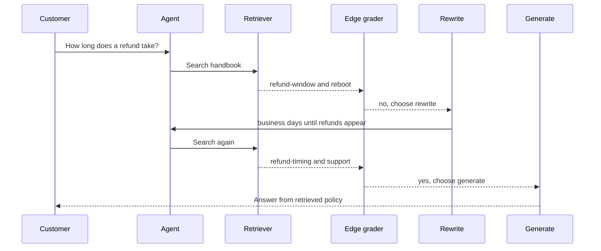
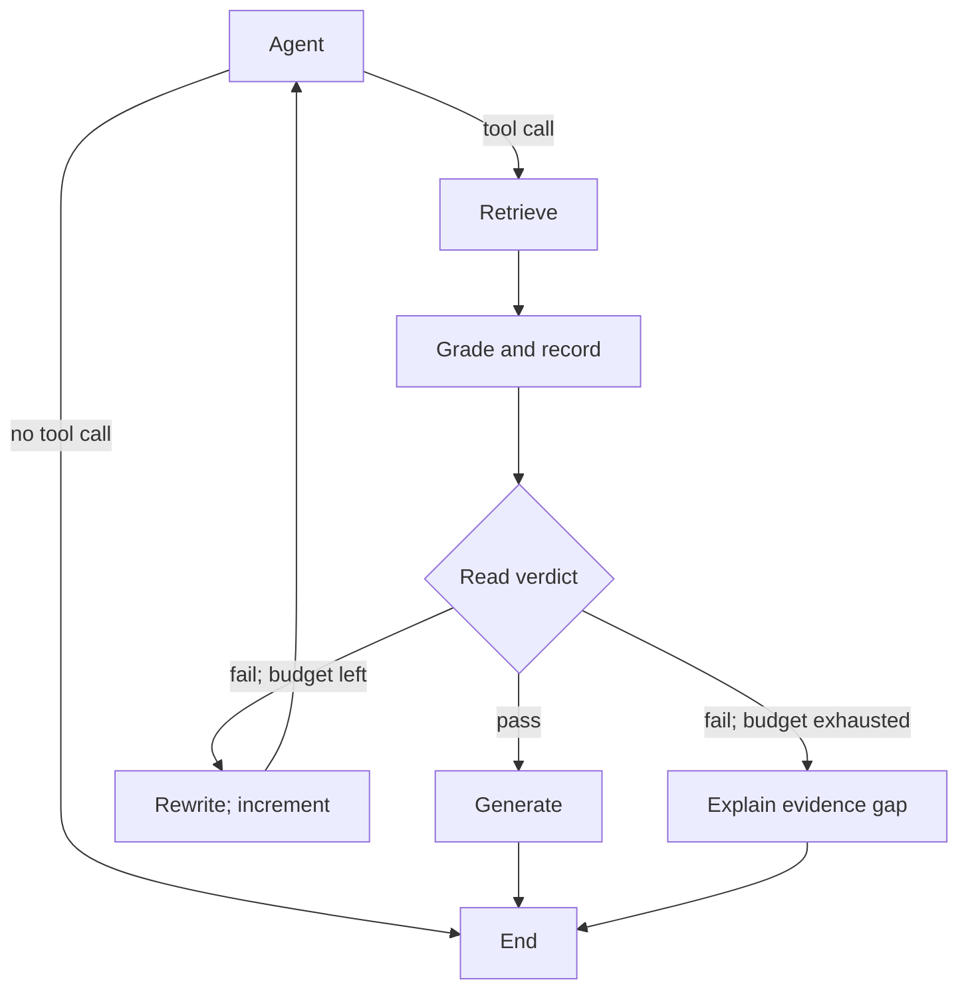

## Start with the refund near miss

A Larkspur customer asks, *How long does a refund take?* The first hit, `refund-window`, says an annual plan can receive a full refund within 30 days. That is an eligibility window. It does not say when the money arrives.

A retrieval-augmented generation (RAG) chain can answer the wrong question confidently: **answering from a near miss**. Successful search still needs grading.

> **What you'll learn**
>
> - Explain when the agent chooses a retriever tool.
> - Trace retrieval, grading and rewriting through the same request.
> - Compare routing inside an edge with grading that updates state.
> - Choose label contracts, stopping rules and evidence checks.

## Build the search, grade and recover loop

[T7.1](https://forwarddeployedprep.com/learn/agentic-systems/the-agent-loop-and-tool-calling/the-agent-loop-and-tool-calling-overview) introduced tool calling. T5.1 introduced one-shot RAG. Here, the agent chooses search, the retriever returns chunks, and grading routes to generation or rewriting.

### Let the model choose the retriever tool

The `agent` node binds a retriever tool with a name, description and argument schema. The model chooses whether to call it and what query to supply. A greeting can bypass handbook search. The notebook searches a research paper.

### Fixed transitions and runtime routing

A **conditional edge** is an edge whose destination is chosen at run time: after its source node runs, LangGraph calls a routing function on the state, and the value it returns names the next node. A fixed edge always goes the same way, as the edge from `rewrite` back to `agent` does. The graph has two conditional edges:

| After node | Routing function | Returns | Goes to |
| --- | --- | --- | --- |
| `agent` | `tools_condition`, prebuilt in LangGraph | `"tools"` if the model's last reply has a tool call, otherwise the end marker | `retrieve` through a path map that translates `"tools"`, or the end |
| `retrieve` | `grade_documents` | `"generate"` or `"rewrite"` | The node with that name, with no path map, because the function returns node names |

*Table 1: The two routing decisions and how each return value becomes a node.*

Put together, the edges form this graph:

<figure class="diagram source-diagram" markdown="0">
<img alt="Original graph: agent chooses retrieval or end; retrieval branches to generation or rewrite; rewrite returns to agent." src="">

<img alt="Original graph: agent chooses retrieval or end; retrieval branches to generation or rewrite; rewrite returns to agent." src="">
</figure>

*Figure 1: The grade-then-rewrite graph. Two edges branch; the rest are fixed.*

### Trace the refund question through a rewrite

The [T9.1 lab](https://forwarddeployedprep.com/labs/rag/m28_retrieval_grading_rewriting/grade-rewrite-retry-lab.html) supplies this trace: one failed grade, then one rewrite finds timing evidence.

<figure class="diagram source-diagram" markdown="0">
<img alt="Original refund sequence: refund-window and reboot fail grading; rewritten search returns refund-timing and support and passes." src="">

<img alt="Original refund sequence: refund-window and reboot fail grading; rewritten search returns refund-timing and support and passes." src="">
</figure>

*Figure 2: One failed grade and one rewrite. The retrieved chunks are the lab's; the reworded question is the lab's hand-written rewrite.*

The first search misses `refund-timing`. TF-IDF matches exact words, and the question says "refund" while the chunk says "Refunds". The reworded question uses "refunds" and "business days", the chunk's own words, and scores 0.720.

Rewrite returns to `agent`. The model decides again whether and how to search, costing another model call per round.

Follow the request. Inspect the input, decision and state at each stage.

<button type="button" data-step="0" aria-pressed="false" aria-controls="request-step-0">1. Ask</button><button type="button" data-step="1" aria-pressed="false" aria-controls="request-step-1">2. Retrieve</button><button type="button" data-step="2" aria-pressed="false" aria-controls="request-step-2">3. Grade</button><button type="button" data-step="3" aria-pressed="false" aria-controls="request-step-3">4. Rewrite</button><button type="button" data-step="4" aria-pressed="false" aria-controls="request-step-4">5. Retry</button><button type="button" data-step="5" aria-pressed="false" aria-controls="request-step-5">6. Answer</button>

<section id="request-step-0" class="step-panel" aria-labelledby="request-heading-0"><h4 id="request-heading-0">1. Ask the original question</h4><dl><dt>Owner</dt><dd>Agent</dd><dt>Input</dt><dd>How long does a refund take?</dd><dt>Next action</dt><dd>Search the handbook</dd><dt>State and evidence</dt><dd>Keep the original question as the answer target.</dd></dl></section><section id="request-step-1" class="step-panel" aria-labelledby="request-heading-1"><h4 id="request-heading-1">2. Inspect the first retrieval</h4><dl><dt>Owner</dt><dd>Retriever</dd><dt>Input</dt><dd>refund-window and reboot</dd><dt>Next action</dt><dd>Grade the returned context</dd><dt>State and evidence</dt><dd>The lab&#x27;s first hit scores 0.227, but describes eligibility, not arrival time.</dd></dl></section><section id="request-step-2" class="step-panel" aria-labelledby="request-heading-2"><h4 id="request-heading-2">3. Reject the near miss</h4><dl><dt>Owner</dt><dd>Edge grader</dd><dt>Input</dt><dd>Question plus retrieved context</dd><dt>Next action</dt><dd>Choose rewrite</dd><dt>State and evidence</dt><dd>The answerability check fails. Its route return does not persist the verdict.</dd></dl></section><section id="request-step-3" class="step-panel" aria-labelledby="request-heading-3"><h4 id="request-heading-3">4. Change the search wording</h4><dl><dt>Owner</dt><dd>Rewrite</dd><dt>Input</dt><dd>No timing evidence</dd><dt>Next action</dt><dd>Return to agent</dd><dt>State and evidence</dt><dd>The lab&#x27;s hand-written query uses “business days until refunds appear”. Preserve customer intent.</dd></dl></section><section id="request-step-4" class="step-panel" aria-labelledby="request-heading-4"><h4 id="request-heading-4">5. Decide again, then search</h4><dl><dt>Owner</dt><dd>Agent and retriever</dd><dt>Input</dt><dd>Reworded query</dd><dt>Next action</dt><dd>Retrieve and grade again</dd><dt>State and evidence</dt><dd>The agent can choose another tool call. The lab finds refund-timing at 0.720, alongside support.</dd></dl></section><section id="request-step-5" class="step-panel" aria-labelledby="request-heading-5"><h4 id="request-heading-5">6. Answer from sufficient evidence</h4><dl><dt>Owner</dt><dd>Generate</dd><dt>Input</dt><dd>Timing evidence passes grading</dd><dt>Next action</dt><dd>Generate, then end</dd><dt>State and evidence</dt><dd>Use the retrieved timing policy for the actual duration. This is a scripted trace, not a live LangGraph run.</dd></dl></section>

<button type="button" data-walk="previous">Previous</button>

<button type="button" data-walk="next">Next step</button>

### Follow the request as a transaction

*Added explanation.* A transaction here is one request's processing lifecycle. The assistant retrieves policy and answers. It does not execute a refund or provide database transaction guarantees.

Figure 3 separates document returns, grading decisions and subsequent actions:

*Figure 3: Added transaction-process trace. The stricter answerability criterion drives the illustrated no/yes outcomes. Edge-local verdicts select routes without becoming state updates.*

## Decide what counts as useful evidence

A **document grader** in this source example is a large language model (LLM) call that reads retrieved text against a question. Structured output supplies a field the router can inspect. The field's schema and the grading prompt solve different problems.

### Test answerability as well as relatedness

The source grader accepts keywords or semantic relatedness. Lesson 3 also accepts explanatory context. Both pass `refund-window` for *How long does a refund take?*, because it is about refunds: the near miss, now approved by the grader. A grader that asks "does this text answer the question?" fails it and sends the query to rewrite. "Related" maximises recall into the prompt; "answers" protects what the model reads.

### Validate the grader label

The source score field is a plain string compared exactly with `"yes"`. Three contracts produce different outcomes:

| Model's label | Exact match with `"yes"` | Trimmed and lower-cased first | Field typed as a fixed set of values |
| --- | --- | --- | --- |
| `yes` | generate | generate | accepted |
| `Yes` | **rewrite** | generate | rejected by validation |
| ` yes` (leading space) | **rewrite** | generate | rejected by validation |
| `maybe` | rewrite | rewrite | rejected by validation |

*Table 2: Planted labels under three contracts. The bold rows are relevant retrievals sent to rewrite.*

The **capital-Y rewrite** sends an affirmative verdict to rewrite. Normalisation fixes capitalisation and whitespace. A fixed set of values (`Literal` in Pydantic) rejects invalid labels, as lesson 3's topic check does. Validation still needs an error-handling path.

### Similarity scores cannot certify an answer

The lab's top-k retriever returns `k` chunks even when none answers the question. The lab's TF-IDF scores over the [T5.1](https://forwarddeployedprep.com/learn/llm-and-retrieval/rag-from-first-principles/rag-from-first-principles-overview) handbook chunks show that no score threshold can replace the grader:

| Query | Top chunk and score | Answers the question? |
| --- | --- | --- |
| *How long does a refund take?* | `refund-window`, 0.227 | No |
| Its rewrite | `refund-timing`, 0.720 | Yes |
| *Do you offer a student discount?* | `billing` and `cancel`, both 0.000 | No |
| Its rewrite *Student discount pricing for plans* | `support` 0.503, then `billing` 0.461 | No |
| *Larkspur outage availability guarantee and incident updates* | `sla` 0.470, then `incidents` 0.253 | Yes |

*Table 3: Retrieval scores from the T9.1 lab. A non-answer at 0.503 outscores a real answer at 0.470.*

The discount question retrieves two zero-score chunks. Its rewrite reaches 0.503 without finding a discount policy. A threshold high enough to reject 0.503 also rejects the outage answer at 0.470. These observations cannot be separated by a single similarity cutoff.

## Compare an edge grader with a grading node

### Start with the same three documents

*Added illustrative example.* Ask a different refund question: *Can I get a refund after 30 days?* These invented policy snippets demonstrate architecture, not Larkspur's actual policy:

| Document | Text | Role in this question |
| --- | --- | --- |
| Doc 1 | Refunds are allowed within 30 days. | Eligibility context; incomplete alone |
| Doc 2 | Shipping takes 5 to 7 business days. | Irrelevant |
| Doc 3 | Refunds after 30 days require manager approval. | Direct evidence about the exception |

*Table 4: One shared illustrative input. Doc 3 supplies the requested fact.*

### Approach A: grade inside the conditional edge

The retriever records all three chunks. The edge's grading function judges the batch and returns `generate` because Doc 3 supplies an answer. The return value chooses a destination. It does not automatically save the verdict or remove Doc 2.

If generation reads the original context, it receives all three chunks. Filtering is possible with additional design. In the source example, the printed verdict leaves no state field, the **invisible verdict**. External tracing may capture the call without persisting its result in shared state.

<figure class="diagram comparison-diagram" markdown="0">

</figure>

*Figure 4: Edge grading combines the evidence check and route selection. Returning a route does not automatically save a verdict or filter documents.*

### Approach B: grade in a dedicated node

The node evaluates the same documents and returns an explicit state update. It can record accepted Docs 1 and 3, rejected Doc 2, a verdict and reasons. A conditional-edge router then reads that state and chooses `generate`.

Generation receives only accepted evidence when you wire it to that field. Node placement alone does not filter documents or improve judgment accuracy. With a checkpointer configured, the updated state is saved at graph super-step boundaries.

<figure class="diagram comparison-diagram" markdown="0">

</figure>

*Figure 5: A separate grading node explicitly filters evidence and updates state before a lightweight router chooses the next action. Generation must read the accepted-evidence field.*

Compare what the generator receives from the same three documents.

<button type="button" data-mode="edge" aria-pressed="false" aria-controls="edge-result">Edge grader</button>
<button type="button" data-mode="node" aria-pressed="false" aria-controls="node-result">Grading node</button>

<section id="edge-result" class="mode-panel" data-announcement="Edge example selected. All three documents reach generation."><h4>Edge grader result</h4><ul><li>Doc 1, eligibility: remains in retrieved context.</li><li>Doc 2, shipping: remains in retrieved context.</li><li>Doc 3, manager approval: remains in retrieved context.</li></ul>
Route: generate. The batch contains an answer, but the route return has not saved a filtered evidence set.

Generator input in this illustration: all three documents.
</section>
<section id="node-result" class="mode-panel" data-announcement="Node example selected. Only accepted Docs 1 and 3 reach generation."><h4>Grading node result</h4><ul><li>Doc 1, eligibility: keep as supporting context.</li><li>Doc 2, shipping: reject.</li><li>Doc 3, manager approval: keep as direct evidence.</li></ul>
State update: accepted Docs 1 and 3, rejected Doc 2, answer evidence available. A lightweight edge router chooses generate.

Generator input in this illustration: accepted Docs 1 and 3, because the generator reads the filtered state field.
</section>

### Separate placement from grading granularity

Either architecture can grade batches or individual chunks. Moving the same call into a node adds a graph boundary without inherently adding an LLM call. The source compares implementations that differ in both placement and granularity:

|  | Edge grader (this lesson) | Node grader (lesson 3 of T9.1) |
| --- | --- | --- |
| Place in the graph | Routing function on the edge after `retrieve` | Node, followed by a separate router |
| What it reads | Everything the tool returned, as one message | One chunk per call |
| Output schema | A score field described as `'yes'` or `'no'` | A relevance label (`RELEVANT` or `IRRELEVANT`) and a reasoning field |
| Decision | Exact match with `"yes"` | Match with `"RELEVANT"` after trimming and upper-casing |
| What reaches the answer | Every retrieved chunk, relevant or not | Only the chunks that pass |
| Grader calls per retrieval | 1 | `k`, the number of chunks retrieved (2 in lesson 3 of T9.1) |

*Table 5: The two graders side by side.*

Grading the block is cheap, but one relevant chunk carries the irrelevant ones into the prompt. Grading each chunk costs `k` calls per retrieval and filters what the model reads.

Choose an edge grader for a compact branch decision. Choose a grading node when verdict reuse, explicit evidence filtering, inspection or a node retry policy earns the boundary. A node can also return `Command` to combine state updates and routing. Static edges remain active alongside dynamic routing, so an unconditional edge can accidentally schedule another destination.

## Bound retries and diagnose failures

The source rewrite path has no counter or deliberate give-up branch. An unanswered question can loop until an execution limit or error stops the run. Lesson 3 adds a counter, persisted passing chunks and a should-generate flag, plus a topic check before retrieval. A sequential grading node adds one graph step per retrieval.

Figure 6 shows an added bounded alternative. Check a passing verdict before applying the exhausted-budget fallback:

*Figure 6: Added node-based alternative. The diamond represents a conditional-edge router. The fallback requires both failed grading and an exhausted rewrite budget.*

Refresh grading state after every retrieval:

| Stage | Stored evidence and verdict | Rewrite count |
| --- | --- | --- |
| First retrieval | `refund-window`, `reboot`; verdict cleared | 0 |
| Grade node | Fail for timing; no passing chunks | 0 |
| Rewrite and retrieve | New query, `refund-timing`, `support`; verdict cleared | 1 |
| Grade node | Pass; retain supporting timing evidence | 1 |

*Table 6: Added illustrative state trace. Preserve the original question separately from search wording.*

Diagnose failures by their effect on the request:

| Failure | What happens | Guard |
| --- | --- | --- |
| Near miss approved | Eligibility text answers a duration question | Test coverage of the requested fact |
| Capital-Y rewrite | Good evidence takes the wrong branch | Normalise or constrain labels; handle validation errors |
| Stale pass | A previous verdict approves new documents | Refresh verdicts for each retrieval |
| Rewrite exhaustion | No supporting policy is found | Stop with an evidence-gap response |
| Unfiltered context | Shipping text reaches generation | Write accepted evidence and consume that field |

*Table 7: Added diagnosis guide. Each guard addresses a different failure mechanism.*

A transient API retry repeats a failed call. A semantic rewrite changes an inadequate search. With persistence configured, completed retrieval can survive a later grading failure. Retried work must tolerate re-execution.

Each rewrite can add another agent call, retrieval and grading. Budget attempts, elapsed time and model use. Evaluate false approvals, unnecessary rewrites, unsupported answers and exhaustion on answerable, unanswerable and near-miss questions. These are suggested checks, not measured results.

## Limits of this evidence

* **Notebook corpus.** The notebook runs on a research paper; the Larkspur paths and scores come from the T9.1 lab.
* **TF-IDF scores.** Table 3 uses exact-word TF-IDF. Embedding scores differ. Filters, thresholds and corpus size can reduce a retriever's returned count.
* **Planted labels.** Table 2 tests the comparison, not how often a model writes `Yes`.

The interactions are scripted illustrations without live model calls. The three-document policy example is fictional.

## References

1. [Original lesson](https://forwarddeployedprep.com/learn/agentic-and-self-correcting-rag/agentic-rag-foundations-grading-and-query-rewriting/retriever-as-a-tool-grade-then-rewrite-in-langgraph), Sourav Banerjee, updated 9 November 2026, retrieved 13 November 2026. The inherited retrieval scores are source-reported, not new notebook runs.
2. [LangChain Graph API](https://docs.langchain.com/oss/python/langgraph/graph-api), accessed 13 November 2026. State updates, conditional edges, Command and recovery boundaries.
3. [Thinking in the Graph API](https://docs.langchain.com/oss/python/langgraph/thinking-in-graph-api), accessed 13 November 2026. Workflow decomposition, state and error handling.

## Run the notebooks

Colab runs the notebook in your browser with its imported packages and API keys. The repository's uv environment supports the full notebook collection.

| Notebook | GitHub | Colab |
| --- | --- | --- |
| Simple agentic RAG | [Open on GitHub](https://github.com/Sourav692/rag-agents-engineering/blob/main/p08_agentic_rag/m28_retrieval_grading_rewriting/mandatory/notebook/01a_simple_agentic_rag.ipynb) | [Open in Colab](https://colab.research.google.com/github/Sourav692/rag-agents-engineering/blob/main/p08_agentic_rag/m28_retrieval_grading_rewriting/mandatory/notebook/01a_simple_agentic_rag.ipynb) |

## Key takeaways

- Let the agent choose the retriever; after rewriting, it decides again whether and how to search.
- Grade whether evidence answers the requested fact. Similarity and topical overlap cannot certify an answer.
- An edge chooses a route. A grading node can record verdicts and filtered evidence; generation must consume that state.
- Choose batching separately from graph placement. Bound recovery and return an evidence gap when failed grading exhausts the budget.

## Check yourself

1. Why does the rewrite node send the new question back to the agent instead of straight to the retriever?

The model reads the rewritten question and decides again whether and how to search. The source has no explicit rewrite counter. Lesson 3 adds one for controlled termination.

2. The refund-duration question retrieves the refund-window chunk first. Does a grader that accepts related text pass it, and what follows?

Yes. It describes the 30-day eligibility window, not payment duration. The answerability criterion rejects this near miss. Rewriting finds `refund-timing` at 0.720.

3. The grader sends a clearly relevant retrieval to rewrite, and its label was Yes with a capital letter. Why, and what are two fixes?

The score is a plain string compared exactly with `"yes"`, so `"Yes"` takes the rewrite branch: the capital-Y rewrite. Trim and lower-case the label before comparing, or type the field as a fixed set of values so any other label fails validation instead of silently choosing a branch.

