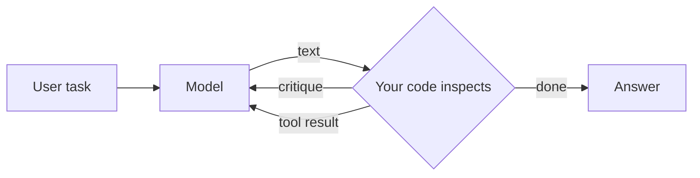
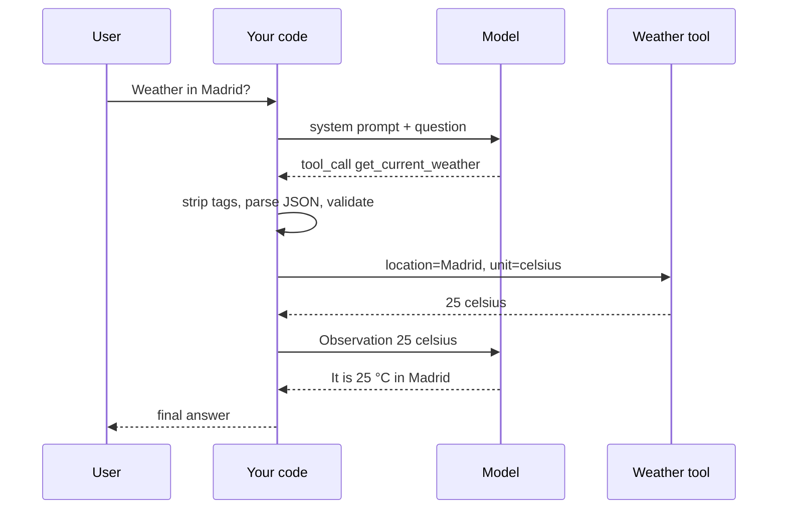
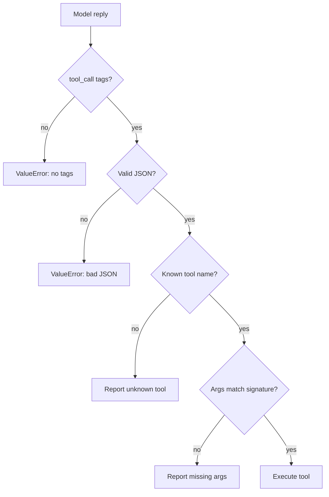
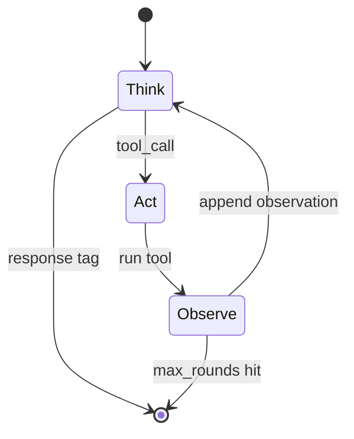
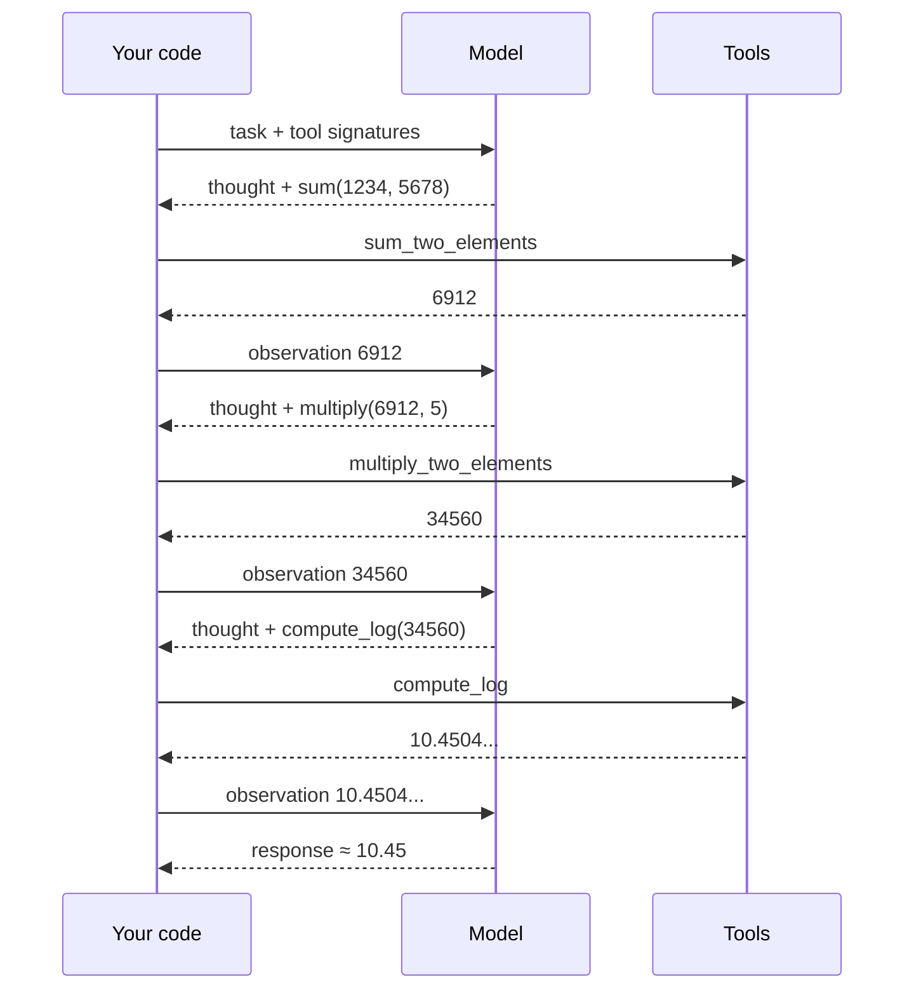
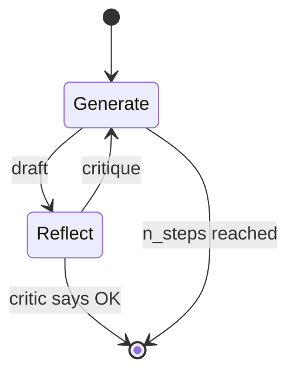
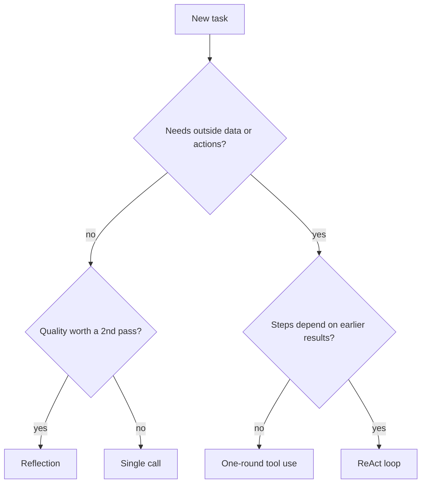

# Agentic patterns from scratch: reflection, tool use and ReAct

*Three loops, three stopping rules, and who actually runs the tool*

> **What you'll learn**
>
> - **Explain** why a language model can *request* a tool but never *run* one.
> - **Build** a text-protocol tool call end to end: prompt → `<tool_call>` → parse → validate → execute → observation.
> - **Compare** reflection, one-round tool use and ReAct by *what repeats* and *when the loop stops*.
> - **Prove** each guard with a planted failure: bad JSON, an unknown tool, a missing argument, a runaway loop.

## Recap

In the overview lesson we said an **agent** is a model inside a loop that can act on the world. This lesson opens that loop up and builds the three classic patterns by hand, with no framework in between.

## The problem

A Larkspur customer asks support: *"How long does a refund take?"* The model doesn't know Larkspur's policy; the answer sits in the support handbook. So the model replies with a request, *search the handbook for "refund timeline"*, and then nothing happens.

The model can't open a file, call an API or wait for a result. It only writes text.

The model decides. Your application acts.

That split leaves two jobs that every agent must do:

- **Running the tool.** Your code parses the request, executes the function and returns the result as an **observation**: a message telling the model what the tool returned.
- **Stopping.** Every loop needs a **stopping rule**, a condition that ends it. Leave one out and you get the most common agent bug there is.

The three patterns in this lesson answer those two jobs differently. Here is the shape they all share:


*Figure 1: The shared skeleton. The model only writes text; your code decides whether to stop or feed something back.*

## What we build, and what we claim

The notebooks for this module call `gpt-4o-mini` through the raw OpenAI SDK. For this page we wrote a 108-line, standard-library-only version of the same patterns, `patterns.py`, so every output below is reproducible on any laptop with Python 3.12 and no API key.

Where a model's reply is needed, a **scripted policy** stands in for it: a ten-line function that reads the observations in the history and writes the next tag, exactly as the protocol asks a model to. The parser, validator, executor and loops are the real code.

We build four pieces, in the order we need them:

- **The contract**: a `@tool` decorator that turns a Python function into a signature the model can read.
- **The gatekeeper**: `execute()`, which parses, checks, casts and runs one call, and turns every failure into an observation.
- **The loop**: `ReactAgent`, a bounded `for` loop with two exits.
- **The second opinion**: `ReflectionAgent`, a draft-and-critic loop with its own two exits.

Before running anything, we wrote down seven claims this page has to prove. The last section gives each one a verdict:

1. The model never runs a tool; your code does.
2. One round of tool use cannot chain dependent calls.
3. ReAct finishes the three-step arithmetic task in exactly four model calls.
4. Every malformed call becomes a readable error, never a crash and never a guess.
5. Type casting prevents a silent wrong answer.
6. The model's own exit is not enough; the loop needs a cap you control.
7. A lenient critic collapses reflection to a single round.

Table 1 is the map for the rest of the page:

| Pattern | What repeats | Stops when | Model calls (our runs) |
|---|---|---|---|
| **Reflection** | draft → critique → redraft | critic returns `<OK>`, or `n_steps` rounds | 2 to 7 with `n_steps = 3` |
| **Tool use** | nothing: one round | the model answers from the observation | 2 |
| **ReAct** | thought → tool call → observation | model writes `<response>`, or `max_rounds` (default 10) | 4 for the arithmetic task |

*Table 1: The three patterns compared by loop body and stopping rule.*

> 👉 **Key distinction:** every pattern has *two* kinds of exit. One belongs to the model (`<OK>`, a final answer, `<response>`). The other belongs to you (`n_steps`, `max_rounds`). Never ship a loop with only the model's exit.

We start with the contract between the model and your code. What does the model actually see?

## Pattern 1: Tool use, one round

In this lesson tools are described *in the system prompt* and the model writes calls as text. We skip the provider's native `tools=` parameter on purpose: doing it by hand shows exactly what the native API automates.

### The contract

A **tool** is a Python function plus a description the model can read. The `@tool` decorator builds that description from the function name, the docstring and the type hints:

```python
@tool
def sum_two_elements(a: int, b: int) -> int:
    """Computes the sum of two integers."""
    return a + b

print(json.dumps(sum_two_elements.signature))
```

```text
#### OUTPUT ####
{"name": "sum_two_elements", "description": "Computes the sum of two integers.", "parameters": {"properties": {"a": {"type": "int"}, "b": {"type": "int"}}}}
```

That JSON goes into the system prompt inside `<tools>` tags, together with one instruction: wrap every call in `<tool_call>…</tool_call>`. The docstring *is* the description, so a vague docstring means a vague tool.

### The request is just a string

Ask *"What's the weather in Madrid?"* and the model doesn't answer. It writes:

```text
<tool_call>
{"name": "get_current_weather", "arguments": {"location": "Madrid", "unit": "celsius"}, "id": 0}
</tool_call>
```

Nothing has run yet. Turning that string into an action is your code's job, and it starts with the parser:

```python
def parse_tool_call_str(text: str) -> dict:
    match = re.search(r"<tool_call>(.*?)</tool_call>", text, re.DOTALL)
    if not match:
        raise ValueError("No <tool_call> tags found in the text.")
    try:
        return json.loads(match.group(1))
    except json.JSONDecodeError:
        raise ValueError("Content inside <tool_call> is not valid JSON.")

def validate_arguments(call: dict, signature: dict) -> dict:
    props = signature["parameters"]["properties"]
    missing = [p for p in props if p not in call["arguments"]]
    if missing:
        raise ValueError(f"Missing argument(s) for {call['name']}: {missing}")
    for name, value in call["arguments"].items():
        call["arguments"][name] = TYPES[props[name]["type"]](value)  # "5" -> 5 when the hint says int
    return call
```

The parser finds the tagged block and loads its JSON, raising instead of guessing when either step fails. The validator then refuses missing arguments and casts each value to its declared type (`int`, `str`, `bool` or `float`).

### The gatekeeper

`execute()` chains those checks with a name lookup, and turns every failure into an observation rather than an exception:

```python
def execute(text_call: str, tools: dict) -> str:
    """Parse, check the name, validate, run. Every failure becomes an observation the model can read."""
    try:
        call = parse_tool_call_str(text_call)
        if call.get("name") not in tools:
            raise ValueError(f"Unknown tool '{call.get('name')}'. Valid tools: {sorted(tools)}")
        call = validate_arguments(call, tools[call["name"]].signature)
        return json.dumps(tools[call["name"]].run(**call["arguments"]))
    except ValueError as e:
        return json.dumps({"error": str(e)})

print("Observation:", execute(madrid_reply, TOOLS))
```

```text
#### OUTPUT ####
Observation: {"temperature": 25, "unit": "celsius"}
```

Your code sends that back as an `Observation:` message, and a second model call turns it into a sentence for the user. Figure 2 shows the full round:


*Figure 2: One round of tool use. Two model calls; the tool runs between them, inside your code.*

### Planted failures

A gatekeeper is only as good as the bad inputs it has been shown. We planted five broken calls, each a mistake models really make:

```python
planted = {
    "no tags":      'I will call the sum tool now.',
    "bad JSON":     '<tool_call>{"name": "sum_two_elements", "arguments": {"a": 1234, "b": }}</tool_call>',
    "unknown tool": '<tool_call>{"name": "calculator", "arguments": {"expr": "1234+5678"}}</tool_call>',
    "missing arg":  '<tool_call>{"name": "multiply_two_elements", "arguments": {"a": 6912}}</tool_call>',
    "string arg":   '<tool_call>{"name": "multiply_two_elements", "arguments": {"a": "6912", "b": "5"}}</tool_call>',
}
for k, v in planted.items():
    print(f"{k:<13}{execute(v, TOOLS)}")
print("no cast      ", json.dumps(multiply_two_elements.fn("6912", 5)[:20] + "..."))
```

```text
#### OUTPUT ####
no tags      {"error": "No <tool_call> tags found in the text."}
bad JSON     {"error": "Content inside <tool_call> is not valid JSON."}
unknown tool {"error": "Unknown tool 'calculator'. Valid tools: ['compute_log', 'get_current_weather', 'multiply_two_elements', 'sum_two_elements']"}
missing arg  {"error": "Missing argument(s) for multiply_two_elements: ['b']"}
string arg   34560
no cast       "69126912691269126912..."
```

The first four never reach a tool; each comes back as an error the model can read and correct. The fifth is the dangerous one. With casting, `"6912"` becomes `6912` and the answer is 34,560. Without it, Python repeats the string five times and returns a confident, wrong answer with no error at all. We'll call that a **stringly-typed answer**.

Figure 3 is the order the gatekeeper checks in:


*Figure 3: Validate in this order. Each failure becomes a specific message the model can act on.*

### Where one round breaks

Now a harder task: *sum 1234 and 5678, multiply the result by 5, then take the natural log.*

Each call needs the result of the one before it. In one round, the model must write every argument before any tool has run. Here is everything our policy can fill in on round one:

```text
#### OUTPUT ####
calls the model can fill in round 1: ['{"name": "sum_two_elements", "arguments": {"a": 1234, "b": 5678}}']
observations in context before choosing round 1: 0
```

The sum is fully specified. The multiplication needs 6,912 and the log needs 34,560, and neither number exists yet. We'll call this **one-shot blindness**: a single round can run independent calls side by side, but it can't chain dependent ones. Fixing it takes a loop that feeds each result into the next decision.

## Pattern 2: ReAct planning

**ReAct** interleaves reasoning and acting: the model writes a thought, takes an action, reads the observation, and repeats [1]. In our text protocol that becomes four tags:

- **`<thought>`**: what the model plans to do next and why.
- **`<tool_call>`**: one action, in the same JSON format as before.
- **`<observation>`**: the tool result, written by *your code*, never by the model.
- **`<response>`**: the final answer, which ends the loop.

### The loop

`ReactAgent.run()` is a bounded `for` loop, not a `while True`:

```python
class ReactAgent:
    def __init__(self, model, tools: list, max_rounds: int = 10):
        self.model, self.tools, self.max_rounds = model, {t.name: t for t in tools}, max_rounds

    def run(self, task: str) -> dict:
        history, calls = [{"role": "user", "content": task}], 0
        for _ in range(self.max_rounds):
            reply = self.model(history); calls += 1
            if done := tag(reply, "response"):
                return {"answer": done[0].strip(), "model_calls": calls}
            history.append({"role": "assistant", "content": reply})
            for raw in tag(reply, "tool_call"):
                obs = execute(f"<tool_call>{raw}</tool_call>", self.tools)
                history.append({"role": "user", "content": f"<observation>{obs}</observation>"})
        return {"answer": None, "model_calls": calls, "stopped": "max_rounds reached without a <response>"}
```

Each round asks the model, returns at once on `<response>`, and otherwise runs every requested call through the same gatekeeper and appends one observation per call. The appended observations are the whole trick: by round two, 6,912 is literally in the model's context.


*Figure 4: The ReAct state machine with its two exits: the model's `<response>` and your `max_rounds` cap.*

### Tracing the arithmetic task

We run it with the three tools from the notebook, `sum_two_elements`, `multiply_two_elements` and `compute_log`:

```python
out = ReactAgent(scripted, [sum_two_elements, multiply_two_elements, compute_log]).run(TASK)
```

```text
#### OUTPUT ####
round 1: {"name": "sum_two_elements", "arguments": {"a": 1234, "b": 5678}}
round 2: {"name": "multiply_two_elements", "arguments": {"a": 6912, "b": 5}}
round 3: {"name": "compute_log", "arguments": {"x": 34560}}
round 4: response
{'answer': '10.450452222917992', 'model_calls': 4}
```

Every argument after round one came from an observation. Figure 5 shows the same run as messages:


*Figure 5: ReAct on a three-step dependent task. Each tool argument comes from the previous observation.*

### Planted failure: the runaway loop

What if the model never writes `<response>`? We planted a stubborn policy that calls `search_handbook` every round, and capped the loop at five. We also reran the arithmetic task with a cap of two, below the number of dependent steps:

```text
#### OUTPUT ####
max_rounds=2:           {'answer': None, 'model_calls': 2, 'stopped': 'max_rounds reached without a <response>'}
stubborn, max_rounds=5: {'answer': None, 'model_calls': 5, 'stopped': 'max_rounds reached without a <response>'}
```

Without the cap, the stubborn run never ends. We'll call that a **runaway loop**. With the cap, it stops after five calls and says why, so the caller can tell "no answer" apart from "an answer". The second run shows the other side: a cap below the task's depth stops the agent before it can finish.

### What the loop costs

Loops are not free, because the history grows each round. The estimate below is illustrative, with stated assumptions: a ~700-token system prompt (protocol plus three tool signatures), a ~40-token question, and ~90 tokens added per round (~60 for the thought and call, ~30 for the observation).

| Call | Input tokens |
|---|---|
| 1 | 700 + 40 = 740 |
| 2 | 740 + 90 = 830 |
| 3 | 830 + 90 = 920 |
| 4 | 920 + 90 = 1,010 |
| **Total** | **≈ 3,500** |

*Table 2: Input tokens resent per ReAct round (illustrative).*

A single round of tool use costs about 740 + 830 ≈ 1,570 input tokens. ReAct roughly doubles that here, and the gap widens every round, because round *k* resends everything from rounds 1 to *k*−1. We'll call that **context creep**. Multiply by your provider's per-token price for a cost per request.

> 💡 **Interview tip:** asked "why not always use ReAct?", answer with latency and cost. Each round is a full model call that must wait for the last one, and the prompt grows every time. Use the smallest loop that solves the task.

ReAct fixes reach and chaining. But what if the tools are fine and the *answer* is weak?

## Pattern 3: Reflection

**Reflection** improves an output by critiquing it and trying again. In the notebook the model writes a Python merge sort, and a second system prompt casts the model as a demanding reviewer who returns either a list of fixes or the token `<OK>`.


*Figure 6: The reflection loop. The critique becomes the next user message for the generator.*

The agent has the same two-exit shape as ReAct:

```python
class ReflectionAgent:
    def __init__(self, generate, critique, n_steps: int = 3):
        self.generate, self.critique, self.n_steps = generate, critique, n_steps

    def run(self, task: str) -> dict:
        draft, calls = self.generate(task, None), 1
        for step in range(1, self.n_steps + 1):
            review = self.critique(draft); calls += 1
            if "<OK>" in review:
                return {"draft": draft, "rounds": step, "model_calls": calls, "stopped": "critic said <OK>"}
            draft = self.generate(task, review); calls += 1
        return {"draft": draft, "rounds": self.n_steps, "model_calls": calls, "stopped": "n_steps reached"}
```

We ran it with three planted critics: one that approves everything, one that finds two real bugs and then approves, and one that never approves:

```text
#### OUTPUT ####
lenient   {'rounds': 1, 'model_calls': 2, 'stopped': 'critic said <OK>'}
demanding {'rounds': 3, 'model_calls': 6, 'stopped': 'critic said <OK>'}
never OK  {'rounds': 3, 'model_calls': 7, 'stopped': 'n_steps reached'}
```

The lenient critic ends the loop after one review, so reflection costs two calls and improves nothing. We'll call that the **lenient critic**. The never-satisfied critic is the reflection version of a runaway loop, and `n_steps` stops it at 1 + 2 × 3 = 7 calls.

> ⚠️ **Pitfall: the lenient critic.** If the reviewer prompt is soft, reflection quietly becomes a single generation that costs double. Tell the critic exactly what "good" means. The notebook keeps the critic demanding for this reason.

The notebook adds one more guard worth copying: both sides keep only their system prompt plus the latest exchange, three messages in all. Without that cap, every round would resend every earlier draft, which is context creep again.

## Choosing a pattern

With all three built, choosing is a short decision:


*Figure 7: Pick the smallest loop that fits the task.*

| | Reflection | Tool use | ReAct |
|---|---|---|---|
| Reaches outside data | ✗ | ✓ | ✓ |
| Chains dependent calls | ✗ | ✗ | ✓ |
| Model calls | 1 + 2 × rounds | 2 | rounds + 1 |
| Main risk | lenient critic | one-shot blindness | runaway loop, context creep |

*Table 3: Trade-offs at a glance.*

The patterns combine. A production support agent often runs ReAct to gather evidence, then a reflection pass to check the draft answer against that evidence.

## In practice: the Larkspur refund question

Back to the customer. The loop is the one we just traced; only the tool changes:

1. The model writes a thought ("I need the refund policy") and a call: `search_handbook({"query": "refund timeline"})`.
2. `execute()` checks the call, runs the search and returns the top handbook chunks as an `<observation>`.
3. The model writes `<response>`, quoting the chunks it was given.

That is retrieval as a tool. The model never touched the handbook; your code did, and the observation carried the evidence back. The same `max_rounds` cap that stopped the stubborn policy above is what stops a search that never satisfies the model.

> 👉 **Key distinction:** native tool calling (lesson 4 of T7.1) moves the tool schema into the API and returns structured `tool_calls` with IDs, so the parser's failure cases shrink. The loop in Figure 4 stays exactly the same, and so does your responsibility for `max_rounds`.

## Verdicts

Here is each claim from the start of the page, with the run that settles it:

| # | Claim | Verdict | Evidence |
|---|---|---|---|
| 1 | The model never runs a tool | **Holds** | every result above came from `execute()`, never from a model reply |
| 2 | One round can't chain dependent calls | **Holds** | round 1 can fill only the sum; 0 observations in context |
| 3 | ReAct finishes the task in 4 calls | **Holds** | trace: 3 tool rounds + 1 response, answer 10.4505 |
| 4 | Malformed calls become readable errors | **Holds** | 4 of 4 planted failures returned an error message |
| 5 | Casting prevents a silent wrong answer | **Holds** | without it, `"6912" * 5` returned a string, no error |
| 6 | The loop needs a cap you control | **Holds** | stubborn policy stopped only by `max_rounds=5` |
| 7 | A lenient critic collapses reflection | **Holds** | 1 round, 2 calls, nothing improved |
| — | A live model behaves like our scripted policy | **Open** | not tested here; run the notebooks below |

*Table 4: Seven claims, seven holds, and one question this page can't answer.*

Claims 2, 3 and 7 use a scripted policy, so they show what the *loop* allows, not how often a real model gets it right. That's the job of the notebooks.

## Limits

- **No live model.** Every model reply on this page is scripted. Real models skip tags, misname tools and stop early in ways a script doesn't. The planted failures cover the common shapes, not their frequency.
- **Illustrative tokens.** Table 2 is an estimate from stated assumptions, not a measured run.
- **Text protocol only.** Native tool calling changes the parsing, not the loop.

What we deliberately left out, and when to add it:

- **Retries with backoff**: add them when you call a real API, which returns rate limits and timeouts.
- **History trimming or summaries**: add them once a task regularly needs more than a handful of rounds.
- **Parallel tool execution**: add it when one round requests several independent calls that are slow.
- **Tracing every round**: add it before the first production user; a runaway loop is invisible without it.

## Try it yourself

1. Run the arithmetic task through one-round tool use in `01b_tool_use_pattern.ipynb`. Which calls does `gpt-4o-mini` choose, and which values is it missing? (Expect 6,912 and 34,560.)
2. Run `ReactAgent` with `max_rounds=2` in `01c_planning_pattern_react.ipynb` and explain the result using the trace above.
3. Soften the reflection critic's prompt in `01a_reflection_pattern.ipynb` and count the rounds before `<OK>`.

**Practice notebooks** (live model calls, so outputs and timings will vary):
- [`01b_tool_use_pattern.ipynb`](https://github.com/Sourav692/rag-agents-engineering/blob/main/p06_agent_foundations/m22_agent_loop_and_tools/mandatory/notebook/01b_tool_use_pattern.ipynb): one-round tool use
- [`01c_planning_pattern_react.ipynb`](https://github.com/Sourav692/rag-agents-engineering/blob/main/p06_agent_foundations/m22_agent_loop_and_tools/mandatory/notebook/01c_planning_pattern_react.ipynb): ReAct from scratch
- [`01a_reflection_pattern.ipynb`](https://github.com/Sourav692/rag-agents-engineering/blob/main/p06_agent_foundations/m22_agent_loop_and_tools/optional/notebook/01a_reflection_pattern.ipynb): reflection from scratch (optional)

## Summary

So overall, the model never executes anything. It writes requests as text, and your code parses, checks, runs and reports back. The three patterns differ only in what they feed back and when they stop.

- **Tool use** feeds back one round of observations, and can't chain dependent calls.
- **ReAct** keeps every observation in history, so each call can build on the last; it stops on `<response>` or `max_rounds`.
- **Reflection** feeds back a critique; it stops on `<OK>` or `n_steps`, and is only as good as its critic.
- The gatekeeper turns bad calls into readable errors and casts types, which prevents silent wrong answers.
- Every loop needs two exits, the model's and yours.

## Talking points

- **Execution boundary:** why can a model request a tool but not run one? What does your application own in that exchange?
- **Chaining:** why does ReAct solve the arithmetic task when one round can't? What exactly is in context at round 2?
- **Stopping rules:** your agent calls a search tool forever. Which exit is missing, and what should the caller see when it fires?
- **Failure handling:** the model returns invalid JSON inside `<tool_call>`. Retry, raise, or send the error back as an observation? Why?
- **Silent failures:** why is a string argument more dangerous than a missing one?
- **Cost:** how do input tokens grow across ReAct rounds, and what are two ways to contain them?

## References

1. Yao, S. et al. *ReAct: Synergizing Reasoning and Acting in Language Models.* arXiv:2210.03629, Oct 2022 (ICLR 2023). <https://arxiv.org/abs/2210.03629>
2. DeepLearning.AI, Andrew Ng. *Agentic AI* course: reflection, tool use, planning and multi-agent design patterns. <https://www.deeplearning.ai/courses/agentic-ai/>
3. Banerjee, S. *RAG & Agents Engineering*, module m22 notebooks (tool use, ReAct, reflection). <https://github.com/Sourav692/rag-agents-engineering>

## Next

**Defining tools and binding them to a model**: replacing the hand-written `<tools>` prompt with real schemas.
