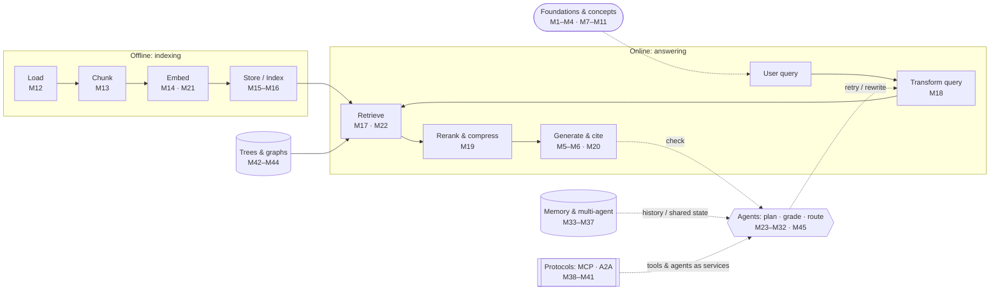

# RAG & Agents Engineering Curriculum

*From Python and your first LLM call to agentic, memory-backed, multi-agent, protocol-connected and graph-based RAG*

Built from 9 repositories. Every notebook in them is mapped to exactly one lesson below.

| Repo | Topic | Notebooks |
|---|---|---|
| [`ai-engineering-demystified-01-foundations`](https://github.com/Sourav692/ai-engineering-demystified-01-foundations) | AI engineering foundations | 53 |
| [`ai-engineering-demystified-02-prompt-context-engineering`](https://github.com/Sourav692/ai-engineering-demystified-02-prompt-context-engineering) | Prompt & context engineering | 10 |
| [`ai-engineering-demystified-03-langchain-fundamentals`](https://github.com/Sourav692/ai-engineering-demystified-03-langchain-fundamentals) | LangChain fundamentals | 34 |
| [`ai-engineering-demystified-04-langgraph-fundamentals`](https://github.com/Sourav692/ai-engineering-demystified-04-langgraph-fundamentals) | LangGraph fundamentals | 19 |
| [`ai-engineering-demystified-05-retrieval-rag`](https://github.com/Sourav692/ai-engineering-demystified-05-retrieval-rag) | Retrieval & RAG | 102 |
| [`ai-engineering-demystified-06-agent-fundamentals`](https://github.com/Sourav692/ai-engineering-demystified-06-agent-fundamentals) | Agent fundamentals | 64 |
| [`ai-engineering-demystified-08-advanced-agent-systems`](https://github.com/Sourav692/ai-engineering-demystified-08-advanced-agent-systems) | Advanced agent systems | 58 |
| [`ai-engineering-demystified-09-advanced-rag`](https://github.com/Sourav692/ai-engineering-demystified-09-advanced-rag) | Advanced RAG | 32 |
| [`ai-engineering-demystified-10-agent-protocols`](https://github.com/Sourav692/ai-engineering-demystified-10-agent-protocols) | Agent protocols | 10 |

## Course at a glance

| Parts | Modules | Lessons | Notebooks mapped | Mandatory | Optional | Suggested effort | Pace |
|---|---|---|---|---|---|---|---|
| 13 | 45 + capstone | 227 | 382 | 211 | 171 | ~214 hours | 26 weeks at ~8 h/week |

## Who this course is for

- Software and ML engineers who build LLM applications and need retrieval that actually works
- Data engineers moving into AI engineering who already know Python and SQL
- Practitioners who have built a demo RAG app and want to understand why it fails and how to fix it

## Prerequisites

- Basic Python and comfort with a terminal; Part I has a refresher for the data tools the course uses
- An OpenAI API key (most notebooks); other providers are optional and named per notebook
- No prior LangChain or LangGraph knowledge: Part III teaches both

## Learning outcomes

By the end of the course you can:

1. Call hosted and open models, choose between them on cost and accuracy, and decide when fine-tuning beats retrieval
2. Write reliable prompts, including reasoning and multimodal prompts
3. Build with LangChain (models, prompts, parsers, LCEL) and LangGraph (state, routing, checkpoints, interrupts, streaming)
4. Explain the RAG lifecycle and build a measured baseline before optimising anything
5. Engineer the ingestion pipeline: loaders, metadata, chunking, embeddings and vector stores
6. Change what gets indexed (parent-document, multi-representation, HyPE, contextual headers, hierarchical)
7. Improve retrieval quality with hybrid search, fusion, query transformation and reranking
8. Ship complete RAG apps with sources, citations, structured data and images
9. Write the agent loop by hand, build ReAct agents, and apply the five workflow patterns plus planning and reflection
10. Build self-correcting RAG (grading, CRAG, Self-RAG, adaptive routing) as LangGraph graphs
11. Expose retrieval as an agent tool and make it reliable with checks and feedback loops
12. Add conversation, long-term and agentic memory, and coordinate retrieval across supervisor, swarm and research multi-agent systems
13. Expose retrieval and agents as services with MCP and A2A
14. Build knowledge graphs in Neo4j and apply RAPTOR, LightRAG and GraphRAG
15. Pick an architecture for a given problem and defend the trade-offs

## How to read this syllabus

- **Levels:** Foundation → Core → Advanced → Expert.
- **Notebooks:** every lesson lists its notebooks as `repo/module/notebook`, split into **Mandatory** and **Optional** columns (see below).
- **Baseline-first:** the M11 lab produces a baseline. Every later lab reports its change against it on the same golden question set.
- **Hours** are suggested study time for the mandatory notebooks plus the lab. Optional notebooks are extra.

## Mandatory vs optional notebooks

You do not need every notebook. **211 of 382 notebooks are mandatory**; the other 171 are optional.

**Rule:** each lesson keeps the one notebook (two, when they teach two distinct ideas) that you need for the lesson objective and the module lab. Everything else is optional for one of three reasons:

| Optional reason | Meaning | Notebooks |
|---|---|---|
| **Alternate** | Same idea taught again from another source course, or the same pattern in another API (e.g. LCEL instead of LangGraph) | 52 |
| **Platform-specific** | Needs a particular vendor or extra infrastructure: Databricks, Astra DB, Postgres, Milvus, Contextual AI, ColPali GPU stack | 13 |
| **Extension** | Extra applied example, reference material or a niche variant; useful practice, not needed for the lab | 106 |

If a lesson has no mandatory notebook, the whole lesson is optional.

## Course map

## Roadmap

| Part | Title | When | Level | Modules |
|---|---|---|---|---|
| I | AI Engineering Foundations | Weeks 1–2 | Foundation | M1, M2, M3, M4 |
| II | Prompt & Context Engineering | Week 3 | Foundation | M5, M6 |
| III | LangChain & LangGraph Fundamentals | Weeks 4–5 | Foundation | M7, M8, M9, M10 |
| IV | RAG Foundations | Week 6 | Foundation | M11 |
| V | The Ingestion & Indexing Pipeline | Weeks 7–9 | Core | M12, M13, M14, M15, M16 |
| VI | Retrieval Quality Engineering | Weeks 10–11 | Core | M17, M18, M19 |
| VII | Building Complete RAG Applications | Week 12 | Core | M20, M21, M22 |
| VIII | Agent Foundations for RAG | Weeks 13–15 | Core | M23, M24, M25, M26, M27 |
| IX | Agentic & Self-Correcting RAG | Weeks 16–17 | Advanced | M28, M29, M30, M31, M32 |
| X | Memory & Multi-Agent RAG | Weeks 18–20 | Advanced | M33, M34, M35, M36, M37 |
| XI | Agent Protocols: MCP & A2A | Weeks 21–22 | Advanced | M38, M39, M40, M41 |
| XII | Hierarchical, Memory & Graph RAG | Weeks 23–24 | Expert | M42, M43, M44 |
| XIII | Architecture Synthesis & Capstone | Weeks 25–26 | Expert | M45, Capstone |

---

## Part I — AI Engineering Foundations

**Weeks 1–2 · Foundation** — Python and data tools, LLM provider APIs and model choice, Hugging Face models, and when fine-tuning beats retrieval.

### Module 1 — Python & Data Toolkit Refresher

**Level:** Foundation · **Time:** ~3 h · **Notebooks:** 3 mandatory, 12 optional · **Source:** `01/01_python_for_ai_engineering`, `01/02_files_data_and_apis`, `01/03_concurrency_and_asyncio`

**Why it matters.** RAG and agent code leans on a small set of Python tools: NumPy arrays for embeddings, pandas for tabular data, SQL for structured retrieval and asyncio for concurrent calls. Skim what you know and practise the rest.

**Learning objectives**

- Write idiomatic Python: data types, control flow, functions and PEP 8
- Work with arrays and tables in NumPy and pandas, and plot results with Matplotlib
- Query SQLite, MySQL and PostgreSQL from Python
- Serve data through a Flask API
- Explain threads, processes, the GIL and asyncio, and avoid race conditions and deadlocks

**Lessons**

| # | Topic | Mandatory | Optional |
|---|---|---|---|
| 1.1 | Python essentials: variables, operators, control flow, functions *(optional lesson)* | — | [`01a_implementing_variables_in_python`](course/p01_ai_engineering_foundations/m01_python_data_refresher/optional/01a_implementing_variables_in_python.ipynb) *(extension)* [`01b_implementation_of_operators_in_python`](course/p01_ai_engineering_foundations/m01_python_data_refresher/optional/01b_implementation_of_operators_in_python.ipynb) *(extension)* [`01c_implementing_conditional_statements`](course/p01_ai_engineering_foundations/m01_python_data_refresher/optional/01c_implementing_conditional_statements.ipynb) *(extension)* [`01d_looping_constructs`](course/p01_ai_engineering_foundations/m01_python_data_refresher/optional/01d_looping_constructs.ipynb) *(extension)* [`01e_implementing_functions_in_python`](course/p01_ai_engineering_foundations/m01_python_data_refresher/optional/01e_implementing_functions_in_python.ipynb) *(extension)* |
| 1.2 | Python best practices *(optional lesson)* | — | [`02a_python_best_practices`](course/p01_ai_engineering_foundations/m01_python_data_refresher/optional/02a_python_best_practices.ipynb) *(extension)* |
| 1.3 | NumPy, pandas and Matplotlib | [`03a_numpy_basics`](course/p01_ai_engineering_foundations/m01_python_data_refresher/notebooks/03a_numpy_basics.ipynb) [`03b_pandas_basics_for_data_analysis`](course/p01_ai_engineering_foundations/m01_python_data_refresher/notebooks/03b_pandas_basics_for_data_analysis.ipynb) | [`03c_matplotlib_basics`](course/p01_ai_engineering_foundations/m01_python_data_refresher/optional/03c_matplotlib_basics.ipynb) *(extension)* |
| 1.4 | Databases from Python: SQLite, MySQL, PostgreSQL | [`04a_sqlite_operations`](course/p01_ai_engineering_foundations/m01_python_data_refresher/notebooks/04a_sqlite_operations.ipynb) | [`04b_mysql_connection`](course/p01_ai_engineering_foundations/m01_python_data_refresher/optional/04b_mysql_connection.ipynb) *(platform-specific)* [`04c_postgresdb_connection`](course/p01_ai_engineering_foundations/m01_python_data_refresher/optional/04c_postgresdb_connection.ipynb) *(platform-specific)* |
| 1.5 | Serving data with Flask APIs *(optional lesson)* | — | [`05a_creating_and_accessing_apis_with_flask`](course/p01_ai_engineering_foundations/m01_python_data_refresher/optional/05a_creating_and_accessing_apis_with_flask.ipynb) *(extension)* [`05b_stock_market_api_endpoints`](course/p01_ai_engineering_foundations/m01_python_data_refresher/optional/05b_stock_market_api_endpoints.ipynb) *(extension)* |
| 1.6 | Concurrency: threads, processes, the GIL and asyncio (22 runnable scripts) *(optional lesson)* | — | [`06a_concurrency_scripts`](course/p01_ai_engineering_foundations/m01_python_data_refresher/optional/06a_concurrency_scripts) *(extension)* |

**Hands-on lab.** Data warm-up: load a CSV into pandas and into SQLite, answer five questions both ways, and expose one of them through a small Flask endpoint.

**Key concepts:** NumPy arrays · pandas DataFrames · SQL from Python · asyncio

### Module 2 — LLM Provider APIs & Model Selection

**Level:** Foundation · **Time:** ~3 h · **Notebooks:** 4 mandatory, 1 optional · **Source:** `01/04_llm_provider_apis`, `01/05_model_landscape_and_selection`

**Why it matters.** Every RAG answer ends in a model call. Knowing how to call hosted and open models directly, and when a reasoning model is worth its cost, makes every later choice about the generator concrete.

**Learning objectives**

- Call the OpenAI and Gemini chat APIs directly from Python
- Call open-source models through the Hugging Face InferenceClient and run one locally
- Measure when a reasoning model pays for itself against a fast model
- Sweep reasoning effort and find the cost/accuracy knee

**Lessons**

| # | Topic | Mandatory | Optional |
|---|---|---|---|
| 2.1 | Calling commercial LLM APIs: OpenAI and Gemini | [`01a_using_chatgpt_or_google_gemini`](course/p01_ai_engineering_foundations/m02_llm_apis_and_model_selection/notebooks/01a_using_chatgpt_or_google_gemini.ipynb) | — |
| 2.2 | Open-source LLMs via Hugging Face Inference and locally | [`02a_open_source_llms_via_hugging_face_inference_api`](course/p01_ai_engineering_foundations/m02_llm_apis_and_model_selection/notebooks/02a_open_source_llms_via_hugging_face_inference_api.ipynb) | [`02b_open_source_llms_locally`](course/p01_ai_engineering_foundations/m02_llm_apis_and_model_selection/optional/02b_open_source_llms_locally.ipynb) *(extension)* |
| 2.3 | Reasoning vs non-reasoning models | [`03a_Reasoning_vs_NonReasoning`](course/p01_ai_engineering_foundations/m02_llm_apis_and_model_selection/notebooks/03a_Reasoning_vs_NonReasoning.ipynb) | — |
| 2.4 | Reasoning-effort levers and cost | [`04a_Reasoning_Effort_Levers`](course/p01_ai_engineering_foundations/m02_llm_apis_and_model_selection/notebooks/04a_Reasoning_Effort_Levers.ipynb) | — |

**Hands-on lab.** Generator choice: answer 20 questions with a fast model, a reasoning model at two effort levels and an open model, and record accuracy, latency and cost per answer.

**Key concepts:** Chat completions · Inference endpoints · Reasoning models · Cost vs accuracy

### Module 3 — Hugging Face Models & Gradio Demos

**Level:** Foundation · **Time:** ~4 h · **Notebooks:** 5 mandatory, 16 optional · **Source:** `01/07_hugging_face_models`

**Why it matters.** Open models from the Hub power local embeddings, rerankers and captioning later in the course. This module covers loading them, running pipelines, and putting a quick Gradio front end on a model.

**Learning objectives**

- Log in to the Hub and load datasets and models
- Run NLP pipelines and tokenize/generate with causal LMs
- Work with image, diffusion, video and audio models
- Build and style Gradio demos around a model

**Lessons**

| # | Topic | Mandatory | Optional |
|---|---|---|---|
| 3.1 | Hub setup, datasets and models | [`01a_hf_setup`](course/p01_ai_engineering_foundations/m03_hugging_face_models/notebooks/01a_hf_setup.ipynb) [`01b_hf_basics`](course/p01_ai_engineering_foundations/m03_hugging_face_models/notebooks/01b_hf_basics.ipynb) | — |
| 3.2 | Pipelines, tokenization and pretrained models | [`02a_pipelines_for_nlp_tasks`](course/p01_ai_engineering_foundations/m03_hugging_face_models/notebooks/02a_pipelines_for_nlp_tasks.ipynb) [`02b_understanding_llms`](course/p01_ai_engineering_foundations/m03_hugging_face_models/notebooks/02b_understanding_llms.ipynb) | [`02c_accessing_pretrained_models`](course/p01_ai_engineering_foundations/m03_hugging_face_models/optional/02c_accessing_pretrained_models.ipynb) *(extension)* |
| 3.3 | Images, diffusion and video generation *(optional lesson)* | — | [`03a_understanding_image_data`](course/p01_ai_engineering_foundations/m03_hugging_face_models/optional/03a_understanding_image_data.ipynb) *(extension)* [`03b_understanding_diffusion_models`](course/p01_ai_engineering_foundations/m03_hugging_face_models/optional/03b_understanding_diffusion_models.ipynb) *(extension)* [`03c_autopipelines_diffusers`](course/p01_ai_engineering_foundations/m03_hugging_face_models/optional/03c_autopipelines_diffusers.ipynb) *(extension)* [`03d_stable_video_diffusion`](course/p01_ai_engineering_foundations/m03_hugging_face_models/optional/03d_stable_video_diffusion.ipynb) *(platform-specific)* [`03e_image2videogen_xl`](course/p01_ai_engineering_foundations/m03_hugging_face_models/optional/03e_image2videogen_xl.ipynb) *(platform-specific)* |
| 3.4 | Audio: data, classification, transcription, generation *(optional lesson)* | — | [`04a_audio_data`](course/p01_ai_engineering_foundations/m03_hugging_face_models/optional/04a_audio_data.ipynb) *(extension)* [`04b_audio_classification`](course/p01_ai_engineering_foundations/m03_hugging_face_models/optional/04b_audio_classification.ipynb) *(extension)* [`04c_audio_transcription`](course/p01_ai_engineering_foundations/m03_hugging_face_models/optional/04c_audio_transcription.ipynb) *(extension)* [`04d_audio_generation`](course/p01_ai_engineering_foundations/m03_hugging_face_models/optional/04d_audio_generation.ipynb) *(extension)* |
| 3.5 | Building demos with Gradio | [`05a_gradio_introduction`](course/p01_ai_engineering_foundations/m03_hugging_face_models/notebooks/05a_gradio_introduction.ipynb) | [`05b_gradio_layout`](course/p01_ai_engineering_foundations/m03_hugging_face_models/optional/05b_gradio_layout.ipynb) *(extension)* [`05c_gradio_interactions`](course/p01_ai_engineering_foundations/m03_hugging_face_models/optional/05c_gradio_interactions.ipynb) *(extension)* [`05d_gradio_image_ml_integration`](course/p01_ai_engineering_foundations/m03_hugging_face_models/optional/05d_gradio_image_ml_integration.ipynb) *(extension)* [`05e_gradio_text_ml_integration`](course/p01_ai_engineering_foundations/m03_hugging_face_models/optional/05e_gradio_text_ml_integration.ipynb) *(extension)* [`05f_gradio_modals_errors`](course/p01_ai_engineering_foundations/m03_hugging_face_models/optional/05f_gradio_modals_errors.ipynb) *(extension)* [`05g_gradio_styling_and_themes`](course/p01_ai_engineering_foundations/m03_hugging_face_models/optional/05g_gradio_styling_and_themes.ipynb) *(extension)* |

**Hands-on lab.** Model demo: wrap an open embedding or text model from the Hub in a Gradio app that shows its output for a user-entered query.

**Key concepts:** Hub & cache · Pipelines · Tokenization · Gradio Blocks

### Module 4 — Fine-Tuning Fundamentals

**Level:** Core · **Time:** ~5 h · **Notebooks:** 5 mandatory, 8 optional · **Source:** `01/08_fine_tuning_fundamentals`

**Why it matters.** Fine-tuning is the main alternative to retrieval for adding knowledge or behaviour. Knowing what it can and cannot do is how you decide between RAG, fine-tuning, or both.

**Learning objectives**

- Explain when fine-tuning beats prompting or RAG, and where it fits after pre-training
- Build instruction-tuning data and prepare it (tokenize, pad, truncate, split)
- Train a small model with the Hugging Face Trainer and evaluate it
- Fine-tune Llama 2 with AutoTrain

**Lessons**

| # | Topic | Mandatory | Optional |
|---|---|---|---|
| 4.1 | Why fine-tune | [`01a_why_finetuning_lab`](course/p01_ai_engineering_foundations/m04_fine_tuning_fundamentals/notebooks/01_why_finetune/01a_why_finetuning_lab.ipynb) | [`01b_why_finetuning_lecture`](course/p01_ai_engineering_foundations/m04_fine_tuning_fundamentals/optional/01_why_finetune/01b_why_finetuning_lecture.ipynb) *(alternate)* |
| 4.2 | Where fine-tuning fits *(optional lesson)* | — | [`02a_where_finetuning_fits_in_lab`](course/p01_ai_engineering_foundations/m04_fine_tuning_fundamentals/optional/02_where_finetuning_fits/02a_where_finetuning_fits_in_lab.ipynb) *(extension)* [`02b_where_finetuning_fits_in_lecture`](course/p01_ai_engineering_foundations/m04_fine_tuning_fundamentals/optional/02_where_finetuning_fits/02b_where_finetuning_fits_in_lecture.ipynb) *(alternate)* |
| 4.3 | Instruction tuning | [`03a_instruction_tuning_lab`](course/p01_ai_engineering_foundations/m04_fine_tuning_fundamentals/notebooks/03_instruction_tuning/03a_instruction_tuning_lab.ipynb) | [`03b_instruction_tuning_lecture`](course/p01_ai_engineering_foundations/m04_fine_tuning_fundamentals/optional/03_instruction_tuning/03b_instruction_tuning_lecture.ipynb) *(alternate)* |
| 4.4 | Data preparation | [`04a_data_preparation_lab`](course/p01_ai_engineering_foundations/m04_fine_tuning_fundamentals/notebooks/04_data_preparation/04a_data_preparation_lab.ipynb) | [`04b_data_preparation_lecture`](course/p01_ai_engineering_foundations/m04_fine_tuning_fundamentals/optional/04_data_preparation/04b_data_preparation_lecture.ipynb) *(alternate)* |
| 4.5 | Training | [`05a_training_lab`](course/p01_ai_engineering_foundations/m04_fine_tuning_fundamentals/notebooks/05_training/05a_training_lab.ipynb) | [`05b_training_lecture`](course/p01_ai_engineering_foundations/m04_fine_tuning_fundamentals/optional/05_training/05b_training_lecture.ipynb) *(alternate)* |
| 4.6 | Evaluation | [`06a_evaluation_lab`](course/p01_ai_engineering_foundations/m04_fine_tuning_fundamentals/notebooks/06_evaluation/06a_evaluation_lab.ipynb) | [`06b_evaluation_lecture`](course/p01_ai_engineering_foundations/m04_fine_tuning_fundamentals/optional/06_evaluation/06b_evaluation_lecture.ipynb) *(alternate)* |
| 4.7 | Fine-tuning Llama 2 with AutoTrain *(optional lesson)* | — | [`07a_3_ways_fine_tuning_llama_2_with_autotrain`](course/p01_ai_engineering_foundations/m04_fine_tuning_fundamentals/optional/07_llama2_autotrain/07a_3_ways_fine_tuning_llama_2_with_autotrain.ipynb) *(platform-specific)* |

**Hands-on lab.** RAG or fine-tune: for one narrow task, compare the M11 RAG baseline with a small fine-tuned model on the same questions and write down which wins and why.

**Key concepts:** Instruction tuning · Data preparation · Trainer · Evaluation

**Part I checkpoint:** concept quiz plus one design question (for example, “Your hit rate is fine but answers are wrong — which stage do you inspect first and why?”).

---

## Part II — Prompt & Context Engineering

**Week 3 · Foundation** — The prompt patterns behind every LLM step in a RAG pipeline, across models and modalities.

### Module 5 — Prompt Engineering Patterns

**Level:** Foundation · **Time:** ~3 h · **Notebooks:** 4 mandatory, 3 optional · **Source:** `02/01_prompting_basics`, `02/02_advanced_prompt_patterns`, `02/03_model_specific_practice`, `02/06_applied_prompting`

**Why it matters.** Query rewriting, grading, routing and answer generation are all prompts. The patterns here are the building blocks of every LLM step in a RAG pipeline.

**Learning objectives**

- Apply persona, flipped-interaction, N-shot, directional-stimulus, template and meta-language patterns
- Use chain-of-thought, self-consistency, least-to-most and ReAct-format prompting
- Run the same tasks across GPT-4o-mini, Gemini and Llama models and compare the results
- Combine the patterns on real business tasks

**Lessons**

| # | Topic | Mandatory | Optional |
|---|---|---|---|
| 5.1 | Core prompt patterns | [`01a_prompt_engineering_patterns`](course/p02_prompt_engineering/m05_prompt_engineering_patterns/notebooks/01a_prompt_engineering_patterns.ipynb) | — |
| 5.2 | Reasoning prompts: chain-of-thought, self-consistency, least-to-most, ReAct | [`02a_advanced_prompt_engineering_patterns`](course/p02_prompt_engineering/m05_prompt_engineering_patterns/notebooks/02a_advanced_prompt_engineering_patterns.ipynb) | — |
| 5.3 | The same tasks across models | [`03a_openai_gpt_4o_mini`](course/p02_prompt_engineering/m05_prompt_engineering_patterns/notebooks/03a_openai_gpt_4o_mini.ipynb) | [`03b_google_gemini_1_5_flash`](course/p02_prompt_engineering/m05_prompt_engineering_patterns/optional/03b_google_gemini_1_5_flash.ipynb) *(alternate)* [`03c_meta_llama_3_2_90b_groq`](course/p02_prompt_engineering/m05_prompt_engineering_patterns/optional/03c_meta_llama_3_2_90b_groq.ipynb) *(alternate)* [`03d_meta_llama_3_2_1b_huggingface`](course/p02_prompt_engineering/m05_prompt_engineering_patterns/optional/03d_meta_llama_3_2_1b_huggingface.ipynb) *(alternate)* |
| 5.4 | Applied prompting on business tasks | [`04a_gpt_4o_and_llama_3_2_real_world_tasks`](course/p02_prompt_engineering/m05_prompt_engineering_patterns/notebooks/04a_gpt_4o_and_llama_3_2_real_world_tasks.ipynb) | — |

**Hands-on lab.** Prompt bake-off: write three prompts for grading whether a retrieved passage answers a question, and measure their agreement with your own labels on 30 pairs.

**Key concepts:** Few-shot · Chain-of-thought · Self-consistency · ReAct format

### Module 6 — Multimodal Prompting

**Level:** Foundation · **Time:** ~2 h · **Notebooks:** 1 mandatory, 2 optional · **Source:** `02/04_multimodal_prompting`

**Why it matters.** Multimodal RAG (M21) ends with a model reading images, PDFs or video frames. This module shows how to prompt those models directly first.

**Learning objectives**

- Prompt Gemini with images, PDFs, audio and video
- Prompt GPT-4o with images and summarise a video from frames and transcript

**Lessons**

| # | Topic | Mandatory | Optional |
|---|---|---|---|
| 6.1 | Multimodal prompting with Gemini | [`01a_multimodal_google_gemini`](course/p02_prompt_engineering/m06_multimodal_prompting/notebooks/01a_multimodal_google_gemini.ipynb) | — |
| 6.2 | Multimodal prompting with GPT-4o *(optional lesson)* | — | [`02a_multimodal_openai_gpt_4o`](course/p02_prompt_engineering/m06_multimodal_prompting/optional/02a_multimodal_openai_gpt_4o.ipynb) *(alternate)* |
| 6.3 | Exercise: financial report analysis *(optional lesson)* | — | [`03a_financial_report_analysis`](course/p02_prompt_engineering/m06_multimodal_prompting/exercises/03a_financial_report_analysis.ipynb) *(extension)* |

**Hands-on lab.** Report reader: answer five questions about a chart-heavy PDF page by prompting a multimodal model with the page image.

**Key concepts:** Image prompts · PDF and audio input · Frame sampling

**Part II checkpoint:** concept quiz plus one design question (for example, “Your hit rate is fine but answers are wrong — which stage do you inspect first and why?”).

---

## Part III — LangChain & LangGraph Fundamentals

**Weeks 4–5 · Foundation** — LangChain models, prompts, parsers and LCEL, then LangGraph state, routing, persistence, interrupts and streaming.

### Module 7 — LangChain Core: Models, Prompts & Parsers

**Level:** Foundation · **Time:** ~4 h · **Notebooks:** 9 mandatory, 13 optional · **Source:** `03/01_getting_started`, `03/02_inputs_outputs_prompts`, `03/06_langchain_v1_course_recap`

**Why it matters.** Most RAG notebooks in this course are written in LangChain. This module covers its building blocks in the 1.x package layout: chat models, messages, prompt templates and output parsers.

**Learning objectives**

- Call commercial and open-source models natively and through LangChain
- Navigate the LangChain 1.x package split and imports
- Use messages, chat models and prompt templates, including few-shot
- Parse model output into structured data

**Lessons**

| # | Topic | Mandatory | Optional |
|---|---|---|---|
| 7.1 | LangChain introduction and the 1.x package split | [`01a_LangChain_Introduction`](course/p03_langchain_and_langgraph/m07_langchain_core/notebooks/01a_LangChain_Introduction.ipynb) [`01b_Package_Split_and_Imports_LangChain_v1`](course/p03_langchain_and_langgraph/m07_langchain_core/notebooks/01b_Package_Split_and_Imports_LangChain_v1.ipynb) | — |
| 7.2 | Commercial LLMs natively and with LangChain | [`02a_Commercial_LLMs_with_LangChain`](course/p03_langchain_and_langgraph/m07_langchain_core/notebooks/02a_Commercial_LLMs_with_LangChain.ipynb) | [`02b_Commercial_LLMs_Natively`](course/p03_langchain_and_langgraph/m07_langchain_core/optional/02b_Commercial_LLMs_Natively.ipynb) *(extension)* |
| 7.3 | Open-source LLMs: Transformers, Inference Client, Groq, LangChain | [`03a_Open_Source_LLMs_with_LangChain`](course/p03_langchain_and_langgraph/m07_langchain_core/notebooks/03a_Open_Source_LLMs_with_LangChain.ipynb) | [`03b_Open_Source_LLMs_HF_Transformers`](course/p03_langchain_and_langgraph/m07_langchain_core/optional/03b_Open_Source_LLMs_HF_Transformers.ipynb) *(alternate)* [`03c_Open_Source_LLMs_HF_Inference_Client`](course/p03_langchain_and_langgraph/m07_langchain_core/optional/03c_Open_Source_LLMs_HF_Inference_Client.ipynb) *(alternate)* [`03d_Open_Source_LLMs_Groq_Cloud`](course/p03_langchain_and_langgraph/m07_langchain_core/optional/03d_Open_Source_LLMs_Groq_Cloud.ipynb) *(alternate)* |
| 7.4 | Inputs and outputs: messages, LLM vs chat model | [`04a_LangChain_Inputs_and_Outputs`](course/p03_langchain_and_langgraph/m07_langchain_core/notebooks/04a_LangChain_Inputs_and_Outputs.ipynb) [`04b_LLM_vs_ChatModel`](course/p03_langchain_and_langgraph/m07_langchain_core/notebooks/04b_LLM_vs_ChatModel.ipynb) | — |
| 7.5 | Prompt templates and few-shot composition | [`05a_Prompt_Templates`](course/p03_langchain_and_langgraph/m07_langchain_core/notebooks/05a_Prompt_Templates.ipynb) | [`05b_Few_Shot_Composition_and_Serialization`](course/p03_langchain_and_langgraph/m07_langchain_core/optional/05b_Few_Shot_Composition_and_Serialization.ipynb) *(extension)* |
| 7.6 | Output parsers | [`06a_Output_Parser`](course/p03_langchain_and_langgraph/m07_langchain_core/notebooks/06a_Output_Parser.ipynb) | — |
| 7.7 | LangChain 1.x recap course, ending in a structured-output Q&A bot | [`07a_smart_bot_section1`](course/p03_langchain_and_langgraph/m07_langchain_core/notebooks/07a_smart_bot_section1.ipynb) | [`07b_core_concepts`](course/p03_langchain_and_langgraph/m07_langchain_core/optional/07b_core_concepts.ipynb) *(alternate)* [`07c_working_with_llms`](course/p03_langchain_and_langgraph/m07_langchain_core/optional/07c_working_with_llms.ipynb) *(alternate)* [`07d_prompt_messages`](course/p03_langchain_and_langgraph/m07_langchain_core/optional/07d_prompt_messages.ipynb) *(alternate)* [`07e_prompt_templates_all`](course/p03_langchain_and_langgraph/m07_langchain_core/optional/07e_prompt_templates_all.ipynb) *(alternate)* [`07f_output_parsers_demo`](course/p03_langchain_and_langgraph/m07_langchain_core/optional/07f_output_parsers_demo.ipynb) *(alternate)* [`07g_output_parsers_final`](course/p03_langchain_and_langgraph/m07_langchain_core/optional/07g_output_parsers_final.ipynb) *(alternate)* [`07h_chains_v1`](course/p03_langchain_and_langgraph/m07_langchain_core/optional/07h_chains_v1.ipynb) *(alternate)* [`07i_main_connectivity_check`](course/p03_langchain_and_langgraph/m07_langchain_core/optional/07i_main_connectivity_check.ipynb) *(extension)* |

**Hands-on lab.** Structured answers: build a prompt template and parser that turn a question plus three passages into a JSON answer with a citations list.

**Key concepts:** Chat models · Messages · Prompt templates · Output parsers

### Module 8 — LCEL, Runnables & Chains

**Level:** Foundation · **Time:** ~3 h · **Notebooks:** 7 mandatory, 5 optional · **Source:** `03/03_lcel_and_runnables`, `03/04_legacy_chains_and_migration`, `03/05_summarization`

**Why it matters.** Every RAG chain in Parts IV–VII is an LCEL pipeline: retriever | prompt | model | parser. Summarization chains are also the first taste of map-reduce over documents.

**Learning objectives**

- Compose Runnables with the pipe operator and run them with invoke, batch and stream
- Branch, route and merge chains
- Migrate pre-1.x chain classes to LCEL
- Summarise long documents with stuff, map-reduce and refine

**Lessons**

| # | Topic | Mandatory | Optional |
|---|---|---|---|
| 8.1 | LCEL and the Runnable interface | [`01a_LCEL_Introduction`](course/p03_langchain_and_langgraph/m08_lcel_runnables_and_chains/notebooks/01a_LCEL_Introduction.ipynb) [`01b_Runnables`](course/p03_langchain_and_langgraph/m08_lcel_runnables_and_chains/notebooks/01b_Runnables.ipynb) | — |
| 8.2 | LCEL deep dive | [`02a_LCEL_Deepdive`](course/p03_langchain_and_langgraph/m08_lcel_runnables_and_chains/notebooks/02a_LCEL_Deepdive.ipynb) | [`02b_LCEL_and_Runnables`](course/p03_langchain_and_langgraph/m08_lcel_runnables_and_chains/optional/02b_LCEL_and_Runnables.ipynb) *(alternate)* |
| 8.3 | Branching, routing and merging chains | [`03a_Branching_Routing_Merging_Chains`](course/p03_langchain_and_langgraph/m08_lcel_runnables_and_chains/notebooks/03a_Branching_Routing_Merging_Chains.ipynb) | — |
| 8.4 | Legacy chains and migration to LCEL | [`04a_Chain_Migrations`](course/p03_langchain_and_langgraph/m08_lcel_runnables_and_chains/notebooks/04a_Chain_Migrations.ipynb) | [`04b_Basics_of_Chains`](course/p03_langchain_and_langgraph/m08_lcel_runnables_and_chains/optional/04b_Basics_of_Chains.ipynb) *(extension)* [`04c_Chains_Basics_and_OutputParsers`](course/p03_langchain_and_langgraph/m08_lcel_runnables_and_chains/optional/04c_Chains_Basics_and_OutputParsers.ipynb) *(extension)* [`04d_Advanced_Chains`](course/p03_langchain_and_langgraph/m08_lcel_runnables_and_chains/optional/04d_Advanced_Chains.ipynb) *(extension)* [`04e_Chain_Migration_Advanced`](course/p03_langchain_and_langgraph/m08_lcel_runnables_and_chains/optional/04e_Chain_Migration_Advanced.ipynb) *(extension)* |
| 8.5 | Summarization: stuff, map-reduce, refine | [`05a_Summarization_Essentials`](course/p03_langchain_and_langgraph/m08_lcel_runnables_and_chains/notebooks/05a_Summarization_Essentials.ipynb) [`05b_Doc_Chains_to_LCEL_LangChain_v1`](course/p03_langchain_and_langgraph/m08_lcel_runnables_and_chains/notebooks/05b_Doc_Chains_to_LCEL_LangChain_v1.ipynb) | — |

**Hands-on lab.** Chain rewrite: rebuild one legacy chain as LCEL, add a branch that routes short and long inputs differently, and compare outputs.

**Key concepts:** Runnable interface · Pipe composition · RunnableParallel / Branch · Map-reduce summarisation

### Module 9 — LangGraph Core: Graphs, State & Control Flow

**Level:** Foundation · **Time:** ~4 h · **Notebooks:** 10 mandatory, 0 optional · **Source:** `04/01_graphs_state_and_reducers`, `04/02_conditional_edges_and_llm_nodes`, `04/03_state_schemas`, `04/04_nodes_runtime_context_and_commands`, `04/07_input_output_schemas_and_configuration`

**Why it matters.** Agentic RAG, memory and multi-agent systems are all LangGraph graphs. This module covers the core: state, nodes, edges, reducers and routing.

**Learning objectives**

- Build a StateGraph with nodes, edges and reducers, including MessagesState
- Route with conditional edges and put a chat model inside a node
- Choose a state schema (TypedDict, dataclass, Pydantic) and validate it
- Use node signatures, runtime context, Command, input/output schemas and configuration

**Lessons**

| # | Topic | Mandatory | Optional |
|---|---|---|---|
| 9.1 | State, graphs and reducers | [`01a_State_and_Graph_Basics`](course/p03_langchain_and_langgraph/m09_langgraph_core/notebooks/01a_State_and_Graph_Basics.ipynb) [`01b_MessagesState`](course/p03_langchain_and_langgraph/m09_langgraph_core/notebooks/01b_MessagesState.ipynb) | — |
| 9.2 | Conditional edges and LLM nodes | [`02a_Conditional_Routing`](course/p03_langchain_and_langgraph/m09_langgraph_core/notebooks/02a_Conditional_Routing.ipynb) [`02b_LLM_Powered_Chatbot`](course/p03_langchain_and_langgraph/m09_langgraph_core/notebooks/02b_LLM_Powered_Chatbot.ipynb) | — |
| 9.3 | State schemas and validation | [`03a_Different_Graph_States`](course/p03_langchain_and_langgraph/m09_langgraph_core/notebooks/03a_Different_Graph_States.ipynb) [`03b_Pydantic_State_Validation`](course/p03_langchain_and_langgraph/m09_langgraph_core/notebooks/03b_Pydantic_State_Validation.ipynb) | — |
| 9.4 | Nodes, runtime context and Command | [`04a_Node_Patterns`](course/p03_langchain_and_langgraph/m09_langgraph_core/notebooks/04a_Node_Patterns.ipynb) [`04b_Runtime_Context`](course/p03_langchain_and_langgraph/m09_langgraph_core/notebooks/04b_Runtime_Context.ipynb) [`04c_Command_Objects`](course/p03_langchain_and_langgraph/m09_langgraph_core/notebooks/04c_Command_Objects.ipynb) | — |
| 9.5 | Input/output schemas and configuration | [`05a_Advanced_State`](course/p03_langchain_and_langgraph/m09_langgraph_core/notebooks/05a_Advanced_State.ipynb) | — |

**Hands-on lab.** First graph: build a graph that classifies a question, routes it to one of two nodes, and returns a structured answer.

**Key concepts:** StateGraph · Reducers · Conditional edges · Command

### Module 10 — LangGraph Runtime: Persistence, HITL & Streaming

**Level:** Foundation · **Time:** ~4 h · **Notebooks:** 9 mandatory, 0 optional · **Source:** `04/05_checkpointing`, `04/06_interrupts_and_human_in_the_loop`, `04/08_subgraphs`, `04/09_async_and_streaming`, `04/10_retry_policies`, `04/11_cycles_and_loops`, `04/12_state_management_in_practice`

**Why it matters.** Grade-and-retry loops, human approval, conversation threads and multi-agent teams need checkpoints, interrupts, subgraphs, streaming and bounded cycles.

**Learning objectives**

- Persist graph state with checkpointers, threads and branching
- Pause for human input with interrupt() and resume
- Compose subgraphs with state transformation
- Stream updates and messages, retry failed nodes, and bound loops

**Lessons**

| # | Topic | Mandatory | Optional |
|---|---|---|---|
| 10.1 | Checkpointing and threads | [`01a_Checkpointing`](course/p03_langchain_and_langgraph/m10_langgraph_runtime/notebooks/01a_Checkpointing.ipynb) | — |
| 10.2 | Interrupts and human-in-the-loop | [`02a_HITL_Mechanics`](course/p03_langchain_and_langgraph/m10_langgraph_runtime/notebooks/02a_HITL_Mechanics.ipynb) [`02b_LangGraph_Interrupt_Primitive`](course/p03_langchain_and_langgraph/m10_langgraph_runtime/notebooks/02b_LangGraph_Interrupt_Primitive.ipynb) [`02c_HITL_Patterns`](course/p03_langchain_and_langgraph/m10_langgraph_runtime/notebooks/02c_HITL_Patterns.ipynb) | — |
| 10.3 | Subgraphs | [`03a_Subgraphs`](course/p03_langchain_and_langgraph/m10_langgraph_runtime/notebooks/03a_Subgraphs.ipynb) | — |
| 10.4 | Async and streaming | [`04a_Async_and_Streaming`](course/p03_langchain_and_langgraph/m10_langgraph_runtime/notebooks/04a_Async_and_Streaming.ipynb) | — |
| 10.5 | Retry policies and bounded cycles | [`05a_Retries`](course/p03_langchain_and_langgraph/m10_langgraph_runtime/notebooks/05a_Retries.ipynb) [`05b_Cycles_and_Loops`](course/p03_langchain_and_langgraph/m10_langgraph_runtime/notebooks/05b_Cycles_and_Loops.ipynb) | — |
| 10.6 | State management in practice | [`06a_LangGraph_State_Management`](course/p03_langchain_and_langgraph/m10_langgraph_runtime/notebooks/06a_LangGraph_State_Management.ipynb) | — |

**Hands-on lab.** Approval loop: add a checkpointer and an interrupt before the answer node of your M09 graph, resume it after approval, and stream the steps.

**Key concepts:** Checkpointer · interrupt() · Subgraphs · Streaming modes

**Part III checkpoint:** concept quiz plus one design question (for example, “Your hit rate is fine but answers are wrong — which stage do you inspect first and why?”).

---

## Part IV — RAG Foundations

**Week 6 · Foundation** — Why retrieval exists, the four stages of a pipeline, and a baseline you will measure every later change against.

### Module 11 — Why RAG & the RAG Lifecycle

**Level:** Foundation · **Time:** ~4 h · **Notebooks:** 4 mandatory, 0 optional · **Source:** `05/01_introduction_to_rag`

**Why it matters.** Before tuning anything you need a working pipeline and a number to beat. This module builds both, first by hand and then with LangChain.

**Learning objectives**

- Explain the knowledge problem RAG solves: stale training data, private data, hallucination, and context-window limits
- Compare RAG with fine-tuning and with simply using a long context window
- Build an index from scratch so 'indexing' and 'nearest neighbour' are concrete
- Run the full lifecycle (load → split → embed → store → retrieve → generate) and record baseline metrics

**Lessons**

| # | Topic | Mandatory | Optional |
|---|---|---|---|
| 11.1 | The knowledge problem: hallucination, freshness, context-window growth, RAG vs fine-tuning vs long context | *Lecture / discussion* | — |
| 11.2 | Indexing from scratch with TF-IDF and nearest neighbours | [`02a_indexing_from_scratch`](course/p04_rag_foundations/m11_rag_lifecycle/notebooks/02a_indexing_from_scratch.ipynb) | — |
| 11.3 | Semantic retrieval with embedding similarity | [`03a_retrieval_strategies`](course/p04_rag_foundations/m11_rag_lifecycle/notebooks/03a_retrieval_strategies.ipynb) | — |
| 11.4 | Your first LangChain RAG with Chroma | [`04a_langchain_rag_quickstart`](course/p04_rag_foundations/m11_rag_lifecycle/notebooks/04a_langchain_rag_quickstart.ipynb) | — |
| 11.5 | The RAG lifecycle and a measured baseline | [`05a_rag_lifecycle_and_baseline`](course/p04_rag_foundations/m11_rag_lifecycle/notebooks/05a_rag_lifecycle_and_baseline.ipynb) | — |

**Hands-on lab.** Baseline pipeline: build the canonical lifecycle notebook end to end on the course corpus and save its retrieval and answer metrics. Every later module reports its improvement against this baseline.

**Key concepts:** Parametric vs non-parametric knowledge · Indexing vs retrieval vs generation · Top-k · Baseline-first optimisation

**Part IV checkpoint:** concept quiz plus one design question (for example, “Your hit rate is fine but answers are wrong — which stage do you inspect first and why?”).

---

## Part V — The Ingestion & Indexing Pipeline

**Weeks 7–9 · Core** — Everything that happens before a query arrives: loading, metadata, chunking, embedding, storing, and deciding what to index.

### Module 12 — Document Ingestion & Metadata Design

**Level:** Core · **Time:** ~5 h · **Notebooks:** 4 mandatory, 9 optional · **Source:** `05/02_document_loading`

**Why it matters.** Retrieval can only be as good as the text and metadata you extract. Bad parsing and missing metadata are the most common root cause of weak RAG.

**Learning objectives**

- Load text, Markdown, CSV, JSON, PDF, Word, web pages, transcripts and papers into `Document` objects
- Choose a PDF parser by comparing PyPDF, PyMuPDF and Unstructured element-level output
- Design a metadata schema that filtering, citation and access control will rely on later
- Write a custom loader with `BaseLoader.lazy_load` for a source no library covers

**Lessons**

| # | Topic | Mandatory | Optional |
|---|---|---|---|
| 12.1 | The Document abstraction and metadata design | [`01a_document_loading_and_metadata`](course/p05_ingestion_and_indexing/m12_document_ingestion/notebooks/01a_document_loading_and_metadata.ipynb) | [`01b_document_loaders_overview`](course/p05_ingestion_and_indexing/m12_document_ingestion/optional/01b_document_loaders_overview.ipynb) *(alternate)* |
| 12.2 | Plain text and Markdown (single vs element mode) *(optional lesson)* | — | [`02a_text_loader`](course/p05_ingestion_and_indexing/m12_document_ingestion/optional/02a_text_loader.ipynb) *(extension)* [`02b_markdown_loader`](course/p05_ingestion_and_indexing/m12_document_ingestion/optional/02b_markdown_loader.ipynb) *(extension)* |
| 12.3 | Semi-structured sources: CSV rows and JSON / JSONL with jq schemas *(optional lesson)* | — | [`03a_csv_loader`](course/p05_ingestion_and_indexing/m12_document_ingestion/optional/03a_csv_loader.ipynb) *(extension)* [`03b_json_loader`](course/p05_ingestion_and_indexing/m12_document_ingestion/optional/03b_json_loader.ipynb) *(extension)* |
| 12.4 | PDF and Word: parser comparison and element-level parsing | [`04a_pdf_loader`](course/p05_ingestion_and_indexing/m12_document_ingestion/notebooks/04a_pdf_loader.ipynb) | [`04b_ms_word_loader`](course/p05_ingestion_and_indexing/m12_document_ingestion/optional/04b_ms_word_loader.ipynb) *(extension)* |
| 12.5 | Web, YouTube and arXiv sources; bulk directory loading | [`05a_url_loader`](course/p05_ingestion_and_indexing/m12_document_ingestion/notebooks/05a_url_loader.ipynb) | [`05b_youtube_transcript_loader`](course/p05_ingestion_and_indexing/m12_document_ingestion/optional/05b_youtube_transcript_loader.ipynb) *(extension)* [`05c_research_paper_loader`](course/p05_ingestion_and_indexing/m12_document_ingestion/optional/05c_research_paper_loader.ipynb) *(extension)* [`05d_directory_loader`](course/p05_ingestion_and_indexing/m12_document_ingestion/optional/05d_directory_loader.ipynb) *(extension)* |
| 12.6 | Custom loaders with lazy loading | [`06a_custom_loader`](course/p05_ingestion_and_indexing/m12_document_ingestion/notebooks/06a_custom_loader.ipynb) | — |

**Hands-on lab.** Multi-source ingestor: load a mixed folder (PDF, DOCX, Markdown, CSV, one web page) into Documents that share one metadata schema (source, type, section, page, date).

**Key concepts:** Loader vs parser · Element-level parsing · Metadata schema · Lazy loading

### Module 13 — Chunking Strategies

**Level:** Core · **Time:** ~6 h · **Notebooks:** 4 mandatory, 6 optional · **Source:** `05/03_chunking`

**Why it matters.** The chunk is the unit of retrieval. Its size and boundaries decide what the retriever can find and how much noise reaches the model.

**Learning objectives**

- Apply character, recursive, token and structure-aware (Markdown, HTML, code) splitters
- Chunk on meaning with embedding-distance breakpoints (semantic chunking)
- Turn text into atomic, self-contained propositions and index those
- Pick chunk size and overlap by measurement instead of by habit

**Lessons**

| # | Topic | Mandatory | Optional |
|---|---|---|---|
| 13.1 | Splitter fundamentals: character, recursive, token and structure-aware | [`01a_document_splitting_and_chunking`](course/p05_ingestion_and_indexing/m13_chunking/notebooks/01a_document_splitting_and_chunking.ipynb) | [`01b_document_splitters_and_chunkers`](course/p05_ingestion_and_indexing/m13_chunking/optional/01b_document_splitters_and_chunkers.ipynb) *(alternate)* [`01c_text_splitters_and_chunking_strategies`](course/p05_ingestion_and_indexing/m13_chunking/optional/01c_text_splitters_and_chunking_strategies.ipynb) *(alternate)* |
| 13.2 | Semantic chunking: breakpoints on embedding distance | [`02a_semantic_chunking`](course/p05_ingestion_and_indexing/m13_chunking/notebooks/02a_semantic_chunking.ipynb) | [`02b_semantic_chunking_walkthrough`](course/p05_ingestion_and_indexing/m13_chunking/optional/02b_semantic_chunking_walkthrough.ipynb) *(alternate)* [`02c_semantic_chunking_rag_techniques`](course/p05_ingestion_and_indexing/m13_chunking/optional/02c_semantic_chunking_rag_techniques.ipynb) *(alternate)* |
| 13.3 | Proposition chunking with LLM quality checks | [`03a_proposition_chunking`](course/p05_ingestion_and_indexing/m13_chunking/notebooks/03a_proposition_chunking.ipynb) | [`03b_proposition_chunking_rag_techniques`](course/p05_ingestion_and_indexing/m13_chunking/optional/03b_proposition_chunking_rag_techniques.ipynb) *(alternate)* |
| 13.4 | Choosing chunk size empirically: retrieval quality, faithfulness, latency | [`04a_choosing_chunk_size`](course/p05_ingestion_and_indexing/m13_chunking/notebooks/04a_choosing_chunk_size.ipynb) | [`04b_choose_chunk_size_llamaindex`](course/p05_ingestion_and_indexing/m13_chunking/optional/04b_choose_chunk_size_llamaindex.ipynb) *(alternate)* |

**Hands-on lab.** Chunking bake-off: index the same corpus with recursive, semantic and proposition chunking at three sizes each, and compare hit rate and answer faithfulness against the M11 baseline.

**Key concepts:** Chunk size and overlap · Breakpoint threshold · Propositions · Structure-aware splitting

### Module 14 — Embeddings & Model Selection

**Level:** Core · **Time:** ~4 h · **Notebooks:** 4 mandatory, 4 optional · **Source:** `05/04_embeddings`

**Why it matters.** The embedding model defines what 'similar' means for your corpus. Choosing one is a measurable decision that trades quality, cost, latency and data residency.

**Learning objectives**

- Explain dense embeddings, dimensions and cosine / dot-product / Euclidean similarity
- Generate embeddings with OpenAI and open-source Hugging Face / sentence-transformers models
- Batch and cache embeddings with `CacheBackedEmbeddings` to cut cost and re-index time
- Benchmark candidate models on your own data and track runs with MLflow

**Lessons**

| # | Topic | Mandatory | Optional |
|---|---|---|---|
| 14.1 | Embedding fundamentals, similarity metrics and model selection | [`01a_embeddings_and_model_selection`](course/p05_ingestion_and_indexing/m14_embeddings/notebooks/01a_embeddings_and_model_selection.ipynb) | — |
| 14.2 | Hosted embeddings: OpenAI models and dimensions | [`02a_openai_embeddings`](course/p05_ingestion_and_indexing/m14_embeddings/notebooks/02a_openai_embeddings.ipynb) | [`02b_openai_embeddings_tutorial`](course/p05_ingestion_and_indexing/m14_embeddings/optional/02b_openai_embeddings_tutorial.ipynb) *(alternate)* |
| 14.3 | Open-source embeddings with Hugging Face | [`03a_huggingface_embeddings`](course/p05_ingestion_and_indexing/m14_embeddings/notebooks/03a_huggingface_embeddings.ipynb) | [`03b_huggingface_embeddings_tutorial`](course/p05_ingestion_and_indexing/m14_embeddings/optional/03b_huggingface_embeddings_tutorial.ipynb) *(alternate)* [`03c_embedding_models`](course/p05_ingestion_and_indexing/m14_embeddings/optional/03c_embedding_models.ipynb) *(alternate)* |
| 14.4 | Production concerns: batching, caching and similarity behaviour | [`04a_embeddings_deep_dive`](course/p05_ingestion_and_indexing/m14_embeddings/notebooks/04a_embeddings_deep_dive.ipynb) | — |
| 14.5 | Benchmarking embedding models with MLflow (Databricks) *(optional lesson)* | — | [`05a_compare_embedding_models_databricks`](course/p05_ingestion_and_indexing/m14_embeddings/optional/05a_compare_embedding_models_databricks.ipynb) *(platform-specific)* |

**Hands-on lab.** Embedding shoot-out: compare one hosted and two open-source models on a 30-question golden set and pick one, writing down the cost and latency per 1,000 chunks.

**Key concepts:** Vector dimensionality · Cosine similarity · Embedding cache · Domain fit

### Module 15 — Vector Stores & Index Operations

**Level:** Core · **Time:** ~5 h · **Notebooks:** 6 mandatory, 4 optional · **Source:** `05/05_vector_stores`, `05/12_langchain_rag_implementations`

**Why it matters.** A vector store is a database. You need to create, update, delete, persist and filter, and keep it in sync with sources that change.

**Learning objectives**

- Run CRUD and persistence operations through LangChain's common vector store interface
- Use embedded stores (Chroma, FAISS) and managed stores (Astra DB, Pinecone), and know when to pick each
- Combine semantic search with metadata filters on Postgres + pgvector
- Keep an index in sync with its sources using the Indexing API and a record manager

**Lessons**

| # | Topic | Mandatory | Optional |
|---|---|---|---|
| 15.1 | Index operations: create, query, update, delete, persist | [`01a_vector_stores_and_index_operations`](course/p05_ingestion_and_indexing/m15_vector_stores/notebooks/01a_vector_stores_and_index_operations.ipynb) | [`01b_vector_database_operations`](course/p05_ingestion_and_indexing/m15_vector_stores/optional/01b_vector_database_operations.ipynb) *(alternate)* [`01c_other_vector_stores`](course/p05_ingestion_and_indexing/m15_vector_stores/optional/01c_other_vector_stores.ipynb) *(extension)* |
| 15.2 | Embedded stores: Chroma and FAISS | [`02a_chromadb`](course/p05_ingestion_and_indexing/m15_vector_stores/notebooks/02a_chromadb.ipynb) [`02b_faiss`](course/p05_ingestion_and_indexing/m15_vector_stores/notebooks/02b_faiss.ipynb) | [`02c_vector_stores_in_practice`](course/p05_ingestion_and_indexing/m15_vector_stores/optional/02c_vector_stores_in_practice.ipynb) *(alternate)* |
| 15.3 | Managed stores: Astra DB and Pinecone | [`03b_pinecone`](course/p05_ingestion_and_indexing/m15_vector_stores/notebooks/03b_pinecone.ipynb) | [`03a_astra_db`](course/p05_ingestion_and_indexing/m15_vector_stores/optional/03a_astra_db.ipynb) *(platform-specific)* |
| 15.4 | Postgres + pgvector with metadata-filtered search | [`04a_filtered_search_pgvector`](course/p05_ingestion_and_indexing/m15_vector_stores/notebooks/04a_filtered_search_pgvector.ipynb) | — |
| 15.5 | Incremental indexing: Indexing API and record manager | [`05a_indexing_api`](course/p05_ingestion_and_indexing/m15_vector_stores/notebooks/05a_indexing_api.ipynb) | — |

**Hands-on lab.** Living index: stand up pgvector with Docker, ingest the M12 corpus, then change, add and delete source files and show that the record manager re-indexes only what changed.

**Key concepts:** ANN search · Collections and namespaces · Metadata filters · Idempotent re-indexing

### Module 16 — Advanced Indexing Strategies

**Level:** Core · **Time:** ~5 h · **Notebooks:** 6 mandatory, 2 optional · **Source:** `05/06_indexing_strategies`, `05/10_building_rag_systems`

**Why it matters.** What you embed does not have to be what you return. Decoupling the search key from the payload fixes many precision and context problems.

**Learning objectives**

- Embed summaries but return full documents (multi-representation / multi-vector indexing)
- Embed small child chunks but return their parent (parent-document retrieval), with a persistent docstore
- Build two-tier hierarchical indices and search top-down
- Generate hypothetical questions at index time (HyPE, document augmentation)
- Prepend document context to chunks before embedding (contextual chunk headers, contextual retrieval)

**Lessons**

| # | Topic | Mandatory | Optional |
|---|---|---|---|
| 16.1 | Multi-representation indexing: search summaries, return documents | [`01a_multi_representation_indexing`](course/p05_ingestion_and_indexing/m16_advanced_indexing/notebooks/01a_multi_representation_indexing.ipynb) | — |
| 16.2 | Parent-document retrieval, in memory and on Postgres | [`02a_parent_document_retrieval`](course/p05_ingestion_and_indexing/m16_advanced_indexing/notebooks/02a_parent_document_retrieval.ipynb) | [`02b_parent_document_retriever_postgres`](course/p05_ingestion_and_indexing/m16_advanced_indexing/optional/02b_parent_document_retriever_postgres.ipynb) *(platform-specific)* |
| 16.3 | Hierarchical indices: summary tier and detail tier | [`03a_hierarchical_indices`](course/p05_ingestion_and_indexing/m16_advanced_indexing/notebooks/03a_hierarchical_indices.ipynb) | — |
| 16.4 | Question-side indexing: HyPE and document augmentation | [`04a_hypothetical_prompt_embeddings`](course/p05_ingestion_and_indexing/m16_advanced_indexing/notebooks/04a_hypothetical_prompt_embeddings.ipynb) | [`04b_document_augmentation`](course/p05_ingestion_and_indexing/m16_advanced_indexing/optional/04b_document_augmentation.ipynb) *(alternate)* |
| 16.5 | Context-aware chunks: contextual headers and contextual retrieval | [`05a_contextual_chunk_headers`](course/p05_ingestion_and_indexing/m16_advanced_indexing/notebooks/05a_contextual_chunk_headers.ipynb) [`05b_contextual_retrieval_rag_system`](course/p05_ingestion_and_indexing/m16_advanced_indexing/notebooks/05b_contextual_retrieval_rag_system.ipynb) | — |

**Hands-on lab.** Index redesign: apply parent-document retrieval and contextual chunk headers to the baseline and report the change in hit rate and answer quality.

**Key concepts:** Search key vs payload · Docstore · HyPE · Contextual retrieval

**Part V checkpoint:** concept quiz plus one design question (for example, “Your hit rate is fine but answers are wrong — which stage do you inspect first and why?”).

---

## Part VI — Retrieval Quality Engineering

**Weeks 10–11 · Core** — Getting the right chunks into the top-k: hybrid search, fusion, query transformation, routing and reranking.

### Module 17 — Retrievers & Hybrid Search

**Level:** Core · **Time:** ~5 h · **Notebooks:** 6 mandatory, 2 optional · **Source:** `05/07_retrievers_and_hybrid_search`

**Why it matters.** Dense vectors miss exact terms such as IDs, names and codes; keyword search misses paraphrase. Production retrieval usually combines both.

**Learning objectives**

- Use the retriever interface: similarity, score threshold, MMR, multi-query, compression, ensemble
- Combine dense and sparse (BM25) retrieval and build a RAG chain on top
- Fuse rankings with normalised scores and with Reciprocal Rank Fusion
- Trade relevance against diversity with Maximal Marginal Relevance
- Filter by metadata, similarity threshold, keywords and diversity together

**Lessons**

| # | Topic | Mandatory | Optional |
|---|---|---|---|
| 17.1 | The retriever interface and its search modes | [`01a_retrievers`](course/p06_retrieval_quality/m17_retrievers_hybrid_search/notebooks/01a_retrievers.ipynb) | — |
| 17.2 | Dense + sparse hybrid retrieval with BM25 and EnsembleRetriever | [`02a_dense_sparse_hybrid_retrieval`](course/p06_retrieval_quality/m17_retrievers_hybrid_search/notebooks/02a_dense_sparse_hybrid_retrieval.ipynb) | [`02b_hybrid_search_rag`](course/p06_retrieval_quality/m17_retrievers_hybrid_search/optional/02b_hybrid_search_rag.ipynb) *(extension)* |
| 17.3 | Fusion retrieval: score normalisation vs rank fusion | [`03a_fusion_retrieval`](course/p06_retrieval_quality/m17_retrievers_hybrid_search/notebooks/03a_fusion_retrieval.ipynb) | — |
| 17.4 | Maximal Marginal Relevance for diversity | [`04a_maximal_marginal_relevance`](course/p06_retrieval_quality/m17_retrievers_hybrid_search/notebooks/04a_maximal_marginal_relevance.ipynb) | — |
| 17.5 | Multi-faceted filtering | [`05a_multi_faceted_filtering`](course/p06_retrieval_quality/m17_retrievers_hybrid_search/notebooks/05a_multi_faceted_filtering.ipynb) | — |
| 17.6 | Retriever patterns compared; hybrid + rerank on Databricks Vector Search | [`06a_advanced_retriever_patterns`](course/p06_retrieval_quality/m17_retrievers_hybrid_search/notebooks/06a_advanced_retriever_patterns.ipynb) | [`06b_hybrid_search_and_reranking_databricks`](course/p06_retrieval_quality/m17_retrievers_hybrid_search/optional/06b_hybrid_search_and_reranking_databricks.ipynb) *(platform-specific)* |

**Hands-on lab.** Hybrid upgrade: add BM25 to the vector retriever, tune the fusion weights on the golden set, and find three queries that only hybrid search answers.

**Key concepts:** Dense vs sparse · BM25 · Reciprocal Rank Fusion · MMR λ

### Module 18 — Query Transformation & Routing

**Level:** Core · **Time:** ~7 h · **Notebooks:** 9 mandatory, 6 optional · **Source:** `05/08_query_transformation`

**Why it matters.** Users write short, vague or compound questions. Rewriting the query before retrieval is often the cheapest large gain available.

**Learning objectives**

- Rewrite and expand queries with an LLM
- Generate multiple query variants and merge their results (multi-query, RAG-Fusion)
- Retrieve with a more general question (step-back) or a hypothetical answer (HyDE)
- Decompose multi-hop questions into sub-questions
- Route queries with an LLM classifier or by semantic similarity, and turn questions into metadata filters (self-query)

**Lessons**

| # | Topic | Mandatory | Optional |
|---|---|---|---|
| 18.1 | Query rewriting and expansion | [`01a_query_expansion`](course/p06_retrieval_quality/m18_query_transformation/notebooks/01a_query_expansion.ipynb) | [`01b_query_transformations_rag_techniques`](course/p06_retrieval_quality/m18_query_transformation/optional/01b_query_transformations_rag_techniques.ipynb) *(alternate)* |
| 18.2 | Multi-query retrieval | [`02a_multi_query_retrieval`](course/p06_retrieval_quality/m18_query_transformation/notebooks/02a_multi_query_retrieval.ipynb) | [`02b_multiquery_retrieval_walkthrough`](course/p06_retrieval_quality/m18_query_transformation/optional/02b_multiquery_retrieval_walkthrough.ipynb) *(alternate)* [`02c_better_queries`](course/p06_retrieval_quality/m18_query_transformation/optional/02c_better_queries.ipynb) *(alternate)* |
| 18.3 | RAG-Fusion with Reciprocal Rank Fusion | [`03a_rag_fusion`](course/p06_retrieval_quality/m18_query_transformation/notebooks/03a_rag_fusion.ipynb) | — |
| 18.4 | Step-back prompting | [`04a_step_back_prompting`](course/p06_retrieval_quality/m18_query_transformation/notebooks/04a_step_back_prompting.ipynb) | — |
| 18.5 | HyDE: embed a hypothetical answer | [`05a_hyde`](course/p06_retrieval_quality/m18_query_transformation/notebooks/05a_hyde.ipynb) | [`05b_hyde_walkthrough`](course/p06_retrieval_quality/m18_query_transformation/optional/05b_hyde_walkthrough.ipynb) *(alternate)* [`05c_hyde_rag_techniques`](course/p06_retrieval_quality/m18_query_transformation/optional/05c_hyde_rag_techniques.ipynb) *(alternate)* |
| 18.6 | Query decomposition for multi-hop questions | [`06a_query_decomposition`](course/p06_retrieval_quality/m18_query_transformation/notebooks/06a_query_decomposition.ipynb) | [`06b_query_decomposition_walkthrough`](course/p06_retrieval_quality/m18_query_transformation/optional/06b_query_decomposition_walkthrough.ipynb) *(alternate)* |
| 18.7 | Routing: LLM classifier and semantic routing | [`07a_routing_with_llm_classifier`](course/p06_retrieval_quality/m18_query_transformation/notebooks/07a_routing_with_llm_classifier.ipynb) [`07b_semantic_routing`](course/p06_retrieval_quality/m18_query_transformation/notebooks/07b_semantic_routing.ipynb) | — |
| 18.8 | Self-querying: natural language to metadata filter | [`08a_self_querying_retrieval`](course/p06_retrieval_quality/m18_query_transformation/notebooks/08a_self_querying_retrieval.ipynb) | — |

**Hands-on lab.** Query-transformation matrix: run multi-query, RAG-Fusion, HyDE and decomposition on the same 30 questions and record which question types each one helps, which it hurts, and the added latency and cost.

**Key concepts:** Query–document asymmetry · RRF · HyDE · Logical vs semantic routing

### Module 19 — Post-Retrieval Optimisation & Reranking

**Level:** Core · **Time:** ~4 h · **Notebooks:** 5 mandatory, 2 optional · **Source:** `05/09_post_retrieval_and_reranking`

**Why it matters.** Bi-encoders are fast but coarse. Retrieving wide and then reranking, compressing or expanding the context gives precision without losing recall.

**Learning objectives**

- Design two-stage retrieval: high-recall first stage, precise second stage
- Rerank with cross-encoders and with LLMs and compare cost and quality
- Compress chunks to only the query-relevant sentences
- Restore surrounding context with enrichment windows and relevant segment extraction

**Lessons**

| # | Topic | Mandatory | Optional |
|---|---|---|---|
| 19.1 | Two-stage retrieval: retrieve wide, rerank narrow | [`01a_two_stage_reranking`](course/p06_retrieval_quality/m19_reranking_post_retrieval/notebooks/01a_two_stage_reranking.ipynb) | — |
| 19.2 | Cross-encoder reranking in a RAG chain | [`02a_cross_encoder_reranking`](course/p06_retrieval_quality/m19_reranking_post_retrieval/notebooks/02a_cross_encoder_reranking.ipynb) | [`02b_reranking_cross_encoder_walkthrough`](course/p06_retrieval_quality/m19_reranking_post_retrieval/optional/02b_reranking_cross_encoder_walkthrough.ipynb) *(alternate)* |
| 19.3 | LLM reranking vs cross-encoder reranking | [`03a_reranking_methods`](course/p06_retrieval_quality/m19_reranking_post_retrieval/notebooks/03a_reranking_methods.ipynb) | — |
| 19.4 | Contextual compression | [`04a_contextual_compression`](course/p06_retrieval_quality/m19_reranking_post_retrieval/notebooks/04a_contextual_compression.ipynb) | — |
| 19.5 | Context enrichment windows | [`05a_context_enrichment_window`](course/p06_retrieval_quality/m19_reranking_post_retrieval/notebooks/05a_context_enrichment_window.ipynb) | — |
| 19.6 | Relevant segment extraction *(optional lesson)* | — | [`06a_relevant_segment_extraction`](course/p06_retrieval_quality/m19_reranking_post_retrieval/optional/06a_relevant_segment_extraction.ipynb) *(extension)* |

**Hands-on lab.** Precision stack: add a cross-encoder reranker over a top-50 hybrid retrieval and measure the gain at top-5, plus the latency budget it consumes.

**Key concepts:** Bi-encoder vs cross-encoder · Recall@50 → precision@5 · Lost in the middle · Context budget

**Part VI checkpoint:** concept quiz plus one design question (for example, “Your hit rate is fine but answers are wrong — which stage do you inspect first and why?”).

---

## Part VII — Building Complete RAG Applications

**Week 12 · Core** — Assembling full systems with sources, citations, structured data and images, in LangChain and LlamaIndex.

### Module 20 — End-to-End RAG Systems

**Level:** Core · **Time:** ~7 h · **Notebooks:** 8 mandatory, 3 optional · **Source:** `05/10_building_rag_systems`

**Why it matters.** Users trust answers they can check. This module turns pipelines into systems that cite sources, explain retrieval and handle tables and JSON.

**Learning objectives**

- Build an end-to-end RAG system over JSONL and PDF sources
- Return source documents with each answer and attach structured per-claim citations
- Explain why each retrieved chunk is relevant
- Choose a row / record representation for CSV and JSON data
- Run a fully local pipeline with Hugging Face models and FAISS

**Lessons**

| # | Topic | Mandatory | Optional |
|---|---|---|---|
| 20.1 | Environment setup and a complete RAG system | [`01a_setup`](course/p07_rag_applications/m20_end_to_end_rag_systems/notebooks/01a_setup.ipynb) [`01b_build_a_simple_rag_system`](course/p07_rag_applications/m20_end_to_end_rag_systems/notebooks/01b_build_a_simple_rag_system.ipynb) | [`01c_simple_rag_pdf`](course/p07_rag_applications/m20_end_to_end_rag_systems/optional/01c_simple_rag_pdf.ipynb) *(alternate)* |
| 20.2 | Answers with sources and per-claim citations | [`02a_rag_system_with_sources`](course/p07_rag_applications/m20_end_to_end_rag_systems/notebooks/02a_rag_system_with_sources.ipynb) [`02b_rag_system_with_citations`](course/p07_rag_applications/m20_end_to_end_rag_systems/notebooks/02b_rag_system_with_citations.ipynb) | — |
| 20.3 | Explainable retrieval | [`03a_explainable_retrieval`](course/p07_rag_applications/m20_end_to_end_rag_systems/notebooks/03a_explainable_retrieval.ipynb) | — |
| 20.4 | RAG over structured data: CSV and JSON | [`04a_structured_data_rag`](course/p07_rag_applications/m20_end_to_end_rag_systems/notebooks/04a_structured_data_rag.ipynb) | [`04b_simple_csv_rag`](course/p07_rag_applications/m20_end_to_end_rag_systems/optional/04b_simple_csv_rag.ipynb) *(alternate)* [`04c_json_rag`](course/p07_rag_applications/m20_end_to_end_rag_systems/optional/04c_json_rag.ipynb) *(extension)* |
| 20.5 | Fully local RAG with Hugging Face and FAISS | [`05a_local_rag_huggingface_faiss`](course/p07_rag_applications/m20_end_to_end_rag_systems/notebooks/05a_local_rag_huggingface_faiss.ipynb) | — |

**Hands-on lab.** Module lab, AI research assistant: package ingestion, retrieval, structured answers with citations and session history into one class (05/10/11). Notebook: [`lab_ai_research_assistant`](course/p07_rag_applications/m20_end_to_end_rag_systems/notebooks/lab_ai_research_assistant.ipynb).

**Key concepts:** Grounded generation · Citation schema · Record representation · Local inference

### Module 21 — Multimodal RAG

**Level:** Core · **Time:** ~3 h · **Notebooks:** 2 mandatory, 1 optional · **Source:** `05/11_multimodal_rag`

**Why it matters.** Real documents contain charts, diagrams and scanned pages. Text-only pipelines silently drop that information.

**Learning objectives**

- Embed text and images in one space with CLIP and answer with a multimodal LLM
- Caption images with a vision model and index captions alongside text
- Retrieve whole PDF pages as images with ColPali (late interaction)

**Lessons**

| # | Topic | Mandatory | Optional |
|---|---|---|---|
| 21.1 | Shared text–image embedding space with CLIP | [`01a_multimodal_rag_with_clip`](course/p07_rag_applications/m21_multimodal_rag/notebooks/01a_multimodal_rag_with_clip.ipynb) | — |
| 21.2 | Caption-then-index with a vision LLM | [`02a_multimodal_rag_with_captioning`](course/p07_rag_applications/m21_multimodal_rag/notebooks/02a_multimodal_rag_with_captioning.ipynb) | — |
| 21.3 | Page-image retrieval with ColPali *(optional lesson)* | — | [`03a_multimodal_rag_with_colpali`](course/p07_rag_applications/m21_multimodal_rag/optional/03a_multimodal_rag_with_colpali.ipynb) *(platform-specific)* |

**Hands-on lab.** Chart-aware RAG: index a report that holds key numbers only in figures and show which of the three approaches answers questions about them.

**Key concepts:** Joint embedding space · Captioning · Late interaction · Page-level retrieval

### Module 22 — Framework Fluency: LlamaIndex

**Level:** Core · **Time:** ~3 h · **Notebooks:** 4 mandatory, 1 optional · **Source:** `05/13_llamaindex_rag`

**Why it matters.** The techniques are framework-independent. Rebuilding them in LlamaIndex proves you understand the idea and not only one API.

**Learning objectives**

- Map LangChain concepts to LlamaIndex (Document/Node, Retriever, QueryEngine, NodePostprocessor)
- Build simple PDF and CSV RAG in LlamaIndex
- Use QueryFusionRetriever, LLM and cross-encoder postprocessors, and sentence-window retrieval

**Lessons**

| # | Topic | Mandatory | Optional |
|---|---|---|---|
| 22.1 | Simple PDF and CSV RAG in LlamaIndex | [`01a_simple_rag_with_llamaindex`](course/p07_rag_applications/m22_llamaindex/notebooks/01a_simple_rag_with_llamaindex.ipynb) | [`01b_simple_csv_rag_with_llamaindex`](course/p07_rag_applications/m22_llamaindex/optional/01b_simple_csv_rag_with_llamaindex.ipynb) *(extension)* |
| 22.2 | Fusion retrieval with QueryFusionRetriever | [`02a_fusion_retrieval_with_llamaindex`](course/p07_rag_applications/m22_llamaindex/notebooks/02a_fusion_retrieval_with_llamaindex.ipynb) | — |
| 22.3 | Reranking with node postprocessors | [`03a_reranking_with_llamaindex`](course/p07_rag_applications/m22_llamaindex/notebooks/03a_reranking_with_llamaindex.ipynb) | — |
| 22.4 | Sentence-window retrieval | [`04a_context_enrichment_window_with_llamaindex`](course/p07_rag_applications/m22_llamaindex/notebooks/04a_context_enrichment_window_with_llamaindex.ipynb) | — |

**Hands-on lab.** Port one of your Part VI pipelines (hybrid + rerank) to LlamaIndex and confirm the metrics match.

**Key concepts:** Nodes · QueryEngine · Postprocessors · Sentence window

**Part VII checkpoint:** concept quiz plus one design question (for example, “Your hit rate is fine but answers are wrong — which stage do you inspect first and why?”).

---

## Part VIII — Agent Foundations for RAG

**Weeks 13–15 · Core** — The agent loop, tools, ReAct, the five workflow patterns, planning and reflection. Agentic RAG in Part IX is built from exactly these parts.

### Module 23 — The Agent Loop & Tool Calling

**Level:** Core · **Time:** ~5 h · **Notebooks:** 7 mandatory, 4 optional · **Source:** `06/01_agents_from_scratch`, `06/02_tools_and_function_calling`

**Why it matters.** Agentic RAG is an agent loop with a retriever as one of its tools. Writing that loop by hand first makes every framework later in the course transparent.

**Learning objectives**

- Implement reflection, tool use and ReAct-style planning with raw API calls and no framework
- Define tools, bind them to a model and run the tool-calling loop by hand and in LangGraph
- Handle tool errors and evaluate whether the model called the right tool with the right arguments
- Choose between client-side tools and provider-hosted tools such as code execution

**Lessons**

| # | Topic | Mandatory | Optional |
|---|---|---|---|
| 23.1 | Agentic patterns from scratch: reflection, tool use, ReAct planning | [`01b_tool_use_pattern`](course/p08_agent_foundations/m23_agent_loop_and_tools/notebooks/01b_tool_use_pattern.ipynb) [`01c_planning_pattern_react`](course/p08_agent_foundations/m23_agent_loop_and_tools/notebooks/01c_planning_pattern_react.ipynb) | [`01a_reflection_pattern`](course/p08_agent_foundations/m23_agent_loop_and_tools/optional/01a_reflection_pattern.ipynb) *(extension)* |
| 23.2 | A real-world agent on raw API calls (Hacker News chatbot) *(optional lesson)* | — | [`02a_real_world_agent_hacker_news_chatbot`](course/p08_agent_foundations/m23_agent_loop_and_tools/optional/02a_real_world_agent_hacker_news_chatbot.ipynb) *(extension)* |
| 23.3 | Defining tools and binding them to a model | [`03a_defining_tools`](course/p08_agent_foundations/m23_agent_loop_and_tools/notebooks/03a_defining_tools.ipynb) | — |
| 23.4 | The manual tool loop and the augmented LLM in LangGraph | [`04a_tool_calling_manual_loop`](course/p08_agent_foundations/m23_agent_loop_and_tools/notebooks/04a_tool_calling_manual_loop.ipynb) [`04b_augmented_llm_with_tools_langgraph`](course/p08_agent_foundations/m23_agent_loop_and_tools/notebooks/04b_augmented_llm_with_tools_langgraph.ipynb) | — |
| 23.5 | Tool errors and evaluating tool calls | [`05a_tool_loop_errors_and_evaluation`](course/p08_agent_foundations/m23_agent_loop_and_tools/notebooks/05a_tool_loop_errors_and_evaluation.ipynb) | — |
| 23.6 | Hosted vs client-side tools: code execution and image generation | [`06a_hosted_vs_client_side_tools`](course/p08_agent_foundations/m23_agent_loop_and_tools/notebooks/06a_hosted_vs_client_side_tools.ipynb) | [`06b_hosted_code_execution`](course/p08_agent_foundations/m23_agent_loop_and_tools/optional/06b_hosted_code_execution.ipynb) *(extension)* [`06c_agentic_image_generation`](course/p08_agent_foundations/m23_agent_loop_and_tools/optional/06c_agentic_image_generation.ipynb) *(extension)* |

**Hands-on lab.** Retriever as a tool, by hand: wrap your Part VII retriever as a tool, run it through your own tool loop with no framework, and log every tool call and error.

**Key concepts:** Agent loop · Tool schema · Tool-call evaluation · Hosted vs client-side tools

### Module 24 — ReAct Agents & LangChain create_agent

**Level:** Core · **Time:** ~5 h · **Notebooks:** 6 mandatory, 7 optional · **Source:** `06/03_react_agents`, `06/04_langchain_agents_and_middleware`

**Why it matters.** ReAct is the closed reason–act–observe loop most RAG agents run. LangChain 1.x packages it as `create_agent`, and middleware is where you add guardrails and human review.

**Learning objectives**

- Build a ReAct agent in LangGraph and explain how it differs from single-shot tool calling
- Build the same agent with LangChain 1.x `create_agent`, with typed messages and structured output
- Control agents with middleware, including human-in-the-loop
- Apply ReAct to web research, software engineering and computer use

**Lessons**

| # | Topic | Mandatory | Optional |
|---|---|---|---|
| 24.1 | The ReAct loop in LangGraph; tool calling vs ReAct | [`01a_react_agent_langgraph`](course/p08_agent_foundations/m24_react_agents/notebooks/01a_react_agent_langgraph.ipynb) [`01b_tool_calling_vs_react`](course/p08_agent_foundations/m24_react_agents/notebooks/01b_tool_calling_vs_react.ipynb) | — |
| 24.2 | ReAct with LangChain `create_agent` | [`02a_react_with_create_agent`](course/p08_agent_foundations/m24_react_agents/notebooks/02a_react_with_create_agent.ipynb) | — |
| 24.3 | Models, messages and structured output in LangChain 1.x | [`03c_structured_output`](course/p08_agent_foundations/m24_react_agents/notebooks/03c_structured_output.ipynb) | [`03a_model_integration`](course/p08_agent_foundations/m24_react_agents/optional/03a_model_integration.ipynb) *(extension)* [`03b_messages`](course/p08_agent_foundations/m24_react_agents/optional/03b_messages.ipynb) *(extension)* |
| 24.4 | Middleware, including human-in-the-loop | [`04a_middleware`](course/p08_agent_foundations/m24_react_agents/notebooks/04a_middleware.ipynb) | — |
| 24.5 | Applied ReAct: web research, SWE and computer-use agents | [`05a_web_research_agent`](course/p08_agent_foundations/m24_react_agents/notebooks/05a_web_research_agent.ipynb) | [`05b_swe_agent_applied`](course/p08_agent_foundations/m24_react_agents/optional/05b_swe_agent_applied.ipynb) *(extension)* [`05c_browser_agent_computer_use`](course/p08_agent_foundations/m24_react_agents/optional/05c_browser_agent_computer_use.ipynb) *(extension)* [`05d_vision_driven_computer_use`](course/p08_agent_foundations/m24_react_agents/optional/05d_vision_driven_computer_use.ipynb) *(extension)* |
| 24.6 | Exercise: intelligent travel assistant agent (with solution) *(optional lesson)* | — | [`06a_intelligent_travel_assistant_agent`](course/p08_agent_foundations/m24_react_agents/exercises/06a_intelligent_travel_assistant_agent.ipynb) *(extension)* [`06b_intelligent_travel_assistant_solution`](course/p08_agent_foundations/m24_react_agents/exercises/06b_intelligent_travel_assistant_solution.ipynb) *(extension)* |

**Hands-on lab.** ReAct research agent: give a `create_agent` agent your RAG retriever and a web-search tool, add a middleware that blocks off-topic questions, and compare its answers with your Part VII system.

**Key concepts:** Reason–act–observe · create_agent · Middleware · Structured output

### Module 25 — Agentic Workflow Patterns

**Level:** Core · **Time:** ~7 h · **Notebooks:** 8 mandatory, 5 optional · **Source:** `06/05_prompt_chaining`, `06/06_routing`, `06/07_parallelization`, `06/08_orchestrator_worker`, `06/09_evaluator_optimizer`

**Why it matters.** Every agentic RAG architecture is a combination of five patterns: CRAG is evaluator–optimizer, adaptive RAG is routing, query decomposition is orchestrator–worker. Learn the patterns once and the architectures become easy to read.

**Learning objectives**

- Chain prompts with quality gates between steps
- Route by handler or by model tier to control cost
- Fan out independent branches (sectioning and voting) and merge the results
- Decompose tasks at runtime with orchestrator–worker and the `Send` API
- Build bounded generate–critique–refine loops (evaluator–optimizer)
- Explain where LCEL stops (it cannot loop) and when a workflow needs LangGraph

**Lessons**

| # | Topic | Mandatory | Optional |
|---|---|---|---|
| 25.1 | Prompt chaining with quality gates | [`01a_prompt_chaining_langgraph`](course/p08_agent_foundations/m25_agentic_workflow_patterns/notebooks/01a_prompt_chaining_langgraph.ipynb) | [`01b_prompt_chaining_structured_output`](course/p08_agent_foundations/m25_agentic_workflow_patterns/optional/01b_prompt_chaining_structured_output.ipynb) *(extension)* [`01c_prompt_chaining_lcel`](course/p08_agent_foundations/m25_agentic_workflow_patterns/optional/01c_prompt_chaining_lcel.ipynb) *(alternate)* |
| 25.2 | Routing by handler and by model tier | [`02a_routing_langgraph`](course/p08_agent_foundations/m25_agentic_workflow_patterns/notebooks/02a_routing_langgraph.ipynb) [`02b_routing_by_model_tier`](course/p08_agent_foundations/m25_agentic_workflow_patterns/notebooks/02b_routing_by_model_tier.ipynb) | [`02c_routing_lcel_runnable_branch`](course/p08_agent_foundations/m25_agentic_workflow_patterns/optional/02c_routing_lcel_runnable_branch.ipynb) *(alternate)* |
| 25.3 | Parallelization: sectioning and voting | [`03a_parallelization_langgraph`](course/p08_agent_foundations/m25_agentic_workflow_patterns/notebooks/03a_parallelization_langgraph.ipynb) [`03b_parallelization_sectioning_and_voting`](course/p08_agent_foundations/m25_agentic_workflow_patterns/notebooks/03b_parallelization_sectioning_and_voting.ipynb) | [`03c_parallelization_lcel`](course/p08_agent_foundations/m25_agentic_workflow_patterns/optional/03c_parallelization_lcel.ipynb) *(alternate)* |
| 25.4 | Orchestrator–worker with the Send API | [`04a_orchestrator_worker_send_api`](course/p08_agent_foundations/m25_agentic_workflow_patterns/notebooks/04a_orchestrator_worker_send_api.ipynb) | [`04b_orchestrator_worker_lcel_map`](course/p08_agent_foundations/m25_agentic_workflow_patterns/optional/04b_orchestrator_worker_lcel_map.ipynb) *(alternate)* |
| 25.5 | Evaluator–optimizer loops, always bounded: LangGraph vs LCEL | [`05a_evaluator_optimizer_langgraph`](course/p08_agent_foundations/m25_agentic_workflow_patterns/notebooks/05a_evaluator_optimizer_langgraph.ipynb) [`05b_evaluator_optimizer_lcel`](course/p08_agent_foundations/m25_agentic_workflow_patterns/notebooks/05b_evaluator_optimizer_lcel.ipynb) | — |

**Hands-on lab.** Pattern mapping: rebuild query decomposition (M18) as orchestrator–worker and an answer-quality check as evaluator–optimizer, then compare latency and cost with the chain versions.

**Key concepts:** Workflow vs agent · Quality gates · Fan-out / fan-in · Bounded loops

### Module 26 — Planning, Reflection & Reasoning Patterns

**Level:** Advanced · **Time:** ~6 h · **Notebooks:** 8 mandatory, 9 optional · **Source:** `06/10_planning`, `06/11_reflection`, `06/12_advanced_cognitive_patterns`

**Why it matters.** Deep research and multi-hop RAG need a plan, and grounded answers need self-checks. Reflection and chain-of-verification are the general forms of Self-RAG's groundedness checks.

**Learning objectives**

- Compare ReAct with plan-and-execute and add replanning
- Build a deep-research planner and a reflective dynamic planning agent
- Apply Reflection, Reflexion, chain-of-verification and constitutional critique
- Use self-consistency, tree of thoughts and LATS when one reasoning path is not reliable enough

**Lessons**

| # | Topic | Mandatory | Optional |
|---|---|---|---|
| 26.1 | Plan-and-execute vs ReAct; decompose, execute, replan | [`01a_planning_react_vs_plan`](course/p08_agent_foundations/m26_planning_reflection_reasoning/notebooks/01a_planning_react_vs_plan.ipynb) [`01b_planning_decompose_execute_replan`](course/p08_agent_foundations/m26_planning_reflection_reasoning/notebooks/01b_planning_decompose_execute_replan.ipynb) | — |
| 26.2 | Deep-research and reflective dynamic planners | [`02a_planning_agent_deep_research`](course/p08_agent_foundations/m26_planning_reflection_reasoning/notebooks/02a_planning_agent_deep_research.ipynb) | [`02b_reflective_dynamic_planning_agent`](course/p08_agent_foundations/m26_planning_reflection_reasoning/optional/02b_reflective_dynamic_planning_agent.ipynb) *(extension)* |
| 26.3 | Reflection and Reflexion agents | [`03a_reflection_agents`](course/p08_agent_foundations/m26_planning_reflection_reasoning/notebooks/03a_reflection_agents.ipynb) [`03b_reflexion_agents`](course/p08_agent_foundations/m26_planning_reflection_reasoning/notebooks/03b_reflexion_agents.ipynb) | [`03c_reflection_architecture`](course/p08_agent_foundations/m26_planning_reflection_reasoning/optional/03c_reflection_architecture.ipynb) *(alternate)* |
| 26.4 | Chain-of-verification and constitutional critique | [`04a_chain_of_verification`](course/p08_agent_foundations/m26_planning_reflection_reasoning/notebooks/04a_chain_of_verification.ipynb) | [`04b_constitutional_ai_critique_loop`](course/p08_agent_foundations/m26_planning_reflection_reasoning/optional/04b_constitutional_ai_critique_loop.ipynb) *(extension)* |
| 26.5 | Self-Discover and reflective code generation *(optional lesson)* | — | [`05a_self_discover`](course/p08_agent_foundations/m26_planning_reflection_reasoning/optional/05a_self_discover.ipynb) *(extension)* [`05b_reflective_code_generation_agent`](course/p08_agent_foundations/m26_planning_reflection_reasoning/optional/05b_reflective_code_generation_agent.ipynb) *(extension)* |
| 26.6 | Self-consistency, tree of thoughts and LATS | [`06a_self_consistency`](course/p08_agent_foundations/m26_planning_reflection_reasoning/notebooks/06a_self_consistency.ipynb) [`06b_tree_of_thoughts`](course/p08_agent_foundations/m26_planning_reflection_reasoning/notebooks/06b_tree_of_thoughts.ipynb) | [`06c_lats`](course/p08_agent_foundations/m26_planning_reflection_reasoning/optional/06c_lats.ipynb) *(extension)* |
| 26.7 | Simulator-in-the-loop, metacognition and exemplar memory *(optional lesson)* | — | [`07a_mental_loop_simulator`](course/p08_agent_foundations/m26_planning_reflection_reasoning/optional/07a_mental_loop_simulator.ipynb) *(extension)* [`07b_reflexive_metacognitive`](course/p08_agent_foundations/m26_planning_reflection_reasoning/optional/07b_reflexive_metacognitive.ipynb) *(extension)* [`07c_self_improving_exemplar_memory`](course/p08_agent_foundations/m26_planning_reflection_reasoning/optional/07c_self_improving_exemplar_memory.ipynb) *(extension)* |

**Hands-on lab.** Verified answers: add chain-of-verification to your RAG answer step and measure how many unsupported claims it removes on the golden set.

**Key concepts:** Plan-and-execute · Replanning · Chain-of-verification · Tree of thoughts / LATS

### Module 27 — Human Approval & Applied Single-Agent Builds

**Level:** Advanced · **Time:** ~5 h · **Notebooks:** 4 mandatory, 6 optional · **Source:** `06/13_human_approval_basics`, `06/14_applied_single_agent_builds`

**Why it matters.** Real agents take actions, so they need approval gates. The applied builds also show text-to-SQL, which is often a better retriever than vectors for structured data.

**Learning objectives**

- Put a dry-run and approval gate in front of consequential actions
- Build research, competitive-intelligence and financial-analyst agents
- Retrieve from SQL databases with a text-to-SQL workflow and a text-to-SQL ReAct agent
- Build LLM workflow apps over business text (reviews, IT support, writing, quizzes)

**Lessons**

| # | Topic | Mandatory | Optional |
|---|---|---|---|
| 27.1 | Dry-run harness and human approval | [`01a_dry_run_harness`](course/p08_agent_foundations/m27_human_approval_applied_agents/notebooks/01a_dry_run_harness.ipynb) | — |
| 27.2 | Research and competitive-intelligence agents | [`02a_research_assistant_agent`](course/p08_agent_foundations/m27_human_approval_applied_agents/notebooks/02a_research_assistant_agent.ipynb) | [`02b_competitive_intelligence_agent`](course/p08_agent_foundations/m27_human_approval_applied_agents/optional/02b_competitive_intelligence_agent.ipynb) *(extension)* |
| 27.3 | Financial analyst agent *(optional lesson)* | — | [`03a_financial_analyst_agent`](course/p08_agent_foundations/m27_human_approval_applied_agents/optional/03a_financial_analyst_agent.ipynb) *(extension)* |
| 27.4 | Text-to-SQL: workflow vs ReAct agent | [`04a_text2sql_workflow`](course/p08_agent_foundations/m27_human_approval_applied_agents/notebooks/04a_text2sql_workflow.ipynb) [`04b_text2sql_react_agent`](course/p08_agent_foundations/m27_human_approval_applied_agents/notebooks/04b_text2sql_react_agent.ipynb) | — |
| 27.5 | LLM workflow apps: review analyst, IT support desk, tailored writer, quiz generator *(optional lesson)* | — | [`05a_review_analyst`](course/p08_agent_foundations/m27_human_approval_applied_agents/optional/05a_review_analyst.ipynb) *(extension)* [`05b_multilingual_it_support_desk`](course/p08_agent_foundations/m27_human_approval_applied_agents/optional/05b_multilingual_it_support_desk.ipynb) *(extension)* [`05c_audience_tailored_writer`](course/p08_agent_foundations/m27_human_approval_applied_agents/optional/05c_audience_tailored_writer.ipynb) *(extension)* [`05d_quiz_generator`](course/p08_agent_foundations/m27_human_approval_applied_agents/optional/05d_quiz_generator.ipynb) *(extension)* |

**Hands-on lab.** SQL or vectors: answer the same 20 questions over a product catalogue with CSV RAG (M20) and with the text-to-SQL agent, and record which wins for each question type.

**Key concepts:** Approval gates · Dry run · Text-to-SQL · Workflow apps

**Part VIII checkpoint:** concept quiz plus one design question (for example, “Your hit rate is fine but answers are wrong — which stage do you inspect first and why?”).

---

## Part IX — Agentic & Self-Correcting RAG

**Weeks 16–17 · Advanced** — Retrieval that makes decisions: grade, rewrite, fall back to the web, reflect, route, and act as an agent tool.

### Module 28 — Agentic RAG Foundations: Grading & Query Rewriting

**Level:** Advanced · **Time:** ~4 h · **Notebooks:** 2 mandatory, 1 optional · **Source:** `09/01_retrieval_grading_and_query_rewriting`

**Why it matters.** The smallest agentic step is to check what came back and try again when it is wrong. Every self-correcting architecture builds on this loop.

**Learning objectives**

- Wrap a retriever as a LangGraph tool
- Grade retrieved documents for relevance with a structured-output LLM
- Rewrite the query and retry when documents fail the grade
- Add topic guardrails and a bounded query-enhancement retry loop

**Lessons**

| # | Topic | Mandatory | Optional |
|---|---|---|---|
| 28.1 | Retriever as a tool; grade then rewrite in LangGraph | [`01a_simple_agentic_rag`](course/p09_agentic_rag/m28_retrieval_grading_rewriting/notebooks/01a_simple_agentic_rag.ipynb) | — |
| 28.2 | The same agent on Databricks Vector Search *(optional lesson)* | — | [`02a_simple_agentic_rag_databricks`](course/p09_agentic_rag/m28_retrieval_grading_rewriting/optional/02a_simple_agentic_rag_databricks.ipynb) *(platform-specific)* |
| 28.3 | Guardrails, query optimisation and a retry loop | [`03a_advanced_rag_agent`](course/p09_agentic_rag/m28_retrieval_grading_rewriting/notebooks/03a_advanced_rag_agent.ipynb) | — |

**Hands-on lab.** Grader loop: add a relevance grader and a two-retry rewrite loop to your Part VII system and log how often each path fires on the golden set.

**Key concepts:** Document grader · Conditional edges · Bounded retries · Topic guardrails

### Module 29 — Self-Correcting RAG: CRAG & Self-RAG

**Level:** Advanced · **Time:** ~5 h · **Notebooks:** 2 mandatory, 2 optional · **Source:** `09/02_corrective_rag`, `09/03_self_rag`

**Why it matters.** Corrective RAG fixes bad retrieval; Self-RAG checks the answer. Together they are the classic patterns for reducing hallucination in production.

**Learning objectives**

- Build CRAG: grade documents, rewrite the query, fall back to web search (Tavily)
- Build Self-RAG: decide whether to retrieve, then check relevance, groundedness and utility
- Compare CRAG and Self-RAG on accuracy, latency and LLM-call cost

**Lessons**

| # | Topic | Mandatory | Optional |
|---|---|---|---|
| 29.1 | Corrective RAG in LangGraph with web-search fallback | [`01a_agentic_corrective_rag_langgraph`](course/p09_agentic_rag/m29_crag_and_self_rag/notebooks/01a_agentic_corrective_rag_langgraph.ipynb) | [`01b_crag_rag_techniques`](course/p09_agentic_rag/m29_crag_and_self_rag/optional/01b_crag_rag_techniques.ipynb) *(alternate)* |
| 29.2 | Self-RAG: retrieve-or-not, relevance, groundedness, utility | [`02a_self_rag_langgraph`](course/p09_agentic_rag/m29_crag_and_self_rag/notebooks/02a_self_rag_langgraph.ipynb) | [`02b_self_rag_rag_techniques`](course/p09_agentic_rag/m29_crag_and_self_rag/optional/02b_self_rag_rag_techniques.ipynb) *(alternate)* |
| 29.3 | Trade-offs: when correction is worth the extra calls | *Lecture / discussion* | — |

**Hands-on lab.** Out-of-corpus stress test: send questions the corpus cannot answer and compare the baseline, CRAG and Self-RAG on refusals, web fallbacks and hallucinated answers.

**Key concepts:** Retrieval evaluator · Knowledge refinement · Reflection tokens · Groundedness check

### Module 30 — Adaptive RAG & Query Routing

**Level:** Advanced · **Time:** ~5 h · **Notebooks:** 3 mandatory, 2 optional · **Source:** `09/04_adaptive_rag_and_routing`, `05/08_query_transformation`

**Why it matters.** Different questions need different paths: some need no retrieval, some need the web, some need a specific knowledge base. Routing up front saves cost and improves answers.

**Learning objectives**

- Route queries to department knowledge bases with a LangGraph router agent
- Refactor an agentic RAG system into reusable modules
- Add sentiment detection and escalation to a human
- Route between vector store and web search, then grade documents and hallucinations
- Pick a retrieval strategy per query type (factual, analytical, opinion, contextual)

**Lessons**

| # | Topic | Mandatory | Optional |
|---|---|---|---|
| 30.1 | Router agentic RAG over multiple knowledge bases | [`01a_router_agentic_rag`](course/p09_agentic_rag/m30_adaptive_rag_routing/notebooks/01a_router_agentic_rag.ipynb) | [`01b_router_agentic_rag_modular`](course/p09_agentic_rag/m30_adaptive_rag_routing/optional/01b_router_agentic_rag_modular.ipynb) *(extension)* |
| 30.2 | Customer-facing routing with sentiment and human escalation *(optional lesson)* | — | [`02a_healthcare_router_agentic_rag`](course/p09_agentic_rag/m30_adaptive_rag_routing/optional/02a_healthcare_router_agentic_rag.ipynb) *(alternate)* |
| 30.3 | Adaptive RAG: vector store vs web, with hallucination grading | [`03a_adaptive_rag_langgraph`](course/p09_agentic_rag/m30_adaptive_rag_routing/notebooks/03a_adaptive_rag_langgraph.ipynb) | — |
| 30.4 | Strategy per query type | [`04a_adaptive_retrieval_rag_techniques`](course/p09_agentic_rag/m30_adaptive_rag_routing/notebooks/04a_adaptive_retrieval_rag_techniques.ipynb) | — |

**Hands-on lab.** Support desk router: route billing, technical and general questions to separate knowledge bases, escalate negative-sentiment tickets, and report routing accuracy.

**Key concepts:** Query classification · Multi-KB routing · Human-in-the-loop escalation · Per-query strategy

### Module 31 — RAG as an Agent Tool

**Level:** Advanced · **Time:** ~3 h · **Notebooks:** 1 mandatory, 2 optional · **Source:** `09/05_rag_as_an_agent_tool`

**Why it matters.** In agent systems retrieval is one tool among many, and the agent decides when to call it. Tool design (name, description, inputs) now matters as much as retrieval quality.

**Learning objectives**

- Expose a RAG pipeline as a tool the agent chooses to call in LangGraph
- Build a managed RAG agent (datastore, parser, reranker, grounded LM) with the Contextual AI SDK
- Ship a LlamaIndex Wikipedia agent with a Chainlit chat UI

**Lessons**

| # | Topic | Mandatory | Optional |
|---|---|---|---|
| 31.1 | RAG as a tool inside a LangGraph agent | [`01a_rag_as_tool_in_agents`](course/p09_agentic_rag/m31_rag_as_agent_tool/notebooks/01a_rag_as_tool_in_agents.ipynb) | — |
| 31.2 | Managed RAG platforms: Contextual AI *(optional lesson)* | — | [`02a_agentic_rag_contextual_ai`](course/p09_agentic_rag/m31_rag_as_agent_tool/optional/02a_agentic_rag_contextual_ai.ipynb) *(platform-specific)* |
| 31.3 | Exercise: LlamaIndex Wikipedia agent with Chainlit *(optional lesson)* | — | [`03a_llamaindex_wikipedia_agent`](course/p09_agentic_rag/m31_rag_as_agent_tool/optional/03a_llamaindex_wikipedia_agent) *(extension)* |

**Hands-on lab.** Two-tool agent: give an agent a private-docs RAG tool and a web-search tool, and tune the tool descriptions until it picks the right one on 20 mixed questions.

**Key concepts:** Tool descriptions · Agent-decided retrieval · Managed RAG · Chat UI

### Module 32 — Reliability, Feedback Loops & Diversity

**Level:** Advanced · **Time:** ~3 h · **Notebooks:** 2 mandatory, 1 optional · **Source:** `09/06_retrieval_feedback_and_reliability`

**Why it matters.** A RAG system in production must show where an answer came from, detect when it is unsupported, and improve from user feedback.

**Learning objectives**

- Add relevance checks, hallucination checks and source highlighting
- Re-score documents from user feedback and refresh the index periodically
- Balance relevance and diversity with Dartboard RAG

**Lessons**

| # | Topic | Mandatory | Optional |
|---|---|---|---|
| 32.1 | Reliable RAG: relevance checks, hallucination checks, source highlighting | [`01a_reliable_rag`](course/p09_agentic_rag/m32_reliability_feedback/notebooks/01a_reliable_rag.ipynb) | — |
| 32.2 | Retrieval with a user-feedback loop | [`02a_retrieval_with_feedback_loop`](course/p09_agentic_rag/m32_reliability_feedback/notebooks/02a_retrieval_with_feedback_loop.ipynb) | — |
| 32.3 | Dartboard RAG: relevance and diversity together *(optional lesson)* | — | [`03a_dartboard_rag`](course/p09_agentic_rag/m32_reliability_feedback/optional/03a_dartboard_rag.ipynb) *(extension)* |

**Hands-on lab.** Feedback flywheel: simulate 100 thumbs-up / thumbs-down events and show the effect on ranking for the affected queries.

**Key concepts:** Hallucination detection · Source highlighting · Implicit vs explicit feedback · Diversity-aware selection

**Part IX checkpoint:** concept quiz plus one design question (for example, “Your hit rate is fine but answers are wrong — which stage do you inspect first and why?”).

---

## Part X — Memory & Multi-Agent RAG

**Weeks 18–20 · Advanced** — Conversation and long-term memory as retrieval over the agent's own history, then supervisors, swarms and research teams that retrieve together.

### Module 33 — Conversation Memory & Conversational RAG

**Level:** Advanced · **Time:** ~5 h · **Notebooks:** 7 mandatory, 3 optional · **Source:** `08/01_langchain_conversation_memory`, `08/02_langgraph_threads_and_checkpoints`

**Why it matters.** Follow-up questions such as “and what about the second one?” fail without history. Conversational RAG rewrites each question with the chat history before retrieving.

**Learning objectives**

- Explain why LLMs forget and add message histories, windows and summaries
- Manage multi-user sessions and persist them to SQLite
- Build history-aware conversational RAG
- Give LangGraph agents thread-scoped memory with checkpointers and keep long threads affordable

**Lessons**

| # | Topic | Mandatory | Optional |
|---|---|---|---|
| 33.1 | Why LLMs forget; classic memory classes | [`01a_why_llms_forget`](course/p10_memory_and_multi_agent/m33_conversational_memory_rag/notebooks/01a_why_llms_forget.ipynb) | [`01b_classic_memory_classes_and_chains`](course/p10_memory_and_multi_agent/m33_conversational_memory_rag/optional/01b_classic_memory_classes_and_chains.ipynb) *(extension)* |
| 33.2 | RunnableWithMessageHistory, multi-user sessions and persistence | [`02a_runnable_with_message_history`](course/p10_memory_and_multi_agent/m33_conversational_memory_rag/notebooks/02a_runnable_with_message_history.ipynb) [`02b_multi_user_sessions_and_persistence`](course/p10_memory_and_multi_agent/m33_conversational_memory_rag/notebooks/02b_multi_user_sessions_and_persistence.ipynb) | — |
| 33.3 | Trimming, windowing and summary memory | [`03a_trimming_windowing_and_summary`](course/p10_memory_and_multi_agent/m33_conversational_memory_rag/notebooks/03a_trimming_windowing_and_summary.ipynb) | — |
| 33.4 | Conversational RAG with history-aware retrieval | [`04a_conversational_rag_with_history`](course/p10_memory_and_multi_agent/m33_conversational_memory_rag/notebooks/04a_conversational_rag_with_history.ipynb) | — |
| 33.5 | Memory apps: product recommender and research agent with SQL memory *(optional lesson)* | — | [`05a_multi_user_product_recommender`](course/p10_memory_and_multi_agent/m33_conversational_memory_rag/optional/05a_multi_user_product_recommender.ipynb) *(extension)* [`05b_multi_user_research_agent_sql_memory`](course/p10_memory_and_multi_agent/m33_conversational_memory_rag/optional/05b_multi_user_research_agent_sql_memory.ipynb) *(extension)* |
| 33.6 | LangGraph threads, checkpoints and memory optimisations | [`06a_memory_and_conversational_agent`](course/p10_memory_and_multi_agent/m33_conversational_memory_rag/notebooks/06a_memory_and_conversational_agent.ipynb) [`06b_memory_optimizations`](course/p10_memory_and_multi_agent/m33_conversational_memory_rag/notebooks/06b_memory_optimizations.ipynb) | — |

**Hands-on lab.** Follow-up test: write 15 three-turn conversations and compare retrieval hit rate on turns two and three with and without history-aware query rewriting.

**Key concepts:** Message history · History-aware retriever · Checkpointer / thread_id · Summary memory

### Module 34 — Long-Term & Agentic Memory

**Level:** Advanced · **Time:** ~5 h · **Notebooks:** 6 mandatory, 5 optional · **Source:** `08/03_long_term_and_persistent_memory`, `08/04_agentic_memory_architectures`

**Why it matters.** Long-term memory is retrieval over the agent's own past: facts, episodes and procedures. The same indexing and retrieval choices from Parts V–VI apply.

**Learning objectives**

- Share memory across threads with a LangGraph `Store` (in-memory and Postgres)
- Build session, semantic, episodic and procedural memory layers
- Compare agentic memory architectures: graph memory, MemGPT tiers, Voyager skill library, Agent Workflow Memory

**Lessons**

| # | Topic | Mandatory | Optional |
|---|---|---|---|
| 34.1 | Cross-thread memory with a Store | [`01a_cross_thread_memory_store`](course/p10_memory_and_multi_agent/m34_long_term_agentic_memory/notebooks/01a_cross_thread_memory_store.ipynb) | — |
| 34.2 | Session, semantic, episodic and procedural memory on SQLite | [`02b_long_term_semantic_memory_sqlite`](course/p10_memory_and_multi_agent/m34_long_term_agentic_memory/notebooks/02b_long_term_semantic_memory_sqlite.ipynb) [`02c_long_term_episodic_memory_sqlite`](course/p10_memory_and_multi_agent/m34_long_term_agentic_memory/notebooks/02c_long_term_episodic_memory_sqlite.ipynb) | [`02a_session_memory_sqlite`](course/p10_memory_and_multi_agent/m34_long_term_agentic_memory/optional/02a_session_memory_sqlite.ipynb) *(extension)* [`02d_long_term_procedural_memory_sqlite`](course/p10_memory_and_multi_agent/m34_long_term_agentic_memory/optional/02d_long_term_procedural_memory_sqlite.ipynb) *(extension)* |
| 34.3 | A combined-memory agent | [`03a_combined_memory_agent_sqlite`](course/p10_memory_and_multi_agent/m34_long_term_agentic_memory/notebooks/03a_combined_memory_agent_sqlite.ipynb) | — |
| 34.4 | Episodic + semantic stack and multi-hop graph memory | [`04a_episodic_with_semantic_memory`](course/p10_memory_and_multi_agent/m34_long_term_agentic_memory/notebooks/04a_episodic_with_semantic_memory.ipynb) | [`04b_graph_memory_multi_hop`](course/p10_memory_and_multi_agent/m34_long_term_agentic_memory/optional/04b_graph_memory_multi_hop.ipynb) *(extension)* |
| 34.5 | MemGPT tiers, Voyager skill library, Agent Workflow Memory | [`05a_memgpt_tiered_memory`](course/p10_memory_and_multi_agent/m34_long_term_agentic_memory/notebooks/05a_memgpt_tiered_memory.ipynb) | [`05b_voyager_skill_library`](course/p10_memory_and_multi_agent/m34_long_term_agentic_memory/optional/05b_voyager_skill_library.ipynb) *(extension)* [`05c_agent_workflow_memory`](course/p10_memory_and_multi_agent/m34_long_term_agentic_memory/optional/05c_agent_workflow_memory.ipynb) *(extension)* |

**Hands-on lab.** Personal RAG: give your assistant semantic memory of user preferences and show that answers in a new thread use them.

**Key concepts:** Semantic / episodic / procedural memory · Store namespaces · Tiered memory · Skill library

### Module 35 — Multi-Agent Architectures

**Level:** Advanced · **Time:** ~5 h · **Notebooks:** 6 mandatory, 3 optional · **Source:** `08/05_multi_agent_foundations`, `08/06_supervisor_and_hierarchical_agents`, `08/07_swarm_and_handoffs`

**Why it matters.** When one agent has too many tools or knowledge bases, split it: a supervisor routes to specialist retrieval agents. This is routing (M30) at the agent level.

**Learning objectives**

- Decide when a task needs several agents instead of one
- Implement network, supervisor, tool-calling supervisor, hierarchical and custom architectures
- Design agent communication and add human review to a supervisor workflow
- Coordinate agents with handoffs and a swarm

**Lessons**

| # | Topic | Mandatory | Optional |
|---|---|---|---|
| 35.1 | Monolithic vs multi-agent; a crew from scratch | [`01a_multi_agent_vs_monolithic_agent`](course/p10_memory_and_multi_agent/m35_multi_agent_architectures/notebooks/01a_multi_agent_vs_monolithic_agent.ipynb) | [`01b_multiagent_pattern_from_scratch`](course/p10_memory_and_multi_agent/m35_multi_agent_architectures/optional/01b_multiagent_pattern_from_scratch.ipynb) *(extension)* |
| 35.2 | The five multi-agent architectures and agent communication | [`02a_five_multi_agent_architectures`](course/p10_memory_and_multi_agent/m35_multi_agent_architectures/notebooks/02a_five_multi_agent_architectures.ipynb) | [`02b_agent_communication`](course/p10_memory_and_multi_agent/m35_multi_agent_architectures/optional/02b_agent_communication.ipynb) *(extension)* |
| 35.3 | Supervisor workflow with human review *(optional lesson)* | — | [`03a_supervisor_workflow_with_human_review`](course/p10_memory_and_multi_agent/m35_multi_agent_architectures/optional/03a_supervisor_workflow_with_human_review.ipynb) *(extension)* |
| 35.4 | Supervisors and hierarchical teams | [`04a_supervisor_pattern`](course/p10_memory_and_multi_agent/m35_multi_agent_architectures/notebooks/04a_supervisor_pattern.ipynb) [`04b_hierarchical_agents`](course/p10_memory_and_multi_agent/m35_multi_agent_architectures/notebooks/04b_hierarchical_agents.ipynb) | — |
| 35.5 | Handoffs and swarms | [`05a_agent_handoffs`](course/p10_memory_and_multi_agent/m35_multi_agent_architectures/notebooks/05a_agent_handoffs.ipynb) [`05b_multi_agent_swarm`](course/p10_memory_and_multi_agent/m35_multi_agent_architectures/notebooks/05b_multi_agent_swarm.ipynb) | — |

**Hands-on lab.** Specialist retrievers: replace the single router from M30 with a supervisor over three specialist RAG agents and compare routing accuracy and cost.

**Key concepts:** Supervisor · Hierarchical teams · Handoffs · Swarm

### Module 36 — Collaboration, Control & Parallel Agents

**Level:** Expert · **Time:** ~4 h · **Notebooks:** 4 mandatory, 5 optional · **Source:** `08/08_collaboration_and_control_patterns`, `08/09_async_and_parallel_multi_agent`

**Why it matters.** Research-style RAG benefits from several perspectives: STORM interviews multiple personas, debate surfaces conflicting evidence, and parallel agents cut latency.

**Learning objectives**

- Share intermediate results through a blackboard
- Use debate, meta-controllers and ensembles to improve answers
- Generate multi-perspective research with STORM
- Run agents concurrently with supersteps, reducers, `Send` map-reduce, async nodes and `astream`

**Lessons**

| # | Topic | Mandatory | Optional |
|---|---|---|---|
| 36.1 | Blackboard architectures | [`01a_blackboard_intro`](course/p10_memory_and_multi_agent/m36_collaboration_parallel_agents/notebooks/01a_blackboard_intro.ipynb) | [`01b_blackboard_research_team`](course/p10_memory_and_multi_agent/m36_collaboration_parallel_agents/optional/01b_blackboard_research_team.ipynb) *(extension)* |
| 36.2 | Debate *(optional lesson)* | — | [`02a_debate`](course/p10_memory_and_multi_agent/m36_collaboration_parallel_agents/optional/02a_debate.ipynb) *(extension)* |
| 36.3 | STORM: multi-perspective research and writing | [`03a_storm`](course/p10_memory_and_multi_agent/m36_collaboration_parallel_agents/notebooks/03a_storm.ipynb) | — |
| 36.4 | Meta-controllers, ensembles and emergent systems *(optional lesson)* | — | [`04a_meta_controller`](course/p10_memory_and_multi_agent/m36_collaboration_parallel_agents/optional/04a_meta_controller.ipynb) *(extension)* [`04b_ensemble_parallel_exploration`](course/p10_memory_and_multi_agent/m36_collaboration_parallel_agents/optional/04b_ensemble_parallel_exploration.ipynb) *(extension)* [`04c_cellular_automata`](course/p10_memory_and_multi_agent/m36_collaboration_parallel_agents/optional/04c_cellular_automata.ipynb) *(extension)* |
| 36.5 | Parallel agents, async nodes and streaming | [`05a_parallel_agents`](course/p10_memory_and_multi_agent/m36_collaboration_parallel_agents/notebooks/05a_parallel_agents.ipynb) [`05b_async_multi_agent_streaming`](course/p10_memory_and_multi_agent/m36_collaboration_parallel_agents/notebooks/05b_async_multi_agent_streaming.ipynb) | — |

**Hands-on lab.** Parallel retrieval: run the sub-questions of a decomposed query as parallel agents and stream partial answers, then report the latency saved.

**Key concepts:** Blackboard · Debate · STORM · Map-reduce / async

### Module 37 — Multi-Agent Applied Builds & Deep Agents

**Level:** Expert · **Time:** ~6 h · **Notebooks:** 7 mandatory, 15 optional · **Source:** `08/10_multi_agent_applied_builds`, `08/11_deep_agents_and_harness_engineering`

**Why it matters.** The applied builds show what production multi-agent systems need beyond the happy path: compliance checks, edge cases, testing, error handling and memory merging.

**Learning objectives**

- Build a multi-agent hotel reservation system step by step, including compliance, testing and error handling
- Pair developer and tester agents
- Build supervisor-led financial research and multi-agent research and summarisation systems
- Package sub-agents, skills, long-term memory and an execution backend as a deep agent

**Lessons**

| # | Topic | Mandatory | Optional |
|---|---|---|---|
| 37.1 | Hotel system: environment, coordinator, reservation agent, compliance | [`01a_hotel_environment_and_coordinator`](course/p10_memory_and_multi_agent/m37_multi_agent_builds_deep_agents/notebooks/01a_hotel_environment_and_coordinator.ipynb) [`01b_hotel_reservation_agent`](course/p10_memory_and_multi_agent/m37_multi_agent_builds_deep_agents/notebooks/01b_hotel_reservation_agent.ipynb) [`01c_hotel_compliance_checker`](course/p10_memory_and_multi_agent/m37_multi_agent_builds_deep_agents/notebooks/01c_hotel_compliance_checker.ipynb) | — |
| 37.2 | Hardening: edge cases, testing and system-wide error handling | [`02a_hotel_edge_cases_and_errors`](course/p10_memory_and_multi_agent/m37_multi_agent_builds_deep_agents/notebooks/02a_hotel_edge_cases_and_errors.ipynb) [`02b_hotel_testing_the_system`](course/p10_memory_and_multi_agent/m37_multi_agent_builds_deep_agents/notebooks/02b_hotel_testing_the_system.ipynb) | [`02c_hotel_system_wide_error_handling`](course/p10_memory_and_multi_agent/m37_multi_agent_builds_deep_agents/optional/02c_hotel_system_wide_error_handling.ipynb) *(extension)* |
| 37.3 | Scaling: parallel agents, memory merging, language and sentiment, web search *(optional lesson)* | — | [`03a_hotel_parallel_reservation_agents`](course/p10_memory_and_multi_agent/m37_multi_agent_builds_deep_agents/optional/03a_hotel_parallel_reservation_agents.ipynb) *(extension)* [`03b_hotel_merging_and_conversation_memory`](course/p10_memory_and_multi_agent/m37_multi_agent_builds_deep_agents/optional/03b_hotel_merging_and_conversation_memory.ipynb) *(extension)* [`03c_hotel_guest_language_and_sentiment`](course/p10_memory_and_multi_agent/m37_multi_agent_builds_deep_agents/optional/03c_hotel_guest_language_and_sentiment.ipynb) *(extension)* [`03d_hotel_web_search_integration`](course/p10_memory_and_multi_agent/m37_multi_agent_builds_deep_agents/optional/03d_hotel_web_search_integration.ipynb) *(extension)* |
| 37.4 | Developer vs tester agents *(optional lesson)* | — | [`04a_developer_vs_tester_agents`](course/p10_memory_and_multi_agent/m37_multi_agent_builds_deep_agents/optional/04a_developer_vs_tester_agents.ipynb) *(extension)* |
| 37.5 | Research systems: supervisor financial research, summarisation, full research system | [`05c_multi_agent_research_system`](course/p10_memory_and_multi_agent/m37_multi_agent_builds_deep_agents/notebooks/05c_multi_agent_research_system.ipynb) | [`05a_supervisor_financial_research`](course/p10_memory_and_multi_agent/m37_multi_agent_builds_deep_agents/optional/05a_supervisor_financial_research.ipynb) *(extension)* [`05b_multi_agent_research_summarization`](course/p10_memory_and_multi_agent/m37_multi_agent_builds_deep_agents/optional/05b_multi_agent_research_summarization.ipynb) *(extension)* |
| 37.6 | Deep agents: orchestrator, sub-agents, skills and long-term memory | [`06a_simple_coding_agent`](course/p10_memory_and_multi_agent/m37_multi_agent_builds_deep_agents/notebooks/06a_simple_coding_agent.py) | [`06b_long_term_memory_agent`](course/p10_memory_and_multi_agent/m37_multi_agent_builds_deep_agents/optional/06b_long_term_memory_agent.py) *(extension)* [`06c_skills`](course/p10_memory_and_multi_agent/m37_multi_agent_builds_deep_agents/optional/06c_skills) *(extension)* |
| 37.7 | Five practical agent patterns, side by side *(optional lesson)* | — | [`07a_sequential_and_conditional_workflows`](course/p10_memory_and_multi_agent/m37_multi_agent_builds_deep_agents/optional/07a_sequential_and_conditional_workflows.ipynb) *(extension)* [`07b_supervisor_agents_as_tools`](course/p10_memory_and_multi_agent/m37_multi_agent_builds_deep_agents/optional/07b_supervisor_agents_as_tools.ipynb) *(extension)* [`07c_parallel_fan_out_fan_in`](course/p10_memory_and_multi_agent/m37_multi_agent_builds_deep_agents/optional/07c_parallel_fan_out_fan_in.ipynb) *(extension)* [`07d_generator_critic_loop`](course/p10_memory_and_multi_agent/m37_multi_agent_builds_deep_agents/optional/07d_generator_critic_loop.ipynb) *(extension)* [`07e_handoffs_with_swarm`](course/p10_memory_and_multi_agent/m37_multi_agent_builds_deep_agents/optional/07e_handoffs_with_swarm.ipynb) *(extension)* |

**Hands-on lab.** Research team: build a supervisor with a RAG researcher, a web researcher and a writer that cites sources, then test it on edge cases (no results, conflicting sources, tool failure).

**Key concepts:** Compliance agent · System testing · Memory merging · Deep-agent harness

**Part X checkpoint:** concept quiz plus one design question (for example, “Your hit rate is fine but answers are wrong — which stage do you inspect first and why?”).

---

## Part XI — Agent Protocols: MCP & A2A

**Weeks 21–22 · Advanced** — Expose retrieval and agents as standard services: MCP servers and clients for tools and resources, A2A for agent-to-agent calls.

### Module 38 — MCP Foundations

**Level:** Advanced · **Time:** ~5 h · **Notebooks:** 11 mandatory, 4 optional · **Source:** `10/01_mcp_foundations`

**Why it matters.** The Model Context Protocol (MCP) is a standard way to expose tools, resources and prompts to any agent. A retriever behind an MCP server can be reused by every agent and client you build.

**Learning objectives**

- Go from a tool-calling chatbot to an MCP server and client
- Connect to reference servers
- Expose prompts and resources as well as tools
- Create and deploy a remote MCP server

**Lessons**

| # | Topic | Mandatory | Optional |
|---|---|---|---|
| 38.1 | From a tool-calling chatbot to MCP | [`01a_chatbot_example`](course/p11_agent_protocols/m38_mcp_foundations/notebooks/01a_chatbot_example.ipynb) | [`01b_chatbot_example_openai_walkthrough`](course/p11_agent_protocols/m38_mcp_foundations/optional/01b_chatbot_example_openai_walkthrough.ipynb) *(alternate)* |
| 38.2 | Building an MCP server | [`02a_creating_an_mcp_server`](course/p11_agent_protocols/m38_mcp_foundations/notebooks/02a_creating_an_mcp_server.ipynb) [`lesson4_research_server`](course/p11_agent_protocols/m38_mcp_foundations/projects/lesson4_research_server) | — |
| 38.3 | Building an MCP client | [`03a_creating_an_mcp_client`](course/p11_agent_protocols/m38_mcp_foundations/notebooks/03a_creating_an_mcp_client.ipynb) [`lesson5_mcp_chatbot`](course/p11_agent_protocols/m38_mcp_foundations/projects/lesson5_mcp_chatbot) | — |
| 38.4 | Connecting to reference servers | [`04a_connecting_to_reference_servers`](course/p11_agent_protocols/m38_mcp_foundations/notebooks/04a_connecting_to_reference_servers.ipynb) [`lesson6_reference_servers_chatbot`](course/p11_agent_protocols/m38_mcp_foundations/projects/lesson6_reference_servers_chatbot) | — |
| 38.5 | Prompts and resources | [`05a_adding_prompt_and_resource_features`](course/p11_agent_protocols/m38_mcp_foundations/notebooks/05a_adding_prompt_and_resource_features.ipynb) [`lesson7_prompts_and_resources`](course/p11_agent_protocols/m38_mcp_foundations/projects/lesson7_prompts_and_resources) | — |
| 38.6 | Remote servers and deployment | [`06a_creating_and_deploying_remote_servers`](course/p11_agent_protocols/m38_mcp_foundations/notebooks/06a_creating_and_deploying_remote_servers.ipynb) [`lesson9_remote_research_server`](course/p11_agent_protocols/m38_mcp_foundations/projects/lesson9_remote_research_server) | — |
| 38.7 | Labs: Wikipedia assistant with tools, resources and prompts *(optional lesson)* | — | [`wikipedia_assistant_1_tools`](course/p11_agent_protocols/m38_mcp_foundations/projects/wikipedia_assistant_1_tools) *(extension)* [`wikipedia_assistant_2_resources`](course/p11_agent_protocols/m38_mcp_foundations/projects/wikipedia_assistant_2_resources) *(extension)* [`wikipedia_assistant_3_prompts`](course/p11_agent_protocols/m38_mcp_foundations/projects/wikipedia_assistant_3_prompts) *(extension)* |

**Hands-on lab.** Retriever over MCP: expose your Part VII retriever as an MCP tool and call it from an MCP client chatbot.

**Key concepts:** MCP server / client · Tools, resources, prompts · Reference servers · Remote transport

### Module 39 — Building MCP Servers & Clients

**Level:** Advanced · **Time:** ~4 h · **Notebooks:** 7 mandatory, 3 optional · **Source:** `10/02_building_mcp_servers`, `10/03_building_mcp_clients`

**Why it matters.** Production MCP work means several servers, your own clients and the right transport. These sub-projects are runnable code rather than notebooks.

**Learning objectives**

- Build single-server MCP projects with tools and resources
- Combine several servers behind one client
- Write your own MCP client
- Use SSE and streamable HTTP transports

**Lessons**

| # | Topic | Mandatory | Optional |
|---|---|---|---|
| 39.1 | Single-server MCP, with resources | [`01_single_server_mcp`](course/p11_agent_protocols/m39_building_mcp_servers_and_clients/projects/01_single_server_mcp) [`02_single_server_mcp_with_resources`](course/p11_agent_protocols/m39_building_mcp_servers_and_clients/projects/02_single_server_mcp_with_resources) | — |
| 39.2 | Multi-server MCP | [`03_multi_server_mcp`](course/p11_agent_protocols/m39_building_mcp_servers_and_clients/projects/03_multi_server_mcp) | — |
| 39.3 | An MCP server as a Databricks App *(optional lesson)* | — | [`04_databricks_apps_mcp_server`](course/p11_agent_protocols/m39_building_mcp_servers_and_clients/projects/04_databricks_apps_mcp_server) *(platform-specific)* |
| 39.4 | Your own client and a multi-server client | [`01_build_your_own_server_client`](course/p11_agent_protocols/m39_building_mcp_servers_and_clients/projects/01_build_your_own_server_client) [`02_multi_server_client`](course/p11_agent_protocols/m39_building_mcp_servers_and_clients/projects/02_multi_server_client) | — |
| 39.5 | Transports: SSE and streamable HTTP | [`03_sse_transport_server_client`](course/p11_agent_protocols/m39_building_mcp_servers_and_clients/projects/03_sse_transport_server_client) [`04_streamable_http_client`](course/p11_agent_protocols/m39_building_mcp_servers_and_clients/projects/04_streamable_http_client) | — |
| 39.6 | Licence and references for the client projects *(optional lesson)* | — | [`License`](course/p11_agent_protocols/m39_building_mcp_servers_and_clients/projects/License) *(extension)* [`Reference_link`](course/p11_agent_protocols/m39_building_mcp_servers_and_clients/projects/Reference_link.md) *(extension)* |

**Hands-on lab.** Two servers, one client: put your retriever and a web-search tool in separate MCP servers and route between them from one client.

**Key concepts:** Multi-server · Client sessions · SSE · Streamable HTTP

### Module 40 — MCP Applications & RAG over MCP

**Level:** Advanced · **Time:** ~5 h · **Notebooks:** 5 mandatory, 3 optional · **Source:** `10/04_mcp_applications`

**Why it matters.** MCP pays off when real applications share it: local agents, Claude Desktop, data analysis, retrieval over MCP and a LangGraph research assistant.

**Learning objectives**

- Run MCP servers behind a local agent and in Claude Desktop
- Combine tools, resources and prompts in one server
- Serve retrieval over MCP with LangChain
- Build a research assistant with MCP and LangGraph, and deploy a server to EC2

**Lessons**

| # | Topic | Mandatory | Optional |
|---|---|---|---|
| 40.1 | Your first MCP server and a local agent | [`01_build_your_first_mcp_server`](course/p11_agent_protocols/m40_mcp_applications/projects/01_build_your_first_mcp_server) [`02_mcp_servers_and_local_agent`](course/p11_agent_protocols/m40_mcp_applications/projects/02_mcp_servers_and_local_agent) | — |
| 40.2 | MCP servers with Claude Desktop *(optional lesson)* | — | [`03_mcp_servers_with_claude_desktop`](course/p11_agent_protocols/m40_mcp_applications/projects/03_mcp_servers_with_claude_desktop) *(platform-specific)* |
| 40.3 | MCP servers for data analysis *(optional lesson)* | — | [`04_mcp_servers_for_data_analysis`](course/p11_agent_protocols/m40_mcp_applications/projects/04_mcp_servers_for_data_analysis) *(extension)* |
| 40.4 | Tools, resources and prompts together | [`05_mcp_tools_resources_and_prompts`](course/p11_agent_protocols/m40_mcp_applications/projects/05_mcp_tools_resources_and_prompts) | — |
| 40.5 | RAG over MCP with LangChain | [`06_mcp_rag_with_langchain`](course/p11_agent_protocols/m40_mcp_applications/projects/06_mcp_rag_with_langchain) | — |
| 40.6 | Research assistant with MCP and LangGraph | [`07_research_assistant_with_mcp_and_langgraph`](course/p11_agent_protocols/m40_mcp_applications/projects/07_research_assistant_with_mcp_and_langgraph) | — |
| 40.7 | Deploying an MCP server on EC2 *(optional lesson)* | — | [`08_deploy_mcp_server_on_ec2`](course/p11_agent_protocols/m40_mcp_applications/projects/08_deploy_mcp_server_on_ec2) *(platform-specific)* |

**Hands-on lab.** Shared retrieval: connect the RAG-over-MCP server to two different clients (a LangGraph agent and Claude Desktop or a local agent) and compare answers.

**Key concepts:** MCP + LangGraph · RAG over MCP · Claude Desktop · Deployment

### Module 41 — A2A: Agent-to-Agent Protocol

**Level:** Advanced · **Time:** ~4 h · **Notebooks:** 4 mandatory, 0 optional · **Source:** `10/05_a2a`

**Why it matters.** MCP connects agents to tools; A2A connects agents to each other across frameworks. Together they let a RAG agent be one service in a larger multi-agent system.

**Learning objectives**

- Describe agents with Agent Cards and exchange tasks and messages
- Serve a LangGraph agent over A2A
- Make agents from different frameworks interoperate
- Combine MCP and A2A in an agentic RAG system

**Lessons**

| # | Topic | Mandatory | Optional |
|---|---|---|---|
| 41.1 | A2A basics: Agent Cards, tasks, messages | [`01a_a2a_protocol_basics`](course/p11_agent_protocols/m41_a2a_protocol/notebooks/01a_a2a_protocol_basics.ipynb) | — |
| 41.2 | A LangGraph agent over A2A | [`02a_langgraph_agent_over_a2a`](course/p11_agent_protocols/m41_a2a_protocol/notebooks/02a_langgraph_agent_over_a2a.ipynb) | — |
| 41.3 | Cross-framework agent interop | [`03a_cross_framework_agent_interop`](course/p11_agent_protocols/m41_a2a_protocol/notebooks/03a_cross_framework_agent_interop.ipynb) | — |
| 41.4 | Capstone: agentic RAG with MCP and A2A | [`mcp_a2a_agentic_rag`](course/p11_agent_protocols/m41_a2a_protocol/projects/mcp_a2a_agentic_rag) | — |

**Hands-on lab.** Agent as a service: put your agentic RAG graph behind A2A and call it from an agent built in a different framework.

**Key concepts:** Agent Card · Tasks & messages · Cross-framework interop · MCP + A2A

**Part XI checkpoint:** concept quiz plus one design question (for example, “Your hit rate is fine but answers are wrong — which stage do you inspect first and why?”).

---

## Part XII — Hierarchical, Memory & Graph RAG

**Weeks 23–24 · Expert** — Structural indexes for questions flat chunks cannot answer: summary trees, memory, knowledge graphs and GraphRAG.

### Module 42 — Hierarchical & Memory-Augmented Retrieval

**Level:** Expert · **Time:** ~4 h · **Notebooks:** 2 mandatory, 1 optional · **Source:** `09/07_hierarchical_retrieval_raptor`, `09/08_memory_augmented_and_light_rag`

**Why it matters.** Questions like 'what are the main themes of this book?' have no single matching chunk. Trees and memory let retrieval work at several levels of abstraction.

**Learning objectives**

- Build a recursive tree of abstractive summaries (RAPTOR) and retrieve across its levels
- Use a global memory model that drafts clues to guide retrieval over long documents (MemoRAG)
- Index entities and relations in a lightweight graph with dual-level retrieval (LightRAG)

**Lessons**

| # | Topic | Mandatory | Optional |
|---|---|---|---|
| 42.1 | RAPTOR: clustering and recursive summarisation | [`01a_raptor`](course/p12_hierarchical_and_graph_rag/m42_hierarchical_memory_rag/notebooks/01a_raptor.ipynb) | — |
| 42.2 | MemoRAG: global memory and clue-guided retrieval *(optional lesson)* | — | [`02a_memorag`](course/p12_hierarchical_and_graph_rag/m42_hierarchical_memory_rag/optional/02a_memorag.ipynb) *(extension)* |
| 42.3 | LightRAG: low-level and high-level graph retrieval | [`03a_light_rag`](course/p12_hierarchical_and_graph_rag/m42_hierarchical_memory_rag/notebooks/03a_light_rag.ipynb) | — |

**Hands-on lab.** Global-question test: ask ten 'summarise / compare across the whole corpus' questions and compare flat RAG, RAPTOR and LightRAG.

**Key concepts:** Abstraction levels · Collapsed-tree retrieval · Global memory · Dual-level retrieval

### Module 43 — Knowledge Graphs with Neo4j

**Level:** Expert · **Time:** ~6 h · **Notebooks:** 6 mandatory, 1 optional · **Source:** `09/09_knowledge_graphs_with_neo4j`

**Why it matters.** Relationships such as 'which doctors treated patients with X at hospital Y' are joins, not similarity. Knowledge graphs answer them precisely.

**Learning objectives**

- Model a domain as nodes and relationships and query it with Cypher
- Load CSV data into a Neo4j knowledge graph
- Answer natural-language questions with LangChain's text-to-Cypher graph QA
- Add embeddings and a vector index to graph nodes for hybrid graph + vector retrieval
- Extract entities and relationships from text with an LLM and build KG-RAG end to end

**Lessons**

| # | Topic | Mandatory | Optional |
|---|---|---|---|
| 43.1 | Graph fundamentals and Cypher | [`01a_kg_simple`](course/p12_hierarchical_and_graph_rag/m43_knowledge_graphs_neo4j/notebooks/01a_kg_simple.ipynb) | — |
| 43.2 | From CSV to knowledge graph | [`02a_healthcare_kg`](course/p12_hierarchical_and_graph_rag/m43_knowledge_graphs_neo4j/notebooks/02a_healthcare_kg.ipynb) | — |
| 43.3 | Natural-language graph QA (text-to-Cypher) | [`03a_query_kg_with_langchain`](course/p12_hierarchical_and_graph_rag/m43_knowledge_graphs_neo4j/notebooks/03a_query_kg_with_langchain.ipynb) | — |
| 43.4 | Vector indexes on graph nodes | [`04a_vector_indexing_and_embedding`](course/p12_hierarchical_and_graph_rag/m43_knowledge_graphs_neo4j/notebooks/04a_vector_indexing_and_embedding.ipynb) | — |
| 43.5 | LLM entity and relationship extraction | [`05a_entity_relationship_extraction`](course/p12_hierarchical_and_graph_rag/m43_knowledge_graphs_neo4j/notebooks/05a_entity_relationship_extraction.ipynb) | [`05b_create_kg_from_text`](course/p12_hierarchical_and_graph_rag/m43_knowledge_graphs_neo4j/exercises/05b_create_kg_from_text.ipynb) *(extension)* |
| 43.6 | End-to-end knowledge-graph RAG | [`06a_roman_empire_graph_rag`](course/p12_hierarchical_and_graph_rag/m43_knowledge_graphs_neo4j/notebooks/06a_roman_empire_graph_rag.ipynb) | — |

**Hands-on lab.** Domain KG: extract a graph from 20 documents in your domain, load it into Neo4j, and answer five multi-hop questions that vector RAG gets wrong.

**Key concepts:** Nodes, edges, properties · Cypher · Text-to-Cypher · Graph + vector hybrid

### Module 44 — GraphRAG Techniques

**Level:** Expert · **Time:** ~5 h · **Notebooks:** 2 mandatory, 2 optional · **Source:** `09/10_graphrag_techniques`

**Why it matters.** GraphRAG uses graph structure for retrieval itself: traversing concepts, summarising communities, and expanding through adjacency.

**Learning objectives**

- Build a concept graph over chunks and traverse it to answer questions
- Attach verifiable per-claim source attribution in local graph RAG
- Index with Microsoft GraphRAG and run global (community) and local queries
- Store entities, relations and passages in Milvus and expand retrieval through graph adjacency

**Lessons**

| # | Topic | Mandatory | Optional |
|---|---|---|---|
| 44.1 | Concept-graph traversal | [`01a_graph_rag`](course/p12_hierarchical_and_graph_rag/m44_graphrag/notebooks/01a_graph_rag.ipynb) | — |
| 44.2 | Local GraphRAG with source attribution *(optional lesson)* | — | [`02a_graph_rag_local_attribution`](course/p12_hierarchical_and_graph_rag/m44_graphrag/optional/02a_graph_rag_local_attribution.ipynb) *(extension)* |
| 44.3 | Microsoft GraphRAG: communities, global vs local search | [`03a_microsoft_graphrag`](course/p12_hierarchical_and_graph_rag/m44_graphrag/notebooks/03a_microsoft_graphrag.ipynb) | — |
| 44.4 | Graph expansion inside a vector database (Milvus) *(optional lesson)* | — | [`04a_graphrag_with_milvus`](course/p12_hierarchical_and_graph_rag/m44_graphrag/optional/04a_graphrag_with_milvus.ipynb) *(platform-specific)* |

**Hands-on lab.** GraphRAG vs RAPTOR vs hybrid: run the same global and multi-hop question set through each and write a one-page recommendation including indexing cost.

**Key concepts:** Community detection · Global vs local search · Graph expansion · Indexing cost

**Part XII checkpoint:** concept quiz plus one design question (for example, “Your hit rate is fine but answers are wrong — which stage do you inspect first and why?”).

---

## Part XIII — Architecture Synthesis & Capstone

**Weeks 25–26 · Expert** — Compare every architecture side by side, choose one for a real problem, and ship it as a capstone.

### Module 45 — Agentic RAG Architectures: Choosing a Design

**Level:** Expert · **Time:** ~3 h · **Notebooks:** 2 mandatory, 0 optional · **Source:** `09/11_agentic_rag_architectures`

**Why it matters.** You now know more than a dozen architectures. The final skill is choosing the simplest one that meets the requirement.

**Learning objectives**

- Place every architecture from the course on one map: entry-level, self-correcting, routing, tool-based, structural
- Walk the whole RAG stack from basic RAG through RAPTOR / ColBERT to agentic self-correction
- Choose an architecture from query complexity, data shape, latency budget and cost

**Lessons**

| # | Topic | Mandatory | Optional |
|---|---|---|---|
| 45.1 | The agentic RAG architecture map | [`01a_AGENTIC_RAG_ARCHITECTURES`](course/p13_architecture_and_capstone/m45_architecture_synthesis/notebooks/01a_AGENTIC_RAG_ARCHITECTURES.md) | — |
| 45.2 | End-to-end RAG ecosystem walkthrough (incl. ColBERT and RAGAS) | [`02a_rag_ecosystem`](course/p13_architecture_and_capstone/m45_architecture_synthesis/notebooks/02a_rag_ecosystem.ipynb) | — |
| 45.3 | Decision framework: picking the simplest architecture that works | *Lecture / discussion* | — |

**Hands-on lab.** Architecture review: write a two-page design document for your capstone that justifies each component against a simpler alternative.

**Key concepts:** Architecture selection · Complexity budget · Late interaction (ColBERT) · End-to-end evaluation

**Part XIII checkpoint:** concept quiz plus one design question (for example, “Your hit rate is fine but answers are wrong — which stage do you inspect first and why?”).

---

## Capstone projects (Weeks 25–26, ~12 h)

Pick one. Each capstone must ship a working system, an evaluation report against a golden question set, and a 10-minute demo.

### Capstone A — Enterprise Knowledge Assistant (Core)

A cited Q&A assistant over a company's PDFs, wiki pages and tables.

**Must include:**

- Multi-source ingestion with a metadata schema (M12)
- Measured chunking and embedding choice (M13, M14)
- pgvector with incremental indexing (M15)
- Hybrid retrieval and reranking (M17, M19)
- Per-claim citations (M20)
- CRAG fallback for out-of-corpus questions (M29)

### Capstone B — Customer-Support Routing Copilot (Advanced)

An agent that routes tickets across department knowledge bases, remembers each customer, and escalates to humans.

**Must include:**

- Query routing and self-query filters (M18, M30)
- Graded retrieval with a rewrite loop (M28)
- Conversation and long-term customer memory (M33, M34)
- RAG exposed as agent tools with approval gates (M31, M27)
- Hallucination checks and a feedback loop (M32)

### Capstone C — Multi-Agent Research Analyst (Advanced)

A supervisor-led research team that plans, retrieves from private and web sources in parallel, and writes a cited report.

**Must include:**

- Plan-and-execute with replanning (M26)
- Orchestrator–worker decomposition (M25)
- Supervisor with specialist RAG agents (M35)
- Parallel retrieval and STORM-style perspectives (M36)
- Edge-case testing and error handling (M37)

### Capstone D — Research GraphRAG Explorer (Expert)

An assistant that answers multi-hop and whole-corpus questions over a research collection.

**Must include:**

- arXiv and PDF ingestion including figures (M12, M21)
- Neo4j knowledge graph built by LLM extraction (M43)
- RAPTOR or Microsoft GraphRAG for global questions (M42, M44)
- Adaptive routing between vector, graph and global search (M30)
- Architecture decision record (M45)

## Assessment

| Component | Weight | What is assessed |
|---|---|---|
| Module labs | 40% | One lab per module, each reported as a change against the M11 baseline |
| Part checkpoints | 20% | Short concept quiz plus a design question at the end of each Part |
| Architecture review | 10% | The final module's design document, peer reviewed |
| Capstone | 30% | Working system, evaluation report on a golden set, and a 10-minute demo |

## Recommended additions (not covered by the source repos)

A top course would also cover the topics below. They are outside the scope of these repositories and are listed so the gaps are explicit.

| Topic | Status in repos | What to add |
|---|---|---|
| **RAG evaluation** | Partial | The repos include `evaluation/evalute_rag.py` helpers, LlamaIndex faithfulness and relevancy evaluators (05/03/10) and RAGAS cells (09/11/01), but no dedicated module. Add retrieval metrics (hit rate, recall@k, MRR, nDCG), generation metrics (faithfulness, answer relevancy, context precision), golden-set building and LLM-as-judge. The repos point to the separate `Agent_Evaluation_Demystified` repository for this. |
| **Caching (CacheRAG)** | Planned | Module 09/12 exists as a placeholder: semantic caching and result reuse. Embedding caching is already covered in 05/04/07. |
| **Production RAG** | Missing here | Serving behind an API, streaming, tracing, latency budgets and cost control. The repos defer this to repository 13 (production and observability). |
| **Security & governance** | Missing | Prompt injection carried in retrieved documents, document-level access control enforced through metadata filters, PII redaction at ingestion, and audit logging of sources. |
| **Vector index internals** | Missing | HNSW, IVF and product quantisation, the recall / latency / memory trade-off, and tuning parameters such as ef and nprobe. Fits as a lesson inside M15. |
| **Fine-tuning retrieval models** | Partial | M04 covers fine-tuning language models (instruction tuning, Trainer, evaluation, AutoTrain). Fine-tuning embedding models and rerankers on domain pairs is still missing; it fits after M19. |
| **Context engineering** | Planned | Repo 02 module 05 is a placeholder: assembling and budgeting the context window. Relevant to M19 (compression) and M33 (memory). |
| **Transformer and ML intuition** | Planned | Repo 01 module 06 is a placeholder: math/ML intuition and the transformer architecture, before M03. |
| **ACP (Agent Communication Protocol)** | Planned | Repo 10 module 06 is a placeholder; M38–M41 cover MCP and A2A. |

## Appendix — source coverage

Every notebook in the source repositories, by source module, and the course modules that use it.

| Repo | Source module | Notebooks | Mandatory | Course modules |
|---|---|---|---|---|
| 01 | `01_python_for_ai_engineering` | 6 | 0 | M1 |
| 01 | `02_files_data_and_apis` | 8 | 3 | M1 |
| 01 | `03_concurrency_and_asyncio` | 0 | 0 | M1 |
| 01 | `04_llm_provider_apis` | 3 | 2 | M2 |
| 01 | `05_model_landscape_and_selection` | 2 | 2 | M2 |
| 01 | `07_hugging_face_models` | 21 | 5 | M3 |
| 01 | `08_fine_tuning_fundamentals` | 13 | 5 | M4 |
| 02 | `01_prompting_basics` | 1 | 1 | M5 |
| 02 | `02_advanced_prompt_patterns` | 1 | 1 | M5 |
| 02 | `03_model_specific_practice` | 4 | 1 | M5 |
| 02 | `04_multimodal_prompting` | 3 | 1 | M6 |
| 02 | `06_applied_prompting` | 1 | 1 | M5 |
| 03 | `01_getting_started` | 8 | 4 | M7 |
| 03 | `02_inputs_outputs_prompts` | 5 | 4 | M7 |
| 03 | `03_lcel_and_runnables` | 5 | 4 | M8 |
| 03 | `04_legacy_chains_and_migration` | 5 | 1 | M8 |
| 03 | `05_summarization` | 2 | 2 | M8 |
| 03 | `06_langchain_v1_course_recap` | 9 | 1 | M7 |
| 04 | `01_graphs_state_and_reducers` | 2 | 2 | M9 |
| 04 | `02_conditional_edges_and_llm_nodes` | 2 | 2 | M9 |
| 04 | `03_state_schemas` | 2 | 2 | M9 |
| 04 | `04_nodes_runtime_context_and_commands` | 3 | 3 | M9 |
| 04 | `05_checkpointing` | 1 | 1 | M10 |
| 04 | `06_interrupts_and_human_in_the_loop` | 3 | 3 | M10 |
| 04 | `07_input_output_schemas_and_configuration` | 1 | 1 | M9 |
| 04 | `08_subgraphs` | 1 | 1 | M10 |
| 04 | `09_async_and_streaming` | 1 | 1 | M10 |
| 04 | `10_retry_policies` | 1 | 1 | M10 |
| 04 | `11_cycles_and_loops` | 1 | 1 | M10 |
| 04 | `12_state_management_in_practice` | 1 | 1 | M10 |
| 05 | `01_introduction_to_rag` | 4 | 4 | M11 |
| 05 | `02_document_loading` | 13 | 4 | M12 |
| 05 | `03_chunking` | 10 | 4 | M13 |
| 05 | `04_embeddings` | 8 | 4 | M14 |
| 05 | `05_vector_stores` | 8 | 4 | M15 |
| 05 | `06_indexing_strategies` | 7 | 5 | M16 |
| 05 | `07_retrievers_and_hybrid_search` | 8 | 6 | M17 |
| 05 | `08_query_transformation` | 15 | 9 | M18 |
| 05 | `09_post_retrieval_and_reranking` | 7 | 5 | M19 |
| 05 | `10_building_rag_systems` | 12 | 9 | M16, M20 |
| 05 | `11_multimodal_rag` | 3 | 2 | M21 |
| 05 | `12_langchain_rag_implementations` | 2 | 2 | M15 |
| 05 | `13_llamaindex_rag` | 5 | 4 | M22 |
| 06 | `01_agents_from_scratch` | 4 | 2 | M23 |
| 06 | `02_tools_and_function_calling` | 7 | 5 | M23 |
| 06 | `03_react_agents` | 8 | 4 | M24 |
| 06 | `04_langchain_agents_and_middleware` | 4 | 2 | M24 |
| 06 | `05_prompt_chaining` | 3 | 1 | M25 |
| 06 | `06_routing` | 3 | 2 | M25 |
| 06 | `07_parallelization` | 3 | 2 | M25 |
| 06 | `08_orchestrator_worker` | 2 | 1 | M25 |
| 06 | `09_evaluator_optimizer` | 2 | 2 | M25 |
| 06 | `10_planning` | 4 | 3 | M26 |
| 06 | `11_reflection` | 7 | 3 | M26 |
| 06 | `12_advanced_cognitive_patterns` | 6 | 2 | M26 |
| 06 | `13_human_approval_basics` | 1 | 1 | M27 |
| 06 | `14_applied_single_agent_builds` | 9 | 3 | M27 |
| 06 | `solutions` | 1 | 0 | M24 |
| 08 | `01_langchain_conversation_memory` | 8 | 5 | M33 |
| 08 | `02_langgraph_threads_and_checkpoints` | 2 | 2 | M33 |
| 08 | `03_long_term_and_persistent_memory` | 6 | 4 | M34 |
| 08 | `04_agentic_memory_architectures` | 5 | 2 | M34 |
| 08 | `05_multi_agent_foundations` | 5 | 2 | M35 |
| 08 | `06_supervisor_and_hierarchical_agents` | 2 | 2 | M35 |
| 08 | `07_swarm_and_handoffs` | 2 | 2 | M35 |
| 08 | `08_collaboration_and_control_patterns` | 7 | 2 | M36 |
| 08 | `09_async_and_parallel_multi_agent` | 2 | 2 | M36 |
| 08 | `10_multi_agent_applied_builds` | 14 | 6 | M37 |
| 08 | `11_deep_agents_and_harness_engineering` | 0 | 0 | M37 |
| 08 | `12_five_practical_agent_patterns` | 5 | 0 | M37 |
| 09 | `01_retrieval_grading_and_query_rewriting` | 3 | 2 | M28 |
| 09 | `02_corrective_rag` | 2 | 1 | M29 |
| 09 | `03_self_rag` | 2 | 1 | M29 |
| 09 | `04_adaptive_rag_and_routing` | 5 | 3 | M30 |
| 09 | `05_rag_as_an_agent_tool` | 2 | 1 | M31 |
| 09 | `06_retrieval_feedback_and_reliability` | 3 | 2 | M32 |
| 09 | `07_hierarchical_retrieval_raptor` | 1 | 1 | M42 |
| 09 | `08_memory_augmented_and_light_rag` | 2 | 1 | M42 |
| 09 | `09_knowledge_graphs_with_neo4j` | 7 | 6 | M43 |
| 09 | `10_graphrag_techniques` | 4 | 2 | M44 |
| 09 | `11_agentic_rag_architectures` | 1 | 1 | M45 |
| 10 | `01_mcp_foundations` | 7 | 6 | M38 |
| 10 | `02_building_mcp_servers` | 0 | 0 | M39 |
| 10 | `03_building_mcp_clients` | 0 | 0 | M39 |
| 10 | `04_mcp_applications` | 0 | 0 | M40 |
| 10 | `05_a2a` | 3 | 3 | M41 |
| 09 | `12_cacherag` | 0 | 0 | — (planned in repo) |
