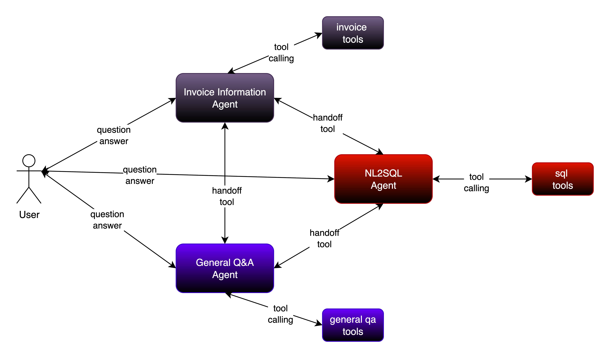

# Multi-Agent Swarm Architecture

> Trimmed from the README of the upstream project ([piyushagni5/langgraph-ai](https://github.com/piyushagni5/langgraph-ai), MIT) to what [`02_multi_agent_swarm.ipynb`](../notebooks/05b_multi_agent_swarm.ipynb) does in this repository. The upstream installation steps, its interactive `start_chat()` loop and its persisted vector store are not part of this repository.

A multi-agent system built with LangGraph that implements a swarm-style architecture: specialised agents hand off control to each other based on their area of expertise. The swarm remembers which agent was last active, so the next message in the same conversation goes straight back to that agent.

## Architecture

The swarm consists of three specialised agents, each built with `langchain.agents.create_agent` and given handoff tools (`langgraph_swarm.create_handoff_tool`) to the other two. `langgraph_swarm.create_swarm` wires them into one graph, and a checkpointer keeps the conversation and the active agent per thread.

### General QA Agent (RAG)
- Answers questions about the company (policies, services, locations) from the knowledge base in [`data/`](data)
- Is the default entry point of the swarm

### NL2SQL Agent
- Answers catalogue questions (albums, artists, tracks, genres) by writing SQL against the [Chinook](https://github.com/lerocha/chinook-database) sample database
- Runs that SQL on a connection that only reads (an SQLite authorizer refuses `ATTACH`, `PRAGMA` and writes), so a model-written query can neither change the data nor open other files

### Invoice Agent
- Looks up a customer's invoices, sorted by date or by unit price, and the support employee for an invoice
- Runs fixed queries with the customer ID as a bound parameter

## Example queries

Try these to see handoffs between the agents:

- **General QA (RAG):** "Tell me about the company's customer service policies"
- **Catalogue (NL2SQL):** "Do you have any albums by the Rolling Stones?"
- **Invoices:** "My customer id is 2. What was my most recent invoice?", then "Who was the employee that helped me with it?"

## Acknowledgements

- **[LangChain](https://github.com/langchain-ai/langchain)** and **[LangGraph](https://github.com/langchain-ai/langgraph)**: agents and stateful multi-actor graphs
- **[LangGraph Swarm](https://github.com/langchain-ai/langgraph-swarm-py)**: `create_handoff_tool` and `create_swarm`
- **[Chinook Database](https://github.com/lerocha/chinook-database)**: the sample database (source and licence in this repository's `docs/data-sources.md`)

## License

The upstream project is licensed under the MIT License. See the [upstream repository](https://github.com/piyushagni5/langgraph-ai) for its LICENSE file.
