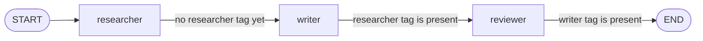
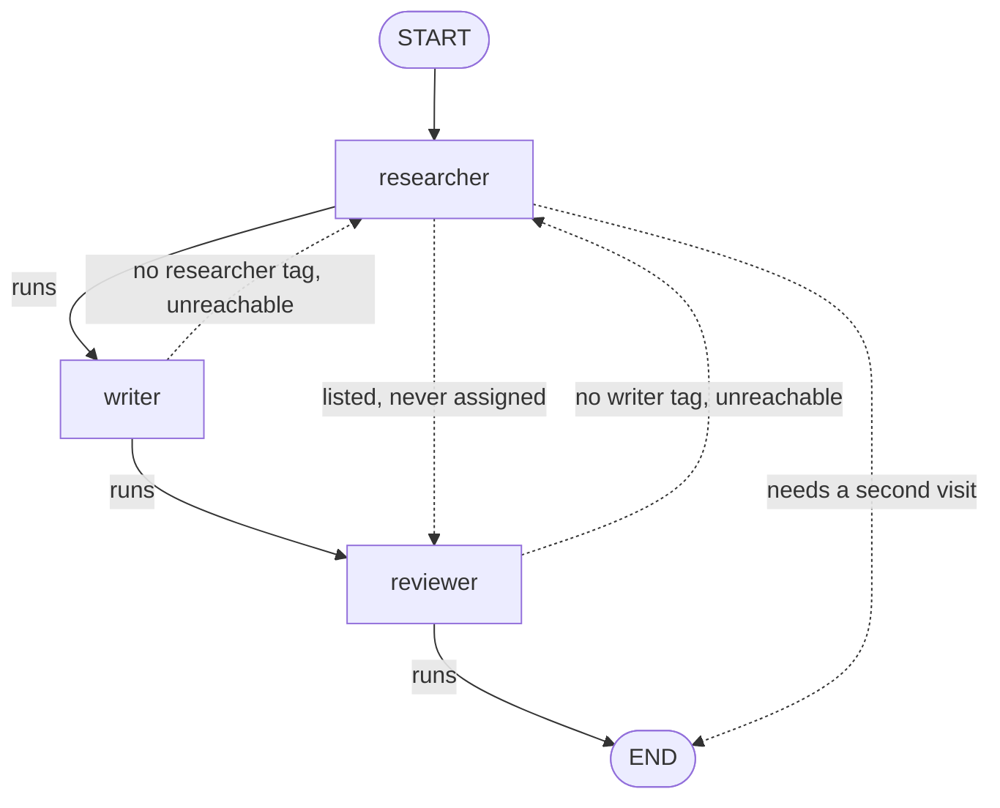
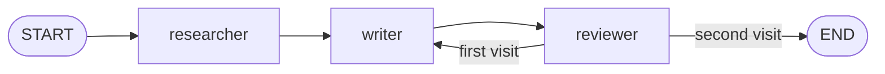

### How this network is wired

A network has no supervisor node. Each agent reads the shared messages, writes its own reply, and returns `Command(goto=...)` to name the next agent. `agent_reply` adds the role tag (`[RESEARCHER]`, `[WRITER]`, `[REVIEWER]`). The `if` matches that tag, so the route stays put when the model's prose changes.

`Literal[...]` is the edge list LangGraph draws in `show_graph()`. Every name in it must be a branch the function can take. A name that the body never assigns still appears as an edge.

The previous snippet looked like a mesh and ran as a straight line. The user message has no `[researcher]` tag, so the researcher went to the writer and then appended `[RESEARCHER]`. The writer saw that tag, went to the reviewer, and appended `[WRITER]`. The reviewer saw that tag and went to `END`. The `else` branches asked for a transcript that this order can never produce.

Solid arrows in the next diagram are that run. Dotted arrows were in the type, or in an else, and the graph never took them.

The cell below keeps a Literal target only when the run can take it. The researcher always hands off to the writer. The writer always hands off to the reviewer. The reviewer sends the draft back to the writer on the first visit, because no reviewer tag exists yet. On the second visit that tag is already in the transcript, so the reviewer goes to END.

