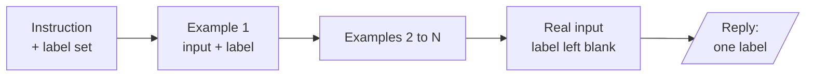
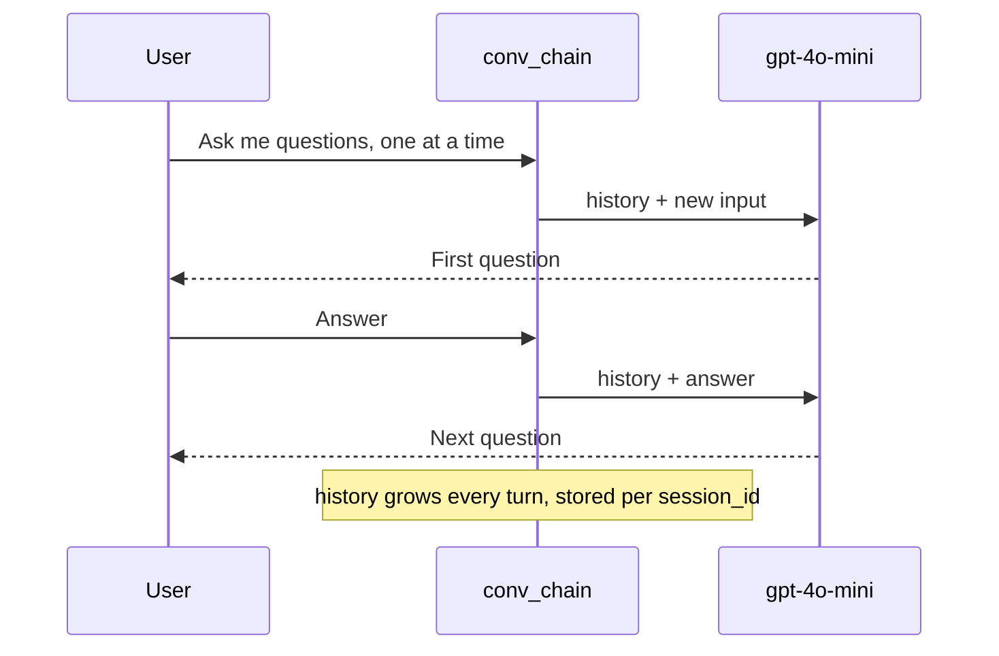
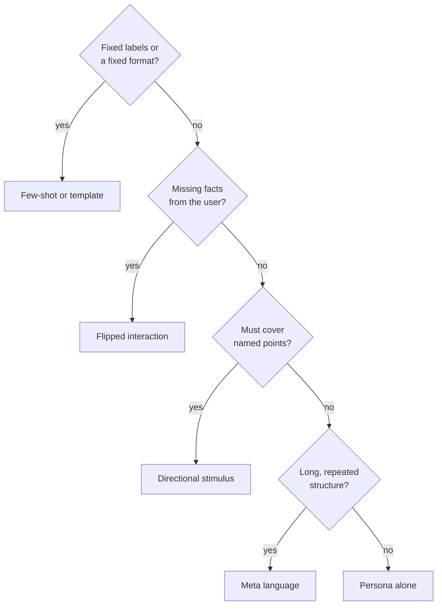

# M04.1 Theory: Core prompt patterns

*[M04 theory](../README.md) · Lesson 4.1 · Notebooks: [`01a_prompt_engineering_patterns.ipynb`](../../notebook/01a_prompt_engineering_patterns.ipynb) · [All theory pages](../../../../../THEORY.md)*
<!-- subtitle: How worked examples, personas, templates and other patterns constrain a model's reply, and what each one costs on every call -->

## A grader that never saw a hard case

> **What you'll learn**
>
> - **Explain** what few-shot examples teach a model that the instruction leaves open.
> - **Count** what those examples cost on every call, and how a RAG grader multiplies that cost.
> - **Diagnose** a few-shot prompt whose examples only cover easy boundaries.
> - **Choose** among persona, flipped interaction, directional stimulus, template and meta language for a given step.

M03 called hosted models and wrapped one in a demo. This module looks at the text we send them. Every LLM step in a RAG pipeline is a prompt: the query rewrite, the relevance grade, the route and the final answer. A **prompt pattern** is a reusable way to write one of those steps.

Take the Larkspur Cloud support assistant from M10. After retrieval, a grading prompt reads each retrieved chunk and answers yes or no: does this passage answer the question? A customer asks *How long does a refund take?* The grader sees the `billing` chunk, which talks about when plans are charged, and says yes. It sees the chunk that says refunds *take 5 to 10 business days to appear on your statement*, and says no, because the passage never uses the words "how long".

Both mistakes come from the same place. The grader's examples showed it one passage that answers and one on an unrelated topic, and nothing in between. This page explains what examples teach, what they cost, and the five other patterns notebook 01a uses to shape a reply.

## Few-shot

**An N-shot prompt puts N solved examples in front of the real input.** Zero-shot gives only the instruction, one-shot adds one example, and few-shot adds several. The model reads the examples as a pattern to continue, and its reply copies their labels, their format and their judgement.

The parts of a few-shot prompt sit in a fixed order:

*Figure 1: The anatomy of an N-shot prompt. The blank label after the real input is the slot the model fills.*

Notebook 01a runs all three forms on the same news classifier with `gpt-4o-mini` at temperature 0. We counted the prompt tokens of each with `tiktoken` in the `o200k_base` encoding that `gpt-4o-mini` uses:

| Prompt in 01a | Examples | Tokens sent |
|---|---|---|
| Zero-shot: four categories and one article | 0 | 31 |
| One-shot: one labelled headline, then the article | 1 | 55 |
| Few-shot: three labelled articles, then the article | 3 | 321 |

*Table 1: Prompt size of the three news classifiers (the notebook's prompts, counted in the scratchpad with no model call).*

### What the examples teach

The examples carry three things the instruction leaves open:

- **The label set and its spelling.** The zero-shot prompt lists `sports, business, entertainment, technology` in lower case; the one-shot and few-shot prompts list them capitalised and show capitalised answers. Code that compares the reply against a fixed string depends on that detail. We call a mismatch here **label drift**.
- **The output shape.** Each example ends `OUTPUT: Sports` or `Category: Sports`, and the model learns to reply with the bare label and stop.
- **Where the boundaries are.** A phone launch is Technology; a company's revenue mix is Business. Examples near a boundary teach more than examples in the middle of a class.

Examples can also leave gaps. The notebook's three cover Sports, Technology and Business, and Entertainment, the fourth label, has no example at all. That is a **missing-label gap**: the model knows the word from the instruction but has never seen what an Entertainment article looks like in this prompt.

### What the examples cost

Examples are sent on every call. The few-shot classifier sends ten times the tokens of the zero-shot one for the same single label. In a RAG grader the cost multiplies again, because the grader runs once per retrieved chunk:

| Quantity | Value | Source |
|---|---|---|
| Extra tokens per call, few-shot over zero-shot | 321 minus 31 = 290 | Table 1 |
| Chunks graded per question | 4 | M10 TF-IDF baseline, k = 4 |
| Extra tokens per question | 4 × 290 = 1,160 | arithmetic |
| Extra tokens per 1,000 questions | 1,160,000 | arithmetic |

*Table 2: What three examples of the classifier's size would add to a per-chunk grader (illustrative volume of 1,000 questions).*

### Planted failure: the easy-boundary grader

Now back to Larkspur. Here are the two examples the failing grader had, and the two it needed. All four passages are real chunks of the [Larkspur handbook](../../../../../p04_rag_foundations/m10_rag_lifecycle/mandatory/theory/README.md):

| # | Question | Passage | Label | What it teaches |
|---|---|---|---|---|
| 1 | Can I export my data after I cancel my plan? | *After a plan is cancelled, its data is kept for 30 days and then permanently deleted. Export it before that window closes.* | yes | what an answer looks like |
| 2 | Can I export my data after I cancel my plan? | *You can reboot a server from the console…* | no | an unrelated topic is not an answer |
| 3 | How long does a refund take? | *Monthly plans are billed at the start of each billing cycle…* | no | a nearby topic is still not an answer |
| 4 | How long does a refund take? | *Refunds go back to the original payment method and take 5 to 10 business days to appear on your statement.* | yes | an answer can use other words |

*Table 3: Grading examples. Rows 1 and 2 are the failing prompt; rows 3 and 4 are the cases it was missing.*

Rows 1 and 2 only teach an easy boundary, because the "no" passage shares no topic with the question. We call this the **easy-boundary grader**. It passes topical near misses and rejects paraphrased answers, the two mistakes from the opening. Adding rows 3 and 4 puts examples on the real boundary and keeps yes and no balanced at two each.

> **Pitfall: tuning to one question.** A fix that makes the refund question pass can break another. Measure the grader against your own labelled pairs before and after each change, which is the M04 [lab brief](../../../lab/README.md): three grading prompts, 30 labelled pairs, agreement for each.

Few-shot fixes the label set and the boundary. The next five patterns shape other parts of the reply.

## Five more patterns

Notebook 01a covers five more patterns, each a different way to constrain the reply:

- **Persona**: a role line sets the vocabulary, the audience and what counts as important. The notebook opens with *Act as a marketing manager* before a phone fact sheet. For Larkspur, *Act as a Larkspur support agent who answers only from the handbook* sets both the tone and the boundary.
- **Flipped interaction**: the model asks the questions. The notebook asks it to *ask me one question at a time* until it has enough to write a data science project plan, then answers seven of its questions. For Larkspur, a server-sizing assistant can ask about peak memory use before it recommends a plan.
- **Directional stimulus**: a hint steers the output without writing it. The notebook asks for a five-line summary of an article on generative AI with *Hint: Generative AI history, data modalities, tools, applications, concerns*. The hint list doubles as a checklist for grading the summary.
- **Template**: the prompt fixes the output fields. The notebook asks for learning activities as `ACTIVITY, TOPIC, RESOURCE, DIFFICULTY SCALE 1-5, NOTES`, returned as JSON. Downstream code can parse the reply only if the model keeps the template; validate it before use.
- **Meta language**: the prompt defines a notation and then uses it. In the notebook, `Business_Understanding,3 -> Data_Understanding,5 -> …` means a step and its days, and the model expands each step into a day-by-day plan. A notation keeps a long instruction short, as long as the prompt explains it once.

### The one pattern with state

The flipped interaction is the only pattern here that remembers. The notebook wraps the chain in `RunnableWithMessageHistory`, which keeps one message history per session id and sends the whole history back to the model on every turn:

*Figure 2: A flipped interaction. Each call carries every earlier question and answer.*

That growth is a cost. The first call sends one message; the eighth sends seven earlier exchanges plus the new answer. We call this **history creep**: the prompt, and the bill, grow with every turn whether or not the old turns still matter.

The history also lives under one key. The notebook runs its whole conversation under the session id `unused`, and the history for that id is the only place the messages can be read back. A cell that reads a different history object finds it empty.

## Choosing a pattern

Each pattern answers a different question about the reply. Ask them in this order:

*Figure 3: Pick the pattern that constrains the part of the reply you need to control. Persona combines with any of them.*

The patterns differ in what they fix and what they cost:

| Pattern | What it fixes | Extra cost | Main risk |
|---|---|---|---|
| Few-shot | labels, format, boundaries | examples on every call | easy-boundary grader |
| Persona | tone, audience, scope | one line | a role the model over-plays |
| Flipped interaction | which facts get collected | history on every turn | history creep |
| Directional stimulus | which points get covered | a hint line | hints read as the whole answer |
| Template | output fields | a field list | a reply that breaks the template |
| Meta language | a long structure, compactly | one definition | a notation never explained |

*Table 4: The six patterns of notebook 01a.*

## In practice: the refund grader

The Larkspur grader from the opening, rebuilt with these patterns:

1. **Persona and scope.** One line: the grader judges only whether the passage answers the question, not whether the answer is good.
2. **Template.** The reply is exactly `yes` or `no`. Anything else counts as a parse failure, and a parse failure counts as `no`, which keeps a hedged reply from being read as approval.
3. **Few-shot.** The four examples of Table 3, two yes and two no, two of them on the boundary.
4. **Measure.** Run it on 30 labelled pairs and compare its agreement with a zero-shot version. Keep the examples only if the agreement they buy is worth the tokens they add to every chunk.

> **What changes next:** lesson 4.2 asks the model to reason before it answers, and shows when sampling several answers and voting helps a grader like this one, and when it hurts.

## Key Takeaways

- Few-shot examples teach the label set, the output shape and the class boundaries. They are paid for on every call: the classifier's three examples cost ten times the zero-shot tokens, and a per-chunk grader multiplies that by k.
- Put examples on the real boundary (a nearby topic that does not answer, an answer in other words), keep labels balanced, cover every label, and measure the prompt against your own labelled pairs.
- Persona, flipped interaction, directional stimulus, template and meta language each constrain a different part of the reply. Validate templated output before code uses it, and expect a stateful conversation to cost more each turn.

## Check yourself

1. What do the few-shot examples teach the news classifier that its instruction leaves open, and what do they cost?

They teach the label set and its spelling, the output shape (the bare label, then stop) and where the boundaries between classes are. They cost tokens on every call: 321 for the few-shot prompt against 31 for the zero-shot one. A RAG grader runs once per retrieved chunk, which multiplies that cost by k.

2. The Larkspur grading prompt has one yes example and one no example on an unrelated topic. Which two examples should you add?

A nearby passage that does not answer, labelled no: the billing chunk for *How long does a refund take?*. And a passage that answers in other words, labelled yes: the one saying refunds take 5 to 10 business days to appear on your statement. The current no example only teaches an easy boundary; the two new ones sit on the real boundary and keep yes and no balanced.

3. A flipped-interaction assistant gets more expensive with every question it asks. Why?

It is the only one of these patterns with state. Each turn sends the whole conversation history for its session id back to the model, and the prompt grows with every question and answer. That is history creep: the cost rises whether or not the old turns still matter.

---
*Previous: [M04 overview](../README.md). Next: [4.2 Reasoning prompts: chain-of-thought, self-consistency, least-to-most, ReAct](../02_reasoning_prompts_chain_of_thought_self_consistency_least_to_most_react/README.md).*
