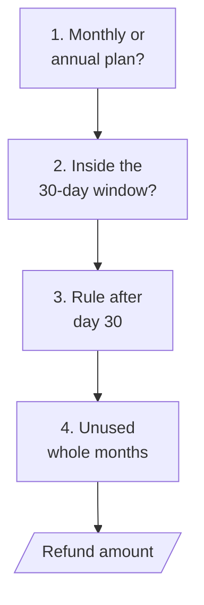
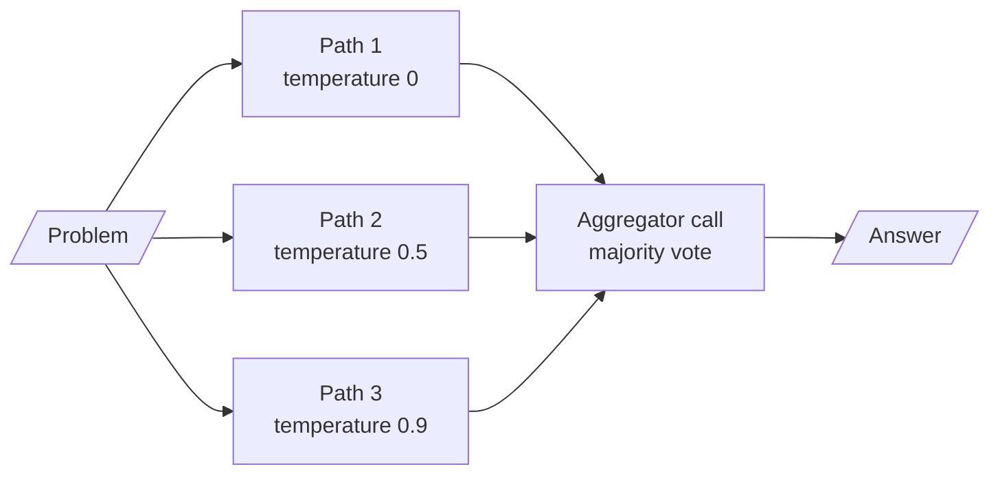
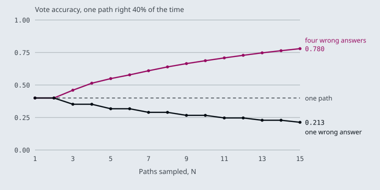
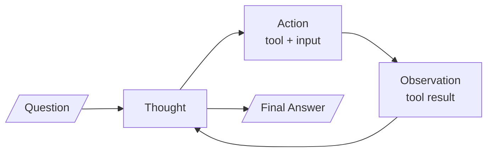
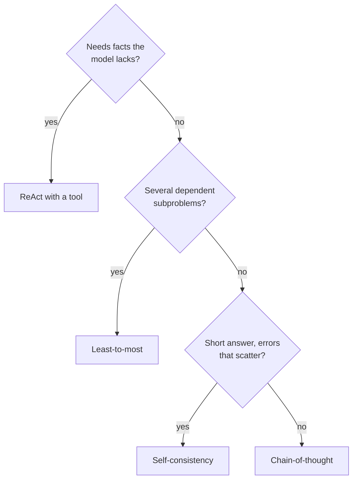

# M04.2 Theory: Reasoning prompts: chain-of-thought, self-consistency, least-to-most, ReAct

*[M04 theory](../README.md) · Lesson 4.2 · Notebooks: [`02a_advanced_prompt_engineering_patterns.ipynb`](../../notebook/02a_advanced_prompt_engineering_patterns.ipynb) · [All theory pages](../../../../../THEORY.md)*
<!-- subtitle: When to ask a model for its steps, when sampling several answers and voting helps or hurts, and when reasoning needs a tool -->

## A question that needs steps

> **What you'll learn**
>
> - **Explain** how chain-of-thought and least-to-most prompts change what comes before the answer.
> - **Diagnose** a few-shot reasoning prompt whose worked examples contain a wrong step.
> - **Predict** when a self-consistency vote raises accuracy and when it locks in a wrong answer.
> - **Describe** the ReAct loop of thought, tool call and observation, and what actually stops it.

Lesson 4.1 shaped the reply with examples, personas and templates, each asking for an answer straight away. Some questions need intermediate steps first, and some need facts the model does not have.

A Larkspur customer asks *Can I get a refund after 45 days?* An assistant that answers in one breath tends to grab the nearest rule it remembers, the 30-day full refund, and reply "No". The handbook has more to say. Monthly plans are never refundable. An annual plan gets a full refund within 30 days, and after day 30 it gets the unused whole months back, minus a 15% early-termination fee. The right answer depends on the plan and on the start date, and the start date is not in the handbook at all.

## Chain-of-thought

**A chain-of-thought (CoT) prompt asks the model to write its reasoning before the answer.** The answer is then conditioned on the steps, and the steps are on the page for you to check.

Notebook 02a uses one test question for every variant: from a game summary, *How many yards was the shortest valid field goal?* The summary has a 35-yard field goal and a 31-yard one that was blocked. The right answer is 35; a model that skips the word "blocked" says 31.

The notebook asks for the reasoning in three ways:

| Variant | What the prompt adds |
|---|---|
| Zero-shot CoT | one instruction: *Think step-by-step to get to your answer. Show your step-by-step reasoning and then the answer.* |
| Few-shot CoT | worked examples with numbered steps (*Step 1: Roger started with 5 balls.*) for the model to copy |
| Least-to-most | an instruction to *break down the problem first into sub problems, answer each sub problem sequentially*, plus one worked example |

*Table 1: The three ways notebook 02a asks for reasoning.*

### Planted failure: the copied mistake

In few-shot CoT the model copies the reasoning of the examples as well as their format, so every step of every example has to be right. Two examples in notebook 02a are not:

| Example | Step as written | What is wrong |
|---|---|---|
| Keystrokes to type 1 to 500 | *9 + 90 + 401 = 1392 keystrokes* | those three numbers add up to 500, the count of numbers; the keystrokes are 9 × 1 + 90 × 2 + 401 × 3 = 1,392 |
| Longest field goal (least-to-most) | *28-yard, 57-yard and 59-yard which are all valid goals* | its own text says the 28-yard kick was blocked; the answer, 59, survives only because the blocked kick was not the longest |

*Table 2: Wrong steps inside the notebook's worked examples (checked by hand against each example's own text).*

The field goal example teaches the exact mistake the test question checks for: counting a blocked kick as valid. We call this the **copied mistake**, and the only guard is to check each worked step, not only each final answer.

### Least-to-most on the refund question

Least-to-most fits Larkspur questions that combine rules. *Can I get a refund after 45 days?* breaks into four subproblems, each answered in order:

*Figure 1: The refund question as a chain of subproblems. Each answer feeds the next.*

Each subproblem has its own source:

| # | Subproblem | Answer | Source |
|---|---|---|---|
| 1 | Which plan? | monthly plans are not refundable; annual plans continue | handbook, plus the customer's account |
| 2 | Is day 45 inside the 30-day full-refund window? | no | handbook |
| 3 | Which rule applies after day 30? | prorated to the unused whole months, minus a 15% early-termination fee | handbook |
| 4 | How many whole months are unused? | depends on the purchase date | billing system |

*Table 3: Least-to-most decomposition of the refund question.*

Subproblems 1 and 4 cannot be solved by reasoning alone. They need a lookup, and a reasoning prompt has no way to make one. ReAct, at the end of this page, adds that.

## Self-consistency

**Self-consistency samples several chain-of-thought paths for the same question and keeps the answer most of them reach** (Wang et al., 2022). One path can slip; if the slips land on different answers, the right answer still collects the most votes.

Notebook 02a builds it from three CoT chains run in parallel, all `gpt-4o-mini`, at temperatures 0, 0.5 and 0.9. A fourth call at temperature 0 reads the three paths and is told to *aggregate, take the majority vote as needed*:

*Figure 2: Self-consistency in notebook 02a: three sampled paths and an LLM that merges them.*

That is four calls where plain CoT makes one. The aggregator is itself a model call, and it can be talked round by a confident wrong path. For short answers that compare as strings or numbers, counting the votes in code does the same job with one call fewer.

### When the vote helps

Whether the extra calls pay depends on how the wrong answers are spread. The [interactive lab](interactive/self-consistency-vote-lab.html) computes this exactly. It treats each path as an independent draw that is right with probability `p` and otherwise gives one of `W` equally likely wrong answers, then counts how often the most common answer is the right one, with ties split at random:

| One path right | Wrong answers | N = 1 | N = 3 | N = 5 | N = 15 |
|---|---|---|---|---|---|
| 0.60 | 1 (yes/no) | 0.600 | 0.648 | 0.683 | 0.787 |
| 0.40 | 1 (yes/no) | 0.400 | 0.352 | 0.317 | 0.213 |
| 0.40 | 4 | 0.400 | 0.460 | 0.549 | 0.780 |
| 0.60 | 4 | 0.600 | 0.720 | 0.835 | 0.987 |

*Table 4: Vote accuracy from the lab (values the lab prints at these settings, checked against a Python port of its formula).*

The curves for a path that is right 40% of the time:

*Figure 3: One accuracy, two outcomes. Scattered errors lift the vote; a single shared error sinks it.*

<!-- lab: interactive/self-consistency-vote-lab.html -->

Three rules follow from the table:

- **A vote amplifies whatever answer is most common.** If one path is right more often than any single wrong answer, more paths help. If not, the vote makes the wrong answer look certain. We call this the **confident wrong vote**: a yes/no grader that is right 40% of the time drops to 0.213 with 15 votes.
- **Scattered errors are where voting pays.** With four distinct wrong answers, a path that is right only 40% of the time still wins the vote 78% of the time at N = 15, because no single wrong answer gathers enough votes. A computed figure such as a prorated refund behaves like this; a yes/no grade never does.
- **On two labels, use an odd N.** An even N can split evenly, and a split is a coin flip. N = 4 scores exactly what N = 3 scores (0.648 at `p` = 0.60) for one more call.

The lab's independence assumption is the best case. Paths from one model share its blind spots and agree on the same wrong answer more often than independent draws, which shrinks the gain; a path at temperature 0 repeats the most likely path rather than sampling a new one. For a measured case where the wrong answers clustered on one value, see [M25's self-consistency page](../../../../../p07_advanced_agents/m25_planning_reflection_reasoning/mandatory/theory/06_self_consistency_tree_of_thoughts_and_lats/README.md#tree-of-thoughts--lats).

## ReAct format

**ReAct prompts the model to alternate reasoning with actions** (Yao et al., 2022): a Thought, an Action with its input, the Observation the action returns, and another Thought, until it can write a Final Answer.

Notebook 02a puts that format in its system prompt, one labelled line per part:

| Line | What the prompt asks for |
|---|---|
| Thought | what to do next |
| Action | the action to take: break the task down, use trained knowledge, or call the tool `search_web` |
| Action Input | the input to the action |
| Observation | the result of the action |
| (repeat) | Thought, Action, Action Input and Observation can repeat N times |
| Final Answer | the answer to the original question, after *I now know the final answer* |

*Table 5: The ReAct format as notebook 02a's system prompt states it.*

The loop those lines describe:

<!-- animated: diagrams/react-loop.anim.html -->

*Figure 4: The ReAct loop. Each Observation goes back into the next Thought until the model answers.*

### What the framework actually runs

The notebook's tool, `search_web`, takes the top five DuckDuckGo results, fetches each page and returns its text. The agent is `gpt-4o` built with `create_tool_calling_agent` and run by `AgentExecutor`. That combination changes what the format means:

- **The Action is a tool call, not text.** The model is given the tool's schema and returns a structured tool call with the tool name and arguments. The agent runs it and feeds the result back as a tool message. Nothing parses an `Action:` line, and the `PAUSE` the system prompt mentions has no effect.
- **The Thought lines are guidance.** They ask the model to plan and to check the Observation before answering. The model may write them, or may call the tool straight away.
- **The loop needs a stop.** `AgentExecutor` ends the run when the model replies without a tool call, or after `max_iterations` (15 by default).

Each of those rules shows up as a failure you can plant:

| Planted case | What the agent returns | Why |
|---|---|---|
| Reply text says `Action: search_web` but carries no tool call | that text, as the final answer | a reply with no tool call ends the run |
| The search keeps returning the same pages and the model keeps searching | *Agent stopped due to iteration limit or time limit.* after 15 rounds | the default stop forces an end |
| One result page never responds | the tool hangs | the fetch has no timeout |

*Table 6: Planted ReAct failures and the rule behind each (behaviour read from the installed agent code and the notebook's tool; no model call).*

We call the second case the **runaway loop**. It usually means the evidence is not where the agent is looking, and the right end is an "I don't know", not a sixteenth search.

The notebook first asks about LangGraph with no tool, and its own comment expects the model to decline or make up an answer; the agent then answers from the pages `search_web` fetched.

For Larkspur the tool is a handbook search. *Can I export my data after I cancel my plan?* takes one round: the search returns the `export` and `retention` chunks, and the answer is to export from Settings, then Data, within 30 days of cancelling. The refund question takes two tools, the handbook for the rules and the customer's billing record for the plan and purchase date. [M22](../../../../../p06_agent_foundations/m22_agent_loop_and_tools/mandatory/theory/README.md) and [M23](../../../../../p06_agent_foundations/m23_react_agents/mandatory/theory/README.md) build this loop in LangGraph.

## Choosing a reasoning prompt

The cheapest prompt that covers the question wins:

*Figure 5: Pick a reasoning prompt by what the question needs.*

| Prompt | Calls per question | Fixes | Main risk |
|---|---|---|---|
| Chain-of-thought | 1 | skipped steps | copied mistake in examples |
| Least-to-most | 1 | rules applied out of order | a subproblem that needs data |
| Self-consistency | N + 1 with an LLM aggregator, N with a code vote | slips that land on different answers | confident wrong vote |
| ReAct | one per round, up to the iteration limit | missing facts | runaway loop |

*Table 7: The four reasoning prompts compared.*

## References

1. Wang, X. et al. (2022). [Self-Consistency Improves Chain of Thought Reasoning in Language Models](https://arxiv.org/abs/2203.11171). arXiv:2203.11171.
2. Yao, S. et al. (2022). [ReAct: Synergizing Reasoning and Acting in Language Models](https://arxiv.org/abs/2210.03629). arXiv:2210.03629.

## Key Takeaways

- Chain-of-thought puts the reasoning on the page before the answer. In few-shot form the model copies the examples' reasoning, so check every step of every example, not only the final answers.
- Self-consistency votes over several paths and amplifies the most common answer. It pays when errors scatter, as computed figures do, and makes a weak yes/no grader worse.
- In a tool-calling agent the action is a structured tool call, a reply with none ends the run, and an iteration limit stops a runaway loop. Use ReAct when a subproblem needs a lookup that reasoning alone cannot supply.

## Check yourself

1. Why does the least-to-most example in notebook 02a make the field goal test harder to pass?

In few-shot chain-of-thought the model copies the reasoning of the examples, not only their format. That example lists a 28-yard kick as valid although its own text says it was blocked; its answer survives only because that kick was not the longest. It teaches the exact mistake the test checks for: counting the blocked 31-yard kick and answering 31 instead of 35.

2. A yes/no grader path is right 40% of the time. What does a 15-path majority vote score, and how would four distinct wrong answers change that?

0.213, worse than a single path's 0.400: the one wrong answer is more common than the right one, and the vote amplifies it. With four equally likely wrong answers the same 40% path wins the vote 78% of the time (0.780), because no single wrong answer gathers enough votes. These figures assume independent paths, the best case; paths from one model share blind spots and gain less.

3. A ReAct agent built with create_tool_calling_agent replies with text that says Action: search_web, but no search runs. Why?

The action is a structured tool call, not text, and nothing parses an `Action:` line. `AgentExecutor` takes a reply with no tool call as the final answer, even if its text says `Action:`, and ends the run there.

---
*Previous: [4.1 Core prompt patterns](../01_core_prompt_patterns/README.md). Next: [4.3 The same tasks across models](../03_the_same_tasks_across_models/README.md).*
