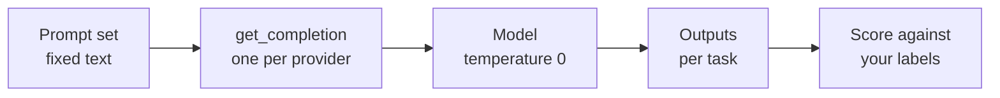
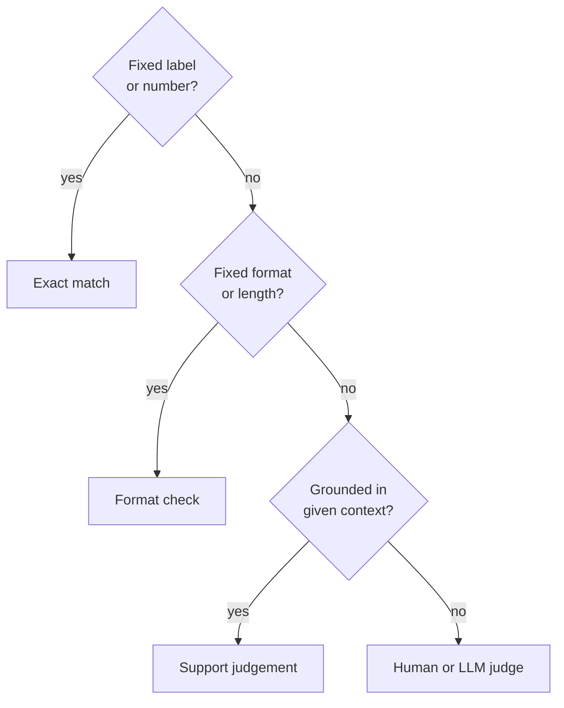

# M04.3 Theory: The same tasks across models

*[M04 theory](../README.md) · Lesson 4.3 · Notebooks: [`03a_openai_gpt_4o_mini.ipynb`](../../notebook/03a_openai_gpt_4o_mini.ipynb), [`03b_google_gemini_1_5_flash.ipynb`](../../../optional/notebook/03b_google_gemini_1_5_flash.ipynb) (optional), [`03c_meta_llama_3_2_90b_groq.ipynb`](../../../optional/notebook/03c_meta_llama_3_2_90b_groq.ipynb) (optional), [`03d_meta_llama_3_2_1b_huggingface.ipynb`](../../../optional/notebook/03d_meta_llama_3_2_1b_huggingface.ipynb) (optional) · [All theory pages](../../../../../THEORY.md)*
<!-- subtitle: How to compare models fairly by holding the prompt set fixed, swapping one wrapper, and scoring every task against your own answers -->

## A model swap with no test set

> **What you'll learn**
>
> - **Explain** why a fixed prompt set and one swappable wrapper make a fair model comparison.
> - **Choose** a check for each kind of task, from exact match to a support judgement.
> - **Diagnose** a comparison that rests on reading replies by eye or on a tiny, leaky test set.
> - **Adapt** a closed-domain question-answering prompt into the answer step of a RAG pipeline.

Lessons 4.1 and 4.2 built prompts for one model. A prompt is written against a model, though, and models change: a cheaper one appears, a provider retires an id, a team wants an open model it can host.

Suppose the Larkspur team moves its support assistant from `gpt-4o-mini` to a cheaper model. Someone sends five handbook questions to the new model, reads the replies, finds them fluent and ships the change. A week later the answer step is filling gaps in the handbook with general knowledge (illustrative). No check measured whether each answer stayed inside the retrieved passages.

The four notebooks of this lesson show the setup that catches it: one fixed prompt set, one wrapper per provider, and a score per task.

## One prompt set across four APIs

The four notebooks run the same ten tasks: zero-shot and few-shot classification, Python and SQL generation, information extraction from a clinical note, closed-domain and open-domain question answering, summarisation, turning a fact sheet into an FAQ, and translation.

Each notebook defines one function, `get_completion(prompt, model)`, and every task calls it. Only that function changes between notebooks:

| Notebook | Model | Client the notebook installs |
|---|---|---|
| 03a | `gpt-4o-mini` | `openai==1.55.3`, Chat Completions |
| 03b | `gemini-1.5-flash` | `google-generativeai==0.8.3`, `generate_content` |
| 03c | `llama-3.2-90b-vision-preview` | `groq==0.13.0`, Chat Completions |
| 03d | `meta-llama/Llama-3.2-1B-Instruct` | `huggingface_hub` `InferenceClient` |

*Table 1: The wrapper is the only part that changes.*

All four set temperature 0, and 03d caps replies at 2,048 tokens. 03d's first test call goes to a different model, `microsoft/Phi-3.5-mini-instruct`; its ten tasks all use the Llama default. The prompt text is identical in 03a, 03c and 03d. 03b adds one prompt, a second LangGraph question ending *If you are not able to find the answer in your trained knowledge just say you don't know*, and for that task its run answers a different prompt.

The structure in one picture:

*Figure 1: The prompt set is the fixed part and the wrapper is the swap point. The last box is the one the notebooks leave to you.*

Three practices make the comparison worth trusting.

### Score, do not eyeball

The notebooks print each reply. A comparison needs a check per task, decided before the run. Several tasks carry their own answer key in the prompt or its context:

| Task | Check | Expected |
|---|---|---|
| 1. Zero-shot sentiment | exact match on one of three labels | speaker review Positive, blender review Negative |
| 5. Clinical note | match against a labelled symptom list | sore throat and tongue swelling present; chest pain, itching, nausea absent |
| 6. Closed QA, mortgage | number match | 12% (£668.51 to £748.94) |
| 6. Closed QA, salary | exact match, number only | 54 |
| 8. Summary | starts with *Summary*, at most 5 lines | format check |
| 9. FAQ | at most 8 question and answer pairs | count check |
| 10. Translation | German and Spanish both present | presence check, then a reader |

*Table 2: A check per task. Expected answers come from the notebooks' own inputs, checked by hand.*

Different outputs call for different checks. Ask in this order:

*Figure 2: The cheapest check that can fail a wrong reply.*

### Planted failure: the leaky two-review test

The sentiment tasks show how a test set can mislead. Task 1 asks for Positive, Negative or Neutral. Task 2, the few-shot version, switches the labels to 😊 and 😡 and gives no Neutral example. Its two examples open with the same words as the two reviews under test (*Just received the…* and *Needed a new…*), and the test set is two reviews long:

| Problem | Effect on the comparison |
|---|---|
| Labels change between tasks | an exact-match scorer needs a mapping, or both tasks score zero |
| Examples echo the test inputs | the model can match on wording rather than sentiment |
| Two test items | each model scores 0%, 50% or 100%; no difference between models is readable |

*Table 3: Three ways the sentiment tasks would mislead a scorer.*

We call this the **leaky test**: the examples share text with the inputs, and the inputs are too few to separate models. A model comparison needs its own labelled cases, kept apart from any examples in the prompt. That is the M04 [lab brief](../../../lab/README.md) on a small scale: 30 labelled pairs, agreement per prompt.

### Keep the model id in one place

Provider ids are retired. Groq shut down `llama-3.2-90b-vision-preview` on 14 April 2025 and names `meta-llama/llama-4-scout-17b-16e-instruct` as the replacement ([Groq deprecations](https://console.groq.com/docs/deprecations), checked 9 November 2026). Notebook 03c and the Llama half of notebook 04a call that id and fail until it is changed. We call this **id rot**. With the id inside `get_completion`, the fix is one line.

Access can also change. The 1B model in 03d is gated: the notebook asks you to request access from Meta on Hugging Face before the first call works.

### Read the prompt as each model will

Task 6, closed-domain QA, gives a survey report as context and asks the model to answer *to the best of your ability*. That wording invites the model's own knowledge. In a RAG pipeline the same prompt needs an instruction to answer only from the context, and to say so when the context does not contain the answer. That is the line 03b adds to its extra prompt.

## In practice: the answer step

The closed-domain prompt becomes the answer step of the Larkspur pipeline. It has four parts:

| Part | Content |
|---|---|
| Instruction | answer the customer's question using only the handbook passages below |
| Refusal line | if the passages do not contain the answer, reply *The handbook does not cover this.* |
| Passages | the retrieved chunks, inside delimiters |
| Question | the customer's question, then an empty *Answer:* slot |

*Table 4: The Larkspur answer prompt, adapted from task 6.*

To compare candidate models on it:

1. Freeze this prompt and the golden questions with their retrieved passages.
2. Run every candidate through the same wrapper at temperature 0.
3. Score each answer for support: every claim must appear in the passages. Fluency earns nothing.
4. Include the five golden questions the handbook cannot answer. For those, the refusal line is the only correct reply.

Take *What happens if my server goes down?* with only the reboot passage retrieved. A model that adds status-page advice or service credits from general knowledge fails step 3, however good the advice sounds. The answer either sticks to the reboot instructions or uses the refusal line.

> **Interview tip:** when asked how to choose between models, describe the frozen prompt set and the per-task checks before naming any model.

## Key Takeaways

- Keep the prompt set fixed and swap models behind one wrapper, so the model id lives in one place and a retired id is a one-line fix.
- Score each task with its own check (exact match, format and length, support by the context), on enough labelled cases kept apart from the prompt's examples.
- For a RAG answer step, tell the model to answer only from the passages and to say when they do not cover the question. Score answers for support by the passages, not fluency.

## Check yourself

1. Why is printing each model's reply not enough to compare the four models on the ten tasks?

Reading replies by eye gives an impression, not a comparison. Each task needs its own check: exact match for the sentiment label, a number match for the mortgage question, a line count for the five-line summary, a labelled list of symptoms for the clinical note. The checks also need enough cases; the sentiment tasks have two reviews, so a model can only score 0%, 50% or 100%.

2. The Larkspur answer prompt gets only the reboot passage for What happens if my server goes down? A model answers fluently from general knowledge. Does it pass?

No. The prompt tells the model to answer only from the handbook passages and to reply *The handbook does not cover this.* when they do not contain the answer. Each answer is scored for whether the passages support every claim, however fluent it is.

3. Notebook 03c now fails on its first call although nobody changed its code. What is the likely cause, and what practice keeps the fix small?

The model id was retired: Groq shut down `llama-3.2-90b-vision-preview` on 14 April 2025 and names `meta-llama/llama-4-scout-17b-16e-instruct` as the replacement. Keep the model id in one place, inside the `get_completion` wrapper, and the fix is a one-line change.

---
*Previous: [4.2 Reasoning prompts: chain-of-thought, self-consistency, least-to-most, ReAct](../02_reasoning_prompts_chain_of_thought_self_consistency_least_to_most_react/README.md). Next: [4.4 Applied prompting on business tasks](../04_applied_prompting_on_business_tasks/README.md).*
