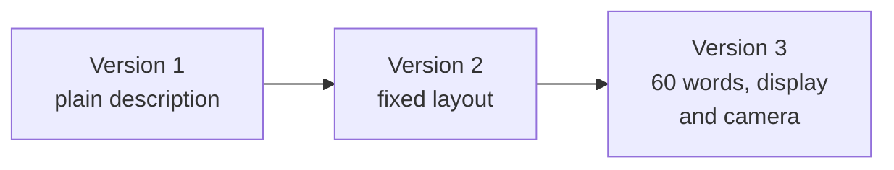
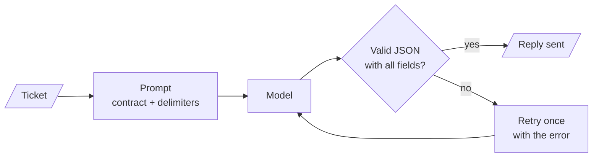

# M04.4 Theory: Applied prompting on business tasks

*[M04 theory](../README.md) · Lesson 4.4 · Notebooks: [`04a_gpt_4o_and_llama_3_2_real_world_tasks.ipynb`](../../notebook/04a_gpt_4o_and_llama_3_2_real_world_tasks.ipynb) · [All theory pages](../../../../../THEORY.md)*
<!-- subtitle: How the patterns combine into production prompts with delimiters, staged refinement and an output contract that code validates -->

## A ticket reply nobody parsed

> **What you'll learn**
>
> - **Combine** several instructions, including conditional ones, into one prompt whose outputs agree.
> - **Explain** what delimiters do for a prompt, and what they cannot guarantee.
> - **Refine** a prompt in stages: structure first, then length and focus.
> - **Design** an output contract that code parses, validates and routes, with a fallback to a person.

Lessons 4.1 to 4.3 built single patterns and compared models on them. A production prompt usually combines several patterns and feeds its reply to code, not to a reader.

Picture the Larkspur support inbox. A ticket in Portuguese says a server stopped responding. A prompt detects the language, picks a category, translates the ticket and drafts a reply. The model returns a reply with one field misspelt and the category written as a sentence. The code that routes tickets reads the category, finds no match and drops the ticket into a default queue, where it waits a day (illustrative). Nothing was wrong with the patterns. Nothing checked the reply.

Notebook 04a works through five business tasks with the patterns from lessons 4.1 and 4.2. This page follows the techniques each task adds, then the contract and validation the notebook leaves out.

## From a pattern to a production prompt

Notebook 04a sends each task to `gpt-4o` and to Llama 3.2 90B on Groq, both at temperature 0. Each task adds one technique that a production prompt needs:

| Task in 04a | Technique it adds | Patterns it combines |
|---|---|---|
| Review analysis and response | several instructions in one pass | persona, template |
| Paper analysis | one source, several audiences | persona, directional stimulus |
| Smartphone adverts | refinement in steps | persona, template |
| IT support tickets | an output contract | persona, template |
| Synthetic data | generated examples | persona, template |

*Table 1: The five tasks and what each adds.*

### Several instructions, one pass

The review prompt asks for a summary of at most 3 lines, the positives and negatives, the overall sentiment, 3 to 5 emotions, and a reply email. The email instruction is conditional: thank the customer if the sentiment is positive or neutral, apologise if it is negative. One call returns every field, and the fields agree with each other because the model wrote them together. A separate call for the email could thank a customer the sentiment call marked as negative.

### Delimiters around the input

The tasks with an input wrap it in delimiters, triple backticks in most and triple quotes for the IT tickets. A **delimiter** marks where the text to work on starts and ends, and the model can tell the instruction from the review or ticket it applies to. Delimiters make an instruction hidden in a review easier to ignore; they do not guarantee it.

The IT ticket prompt also shows a small mismatch: its instruction says the message is *in triple backticks*, while the message sits inside triple quotes. A prompt should name the delimiter it uses.

### One source, several audiences

The same paper abstract on ethics in generative AI for healthcare goes through three prompts. Each keeps the persona, *Act as a Artificial Intelligence Expert*, and changes only the target line:

| Version | Target line |
|---|---|
| 1 | a short concise summary of at most 10 lines |
| 2 | an executive summary for a healthcare company, with bullet points for the pros and cons of ethics in generative AI |
| 3 | an executive summary for a generative AI company solving healthcare problems, with key points for text, image and structured data |

*Table 2: One abstract, three readers. The persona is constant.*

Version 3 is a directional stimulus from lesson 4.1: the three data types tell the model how to organise the summary.

### Refinement in steps

The phone advert goes through three versions, each fixing one thing:

*Figure 1: Refine structure first, then length and focus.*

Version 2 fixes the layout: a product name, a description, and a two-column `Feature` and `Specification` table with exact numbers where they exist, focused on the foldable display, processing power, RAM, camera and battery. Version 3 fixes the length and focus: at most 60 words on the display and camera. Changing one thing per version makes it clear which instruction caused which change in the reply.

### An output contract

The IT support prompt asks for JSON with six fields:

| Field | What it holds |
|---|---|
| `orig_msg` | the customer's original message |
| `orig_lang` | the detected language, e.g. Spanish |
| `category` | one or two words for the problem |
| `trans_msg` | the message in English |
| `response` | the reply, in the customer's language |
| `trans_response` | the reply, in English |

*Table 3: The IT support output contract in notebook 04a.*

The six tickets are in Portuguese, Italian, Japanese, Russian (two) and Turkish. One prompt detects the language, classifies, translates and replies in the customer's language. An **output contract** is this list of named fields the reply must contain, so that code can read the reply without guessing.

### Synthetic examples

The last task asks for five positive and five negative movie-review tweets of at most 250 characters, then three positive and three negative laptop reviews of at most 200 words, each with a sentiment and up to three key topics. Generated examples like these can seed a few-shot prompt or a test set, once a person has checked their labels. Unchecked, they bring the model's own mistakes into the examples that later teach it.

## Where the notebook stops short

Two details in the notebook are worth copying the other way round:

| Detail in 04a | What happens | What production needs |
|---|---|---|
| The contract lists fields as `orig_msg: The original customer message` inside braces | that describes JSON without being JSON, and the reply is displayed as Markdown without parsing | a real schema, and a parser on every reply |
| `get_completion` returns *LLM not configured!* for an unknown model name | a typo produces a plausible-looking string instead of an error | an exception on an unknown model |

*Table 4: Two habits to reverse.*

We call the first one the **unchecked contract**: the prompt asks for structure, and nothing confirms the structure arrived. The second is a **silent fallback**: a configuration mistake reaches downstream code as if it were a reply.

A production version parses and validates every reply, and fails loudly:

*Figure 2: Validate every reply. A failure goes back once with the error message; the retry's reply is checked the same way.*

If the retry also fails, the ticket goes to a person, not to the customer. One retry is a deliberate limit: a reply that fails twice usually means the ticket itself is unusual, and a person reads it faster than a loop of model calls.

## In practice: Larkspur ticket triage

The same contract triages Larkspur support tickets. The handbook already defines the routing: tickets go to one of three categories, *Billing for invoices, refunds and credits; Technical for servers, storage and the API; Security for access and suspected incidents*.

1. **Fix the category list in the prompt.** `category` must be exactly `Billing`, `Technical` or `Security`, as the few-shot classifier in lesson 4.1 fixes its labels. Code can route on an exact value; it cannot route on a sentence.
2. **Keep the language fields.** `orig_lang` and `trans_msg` let an English-speaking team read a Portuguese ticket.
3. **Ground the draft reply.** The `response` field is filled by the answer step from lesson 4.3, from the retrieved handbook passages only.
4. **Validate before routing.** Parse the JSON, check every field is present and the category is one of the three, retry once with the error, and send a second failure to a person.

The Portuguese ticket from the opening now arrives as `Technical`, with an English translation and a draft that points to the reboot instructions. A reply with a misspelt field fails validation, gets one retry, and reaches a person instead of a default queue.

> **Key distinction:** the prompt asks for a contract; only code enforces it.

## Key Takeaways

- One prompt can carry several instructions, including conditional ones, and return fields that agree because the model wrote them together. Wrap the input in delimiters, and name the delimiter you use.
- Refine a prompt in steps: fix the structure first, then the length and focus. Keep the persona and change the target line to reuse one source for several readers.
- Give structured output a contract with a fixed category list, parse and validate every reply, retry once with the error, and send a second failure to a person.

## Check yourself

1. Why do the notebook's prompts wrap each input in delimiters, and what does that not guarantee?

Delimiters let the model tell the instruction from the text it works on, such as a review or an IT ticket. That makes an instruction hidden inside the input easier to ignore, but it does not guarantee the model ignores it. The prompt should also name the delimiter it actually uses, which the IT ticket prompt does not.

2. You adapt the IT support JSON contract to triage Larkspur tickets. What fields does it need, and what makes the reply routable by code?

The detected language, a category, an English translation for the support team, and a draft reply in the customer's language that the answer step fills from the handbook. The category must be one of a fixed list in the prompt, the handbook's three ticket categories Billing, Technical and Security. Code can route on an exact value.

3. A ticket's reply comes back as something that is not valid JSON with all six fields. What should the production pipeline do?

Parse and validate every reply, then retry once with the error. If the retry also fails, the ticket goes to a person, not to the customer. The notebook only displays the reply as Markdown, and a broken reply would pass unnoticed.

---
*Previous: [4.3 The same tasks across models](../03_the_same_tasks_across_models/README.md). Next: [M04 interview questions](../README.md#interview-spotlight-5-questions-you-might-get-asked).*
