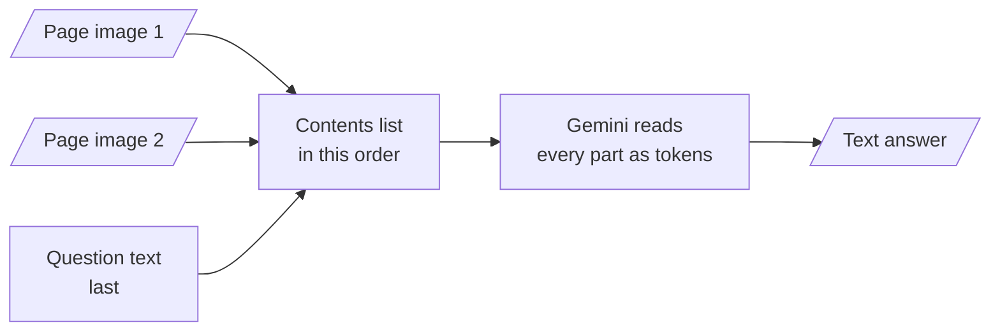
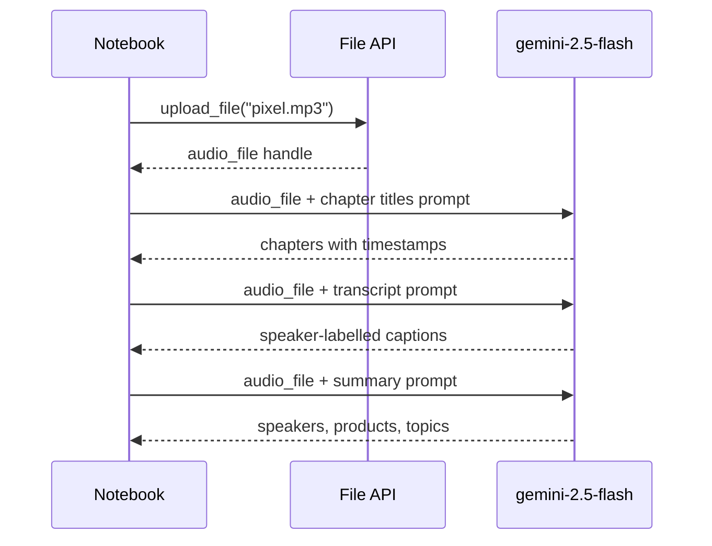

# M05.1 Theory: Multimodal prompting with Gemini

*[M05 theory](../README.md) · Lesson 5.1 · Notebooks: [`01a_multimodal_google_gemini.ipynb`](../../notebook/01a_multimodal_google_gemini.ipynb) · [All theory pages](../../../../../THEORY.md)*
<!-- subtitle: A prompt becomes an ordered list of images, documents, recordings and text, and every part has a token price you can work out before you send it -->

## Image prompts

> **What you'll learn**
>
> - **Build** an image prompt as an ordered list of parts that says what the pictures hold.
> - **Explain** why PDFs, audio and video go in by uploaded handle instead of inline bytes.
> - **Price** a page, an image and a second of audio in tokens before you call the model.
> - **Design** prompts that fix the output shape and refuse anything the file does not contain.

[M04](../../../../m04_prompt_engineering_patterns/mandatory/theory/README.md) wrote prompt patterns for text alone: roles, few-shot examples, chain of thought. This lesson keeps those patterns and adds the part they never needed: the evidence arrives as a picture, a document or a recording.

A Larkspur customer sends a screenshot of the pricing page and asks *How much outbound traffic does the starter plan include?* A text-only assistant cannot see the screenshot. A multimodal model can, and it can still answer badly: it can describe the page instead of reading it, or estimate a value from a bar that carries no printed number. The prompt has three jobs here. It must tell the model what kind of image it holds, ask the exact question, and give it a way to say the answer is not on the page.

An **image prompt** is a list of parts: one or more images, then the question as text. The notebook sends two scanned pages on US wildfires to Gemini this way, with the pictures first and the question last:

*Figure 1: An image prompt is an ordered list. The pictures travel inline with the request; nothing is uploaded first.*

The notebook's code runs `gemini-2.5-flash` at temperature 0, although its Markdown cells still describe Gemini 1.5 Flash. The model name changes over time; the shape of the request stays.

### Three choices that carry over

The wildfire prompt makes three choices worth copying for any image question:

| Choice in the prompt | What it does | Larkspur pricing screenshot |
|---|---|---|
| "can contain graphs, tables and text" | tells the model to read the chart and the table, not describe the picture | "This is a pricing page with a plan table and a traffic chart." |
| "analyze all of them" | spreads the answer across both pages | one screenshot, one image |
| one question per call | two calls over the same images: top five years, then the acreage trend | one call per question, each graded on its own |

*Table 1: The wildfire prompt's choices, applied to the Larkspur question.*

The third choice is a trade-off. Lesson 5.2 sends both wildfire questions in one GPT-4o call. Separate calls pay for the images twice, but each answer can be graded by itself.

The Larkspur prompt adds one line the wildfire prompt lacks: "If the value is not printed on the page, say so." Without it the model meets a bar with no label and estimates its height. Call that failure **guessing from the picture**: an answer that looks like a reading of the page but is a measurement of pixels.

### An image as the question

An image can also be the thing you ask about. The notebook's last example sends a video, a still image and the prompt "When is the moment in the image happening in the video? Provide a timestamp." For a support team that is a customer's screenshot of an error, matched against a recorded walkthrough to find the step where they are stuck.

### What an image costs

Images cost tokens like text. Gemini's token documentation counts an image of 384 pixels or less on both sides as 258 tokens, and tiles larger images into 768 by 768 tiles of 258 tokens each [1]. A large screenshot therefore costs a multiple of a small one. Documents and recordings are priced the same way, by page and by second, and they travel differently.

## PDF and audio input

PDFs, audio and video go through the **File API**: you upload the file once and get back a **file handle**, a reference the model can read. The handle takes the image's place in the contents list. The notebook uploads a Congressional Research Service PDF on wildfire statistics, an interview recording, three videos and one still image this way.

The upload happens once. The notebook reuses one audio handle for three prompts:

*Figure 2: One upload, three prompts. Each call sends the handle, not the recording's bytes.*

Sending the bytes again with every prompt is the **re-upload tax**: the same file crosses the network three times for three questions. A handle avoids it, and uploaded files stay available for 48 hours [2].

### Three prompts over one recording

Each of the three prompts fixes the output shape and keeps the model to what is in the recording:

| Prompt | Output shape it asks for | Guard against invention |
|---|---|---|
| Chapters | chapter titles with timestamps, short, no chapter summaries | "Do not make up any information that is not part of the audio" |
| Transcript | `[timecode] - [speaker] : caption`, speakers A, B and so on mapped to real names first, one caption per speaker turn | only the part of the conversation about the Pixel Watch |
| Summary | three headed lists: key speakers, products and features, other notable discussion | scoped to the audio file |

*Table 2: The notebook's three audio prompts. The notebook ships without outputs, and the answers depend on your run.*

For Larkspur, the transcript prompt turns a recorded support call into turns labelled Customer and Agent. A follow-up question such as "What refund window did the agent quote?" can then be checked against the handbook's 30 days. A summary that states the wrong window is the expensive error here, because a customer will act on it.

### What a document or a call costs

The token rates come from Gemini's documentation: 258 tokens per PDF page [3] and 32 tokens per second of audio [1]. With Larkspur sizes:

| Input | Gemini rate | Larkspur example | Tokens |
|---|---|---|---|
| PDF | 258 per page | 40-page handbook | 10,320 |
| Audio | 32 per second | 10-minute support call | 19,200 |

*Table 3: The token price of two Larkspur files, before the question is read.*

A 10-minute call costs almost twice the whole handbook. Every question about that call pays the 19,200 again, because the handle saves transfer, not tokens.

### When to upload

Gemini accepts PDFs up to 50 MB or 1,000 pages [3]. Its Files API guide says to upload whenever the whole request, files and prompt together, is larger than 100 MB [2]. Upload below that size too when the same file serves several prompts, as the audio handle does in Figure 2:

- **Inline**: small images sent once, such as the pricing screenshot.
- **Uploaded handle**: PDFs, recordings and anything you will ask about more than once.

Video goes in the same way, and Gemini samples it into frames by itself. Lesson 5.2 samples video by hand and shows what the sampling rate decides.

## References

1. Google, [Understand and count tokens](https://aistudio.google.com/docs/tokens), Gemini API documentation, checked November 2026.
2. Google, [Files API](https://aistudio.google.com/docs/files), Gemini API documentation, checked November 2026.
3. Google, [Document understanding](https://aistudio.google.com/docs/document-processing), Gemini API documentation, checked November 2026.

## Key Takeaways

- An image prompt is an ordered list of images followed by the question. Say what the images hold, ask the model to use all of them, and give it a way to say a value is not printed.
- Upload PDFs, recordings and video once through the File API and reuse the handle across prompts; upload anything that takes a request over 100 MB.
- Media cost tokens on every call: 258 per small image or PDF page and 32 per second of audio. Fix the output shape in the prompt and forbid anything that is not in the file.

## Check yourself

1. Why does the notebook upload the interview recording through the File API instead of sending it inline with each prompt?

The upload returns a handle that takes the image's place in the contents list, and one upload serves the chapters, transcript and summary prompts. Sending the bytes with each prompt pays the re-upload tax three times. The handle saves transfer, not tokens: each call still pays for the audio's seconds.

2. How many tokens does Gemini count for the 40-page Larkspur handbook as a PDF, and for a 10-minute support call as audio?

10,320 for the PDF, at 258 tokens per page. 19,200 for the call, at 32 tokens per second over 600 seconds, almost twice the handbook.

3. You want the starter plan's included outbound traffic from a pricing-page screenshot. How do you build the prompt?

Send the screenshot first and the question last, say that the image holds a plan table and a chart, and add "If the value is not printed on the page, say so." That last line stops the model guessing from the picture when a bar has no label. Ask one question per call and grade each answer on its own.

---
*Previous: [M05 overview](../README.md). Next: [5.2 Multimodal prompting with GPT-4o](../../../optional/theory/02_multimodal_prompting_with_gpt_4o/README.md).*
