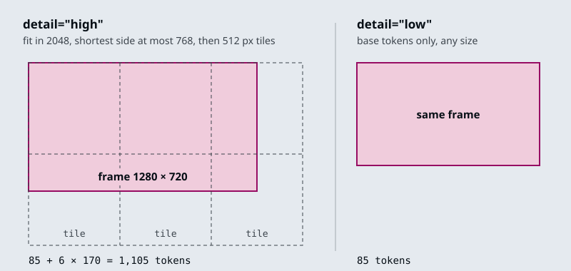
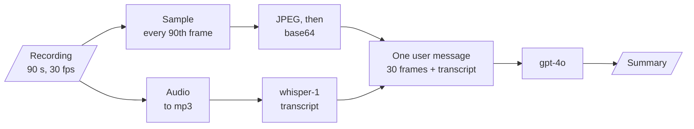
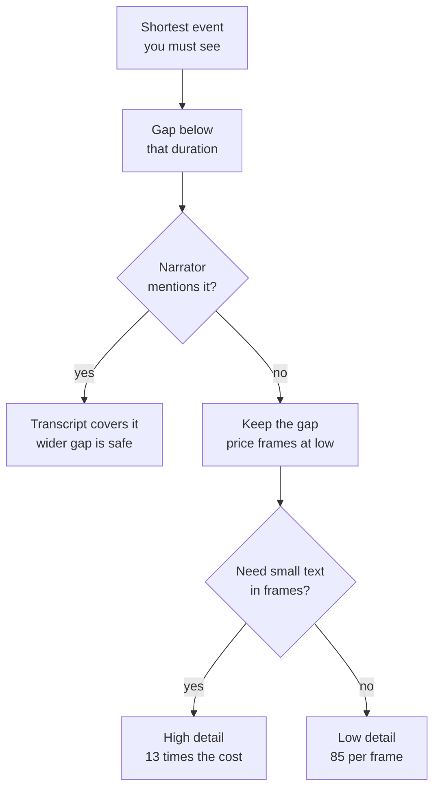

# M05.2 Theory: Multimodal prompting with GPT-4o

*[M05 theory](../../../mandatory/theory/README.md) · Lesson 5.2 · Notebooks: [`02a_multimodal_openai_gpt_4o.ipynb`](../../notebook/02a_multimodal_openai_gpt_4o.ipynb) (optional) · [All theory pages](../../../../../THEORY.md)*
<!-- subtitle: Images go in as typed message parts priced by tile, and a video becomes sampled frames plus a transcript, where the gap between frames sets both the bill and what the model can see -->

## Image content parts

> **What you'll learn**
>
> - **Build** a chat message that mixes text and image parts, sent as a data URL or a public URL.
> - **Price** an image for `gpt-4o` at low and high detail from its size.
> - **Explain** how a video becomes sampled frames plus a transcript when the API takes no video.
> - **Choose** a frame gap from the shortest event you need the model to see.

Lesson 5.1 sent images, PDFs and recordings to Gemini as a list of parts. The OpenAI Chat Completions API uses the same idea with a different envelope, and it takes no video file at all.

A Larkspur customer records a 90-second screen capture of the data export and asks support whether the export finished. The answer is on screen for 1.2 seconds, as an "Export ready" toast. A pipeline that samples one frame every 2 seconds can send 45 frames and still never show the model that toast. This lesson builds up to that failure from single images.

### Text and image parts in one message

In the Chat Completions API a user message's content can be a list of typed parts instead of one string. The notebook's first image call sends a system message ("Help me with my math homework!") and a user message with two parts:

| Part | Type | What it carries |
|---|---|---|
| 1 | `text` | "What's the area of the triangle?" |
| 2 | `image_url` | the scanned page, as a URL |

*Table 1: The two parts of the notebook's first image message.*

The URL field takes either of two forms, and the notebook sends the same scanned page both ways:

- **A base64 data URL**: the notebook reads the file from disk and base64-encodes it into the request. Use it for private files, such as a Larkspur customer's console screenshot. The request carries the bytes, and base64 makes them about a third larger (4 characters for every 3 bytes).
- **A public `https` URL**: the request stays small, but OpenAI fetches the image itself, which only works for images anyone can reach.

The notebook keeps one answer as a Markdown cell. From a scanned page of *The Algebra of Mohammed Ben Musa* (al-Khwarizmi), the model read the triangle's sides as 6, 5 and 9 and applied Heron's formula: semi-perimeter 10, area √200 = 10√2, about 14.14. The arithmetic checks out; whether the sides were read correctly is a question about the scan, which is why later lessons grade answers against values printed on the page.

### Extraction prompts with an escape

The notebook's extraction prompts share one shape: a role in the system message, a fixed output format, and an explicit escape for anything the model cannot read:

| Image | Role (system) | Output format | Escape |
|---|---|---|---|
| Clinical note | expert in handwritten clinical notes | Markdown table with columns Symptoms, Present/Denies and Probability; acronyms expanded in an appendix table | "Do not make up terms, if something is not detectable leave it out." |
| Handwritten page | handwriting expert | the text "exactly as in the image" | `[NOT_EXTRACTED]` for any word it cannot read |
| Sales chart | data analyst | a brief summary, then detailed statistics on the top 3 salesmen | none |
| Two wildfire pages | analyst of document scans | both 5.1 questions in one call | none |

*Table 2: The notebook's image prompts. Outputs are not shipped, and only the triangle answer is recorded.*

An escape marker turns an unreadable word into a visible gap instead of a plausible guess. For Larkspur, a screenshot of a console error gets the same treatment: read the error code exactly, or mark it `[NOT_EXTRACTED]`.

### What `detail` costs

Each image part also takes a `detail` setting, and it sets the price. OpenAI's images and vision guide gives the rule for `gpt-4o` [1]. At `detail="low"` an image costs the base 85 tokens whatever its size. At `detail="high"` the image is scaled to fit 2048 by 2048, its shortest side is scaled down to 768 if longer, and every 512-pixel tile covering the result adds 170 tokens:

*Figure 1: How `gpt-4o` prices one 1280 by 720 frame at each detail setting.*

Applying the rule to three sizes:

| Image | Size after scaling | Tiles | High | Low |
|---|---|---|---|---|
| Video frame, 1280 by 720 | 1280 by 720 | 3 by 2 | 1,105 | 85 |
| Screenshot, 1920 by 1080 | 1365 by 768 | 3 by 2 | 1,105 | 85 |
| Report page, 860 by 1064 (lesson 5.3) | 768 by 950 | 2 by 2 | 765 | 85 |

*Table 3: `gpt-4o` image tokens from OpenAI's published rule, computed for each size.*

A 1280 by 720 frame costs 13 times less at low detail. The 1920 by 1080 screenshot costs the same as the smaller frame, because scaling happens before tiling. The notebook sends its video frames at `detail="low"`, which matters once a video becomes dozens of images.

## Frame sampling

**Frame sampling** turns a video into a list of still images taken at a fixed gap, so a model that reads only text and images can follow it. The notebook was written when the GPT-4o API took text and images only, and it builds the video input itself with OpenCV and moviepy:

1. Read the video's frame rate and frame count.
2. Compute the step between sampled frames as frame rate times `seconds_per_frame`, truncated to a whole number.
3. Read every step-th frame, encode it as JPEG, then as base64.
4. Write the soundtrack to an mp3 at a 32k bitrate and transcribe it with `whisper-1`.
5. Send the frames and the transcript in one user message.

<!-- animated: diagrams/frame-sampling.anim.html -->

*Figure 2: A 90-second recording at the notebook's 3-second example gap: every 90th frame, 30 frames, plus the transcript.*

The notebook then writes three summaries of an OpenAI DevDay recap video: from the frames alone, from the transcript alone, and from both in one message. Its own conclusion is that the combined summary is the most accurate. The frames miss what the speaker says, and the transcript misses what is on screen.

### The gap decides what the model sees

`seconds_per_frame` is the setting that matters. It decides how many frames the model reads, which sets the cost. It also decides which moments the model sees at all: something on screen for less time than the gap may fall between two frames. Call that failure **the event between frames**.

The [interactive lab](interactive/frame-sampling-lab.html) runs a port of the notebook's sampling on a fictional 90-second Larkspur screen recording (30 fps, 1280 by 720) that walks through a data export in eight steps. Two of them are short: a 1.8 s confirm dialog and a 1.2 s "Export ready" toast, the only frame that shows the export finished. Its numbers:

| Gap (s) | Frames | Tokens, low | Tokens, high | Steps seen |
|---|---|---|---|---|
| 1 | 90 | 7,650 | 99,450 | 8 |
| 2, the notebook default | 45 | 3,825 | 49,725 | 7, toast missed |
| 2.5 | 36 | 3,060 | 39,780 | 8 |
| 3, the notebook example | 30 | 2,550 | 33,150 | 7, toast missed |
| 10 | 9 | 765 | 9,945 | 6 |

*Table 4: Frames, tokens and coverage per gap in the frame sampling lab.*

<!-- lab: interactive/frame-sampling-lab.html -->

- **Only a gap shorter than the shortest event guarantees a frame on it.** The toast lasts 1.2 s, and 1 s is the widest gap in the lab that always catches it. At 2.5 s the frames happen to land on both short steps; if the toast came 1.2 s later, the same gap would miss it.
- **Cost grows with the number of frames.** Halving the gap doubles the frames and the tokens. High detail multiplies the bill by 13 again.
- **The transcript is the other source.** A step the narrator mentions survives a missed frame; a silent toast does not.

Gemini takes the video file itself and samples it at 1 frame per second by default, and a request can set a custom rate [2]. Its documentation warns that "fast action sequences might lose detail due to the 1 FPS sampling rate". At 1 frame per second the lab's 1.2 s toast always gets a frame.

### Two sharp edges in the sampler

The notebook's sampler has two bugs worth knowing before you copy it:

| Planted input | What happens | Why |
|---|---|---|
| 29.97 fps, 3 s gap | step of 89 frames, one frame every 2.97 s | truncation drops the fraction of 89.91 |
| 30 fps, 0.02 s gap | the loop never ends | the step truncates to 0 and the frame position never advances |

*Table 5: Planted inputs for the sampler, worked from the notebook's own arithmetic.*

Rounding the step to the nearest whole frame, with a floor of 1, fixes both: the loop always advances, and the 29.97 fps gap comes back to 3.003 s. The video setup also needs moviepy 1.x, because moviepy 2 removed the `moviepy.editor` module the notebook imports; this repo pins `moviepy<2` for that reason.

## Choosing a frame gap

Pick the gap from the event, then check the bill:

*Figure 3: Choosing a gap and a detail level for a recorded walkthrough.*

For the Larkspur export recording, the toast is silent and lasts 1.2 s. The widest lab gap that always catches it is 1 s: 90 frames, 7,650 tokens at low detail. Try low detail on the toast frame first, and move to high only if the model cannot read the toast's text.

## References

1. OpenAI, [Images and vision](https://developers.openai.com/api/docs/guides/images-vision), API documentation, checked November 2026.
2. Google, [Video understanding](https://aistudio.google.com/docs/video-understanding), Gemini API documentation, checked November 2026.

## Key Takeaways

- Send private images as base64 data URLs and public ones as `https` URLs. Give extraction prompts a role, a fixed output format and an explicit marker for anything unreadable.
- `detail` sets the image price: 85 tokens at low, plus 170 per 512-pixel tile at high, so a 1280 by 720 frame costs 13 times more at high.
- For video, the frame gap sets both cost and coverage. Only a gap shorter than the shortest event guarantees a frame on it, and a transcript covers what the narrator says.

## Check yourself

1. When should an image part use a base64 data URL rather than a public https URL?

Use a data URL for private files, such as a Larkspur customer's console screenshot: the request carries the bytes, about a third larger after base64. A public URL keeps the request small, but OpenAI fetches the image itself, and that works only for images anyone can reach.

2. What does a 1920 by 1080 screenshot cost gpt-4o at detail high, and at detail low?

1,105 tokens at high: it fits within 2048 by 2048, its shortest side is scaled to 768 (giving 1365 by 768), and six 512-pixel tiles cost 85 + 6 × 170. At low it costs the base 85 tokens, 13 times less.

3. At the notebook's default 2-second gap, the lab's frames never show the Export ready toast. Why, and which gap guarantees it?

The toast lasts 1.2 s, shorter than the gap, and it falls between two frames. Only a gap shorter than the shortest event guarantees a frame on it: 1 s in the lab, at 90 frames and 7,650 tokens at low detail. The 2.5 s gap catches it by luck and would miss it if the toast came 1.2 s later.

---
*Previous: [5.1 Multimodal prompting with Gemini](../../../mandatory/theory/01_multimodal_prompting_with_gemini/README.md). Next: [5.3 Exercise: financial report analysis](../03_exercise_financial_report_analysis/README.md).*
