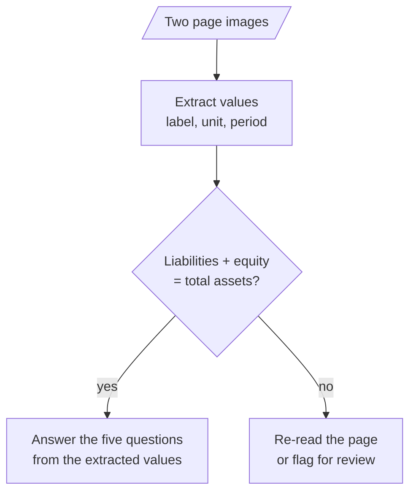

# M05.3 Theory: Exercise: financial report analysis

*[M05 theory](../../../mandatory/theory/README.md) · Lesson 5.3 · Notebooks: [`03a_financial_report_analysis.ipynb`](../../notebook/03a_financial_report_analysis.ipynb) (optional) · [All theory pages](../../../../../THEORY.md)*
<!-- subtitle: Turn a summary request into questions with printed answers, extract every value before interpreting it, and let code check the totals -->

## Questions about a report page

> **What you'll learn**
>
> - **Replace** an open summary request with questions whose answers are printed on the page.
> - **Order** a report prompt as extraction first, interpretation second.
> - **Check** extracted values in code, with a tolerance for the report's own rounding.
> - **Handle** unlabelled charts and answers the page does not contain.

Lessons 5.1 and 5.2 sent images to a model and asked it to read them. This exercise asks the harder question: how you know the reading was right.

The exercise sends two page images from ABN AMRO's third-quarter 2024 report to `gemini-2.5-flash`:

- **Balance sheet** (779 by 597 pixels): the condensed statement of financial position at 30 September 2024, 30 June 2024 and 31 December 2023.
- **Figures at a glance** (860 by 1064 pixels): nine bar charts from Q3 2023 to Q3 2024, each bar labelled with its value.

Its prompt casts the model as a financial analyst and asks for a six-part summary: key metrics, income and expenses, balance sheet, credit quality, strategy, outlook. The notebook ships without its output. Even with one, a summary is hard to grade, since no single line of it is right or wrong. Call that failure the **ungradable summary**.

The module's lab brief asks for five questions instead. Each one has a value printed on the page, so each answer can be graded line by line:

| Question | On the page |
|---|---|
| Net profit in Q3 2024 | EUR 690 million |
| Return on equity in Q3 2024 | 11.6%, target 9 to 10% |
| Cost/income ratio in Q3 2024 | 59.2%, target circa 60% |
| Total assets, 30 September 2024 | 403,771 million |
| Total equity, 30 September 2024 | 25,810 million |

*Table 1: Five gradable questions and the values printed on the two pages.*

## Extract, check, then answer

Ask for extraction before interpretation. A prompt that first lists each value with its label, unit and period, then answers from that list, leaves a record you can check against the page:

*Figure 1: Extract first, let code check the totals, then answer from the checked values.*

The balance sheet gives you a check for free. At 30 September 2024, total liabilities of 377,961 plus total equity of 25,810 is 403,771, the printed total assets. Do that sum in code, not in the prompt: code adds exactly, while a model asked to check its own reading can make a second error on top of the first. Most misread digits in any of the three values show up here.

### Planted check: the report's own rounding

An exact-equality check fails on values the model read correctly. The report prints every line in millions, rounded, and its subtotals do not always match the sum of its own rounded lines. Summing the columns of the printed page:

| Check | Printed total | Sum of printed lines | Gap |
|---|---|---|---|
| 30 Sep 2024: liabilities + equity | 403,771 | 403,771 | 0 |
| 30 Sep 2024: eight liability lines | 377,961 | 377,959 | 2 |
| 30 Jun 2024: liabilities + equity | 393,404 | 393,403 | 1 |
| 31 Dec 2023: eight asset lines | 377,909 | 377,911 | 2 |

*Table 2: Totals on the balance sheet image against sums of its own printed lines.*

A tolerance of a few million in the check keeps rounding from raising false alarms, while a misread digit in the thousands still fails it. Call the opposite mistake the **false alarm**: a checker so strict that reviewers learn to ignore it.

## Reading charts honestly

Two more rules keep the answers honest:

- **Read labels, do not measure bars.** Every bar on "Figures at a glance" carries its value, and the model reads a number instead of estimating a height. For a chart without labels, ask for the axis range and an estimate, and grade with a tolerance.
- **Allow "not on the page".** A question whose answer is not printed should get that answer, not a guess from neighbouring figures.

Sent to `gpt-4o` at high detail, each of the two images costs 765 tokens under the rule from lesson 5.2: 2 by 2 tiles of 512 pixels, after "Figures at a glance" is scaled to 768 by 950. Five questions in one call cost the images once; five calls cost them five times.

## In practice: Larkspur pricing

The same method reads a Larkspur pricing page:

1. Extract each plan's printed figures with label, unit and billing period: price, included outbound traffic, refund terms.
2. Check in code what can be checked, such as an annual price against twelve monthly prices when the page states a discount.
3. Answer customer questions from the extracted list, and reply "not on the page" for a value the page does not print.

The extracted list doubles as a test fixture. When the pricing page changes, rerunning the extraction shows exactly which values moved.

## Key Takeaways

- Ask specific questions whose values are printed on the page, not for a summary, and grade each answer line by line.
- Extract each value with its label, unit and period before interpreting, and check totals in code with a small tolerance for the report's own rounding.
- Have the model read printed labels instead of measuring bars, and accept "not on the page" as an answer rather than a guess.

## Check yourself

1. Why should the prompt extract each value with its label, unit and period before answering the five questions?

Extraction before interpretation leaves a record you can check against the page. It also lets code test the extracted values, such as whether the balance sheet adds up, before any answer is built on them.

2. The model extracts total liabilities of 377,961 million and total equity of 25,810 million at 30 September 2024. What check do you run, and where?

Add them in code, not in the prompt: 377,961 + 25,810 = 403,771, the printed total assets. Allow a gap of a few million, because the report's rounded lines can miss their printed totals by 1 or 2. A larger gap means a misread digit: re-read the page or flag it for review.

3. A question asks for a figure the two report pages do not print, and another chart has no value labels. How should each be handled?

The first should get the answer that the figure is not on the page, not a guess from neighbouring figures. For a chart without labels, ask for the axis range and an estimate, and grade the answer with a tolerance.

---
*Previous: [5.2 Multimodal prompting with GPT-4o](../02_multimodal_prompting_with_gpt_4o/README.md). Next: [M05 interview questions](../../../mandatory/theory/README.md#interview-spotlight-5-questions-you-might-get-asked).*
