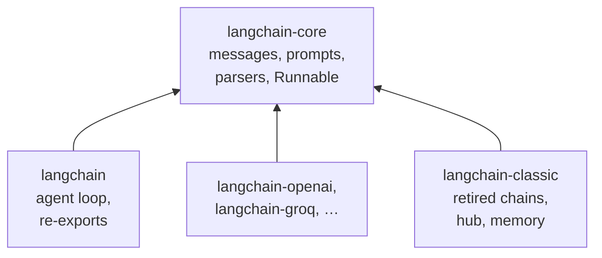
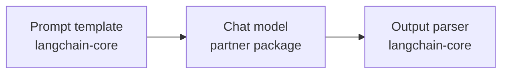
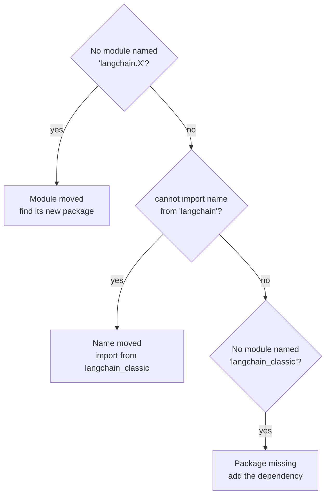

# M06.1 Theory: LangChain introduction and the 1.x package split

*[M06 theory](../README.md) · Lesson 6.1 · Notebooks: [`01a_LangChain_Introduction.ipynb`](../../notebook/01a_LangChain_Introduction.ipynb), [`01b_Package_Split_and_Imports_LangChain_v1.ipynb`](../../notebook/01b_Package_Split_and_Imports_LangChain_v1.ipynb) · [All theory pages](../../../../../THEORY.md)*
<!-- subtitle: Where every LangChain class lives in 1.x, and how the exception class tells you whether a module moved, a name moved or a package is missing -->

## The 1.x package split

> **What you'll learn**
>
> - **Explain** why LangChain 1.0 split one package into four kinds of package.
> - **Name** the package that holds each part of a chain: template, model and parser.
> - **Diagnose** an old import from its exception class alone.
> - **Choose** between moving an old class and replacing it.

[M02](../../../../../p01_ai_engineering_foundations/m02_llm_apis_and_model_selection/mandatory/theory/README.md) called the provider SDKs directly, and M04 and M05 wrote the prompts those calls send. This module wraps both in LangChain, the framework most notebooks in this course are written in.

The Larkspur Cloud support assistant has a script from an older LangChain tutorial. It imports `LLMChain` from `langchain.chains`, `HumanMessage` from `langchain.schema` and the prompt hub from `langchain`. On the course environment (`langchain` 1.4.7, `langchain-core` 1.7.0) the script stops on its first line. The old path has no shim that forwards it and no warning that names the new one.

The reason is a change in where code lives. Through the 0.x releases, the `langchain` package held the whole ecosystem: chains, agents, memory, retrievers, every provider integration and the prompt hub. Installing it pulled in all of that, and a break in any one integration could break the import. Version 1.0 split the surface by **how fast each part changes and who owns it**:

| Package | Holds | Changes |
|---|---|---|
| `langchain-core` | messages, documents, prompts, output parsers, `Runnable` | rarely, deliberately |
| `langchain` | the agent loop and short re-exports such as `init_chat_model` | with the agent API |
| `langchain-openai`, `langchain-groq`, … | one provider each | at that provider's pace |
| `langchain-classic` | retired chains, retrievers, indexing, the hub | frozen |

*Table 1: The four kinds of package in LangChain 1.x.*

Every other package builds on `langchain-core`:

*Figure 1: The dependency direction. A partner package can change at its provider's pace without touching the base types.*

### The three parts of every chain

The first notebook already shows the shape every later chain keeps: a template, a model and a parser joined with LCEL's `|`. The notebook then grows it into a pipeline of three chains (details, then a one-sentence summary, then the summary's sentiment), each fed by the one before. Each of the three parts comes from a known package:

*Figure 2: One chain, two sources. Only the model comes from outside `langchain-core`.*

The model class comes from a partner package (`langchain_openai.ChatOpenAI`), or from `init_chat_model` in `langchain` when the provider is named in a string. Everything else in this module, the template classes, the message classes and all four output parsers, imports from `langchain-core`. [M07](../../../../m07_lcel_runnables_and_chains/mandatory/theory/README.md) covers the pipe itself, and lessons 6.2 to 6.7 cover the three parts. Knowing where each class lives is half of a migration. The other half is reading the error when an old path fails.

## Reading an import error

Old code fails on 1.x in two different ways, and **the exception class says what moved**. We ran the notebook's import audit and the hub import on the course environment:

| Old import | Error on 1.x | Fix |
|---|---|---|
| `langchain.chains` | `ModuleNotFoundError` | `langchain_classic.chains`, or rewrite as an LCEL chain (M07) |
| `langchain.schema` | `ModuleNotFoundError` | `langchain_core.messages`, `.documents` or `.output_parsers` |
| `langchain.text_splitter` | `ModuleNotFoundError` | `langchain_text_splitters` |
| `langchain.memory` | `ModuleNotFoundError` | `langchain_classic.memory`, or better a checkpointer (below) |
| `langchain.llms` | `ModuleNotFoundError` | the provider's partner package |
| `langchain.retrievers`, `langchain.indexes` | `ModuleNotFoundError` | `langchain_classic` |
| `from langchain import hub` | `ImportError: cannot import name 'hub'` | `langchain_classic` |

*Table 2: The seven 0.x module paths the notebook audits, plus the hub. All seven raise `ModuleNotFoundError`; only the hub raises `ImportError`.*

`ModuleNotFoundError` means the module is gone. `ImportError` means the package still exists and no longer exports the name. A third message looks similar and means something else: `No module named 'langchain_classic'` says the replacement package is not installed in this environment. Listing it in a requirements file is not the same as installing it. Declare it in the project's dependencies and sync.

Read the three messages in order:

*Figure 3: Diagnosing an old import. Each "no" moves one question down.*

The short paths that `langchain` keeps are aliases, not copies. `langchain.messages.HumanMessage is langchain_core.messages.HumanMessage` returns `True` on the course environment. The notebook reads a `False` as two LangChain installs on `sys.path`, a broken environment that no import change will fix.

### Moved is not recommended

Memory is the one place where the moved class is the wrong answer. `ConversationBufferMemory` still imports from `langchain_classic.memory`, and the old app would run again after a one-line change. The 1.x replacement is a LangGraph checkpointer with a `thread_id` ([M09](../../../../m09_langgraph_runtime/mandatory/theory/README.md), M33), which stores each conversation outside the process. We call the shortcut **the moved-class migration**: the import works, and the design it carries is the one 1.x retired. Retired chains are a milder case of the same thing. `langchain_classic.chains` still runs them, and M07 rewrites them as LCEL.

## In practice: the refund script

For the Larkspur script, the error classes give the order of work:

1. `ModuleNotFoundError` on `langchain.schema`: import `HumanMessage` from `langchain_core.messages`.
2. `ModuleNotFoundError` on `langchain.chains`: rewrite `LLMChain` as template, model and parser joined with `|`, which needs no classic package.
3. `ImportError` on `hub`: import it from `langchain_classic`, and add that package to the project's dependencies if the next error says it is missing.
4. Any conversation memory: move it to a checkpointer, not to `langchain_classic.memory`.

> **Key distinction:** a `ModuleNotFoundError` names a path, an `ImportError` names a symbol. Fix the path for the first and the import source for the second.

Lesson 6.2 takes the middle part of Figure 2, the chat model, and shows what stays the same when its provider changes.

## Key Takeaways

- Version 1.0 split LangChain by pace of change. Prompts, messages, parsers and `Runnable` live in `langchain-core`, each provider in its own package, and retired chains and the hub in the frozen `langchain-classic`.
- Read the exception class. `ModuleNotFoundError` means the module moved, `ImportError` means the package no longer exports the name, and a missing `langchain_classic` means it is not installed.
- Not every old class should simply move. Replace conversation memory with a LangGraph checkpointer and a `thread_id`, and rewrite retired chains in LCEL.

## Check yourself

1. Why did version 1.0 split the single langchain package into several packages?

In 0.x, installing `langchain` pulled in every provider integration, and a break in any one of them could break the import. Version 1.0 split the surface by how fast each part changes and who owns it: `langchain-core` changes rarely, each partner package moves at its provider's pace, and `langchain-classic` is frozen.

2. Old code runs from langchain import hub on 1.x. Which error do you expect, and where should hub come from now?

`ImportError: cannot import name 'hub' from 'langchain'`. The package still exists but no longer exports the name, so import it from `langchain_classic`. Compare `langchain.chains`, where the module itself is gone and the error is `ModuleNotFoundError`.

3. A 0.x app keeps chat history in ConversationBufferMemory. Is changing its import path the right migration?

It runs, but it is not the recommended answer. The class still imports from `langchain_classic.memory`; the 1.x replacement is a LangGraph checkpointer with a `thread_id` (M09, M33). Memory is the one place where moving the import is not the fix.

---
*Previous: [M06 overview](../README.md). Next: [6.2 Commercial LLMs natively and with LangChain](../02_commercial_llms_natively_and_with_langchain/README.md).*
