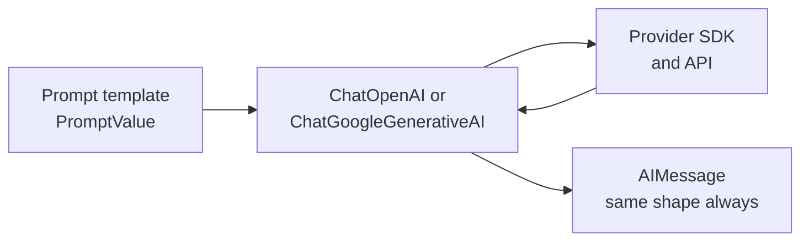

# M06.2 Theory: Commercial LLMs natively and with LangChain

*[M06 theory](../README.md) · Lesson 6.2 · Notebooks: [`02a_Commercial_LLMs_with_LangChain.ipynb`](../../notebook/02a_Commercial_LLMs_with_LangChain.ipynb), [`02b_Commercial_LLMs_Natively.ipynb`](../../../optional/notebook/02b_Commercial_LLMs_Natively.ipynb) (optional) · [All theory pages](../../../../../THEORY.md)*
<!-- subtitle: One response object for every provider: what a LangChain chat model takes, what it returns, and what a provider swap does not keep the same -->

## Two SDKs, two response shapes

> **What you'll learn**
>
> - **Explain** what a LangChain chat model adds over a provider's own SDK.
> - **Read** the three parts of an `AIMessage`: content, token usage and provider metadata.
> - **Diagnose** a reply that stopped at the token limit from its metadata.
> - **Decide** when a provider swap is ready to ship.

Lesson 6.1 placed the chat model in a partner package, the one part of a chain that lives outside `langchain-core`. This lesson looks at what that class gives you.

Larkspur's support team wants to compare OpenAI and Gemini on the refund question. The optional notebook calls both through their own SDKs, and the two calls share almost nothing:

| | OpenAI SDK | Gemini SDK |
|---|---|---|
| Set up | a key on the `openai` module | `genai.configure(api_key=...)` |
| Send | a messages array with roles, to `chat.completions.create` | a prompt string, to a `GenerativeModel`'s `generate_content` |
| Read the text | `response.choices[0].message.content` | `response.text` |

*Table 1: The same request in the two native SDKs, from the optional notebook.*

Every line that touches the response is provider-specific. Supporting a third provider means a third set of those lines, and every place that logs tokens or checks why a reply stopped has to know which provider answered. A common interface fixes that.

## Chat models

**A chat model is any class that implements LangChain's `BaseChatModel` interface: it takes messages and returns an `AIMessage`, whichever provider answers.** The provider SDK still makes the call underneath; the class translates the request on the way out and the response on the way back:

*Figure 1: A chat model wraps the provider's call. The chain sees one response type.*

Every chat model has the same three calls:

| Call | Takes | Returns |
|---|---|---|
| `invoke` | a string, a message list or a `PromptValue` | one `AIMessage` |
| `batch` | a list of inputs | a list of `AIMessage`, run concurrently on a thread pool |
| `stream` | one input | the reply in chunks as it arrives |

*Table 2: The three calls every chat model offers.*

### What comes back

The `AIMessage` carries more than the text. Notebook 02a reads three attributes:

| Attribute | Holds | Same keys for every provider |
|---|---|---|
| `.content` | the reply text | ✓ |
| `.usage_metadata` | input, output and total token counts | ✓ |
| `.response_metadata` | what the provider reported, such as `model_name` and `finish_reason` | ✗ |

*Table 3: The three parts of an `AIMessage` that lesson 6.2 reads.*

The last row matters more than it looks. On OpenAI, a `finish_reason` of `length` means the reply hit the token limit and stopped mid-sentence, or mid-JSON. We call this **the truncated reply**: the text reads like an answer and ends early. [Lesson 6.6](../06_output_parsers/README.md#output-parsers) shows what each output parser makes of one.

The notebook also takes the chain apart. `prompt | model` builds a `RunnableSequence`, and so do `prompt.pipe(model)` and `RunnableSequence(prompt, model)`; we ran all three with a stub model and each gave a sequence of 2 steps. Calling the template on its own returns a `ChatPromptValue` holding one `HumanMessage` ("Explain AI in 2 bullet points"), which is exactly what the model then receives. Invoking each step by hand is how you debug a prompt.

### Changing provider

Changing provider changes one class. In the notebooks the same `prompt | model` chain runs on all of these:

| Class | Where the model runs | Model in the notebook |
|---|---|---|
| `ChatOpenAI` | OpenAI's API | `gpt-4o-mini` |
| `ChatGoogleGenerativeAI` | Google's Gemini API | `gemini-2.5-flash` |
| `ChatGroq` | Groq's hosted inference | `llama-3.1-8b-instant` |
| `ChatHuggingFace` over `HuggingFaceEndpoint` | Hugging Face Inference Providers | `moonshotai/kimi-k2-instruct-0905` |
| `ChatHuggingFace` over `HuggingFacePipeline` | your own machine | `TinyLlama/TinyLlama-1.1B-Chat-v1.0` |

*Table 4: One chain, five model classes. The last three are lesson 6.3's open-source backends.*

[Lesson 6.3](../03_open_source_llms_transformers_inference_client_groq_langchain/README.md) runs those three. `ChatHuggingFace` is a wrapper: the two Hugging Face classes underneath are completion-style LLMs, and the wrapper gives them the chat interface ([lesson 6.4](../04_inputs_and_outputs_messages_llm_vs_chat_model/README.md#llm-vs-chat-model)).

`init_chat_model` from `langchain` moves the choice out of the import line and into a string, which is how notebook 01b loads its model. The string names the provider and the model together:

| String | Class it builds |
|---|---|
| `"openai:gpt-4o-mini"` | `ChatOpenAI` |
| `"groq:openai/gpt-oss-120b"` | `ChatGroq` |

*Table 5: Two `init_chat_model` strings from notebook 01b. Swapping provider is an edit to the string.*

### Planted failure: the silent provider swap

The swap keeps the code running. It does not keep the replies the same: another model formats, refuses and rambles differently. We call this **the silent provider swap**: every call succeeds, and the answers drift. For Larkspur, the refund question might come back with the timing right and the citation format wrong, which no exception reports. A provider change is a release like any other, checked against the golden questions from [M10](../../../../../p04_rag_foundations/m10_rag_lifecycle/mandatory/theory/README.md) before it ships.

## In practice: comparing two providers

For the Larkspur comparison, the chat model reduces the work to this:

1. Build one chain from the answer template and a chat model named by an `init_chat_model` string.
2. Run the golden questions through it once per provider string.
3. Compare `.content` against the expected answers, `.usage_metadata` for cost, and `finish_reason` in `.response_metadata` for truncated replies.
4. Ship the provider that passes, and keep the string in configuration so a rollback is one edit.

> **Interview tip:** "LangChain makes models interchangeable" is half true. The call shape is interchangeable. The behaviour is not, and a strong answer says how you would measure the difference.

Lesson 6.3 runs the same chain on open-source models, locally and hosted.

## Key Takeaways

- Every LangChain chat model offers `invoke`, `batch` and `stream` and returns an `AIMessage`, with token counts under the same keys for every provider.
- Read `.response_metadata` as well as `.content`. A `finish_reason` of `length` means the reply hit the token limit and stopped mid-sentence or mid-JSON.
- Changing provider changes one class or one `init_chat_model` string, but the replies change too. Treat a provider swap as a release and check it against the golden questions.

## Check yourself

1. What does a LangChain chat model give you that calling each provider SDK directly does not?

The same response object for every provider. Each SDK returns its own object, while every `BaseChatModel` offers `invoke`, `batch` and `stream` and returns an `AIMessage`, with token counts under the same keys in `.usage_metadata`. Changing provider then changes one class.

2. A Larkspur reply on OpenAI stops mid-JSON, and its response metadata shows a finish reason of length. What happened?

The reply hit the token limit and stopped mid-sentence, or here mid-JSON. `.response_metadata` reports what the provider said, and `finish_reason` of `length` is OpenAI's signal for it. Lesson 6.6 shows what each output parser makes of such a truncated reply.

3. You change the init_chat_model string from an OpenAI model to a Groq model and the chain still runs. Can you ship the change?

Not yet. The swap keeps the code running, but another model formats, refuses and rambles differently, so the replies change. For Larkspur, a provider change is a release like any other, checked against the M10 golden questions before it ships.

---
*Previous: [6.1 LangChain introduction and the 1.x package split](../01_langchain_introduction_and_the_1_x_package_split/README.md). Next: [6.3 Open-source LLMs: Transformers, Inference Client, Groq, LangChain](../03_open_source_llms_transformers_inference_client_groq_langchain/README.md).*
