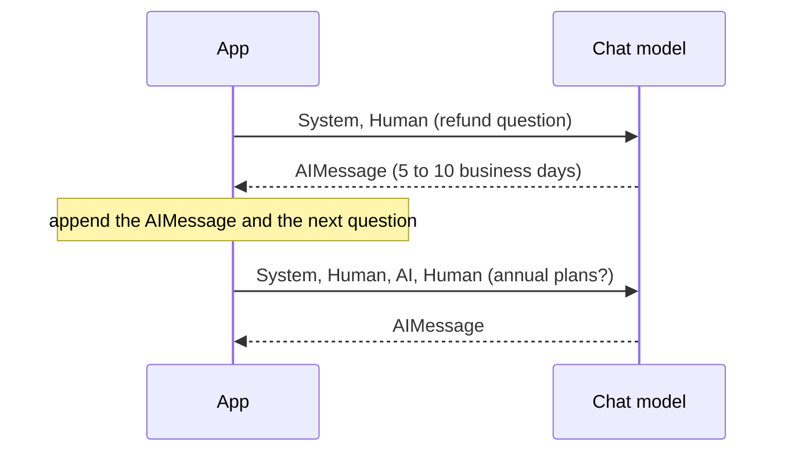
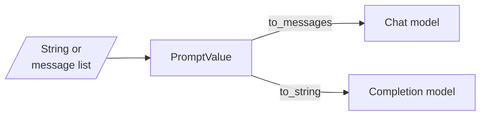

# M06.4 Theory: Inputs and outputs: messages, LLM vs chat model

*[M06 theory](../README.md) · Lesson 6.4 · Notebooks: [`04a_LangChain_Inputs_and_Outputs.ipynb`](../../notebook/04a_LangChain_Inputs_and_Outputs.ipynb), [`04b_LLM_vs_ChatModel.ipynb`](../../notebook/04b_LLM_vs_ChatModel.ipynb) · [All theory pages](../../../../../THEORY.md)*
<!-- subtitle: Why the model forgets the last turn unless you resend it, and what happens to roles when messages reach a completion model -->

## Messages

> **What you'll learn**
>
> - **Explain** the three message roles and why a chat model keeps no state between calls.
> - **Trace** a conversation as the list the app resends on every turn.
> - **Compare** `invoke`, `batch` and `generate` by what they take and return.
> - **Diagnose** an ignored system rule as a completion model flattening the roles.

Lessons 6.2 and 6.3 sent one prompt to a chat model and read one `AIMessage` back. A support conversation has more than one turn.

A Larkspur customer asks *How long does a refund take?* and gets a good answer. The follow-up is *And for annual plans?* The assistant replies as if it had never seen the first question. Nothing failed: the app sent only the second question, and the model had nothing else to read.

**A message is one turn of a conversation, tagged with the role of whoever said it.** A chat model reads a list of them:

| Class | Role in an OpenAI-style dict | Holds |
|---|---|---|
| `SystemMessage` | `system` | the instructions for the whole conversation |
| `HumanMessage` | `user` | what the user said |
| `AIMessage` | `assistant` | a reply from the model, including earlier replies you send back |

*Table 1: The three message classes. Tool results add a fourth, `ToolMessage`, in M22.*

The dict spelling works too. LangChain converts each dict to the matching class before the call; we ran the notebook's `convert_to_messages` on a system, a user and an assistant dict and got a `SystemMessage`, a `HumanMessage` and an `AIMessage`, in that order. Both spellings send the same request.

### The conversation is the list

A chat model keeps no state between calls. To continue a conversation, the app appends the model's `AIMessage` and the next question to the list and sends the whole list again:

*Figure 1: Two turns. The second call carries the first turn because the app put it there.*

We call the opening bug **the forgotten turn**: the app sent the new question without the old ones. In notebook 04a, "What did we discuss so far?" gets a real answer only because the earlier turns are in the list. Drop them and the model has nothing to summarise.

Resending has a price. Every earlier turn is paid for again as input tokens on every call:

| Turn | Messages sent | Earlier turns resent |
|---|---|---|
| 1 | system, human | 0 |
| 2 | system, human, AI, human | 1 |
| 5 | system plus 4 earlier exchanges plus the new question | 4 |
| 20 | system plus 19 earlier exchanges plus the new question | 19 |

*Table 2: How the list grows. The input cost of turn n includes all n minus 1 earlier exchanges.*

History therefore needs a bound (M33). It is also just data your app holds, which can be trimmed, summarised or filtered before it is sent. In a template, history goes in a `MessagesPlaceholder` ([lesson 6.5](../05_prompt_templates_and_few_shot_composition/README.md#prompt-templates)).

### One call or several

For several requests at once, notebook 04a uses two calls besides `invoke`:

| Call | Input | Output |
|---|---|---|
| `.invoke()` | a string or one message list | one `AIMessage` |
| `.batch()` | a list of inputs | a list of `AIMessage`, run concurrently |
| `.generate()` | a list of message lists | an `LLMResult`: `generations` holds one entry per conversation, and `llm_output["token_usage"]` sums the batch |

*Table 3: Three ways to call a model, from notebook 04a.*

With `.generate()`, each inner list is its own conversation with its own system prompt; the notebook translates one sentence into German and Spanish in one call this way. Each conversation is still its own request to the provider. The model reads roles because it was trained on them, which raises the question of what happens with a model that was not.

## LLM vs chat model

LangChain has two model interfaces, and every model class implements one of them. We ran the notebook's base-class check on the installed packages:

| Interface | In and out | Classes |
|---|---|---|
| `BaseLLM` | a string in, a string out | `OpenAI` (`gpt-3.5-turbo-instruct`), `HuggingFaceEndpoint`, `HuggingFacePipeline` |
| `BaseChatModel` | messages in, an `AIMessage` out | `ChatOpenAI`, `ChatGoogleGenerativeAI`, `ChatHuggingFace`, `ChatGroq` |

*Table 4: The two interfaces. A **completion model** (`BaseLLM`) continues text; a chat model answers roles.*

Both accept both input shapes, because LangChain first turns the input into a `PromptValue` and then asks it for the shape the model needs:

*Figure 2: One input, two conversions. The model's interface decides which one runs.*

We ran both conversions with `langchain-core` 1.7.0 on Larkspur inputs:

| Input | Sent to | What the model receives |
|---|---|---|
| the string "How long does a refund take?" | a chat model | one `HumanMessage` with that text |
| a system message "Answer only from the passages." and a human message with the refund question | a completion model | one string: `System: Answer only from the passages.` then a new line and `Human: How long does a refund take?` |

*Table 5: The two conversions, traced.*

A string sent to a chat model becomes one `HumanMessage`, and nothing is lost. A message list sent to a completion model is flattened into plain text lines, which the model continues like any other text. We call this **the flattened role**: the system instruction becomes a hint instead of a role the model was trained to follow. That is why every chain in this course uses a chat model, and why a completion model appears only in notebook 04b, for contrast.

> **Pitfall: the flattened role.** A system rule that works on a chat model can be ignored by a completion model given the same messages. Check the base class before blaming the prompt.

## In practice: the follow-up question

For Larkspur's follow-up, the fix is in the app:

1. Keep the conversation as a list of messages per customer session.
2. After each call, append the returned `AIMessage`, then the next `HumanMessage`.
3. Send the whole list, through a chat model, so the system rules keep their role.
4. Cap the list at a few turns, or summarise older ones, and watch input tokens per turn.

Lesson 6.5 moves the list into a template, with the history in a placeholder and the passages and question in their own slots.

## Key Takeaways

- A chat model reads a list of system, human and AI messages and keeps no state. The app resends the history on every call: bound it, and trim or summarise it as data before sending.
- LangChain turns any input into a `PromptValue`, so a string sent to a chat model becomes one `HumanMessage` and nothing is lost.
- Use chat models for chains. A completion model flattens messages into plain text lines, and a system instruction becomes a hint instead of a role.

## Check yourself

1. Why can the model answer "What did we discuss so far?" in notebook 04a, when a chat model keeps no state between calls?

Because the app sends the earlier turns again. After each call it appends the model's `AIMessage` and the next question to the list and sends the whole list. The model reads the conversation from its input, not from memory.

2. Larkspur's assistant reaches its twentieth turn. What does each new call cost, and what can the app do about it?

Every earlier turn is paid for again as input tokens on every call, so the twentieth call resends nineteen earlier exchanges and history needs a bound (M33). The app holds the history as data and can trim, summarise or filter it before sending, and a template takes it through a `MessagesPlaceholder`.

3. A teammate sends a system and a human message to a completion model, and the system rule is ignored. Why?

The message list is flattened into `System:` and `Human:` lines of plain text, which the model continues like any other text. The system instruction becomes a hint instead of a role the model was trained to follow. That is why every chain in the course uses a chat model.

---
*Previous: [6.3 Open-source LLMs: Transformers, Inference Client, Groq, LangChain](../03_open_source_llms_transformers_inference_client_groq_langchain/README.md). Next: [6.5 Prompt templates and few-shot composition](../05_prompt_templates_and_few_shot_composition/README.md).*
