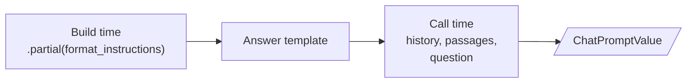
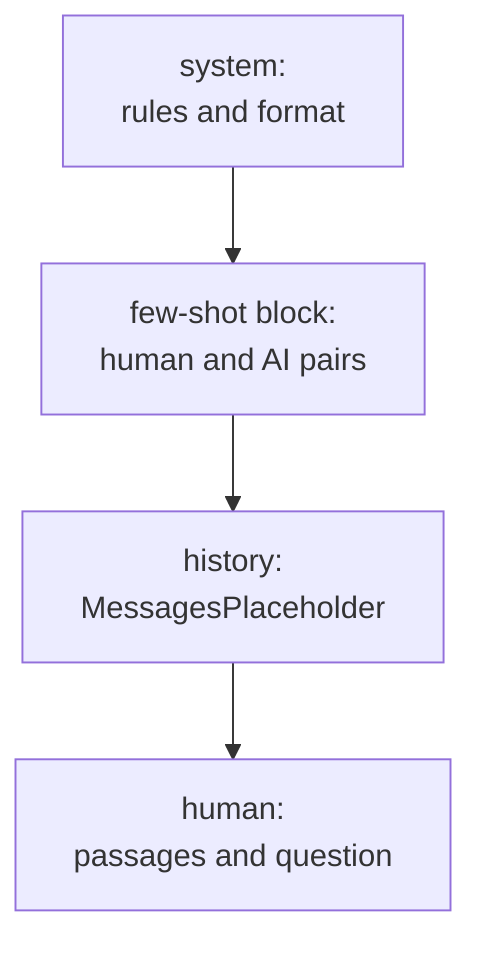

# M06.5 Theory: Prompt templates and few-shot composition

*[M06 theory](../README.md) · Lesson 6.5 · Notebooks: [`05a_Prompt_Templates.ipynb`](../../notebook/05a_Prompt_Templates.ipynb), [`05b_Few_Shot_Composition_and_Serialization.ipynb`](../../../optional/notebook/05b_Few_Shot_Composition_and_Serialization.ipynb) (optional) · [All theory pages](../../../../../THEORY.md)*
<!-- subtitle: Prompts as functions of named slots: which template mistakes raise, which pass without a word, and how examples, parts and saved files fit in -->

## Prompt templates

> **What you'll learn**
>
> - **Explain** a prompt template as a function from variables to a `PromptValue`.
> - **Build** the Larkspur answer prompt from a system message, a history placeholder and a human message.
> - **Diagnose** the two template mistakes that raise and the two that pass silently.
> - **Compose** templates from examples and parts, and save them as data.

Lesson 6.4 ended with the app holding a list of messages per conversation. Something still has to put the passages, the question and the format rules into that list on every call.

The first Larkspur version builds the prompt with string concatenation. It works until someone adds an example answer, `{"answer": ..., "citations": [...]}`, to the system text, and the next refactor swaps concatenation for a format call. The prompt now fails on a key named `"answer"`, and the error points at the wrong line.

**A prompt template is a function from named variables to a prompt.** Its `{slots}` are filled with Python's `str.format` syntax, and it comes in two kinds:

| Class | Produces | Use with |
|---|---|---|
| `PromptTemplate` | a `StringPromptValue`: one string | completion models, or one human message |
| `ChatPromptTemplate` | a `ChatPromptValue`: a list of role-tagged messages | chat models, and anything with a system prompt or history |

*Table 1: The two template classes.*

Both work with a chat model, because a string becomes one `HumanMessage` ([lesson 6.4](../04_inputs_and_outputs_messages_llm_vs_chat_model/README.md#llm-vs-chat-model)). `ChatPromptTemplate.from_template("Explain {topic}")` is exactly `from_messages([("human", "Explain {topic}")])`; we ran the notebook's comparison and the two produce the same messages. Use `from_messages` whenever there is a system prompt.

Three calls fill a template:

| Call | Takes | Returns |
|---|---|---|
| `.format()` | keyword arguments | a plain string |
| `.format_prompt()` | keyword arguments | a `PromptValue` |
| `.invoke()` | a dict | a `PromptValue`; this is the call an LCEL chain makes for you |

*Table 2: Three ways to fill a template, from notebook 05a.*

### The Larkspur answer prompt

The answer prompt has three messages: a system message with the rules and a `{format_instructions}` slot for the parser's text, a `MessagesPlaceholder` named `history` for the conversation so far, and a human message with `{passages}` and `{question}`. Slots fill at two different times:

*Figure 1: `.partial()` fills a slot once when the chain is built; the rest arrive with every call.*

We built that template with `langchain-core` 1.7.0 and printed its variables:

| Template | `input_variables` |
|---|---|
| as built | `format_instructions`, `history`, `passages`, `question` |
| after `.partial(format_instructions=...)` | `history`, `passages`, `question` |

*Table 3: The answer prompt's slots before and after `.partial()`.*

`.partial()` fills a slot once, so callers never pass it. `MessagesPlaceholder` takes a whole list of messages at call time, which is where the history from lesson 6.4 goes.

### Planted failures: four template mistakes

Two of these mistakes raise and two pass without a word. We planted each one on the course environment:

| Mistake | What happens |
|---|---|
| A typo in the `input_variables` you pass (`output_langauge`) | The list is recomputed from the template text and the typo disappears. Only `validate_template=True` raises, with a Pydantic validation error. |
| A variable left out at format time | `KeyError` names it (`'output_language'`). This one is loud. |
| Literal JSON braces in a template, `{"answer": ...}` | `"answer"` becomes a variable, and formatting raises `KeyError('"answer"')`. Double the braces: `{{"answer": ...}}`. |
| `.partial()` for a slot the template does not have | Ignored without an error: `input_variables` is unchanged and the value never reaches the model. Lesson 6.6 finds this in a course notebook. |

*Table 4: Four template mistakes and what `langchain-core` 1.7.0 does with each.*

We call the quiet pair **the silent slot**: a value you meant to send, or a check you meant to run, that LangChain drops without telling you. Printing `input_variables` and the formatted messages once, before the first model call, catches both. The opening refactor bug is the third row: double the braces in any example JSON.

## Few-shot and composition

Examples in the prompt steer both the answer and its format. The optional notebook 05b first writes nine labelled restaurant reviews (three restaurants, three sentiments each) straight into one template string, with every JSON brace doubled. The few-shot classes keep examples as data instead:

- **`FewShotPromptTemplate`**: formats a list of example dicts with an `example_prompt` and adds a `suffix` holding the real input. Adding an example is appending a dict.
- **`FewShotChatMessagePromptTemplate`**: turns each example into a human message and an AI reply, and slots the block into a `ChatPromptTemplate` between the system prompt and the question. Lesson 6.7's optional template notebook builds one.

For Larkspur, one or two examples of a question, its passages and the exact JSON answer show the model the citation format better than a description of it. In the chat version, the block sits here:

*Figure 2: The message order of a few-shot answer prompt. Examples come before the real conversation.*

The notebook also writes the examples as **chain-of-thought** pairs, where each example shows the reasoning before the JSON answer.

### Composing templates

Templates compose with `+`. Adding two `PromptTemplate` objects concatenates the text and merges the variables. We ran it: a passages part plus a question part gives one `PromptTemplate` with `passages` and `question`. `ChatPromptTemplate` objects add the same way, message list to message list. The notebook builds its sentiment prompt from three parts (an introduction, a worked example and the request) and gets one template with 6 variables; `.partial()` on the five example slots leaves only `input`.

`PipelinePromptTemplate`, the 0.x class for this, is in neither `langchain-core` 1.7.0 nor `langchain-classic`. The one thing `+` does not do is place a part into a named slot of a larger template; for that, fill a final template with the formatted parts yourself.

### Saving templates

A template is data, so it can be versioned like code. In 1.x, `dumps` and `loads` from `langchain_core.load` save and restore it as JSON:

| Step | What we saw on the course environment |
|---|---|
| `dumps` on the joke template | 235 characters with the keys `lc`, `type`, `id`, `kwargs` and `name` |
| `loads` with `allowed_objects=[PromptTemplate]` | a `PromptTemplate` back, and a warning that `loads` is in beta |
| `loads` without `allowed_objects` | a warning that the default will change, asking for an explicit list |
| the older `.save()` | still runs, with a warning that it was deprecated in `langchain-core` 1.2.21 and will be removed in 2.0.0 |

*Table 5: Serialising a template in `langchain-core` 1.7.0.*

`allowed_objects` is a security boundary. Deserialising rebuilds objects from the file's contents, and you name the classes you trust.

## In practice: the answer prompt

For Larkspur, the prompt comes together in this order:

1. Write the system rules as a `ChatPromptTemplate` message, with `{format_instructions}` as a slot and every literal brace doubled.
2. Add one or two worked examples as a few-shot block.
3. Add a `history` placeholder and a human message with `{passages}` and `{question}`.
4. Fill `format_instructions` with `.partial()`, then print `input_variables` and one formatted prompt.
5. Save the template with `dumps` next to the code, where a prompt change shows up in review.

> **Key distinction:** a loud mistake stops the first request; a silent slot ships. Print the formatted prompt once, before any model sees it.

Lesson 6.6 fills that `{format_instructions}` slot from an output parser.

## Key Takeaways

- Use `ChatPromptTemplate.from_messages` whenever there is a system prompt or history. Fill fixed slots once with `.partial()` and pass history through a `MessagesPlaceholder`.
- Double literal JSON braces in templates, and print `input_variables` and the formatted messages once before the first call, since a typo or an unused partial fails silently.
- Keep few-shot examples as data in a few-shot template, compose templates with `+`, and save them with `dumps` and `loads`, naming the classes you trust.

## Check yourself

1. In the Larkspur answer prompt, why do the input variables drop from four names to three after calling partial for the format instructions?

`.partial()` fills the `format_instructions` slot once, at build time, so callers never pass it. What remains is `history`, `passages` and `question`; `history` is a `MessagesPlaceholder` that takes a whole message list at call time.

2. You want the model to return Larkspur answers in an exact JSON citation format. Should you describe the format or show it, and what must you watch for?

Show it. One or two examples of a question, its passages and the exact JSON answer show the citation format better than a description; `FewShotChatMessagePromptTemplate` adds each as a human message and an AI reply. Examples written inside a template string need their braces doubled, or `"answer"` becomes a variable and formatting raises `KeyError`.

3. Two of the four template mistakes pass without an error. Which two, and how do you catch them?

A typo in the `input_variables` you pass, which is recomputed from the template text unless `validate_template=True`, and `.partial()` for a slot the template does not have, which is ignored. Printing `input_variables` and the formatted messages once, before the first model call, catches both.

---
*Previous: [6.4 Inputs and outputs: messages, LLM vs chat model](../04_inputs_and_outputs_messages_llm_vs_chat_model/README.md). Next: [6.6 Output parsers](../06_output_parsers/README.md).*
