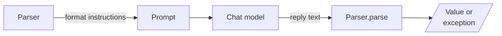
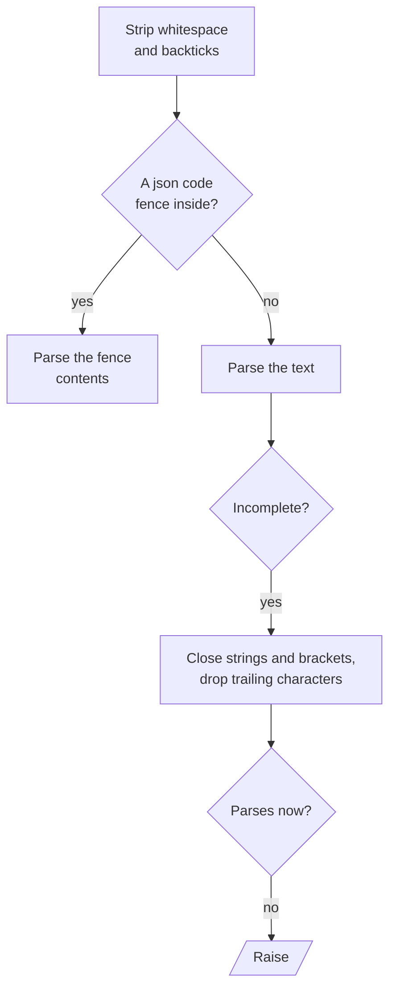

# M06.6 Theory: Output parsers

*[M06 theory](../README.md) · Lesson 6.6 · Notebooks: [`06a_Output_Parser.ipynb`](../../notebook/06a_Output_Parser.ipynb) · [All theory pages](../../../../../THEORY.md)*
<!-- subtitle: A parser cannot make a reply good; it decides whether a bad reply raises or reaches your code looking fine -->

## Output parsers

> **What you'll learn**
>
> - **Explain** the two jobs of an output parser: format instructions before the call, parsing after it.
> - **Compare** four parsers on the same eight replies by what they raise and what they let through.
> - **Diagnose** a truncated reply that `JsonOutputParser` repaired into an ordinary dict.
> - **Choose** a schema that states the rule your app grades by.

Lesson 6.5 left a `{format_instructions}` slot in the Larkspur answer prompt. An output parser fills it, and then reads what comes back.

The refund assistant asks for a JSON answer with a list of cited passages. One reply stops at the token limit, mid-citation. `JsonOutputParser` returns a dict for it without an error, and the citations list ends in `"refund-win"`, a passage id that does not exist. The bad answer reaches the customer because nothing raised.

**An output parser is the last step of a chain, `prompt | llm | parser`, and it works in two places.** Before the call, `get_format_instructions()` returns text that goes into the prompt. After it, `parse()` turns the reply text into a Python value or raises `OutputParserException`:

*Figure 1: One parser, two jobs. The same object writes the instructions and reads the reply.*

Notebook 06a uses four parsers:

| Parser | Returns | Raises when |
|---|---|---|
| `StrOutputParser` | the reply text | never |
| `CommaSeparatedListOutputParser` | a list of strings | never; `"Sure: a, b"` becomes `['Sure: a', 'b']` |
| `JsonOutputParser` | whatever JSON it finds, usually a dict | it finds no JSON it can repair |
| `PydanticOutputParser` | an instance of your model | no JSON, or the JSON fails the model's validation |

*Table 1: The four parsers in notebook 06a.*

### How the JSON parser repairs

`JsonOutputParser` is more forgiving than its name suggests. In `langchain-core` 1.7.0 it tries these steps in order:

*Figure 2: The repair path. A reply raises only when no amount of closing and trimming yields JSON.*

`PydanticOutputParser` runs that same JSON step, then validates the result against the schema. A parser only checks what the schema states, and a reply can be valid JSON and still wrong.

### Eight replies, four parsers

The [interactive lab](interactive/parser-bench-lab.html) runs eight representative replies to the Larkspur refund question through four parsers. The replies are hand-written, since no model was called. The parsers are JavaScript ports of the library code; we re-checked them against `langchain-core` 1.7.0 and Pydantic 2.14.1 on every truncation of the eight replies (535 distinct texts, four parsers each) and found no disagreement. The lab's counts:

| Parser | Raised | Returned, unusable | Usable |
|---|---|---|---|
| `StrOutputParser` | 0 | 8 | 0 |
| `JsonOutputParser` | 1 | 4 | 3 |
| `PydanticOutputParser`, `list[str]` ids | 3 | 2 | 3 |
| `PydanticOutputParser`, `Literal` ids | 5 | 0 | 3 |

*Table 2: The lab's counts. "Usable" is the lab's own rule: an answer string and at least one citation that names one of the three passages.*

Reply by reply, the three field-reading parsers split like this:

| Reply | `JsonOutputParser` | `list[str]` ids | `Literal` ids |
|---|---|---|---|
| Clean JSON, fenced, trailing note | usable | usable | usable |
| Prose before unfenced JSON | raised | raised | raised |
| Truncated mid-citation | unusable | unusable | raised |
| No `citations` key | unusable | raised | raised |
| `citations` as a string | unusable | raised | raised |
| Invented id `handbook-p4` | unusable | unusable | raised |

*Table 3: Where each of the eight replies lands. The first row covers three replies.*

Four things follow from the two tables:

- **The usable count never moves.** A stricter parser produces no extra good answers. It moves bad ones from the returned column to the raised column, where a retry or a fallback can catch them.
- **`JsonOutputParser` raises on one reply only**, the one with prose before unfenced JSON. The trailing note is dropped by the repair step, and the truncated reply comes back as an ordinary dict.
- **`list[str]` stops the shape errors but not the made-up ids.** `"refund-win"` (a truncated id) and `"handbook-p4"` (an invented one) are strings and pass. We call this **the stringly-typed citation**.
- **A `Literal` of the passage ids raises on all five.** The schema now states the rule the lab grades by.

<!-- lab: interactive/parser-bench-lab.html -->

### Planted failure: the repaired truncation

Truncation is where the repair step matters most. The lab cuts the clean 124-character reply at each of its 125 lengths, as a `max_tokens` limit would:

| Parser | Raised | Unusable | Usable |
|---|---|---|---|
| `JsonOutputParser` | 1 | 120 | 4 |
| `PydanticOutputParser`, `list[str]` ids | 107 | 14 | 4 |
| `PydanticOutputParser`, `Literal` ids | 120 | 1 | 4 |

*Table 4: Every cut of the clean reply, from 0 characters to all 124.*

`JsonOutputParser` raises only on the empty cut and returns a dict for the other 124. We call that **the repaired truncation**: a reply the model never finished arrives as a value that looks complete. With `list[str]`, 14 cuts get through as unusable answers, such as a citation cut to `"refund-t"`. With `Literal` ids, the one unusable cut is `"citations": []`, cut just after the bracket, which no `Literal` can catch. A `min_length=1` on the list would catch it, at the cost of refusing an honest "the handbook does not say" with no citations.

The schema behind the `Literal` row, `CitedAnswer`, has two fields:

| Field | Type | Description sent to the model |
|---|---|---|
| `answer` | string | The answer, using only the passages |
| `citations` | list of `Literal["refund-window", "refund-timing", "billing"]` | Ids of the passages the answer uses |

*Table 5: The `CitedAnswer` schema. The `list[str]` row of the lab differs only in the item type.*

The three ids are fixed here because the lab has one question. In a live pipeline the retrieved ids change per question. Either build the `Literal` per request or check the ids against the retrieved set right after parsing. The check has to exist somewhere; the lab shows what happens where it does not.

## Check that the instructions arrive

Format instructions only help if they reach the model. The prompt needs a `{format_instructions}` slot, filled with `.partial()` or `partial_variables`, as notebook 06a does. The instructions are long, and they are sent as input tokens on every call. The lab prints their length for each parser:

| Parser | Format instructions |
|---|---|
| `StrOutputParser` | none; the prompt has to ask for JSON in its own words |
| `PydanticOutputParser`, `list[str]` ids | 748 characters |
| `PydanticOutputParser`, `Literal` ids | 803 characters |
| `JsonOutputParser(pydantic_object=...)` | 1,301 characters |

*Table 6: Format instruction length for the two-field schema, from the lab.*

One of lesson 6.7's optional recap notebooks shows the silent version of this mistake, **the dropped partial**. Its `PydanticOutputParser` example calls `.partial(format_instructions=...)` on a template with no `{format_instructions}` slot. LangChain ignores the value without an error (lesson 6.5's silent slot), and the model never sees the schema. The chain works only when the model happens to produce matching JSON from the one-line request. Printing the formatted prompt once shows whether the schema is in it.

## In practice: the refund answer

For Larkspur's cited answers:

1. Use `PydanticOutputParser` with `CitedAnswer`, building the `Literal` from the retrieved passage ids, or check the ids right after parsing.
2. Put `{format_instructions}` in the system message and fill it with `.partial()`; print one formatted prompt.
3. Treat `OutputParserException` as a signal: log the raw reply, retry once, then fall back.
4. Watch `finish_reason` from lesson 6.2, since a truncated reply is the case the repair step hides best.

> **Key distinction:** a parser decides which failures you see. It never turns a bad reply into a good one.

Lesson 6.7 moves the schema out of the prompt and into the provider's API.

## Key Takeaways

- A parser adds format instructions to the prompt and turns the reply into a value or raises. `JsonOutputParser` repairs truncated JSON and returns broken replies as ordinary dicts.
- A stricter schema does not make more good answers. It turns bad ones into errors a retry can catch, so state every rule in the schema, such as `Literal` passage ids, or check ids against the retrieved set.
- Format instructions help only if they reach the model. Give the prompt a `{format_instructions}` slot and print the formatted prompt once to confirm the schema is there.

## Check yourself

1. In the lab, moving from the JSON parser to the Pydantic parser with Literal ids leaves the usable count at three. What does the stricter parser change?

It moves bad replies from the returned column to the raised column. The three good replies pass every parser that reads fields; a stricter schema produces no extra good answers, but a raised error is one a retry or a fallback can catch, while an unusable dict goes downstream unnoticed.

2. A reply cites handbook-p4, an id that is not among the three passages. Which of the lab's parsers stop it?

Only `PydanticOutputParser` with `Literal` ids. `JsonOutputParser` returns it as an ordinary dict, and with `list[str]` the invented id is still a string, so it passes. The schema has to state the rule, or the ids have to be checked against the retrieved set right after parsing.

3. A chain with the Pydantic parser works on some questions and fails on others. Its template has no format instructions slot. What went wrong?

The `.partial(format_instructions=...)` call was ignored without an error, so the model never saw the schema. The chain works only when the model happens to produce matching JSON from the one-line request. Printing the formatted prompt once shows whether the schema is in it.

---
*Previous: [6.5 Prompt templates and few-shot composition](../05_prompt_templates_and_few_shot_composition/README.md). Next: [6.7 LangChain 1.x recap course, ending in a structured-output Q&A bot](../07_langchain_1_x_recap_course_ending_in_a_structured_output_q_a_bot/README.md).*
