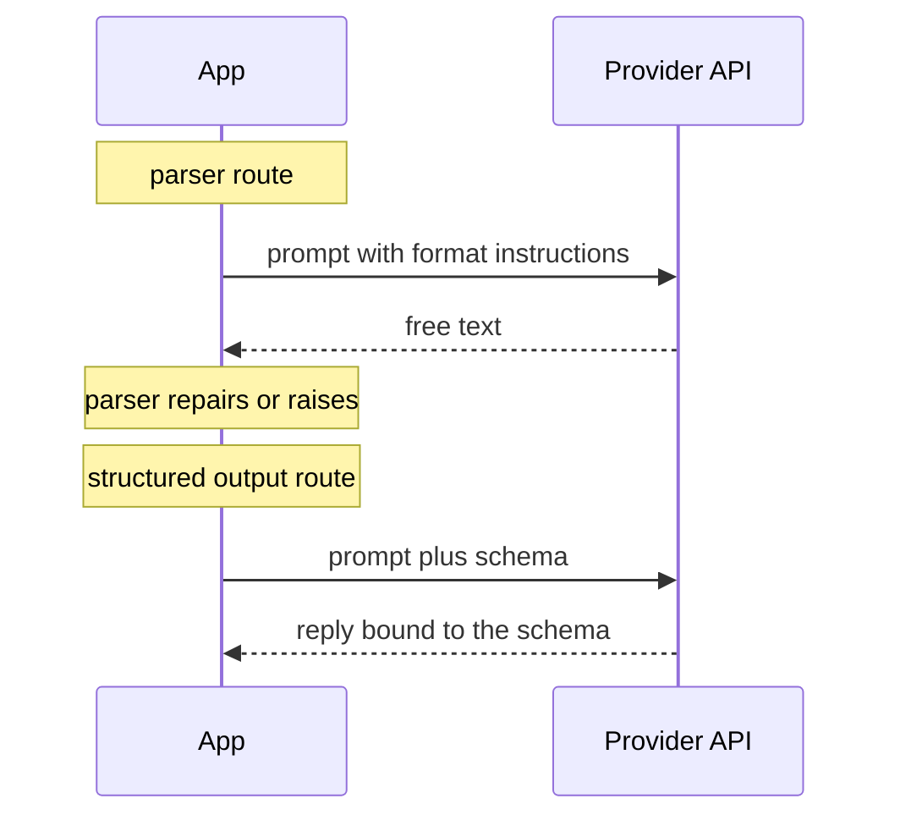
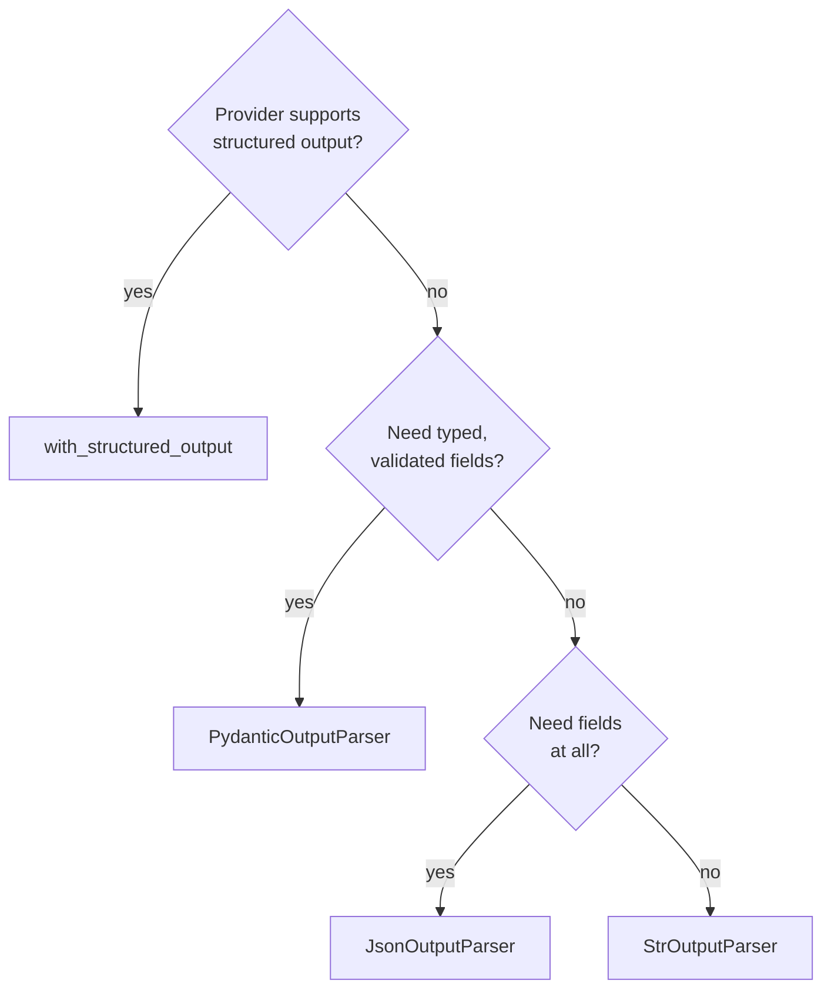

# M06.7 Theory: LangChain 1.x recap course, ending in a structured-output Q&A bot

*[M06 theory](../README.md) · Lesson 6.7 · Notebooks: [`07a_smart_bot_section1.ipynb`](../../notebook/07a_smart_bot_section1.ipynb), [`07f_output_parsers_demo.ipynb`](../../../optional/notebook/07f_output_parsers_demo.ipynb) (optional), [`07g_output_parsers_final.ipynb`](../../../optional/notebook/07g_output_parsers_final.ipynb) (optional) · [All theory pages](../../../../../THEORY.md)*
<!-- subtitle: Sending the schema to the provider instead of the prompt, what that does and does not stop, and a Q&A bot that always returns the same type -->

## Structured output

> **What you'll learn**
>
> - **Explain** where `with_structured_output` puts the schema, compared with an output parser.
> - **Choose** between structured output and the four parsers with one decision chain.
> - **Diagnose** a batch that loses every answer when one input fails.
> - **Copy** the bot design that always returns the same type to its caller.

Lesson 6.6 put the schema in the prompt and checked the reply afterwards. The parser could refuse a bad reply; it could not stop the model from writing one.

Larkspur's assistant still pays for that design on every call. The format instructions for `CitedAnswer` run to 803 characters of input, and a reply that opens with a sentence of prose before the JSON still raises, as the lesson 6.6 lab shows. The rule that the reply must be JSON lives only in the prompt, where the model may ignore it.

**`llm.with_structured_output(Schema)` returns a new runnable whose output is an instance of the schema.** It sends the schema to the provider with the request instead of writing it into the prompt, and providers that support structured output constrain the reply to it. Notebook 07g's advice is to prefer it over `PydanticOutputParser` for any model that supports it:

*Figure 1: The two routes. The parser checks the reply after the fact; structured output tells the provider the shape before it writes.*

| | `PydanticOutputParser` | `with_structured_output` |
|---|---|---|
| Where the schema goes | into the prompt, as format instructions (748 to 803 characters for the lesson 6.6 schemas) | to the provider's API |
| Which models | any model that follows instructions | models with structured-output or tool-calling support |
| Prose around the JSON, fences, trailing notes | repaired or raised by the parser | not produced when the provider constrains the reply |
| Values the schema allows but your app does not | pass | pass |

*Table 1: The two approaches side by side.*

The last row is the same for both. A schema bound to the model still lets through a made-up passage id if `citations` is `list[str]`. The lesson 6.6 rule holds: put every rule you can into the schema, with `Literal` for ids and fixed labels. We call the gap **the allowed-but-wrong value**: valid against the schema, wrong for the app.

Notebook 07g also binds nested schemas (a company with an address object and a product list) the same way; validation covers the whole structure.

Picking the tool comes down to a few questions in order:

*Figure 2: Choosing between structured output and the parsers. Each "no" moves one question down.*

## Inside SmartQABot

Notebook 07a builds `SmartQABot` on structured output: a `ChatPromptTemplate` with a system prompt and a `{question}` slot, piped into a chat model bound to `QAResponse`. The schema has five fields:

| Field | Type | Purpose |
|---|---|---|
| `answer` | string | the answer |
| `confidence` | string | asked to be high, medium or low |
| `reasoning` | string | why the bot answered as it did |
| `follow_up_questions` | list of strings, empty by default | suggestions for the user |
| `sources_needed` | boolean, false by default | whether external sources would help |

*Table 2: `QAResponse`, the bot's return type.*

Two of its choices are worth copying, and two are worth fixing before Larkspur uses the pattern:

- **Copy: a fallback object.** `ask()` catches any exception and returns a valid `QAResponse` with `confidence="low"` and the error in `reasoning`. The caller always gets the same type back.
- **Copy: tracing.** `@traceable` sends every call to LangSmith when a LangSmith API key is set, and a bad answer can then be traced to its exact prompt and reply.
- **Fix: `confidence` is a `str`.** Its description asks for high, medium or low, but nothing enforces it; `Literal["high", "medium", "low"]` would.
- **Fix: `ask_batch()` has no fallback.** It calls `chain.batch(inputs)`, and by default `batch` raises the first exception and loses every result.

### Planted failure: the all-or-nothing batch

We checked the batch behaviour with a three-input batch whose middle input fails, using a stub step in place of the model:

| Call | Result |
|---|---|
| `batch([1, 2, 3])` | raises the middle input's `ValueError`; no results returned |
| `batch([1, 2, 3], return_exceptions=True)` | the first and third results, with the exception object in the middle slot |

*Table 3: One failing input in a batch of three, run with `langchain-core` 1.7.0.*

We call the default **the all-or-nothing batch**: one bad question costs the answers to the good ones. With `return_exceptions=True`, the caller can replace each exception with the same fallback object `ask()` returns.

## In practice: Larkspur's cited answer

For the lab brief, the same shape answers Larkspur's refund question:

1. Use `CitedAnswer` from lesson 6.6 as the schema, with `Literal` passage ids.
2. Put the three passages and the question in the human message; the system message holds the rules, with no format instructions.
3. Bind the schema with `with_structured_output` if the provider supports it, and fall back to `PydanticOutputParser` if not (Figure 2).
4. On any exception, return a `CitedAnswer`-shaped fallback that says the handbook could not be checked, instead of guessing.
5. Batch with `return_exceptions=True` and trace every call.

> **Interview tip:** structured output removes a class of format failures; it does not validate meaning. Name the check you still run after it.

## Key Takeaways

- Prefer `with_structured_output` on models that support it. It sends the schema to the provider instead of the prompt, and the provider constrains the reply to it.
- Neither approach stops values the schema allows, so type fixed labels and ids as `Literal`.
- Return a fallback object of the same type when a call fails, trace every call, and pass `return_exceptions=True` to `batch` so one failure does not lose the other results.

## Check yourself

1. How does with_structured_output differ from the Pydantic output parser in where the schema goes, and what does that buy?

It sends the schema to the provider's API with the request instead of writing it into the prompt as format instructions (748 to 803 characters for the lesson 6.6 schemas). Providers that support structured output constrain the reply to it, so prose around the JSON, fences and trailing notes are not produced.

2. You bind CitedAnswer with citations typed as a list of strings to the model. Can it still return a made-up passage id?

Yes. A schema bound to the model still passes any value the schema allows, and any string is allowed. The lesson 6.6 rule holds for both approaches: put the rule into the schema, with `Literal` for passage ids and fixed labels.

3. SmartQABot's ask_batch sends three questions and the middle one fails. What does the caller get, and how do you fix it?

An exception and no results, because `batch` raises the first exception by default and loses every result. `batch(..., return_exceptions=True)` returns the two good results with the exception in place of the middle one, which a fallback like the one in `ask()` can then replace.

---
*Previous: [6.6 Output parsers](../06_output_parsers/README.md). Next: [M06 interview questions](../README.md#interview-spotlight-5-questions-you-might-get-asked).*
