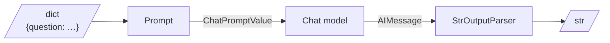
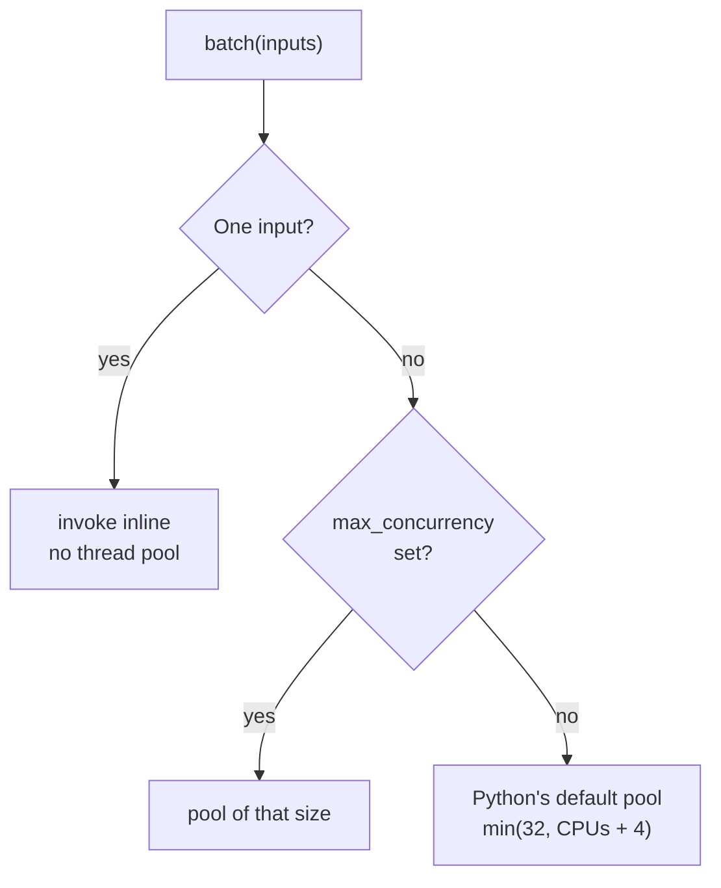

# M07.1 Theory: LCEL and the Runnable interface

*[M07 theory](../README.md) · Lesson 7.1 · Notebooks: [`01a_LCEL_Introduction.ipynb`](../../notebook/01a_LCEL_Introduction.ipynb), [`01b_Runnables.ipynb`](../../notebook/01b_Runnables.ipynb) · [All theory pages](../../../../../THEORY.md)*
<!-- subtitle: Why a prompt, a model, a parser, a retriever and a whole chain can all be run, tested and batched the same way -->

## Runnable interface

> **What you'll learn**
>
> - **Explain** what makes a component a Runnable and which methods every Runnable shares.
> - **Pass** several values through an interface that takes exactly one input.
> - **Diagnose** a broken pipe by invoking each step alone and reading the type it returns.
> - **Predict** what `batch` and `stream` do before you rely on them.

[M06](../../../../m06_langchain_core/mandatory/theory/README.md) built the pieces of a LangChain app one at a time: a chat model, a prompt template, an output parser. Each had its own way of being called. The Larkspur Cloud support assistant needs all of them at once, plus a retriever over the handbook, and the first version of its refund chain fails with `AttributeError: 'AIMessage' object has no attribute 'upper'`. Nothing in that message says which of the four steps broke. This lesson gives every step the same shape, and that shape is what lets you find the broken step in one pass.

**A Runnable is any LangChain component that takes one input and returns one output through a fixed set of methods.** A prompt template, a chat model, an output parser, a retriever and a chain built from them all have the same methods. Code that runs one of them runs any of them. **LCEL**, the LangChain Expression Language, is the pipe syntax that joins Runnables into a chain; lesson 7.2 opens it up. The methods every Runnable shares:

| Method | Takes | Returns | Use it for |
|---|---|---|---|
| `invoke` | one input | one output | a single request |
| `batch` | a list of inputs | a list of outputs, in input order | many independent requests, run on a thread pool |
| `stream` | one input | an iterator of chunks | showing tokens as the model writes them |
| `ainvoke`, `abatch`, `astream` | the same | awaitables and async iterators | async servers |

*Table 1: The Runnable methods. Every component and every chain has all of them.*

Each method also takes an optional `config`. It carries tags, metadata and callbacks for tracing, and `max_concurrency`, which caps how many `batch` calls run at once. The same `config` works on a single prompt and on a ten-step chain, which is why tracing and rate limits attach once rather than per component.

### One input, always

`invoke` passes exactly one argument. When a step needs two values, they travel together in one container. Notebook 01b shows three ways: a tuple the function unpacks, a dict the function reads by key, and a small lambda that takes a dict and calls an existing two-parameter function with its two keys. Dicts win in practice. Prompt templates read their variables from a dict, and `RunnableParallel` returns one, which lets a dict flow from step to step without conversion.

We planted three wrong inputs and ran them against the installed `langchain-core` 1.7, with a fake chat model standing in for a real one:

| Planted input | What came back | Why |
|---|---|---|
| A lambda with two parameters, invoked with `1` | `TypeError: missing 1 required positional argument: 'b'` | the Runnable passes one argument and never splits it |
| A prompt that declares `{question}`, given `{"q": ...}` | `KeyError: Input to ChatPromptTemplate is missing variables {'question'}` | the dict keys must match the template's variables |
| A function that upper-cases a string, placed right after the model | `AttributeError: 'AIMessage' object has no attribute 'upper'` | the model returns a message object, not a string |

*Table 2: Three planted input errors and the exception each raises.*

The third row is the Larkspur refund chain's bug. It belongs to a family worth naming.

### Each step changes the type

Notebook 02a invokes the pieces of `prompt | model | parser` one at a time before building anything. On a Larkspur question the data changes shape at every arrow:

*Figure 1: The type that crosses each arrow of a prompt, model and parser chain.*

A **seam mismatch** is a step that receives a different type from the one it was written for. A function that expects a string receives a dict, a prompt receives an `AIMessage`, or a string function receives the model's message before the parser has turned it into text. Most pipe errors are seam mismatches, and the exception names the type at the broken seam, never the step.

The cure is the same three moves for every step: invoke it alone, print what it returns, check the type against what the next step expects. We traced the refund chain that way, with a fake model that always gives the same reply (*Illustrative*):

| Step | Receives | Returns |
|---|---|---|
| Prompt | `{"question": "How long does a refund take?"}` | `ChatPromptValue` holding one human message |
| Chat model | that `ChatPromptValue` | `AIMessage` with the reply text |
| `StrOutputParser` | that `AIMessage` | the reply as a plain `str` |
| Upper-case function | a `str`, once it sits after the parser | the same text in capitals |

*Table 3: The refund chain traced step by step. Moving the upper-case function after the parser fixes the seam mismatch from Table 2.*

### Three helpers for glue code

Most of the code between prompts and models is glue, and three Runnables cover nearly all of it:

- **`RunnablePassthrough`**: returns its input unchanged. It keeps the original question available beside a transformed copy.
- **`RunnableLambda`**: wraps any Python function so it can sit in a pipe, for cleaning input, formatting retrieved documents or pulling out one key.
- **`RunnableParallel`**: runs several Runnables on the same input and returns a dict of their outputs, one key per branch. Lesson 7.3 covers it in depth.

Notebook 01b combines the first two before a prompt. One branch passes the text through untouched, the other keeps the first three words longer than four characters. On "Building scalable data platforms requires careful architecture planning" the keyword branch returns `building`, `scalable` and `platforms`, and the prompt receives both the original sentence and that list.

### Batch and stream come with it

`batch` and `stream` need no extra code, but each has a detail that changes what you see.

The default `batch` runs `invoke` once per input on a thread pool. With no `max_concurrency` set, the pool uses Python's default worker count, the smaller of 32 and the CPU count plus 4 (19 workers on the 15-core machine we ran on). With exactly one input, `batch` skips the pool and runs inline on the calling thread. The installed source checks the count before it builds an executor:

*Figure 2: How `batch` chooses where calls run. A one-item batch shows no speed-up by design.*

A failure in one input fails the whole batch unless you pass `return_exceptions=True`. With it, a list of three inputs whose second raises returns the first result, the exception object and the third result, each in its slot.

A `RunnableLambda` that wraps a generator streams each `yield`. Notebook 01b's word processor upper-cases one word at a time:

| Call | On "building scalable data solutions" | What you get |
|---|---|---|
| `stream` | 4 chunks | "Processed: BUILDING", then "Processed: BUILDING SCALABLE", and so on up to all four words |
| `invoke` | 1 string | the four chunks added together end to end, with no separator |

*Table 4: The same generator Runnable called two ways, from a run of the notebook's function.*

The `invoke` result is the **concatenated stream**: a Runnable combines streamed chunks by adding them, which suits token deltas and garbles cumulative snapshots. A generator that yields growing snapshots belongs behind `stream` only.

## In practice: testing each step

For the Larkspur assistant the shared interface turns into one way of testing every part:

1. Invoke the refund prompt with a sample question and check that it returns a `ChatPromptValue` with the question filled in.
2. Invoke the retriever with the same question and check that the refund paragraph of the handbook comes back.
3. Invoke the parser on a hand-written `AIMessage` and check that it returns a string.
4. Invoke the finished chain and check the answer. When it fails, steps 1 to 3 have already shown which seam is wrong.

The same three lines (invoke, print, assert) work on each of them because each is a Runnable. Lesson 7.2 shows how the pipe operator turns those separate steps into one Runnable without losing that property.

## Key Takeaways

- Every Runnable takes one input through the same methods: `invoke`, `batch`, `stream` and their async forms. Pass several values as a dict, which prompt templates read and `RunnableParallel` returns.
- Most pipe failures are seam mismatches. Invoke each step alone, print what it returns, and compare the type with what the next step expects.
- `batch` uses a thread pool except for a single input, and fails as a whole unless `return_exceptions=True`. A generator `RunnableLambda` streams each `yield`, and `invoke` adds those chunks together.

## Check yourself

1. Why can the same few test lines check the Larkspur refund prompt, the retriever, the parser and the finished chain?

Each of them is a Runnable with the same fixed methods: `invoke`, `batch`, `stream` and their async forms. Code that runs one runs any of them, which is why the same three lines (invoke, print, assert) work on every part.

2. An existing function takes two parameters, a and b. How do you put it in a pipe?

Wrap it in a small lambda that takes one dict and calls the function with the dict's `a` and `b` values. `invoke` passes exactly one argument, and a two-parameter lambda raises `TypeError` for the missing `b`. Dicts are the usual container because prompt templates read their variables from one and `RunnableParallel` returns one.

3. A pipe of prompt, model and your own string function fails with an AttributeError on AIMessage. Where is the bug, and how do you confirm it?

It is a seam mismatch: the string function sits right after the model, which returns an `AIMessage`, not a string. Invoke each step alone and print what it returns (dict, then `ChatPromptValue`, then `AIMessage`, then `str`). Moving the function after `StrOutputParser` gives it the string it expects.

---
*Previous: [M07 overview](../README.md). Next: [7.2 LCEL deep dive](../02_lcel_deep_dive/README.md).*
