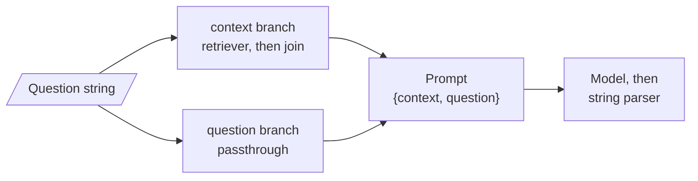

# M07.2 Theory: LCEL deep dive

*[M07 theory](../README.md) · Lesson 7.2 · Notebooks: [`02a_LCEL_Deepdive.ipynb`](../../notebook/02a_LCEL_Deepdive.ipynb), [`02b_LCEL_and_Runnables.ipynb`](../../../optional/notebook/02b_LCEL_and_Runnables.ipynb) (optional) · [All theory pages](../../../../../THEORY.md)*
<!-- subtitle: What the pipe operator really builds, why a dict inside a pipe runs in parallel, and how to add a key without losing the rest -->

## Pipe composition

> **What you'll learn**
>
> - **Explain** what Python does when two Runnables are joined with `|`, and what object comes back.
> - **Predict** the output of a dict placed inside a pipe, including nested pipes and plain lambdas.
> - **Choose** between `RunnableParallel` and `.assign()` when a later step still needs the original input.
> - **Trace** the Larkspur RAG chain from question string to prompt variables.

Lesson 7.1 made every step a Runnable with one input and one output. A chain is several of them joined with `|`, and the Larkspur team's RAG chain looks harmless: a dict that fetches context and keeps the question, then a prompt, a model and a parser. Then someone adds a step that computes a confidence score as a `RunnableParallel`, and the next step fails with a `KeyError` for `question`. The question was there one step earlier. This page explains where it went, starting with what `|` actually does.

### The pipe is a Python operator

The `|` in `prompt | model | parser` is ordinary Python. `a | b` calls `a.__or__(b)`, the same way `2 + 4` calls `(2).__add__(4)`. A class decides what its operators mean: notebook 02a's toy `StupidAdder` makes `5 + 10` return 57 by adding 42 on every sum. LangChain's `Runnable.__or__` returns a `RunnableSequence` that holds both sides, and the sequence's `invoke` runs the first step and feeds its output to the next.

Notebook 02a proves this by building the mechanism from scratch. Its `CRunnable.__or__` returns a `CRunnableSequence` holding the two sides, and the sequence's `invoke` hands the first step's result to the second. Three small steps piped together give:

*Figure 1: The notebook's hand-built pipe. Each arrow carries the previous step's output; running it prints 10, 20 and 40 before returning "Result: 40".*

LangChain's real `RunnableSequence` works the same way and adds what the toy lacks:

| Capability | Toy `CRunnableSequence` | LangChain `RunnableSequence` |
|---|---|---|
| `invoke` feeds each output forward | ✓ | ✓ |
| `batch`, `stream` and async on the whole pipe | ✗ | ✓ |
| A traced child run per step | ✗ | ✓ |
| Flattening: `(a \| b) \| c` is one sequence of three steps | ✗, it nests | ✓, we checked: 3 steps |

*Table 1: What the library sequence adds to the bare operator.*

Flattening matters when you read traces. A chain assembled from smaller chains still shows one flat list of steps, and each step keeps its own latency.

### A dict in a pipe runs in parallel

When the left side of `|` is a plain dict, Python asks the Runnable on the right through `__ror__`, and LangChain turns the dict into a `RunnableParallel`. A dict on the right side is converted the same way. Each value runs on the same input, and the output is a dict with the same keys. We reran notebook 02a's cells, which need no API key:

| Chain | Input | Output |
|---|---|---|
| `x` and `y` both `RunnablePassthrough()` | `"hello"` | `{'x': 'hello', 'y': 'hello'}` |
| same, with `y` a plain lambda reading `input2` | `{"input": "hello", "input2": "goodbye"}` | `{'x': {'input': 'hello', 'input2': 'goodbye'}, 'y': 'goodbye'}` |
| `x` becomes a pipe: passthrough, then a function that upper-cases `input` | the same dict | `{'x': 'HELLO', 'y': 'goodbye'}` |
| `x` a passthrough, then `.assign(extra=...)` returning 100 | the same dict | `{'x': {'input': 'hello', 'input2': 'goodbye'}, 'extra': 100}` |

*Table 2: The notebook's `RunnableParallel` runs, reproduced offline.*

Two rules follow from the table. A plain lambda in a dict is wrapped in a `RunnableLambda` for you. A branch can be a pipe of its own, which means pipes nest inside dicts and dicts inside pipes.

### Adding a key, keeping the rest

Here is the bug from the opening. A `RunnableParallel` **replaces** its input with the dict it builds. `.assign(key=runnable)`, on `RunnablePassthrough` or on a parallel, computes the new key from the current dict and returns the old keys with it. On the input `{"q": "refund?"}` with a branch that counts characters:

| Step | Output |
|---|---|
| `RunnableParallel(n=...)` | `{'n': 7}` |
| `RunnablePassthrough.assign(n=...)` | `{'q': 'refund?', 'n': 7}` |

*Table 3: Parallel replaces the input; assign extends it. Both runs are from the installed library.*

We call the parallel case the **lost question**: a key that a later step needs is dropped because an intermediate step rebuilt the dict from scratch. `.assign()` is how a pipe carries the question forward while later steps add `context`, then `answer`, then `sources`.

Finished chains compose like any step. Notebook 02a pipes the `.assign()` chain from Table 2 into a second chain that reads `extra` and upper-cases it as text; the result is the string `'100'`. Optional notebook 02b applies the same pieces to a RAG chain over a vector store.

## In practice: the Larkspur RAG chain

The Larkspur RAG chain from lesson 7.4 is the dict rule in action. It starts with a dict of two branches, then a prompt, a model and a string parser:

*Figure 2: The question fans out to two branches, which meet again as the prompt's two variables.*

We traced it with a stub retriever over two sentences of the Larkspur refunds section and a fake model (*Illustrative*):

| Step | Receives | Returns |
|---|---|---|
| Dict (a `RunnableParallel`) | "How long does a refund take?" | `{context: ..., question: ...}` |
| Context branch | the same string | the retrieved paragraphs joined with blank lines into one string |
| Question branch | the same string | the string unchanged |
| Prompt | that dict | one message with the context and the question filled in |
| Model and parser | that message | the answer as a string |

*Table 4: The Larkspur RAG chain traced step by step.*

The prompt receives exactly the two variables it declares. Lesson 7.3 builds the shapes that come next: pipelines that keep every intermediate key, fan-outs that merge, and routers.

## Key Takeaways

- The `|` operator calls `__or__`, which returns a flattened `RunnableSequence` that feeds each step's output to the next and adds batch, streaming, async and tracing.
- A plain dict in a pipe becomes a `RunnableParallel`: every value runs on the same input, and lambdas are wrapped for you. Pipes nest inside dicts and dicts inside pipes.
- `RunnableParallel` replaces its input. Use `.assign()` to add a key while keeping the rest, or a later step meets the lost question.

## Check yourself

1. What does Python actually do when you join two Runnables with the pipe operator, and what object comes back?

`a | b` calls `a.__or__(b)`, the same way `2 + 4` calls `(2).__add__(4)`. LangChain's `Runnable.__or__` returns a `RunnableSequence` holding both sides, whose `invoke` runs the first step and feeds its output to the next. It also flattens, so `(a | b) | c` is one sequence of three steps.

2. The Larkspur RAG chain starts with a plain dict of context and question. What does each value receive, and what reaches the prompt?

The dict becomes a `RunnableParallel`, and the question string goes to both values. The retriever turns it into documents that are joined into one string, while the passthrough keeps the question as it is. The prompt receives a dict with `context` and `question`, exactly the two variables it declares.

3. A later step needs the original question, but the RunnableParallel before it replaced its input. What should you use instead?

`.assign()`. `RunnableParallel` replaces its input with the new dict, while `.assign(key=runnable)` computes the new key from the current dict and returns the old keys with it. That is how a pipe carries the question forward while later steps add `context`, then `answer`, then `sources`.

---
*Previous: [7.1 LCEL and the Runnable interface](../01_lcel_and_the_runnable_interface/README.md). Next: [7.3 Branching, routing and merging chains](../03_branching_routing_and_merging_chains/README.md).*
