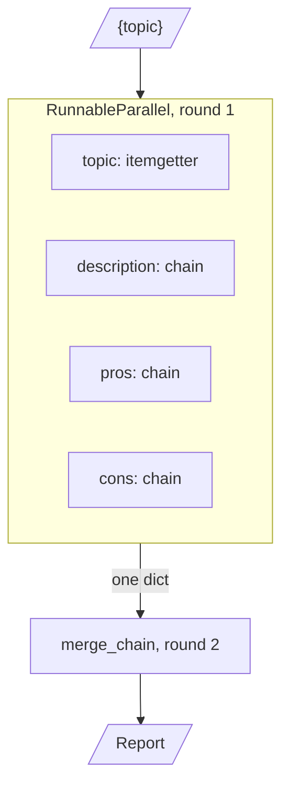
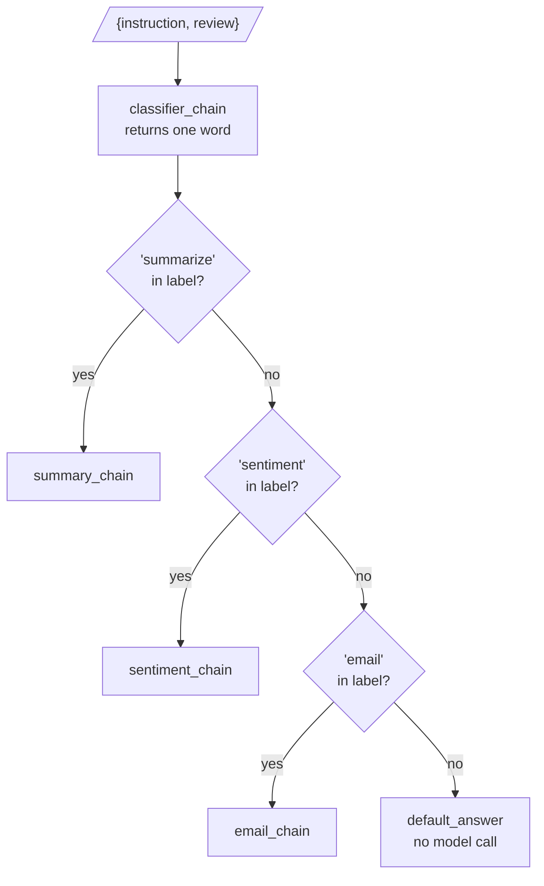

# M07.3 Theory: Branching, routing and merging chains

*[M07 theory](../README.md) · Lesson 7.3 · Notebooks: [`03a_Branching_Routing_Merging_Chains.ipynb`](../../notebook/03a_Branching_Routing_Merging_Chains.ipynb) · [All theory pages](../../../../../THEORY.md)*
<!-- subtitle: Three shapes beyond a straight pipe: a pipeline that keeps every result, a fan-out that merges, and a router that picks one chain -->

## RunnableParallel / Branch

> **What you'll learn**
>
> - **Build** a multi-step pipeline that keeps every intermediate result with `.assign()`.
> - **Count** the model calls and rounds of a fan-out and merge.
> - **Explain** how `RunnableBranch` picks a chain, and why the order of its conditions decides ties.
> - **Design** a default branch that surfaces classifier drift instead of hiding it.

Lesson 7.2 showed that a dict inside a pipe runs its values in parallel and that `.assign()` keeps old keys. A straight pipe still does one thing in one order. The Larkspur support desk needs more: tickets arrive in Spanish and French and must be answered in the customer's language, sales wants a plan comparison written from three angles at once, and every ticket must reach the chain that holds the right policy. On the first day of routing, a ticket labelled "Refund or outage" goes to the refund chain, and nobody notices that the outage was never handled. Notebook 03a builds the three shapes these jobs need, each from the pieces of lessons 7.1 and 7.2.

### Linking: keep the trail

The notebook's IT-support pipeline runs four model chains in order. Each step is a `RunnablePassthrough.assign()`, which means each one adds a key and keeps every key before it:

| Step | Reads | Adds |
|---|---|---|
| Detect the language | `orig_msg` | `orig_lang` |
| Translate to English | `orig_msg`, `orig_lang` | `trans_msg` |
| Write a resolution | `trans_msg` | `trans_response` |
| Translate the reply back | `trans_response`, `orig_lang` | `orig_response` |

*Table 1: The four linked steps of notebook 03a. The last step still reads `orig_lang` from the first.*

`final_chain.map()` runs the pipeline over the notebook's queue of four messages at once. We ran the same chain shape with a stub that sleeps in place of the model: 16 model calls in 4 rounds rather than 16, because the four messages run side by side while each message's four steps stay in order. A **round** here is one wait on the model; calls in the same round run at the same time.

### Fan-out, then merge

Some jobs split into independent parts that meet again. The notebook writes a report on a topic from three branches:

*Figure 1: Three model branches run at once, and one merge call reads all four keys.*

The three model branches share one input and run at the same time. `itemgetter('topic')` copies the topic through without a model call, which lets the merge prompt name it. The merge prompt reads all four keys and writes the report. That is 4 model calls in 2 rounds, confirmed with the same stub, and the wall time is the slowest branch plus the merge. A Larkspur version compares plans: description, pros and cons of the annual plan in parallel, then one call that writes the comparison table.

### Routing with RunnableBranch

*Figure 2: The review router in notebook 03a. Conditions are tested top to bottom.*

**`RunnableBranch` takes `(condition, Runnable)` pairs followed by a default, tests the conditions in order, runs the first whose condition returns true, and runs the default when none does.** It needs at least one pair and a default: given a single argument, the installed library raises `ValueError: RunnableBranch requires at least two branches`. In the notebook a dict first runs the classifier and copies `instruction`, `review` and `sentiment` beside its label, and the branch then picks a chain. A routed request costs 2 model calls in 2 rounds, or 1 call when the default answers with its fixed string.

We fed the notebook's branch a set of planted labels, with stubs in place of the three model chains:

| Classifier label | Chain that ran | Why |
|---|---|---|
| "Summarize" | summary | the conditions lower-case the label first |
| "Email." | email | a substring test ignores the trailing full stop |
| "summarize and email" | summary | the first true condition wins; email is never tested |
| "translate" | default, 0 model calls | no condition matches |

*Table 2: Planted classifier labels and where the router sent them.*

The third row is **first-match capture**: a request that matches two conditions goes to whichever comes first, silently. The same thing happens in the keyword router of notebook 01b, which checks machine-learning words before cloud words. A deployment question that mentions both models and a cloud provider is answered by the machine-learning handler, although the notebook's own comment expects the cloud one. For the Larkspur triage router the opening ticket behaves the same way: with a refund condition ahead of an outage condition, "Refund or outage" reaches the refund chain, and "refunds" matches too because "refund" is inside it.

### Planning the default

The default is where every request the classifier cannot place lands. In notebook 03a it returns a fixed apology. We call that a **silent default**: the request gets an answer, nothing is logged, and a classifier that has started returning new labels looks healthy. For a support desk the default should hand the ticket to a person and be counted, because a rising default rate is an early sign that the classifier has drifted.

The notebook ends with a guard of a different kind. It pipes a chain into `OpenAIModerationChain`, a chain class from the `langchain-classic` package, which screens the output before it reaches the caller. Any Runnable can take that last position, which is how output checks and guardrails attach to a pipe.

## Choosing a chain shape

The three shapes answer different questions about the work:

| Shape | Use it when | Calls and rounds (notebook examples) | Main risk |
|---|---|---|---|
| Linked `.assign()` steps | each step needs earlier results | 4 calls in 4 rounds per message | latency adds up step by step |
| Fan-out and merge | parts are independent, then combined | 4 calls in 2 rounds | wall time set by the slowest branch |
| Router | each input needs one of several chains | 2 calls in 2 rounds, 1 for the default | first-match capture and a silent default |

*Table 3: The three shapes compared on the notebook's own chains.*

## In practice: ticket triage

A ticket triage chain for Larkspur combines all three:

1. A dict runs the classifier and copies the ticket text and the customer's plan beside the label, as the review router does.
2. The classifier returns one of a fixed set of labels (`refund`, `outage`, `export`), which removes most multi-label answers before they reach the branch.
3. The branch sends each label to the chain whose prompt holds that policy. Exact matches replace substring tests: "refunds" no longer passes as "refund".
4. The default hands the ticket to a person, and its rate is logged per day.
5. A non-English ticket runs through the linked translation steps around whichever chain answers it.

Lesson 7.4 turns to older code: the chain classes that did these jobs before LCEL, and how to replace them.

## Key Takeaways

- Link steps with `.assign()` to keep every intermediate result, and use `.map()` to run several inputs side by side while each input's steps stay in order.
- Fan out with `RunnableParallel` and merge with one more chain. Wall time is the slowest branch plus the merge.
- `RunnableBranch` runs the first true condition, which makes first-match capture the default behaviour. Constrain the labels, and make the default hand off to a person and count it.

## Check yourself

1. How does RunnableBranch choose a chain, and where does a label such as summarize and email end up in notebook 03a?

It tests the conditions in order, runs the first whose condition returns true, and runs the default when none does. The 03a conditions are substring tests, and the summary condition comes first, so "summarize and email" goes to the summary chain and never reaches the email chain. That is first-match capture.

2. The Larkspur plan comparison runs description, pros and cons in parallel, then one merge. How many model calls and rounds is that, and what sets the wall time?

4 model calls in 2 rounds. The three model branches run at the same time and `itemgetter('topic')` copies the topic through without a model call; the merge reads all four keys. The wall time is the slowest branch plus the merge.

3. In notebook 03a the router's default returns a fixed apology. What should the default do for the Larkspur support desk, and why?

Hand the ticket to a person and count it. The default is where every ticket the classifier cannot place lands, so a rising default rate is an early sign that the classifier has drifted, and a fixed string hides that.

---
*Previous: [7.2 LCEL deep dive](../02_lcel_deep_dive/README.md). Next: [7.4 Legacy chains and migration to LCEL](../04_legacy_chains_and_migration_to_lcel/README.md).*
