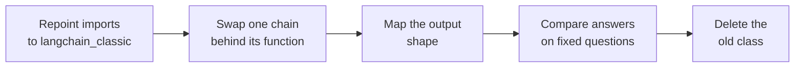

# M07.4 Theory: Legacy chains and migration to LCEL

*[M07 theory](../README.md) · Lesson 7.4 · Notebooks: [`04a_Chain_Migrations.ipynb`](../../notebook/04a_Chain_Migrations.ipynb), [`04b_Basics_of_Chains.ipynb`](../../../optional/notebook/04b_Basics_of_Chains.ipynb) (optional), [`04c_Chains_Basics_and_OutputParsers.ipynb`](../../../optional/notebook/04c_Chains_Basics_and_OutputParsers.ipynb) (optional), [`04d_Advanced_Chains.ipynb`](../../../optional/notebook/04d_Advanced_Chains.ipynb) (optional), [`04e_Chain_Migration_Advanced.ipynb`](../../../optional/notebook/04e_Chain_Migration_Advanced.ipynb) (optional) · [All theory pages](../../../../../THEORY.md)*
<!-- subtitle: Where the pre-1.x chain classes went, why some of them never warn, and how to replace each one without breaking its callers -->

## Legacy chains to LCEL

> **What you'll learn**
>
> - **Explain** where `LLMChain`, `RetrievalQA` and `load_summarize_chain` live in LangChain 1.x and when they will be removed.
> - **Map** each legacy class to the LCEL pipe that replaces it, including the change in output shape.
> - **Diagnose** a legacy chain that runs without warnings.
> - **Plan** a migration that callers never notice.

Lessons 7.1 to 7.3 built chains as pipes. Older code did not. Larkspur's billing FAQ service was written on LangChain 0.x with `RetrievalQA`, a prompt pulled from the prompt hub, and `load_summarize_chain` for weekly digests. After the upgrade to 1.x its first import fails with `ModuleNotFoundError: No module named 'langchain.chains'`. Repointing the imports makes it run again, and the digest job prints no warning at all. This page explains why "it runs" and "it warns about nothing" do not mean "it is current", and how to finish the move.

### Where the old classes went

Before LCEL, LangChain packaged each pattern as a class. In 1.x those classes left the `langchain` package. They live in the compatibility package `langchain-classic`, still run, and carry deprecation markers. We read the markers from the installed `langchain-classic` 1.0.8 source:

| Legacy class or call | Deprecated since | Removal |
|---|---|---|
| `LLMChain` | 0.1.17 | 2.0.0 |
| `RetrievalQA` | 0.2.13 | 2.0.0 |
| `StuffDocumentsChain` (what `load_summarize_chain` returns for stuff) | 0.2.13 | 2.0.0 |
| Calling a chain directly, `chain({...})` | 0.1.0 | 2.0.0 |
| `Chain.run` | 0.1.0 | 2.0.0 |
| `hub.pull` | 1.0.6 | 2.0.0 |

*Table 1: Deprecation markers in the installed source.*

Each class has a short pipe that replaces it. The column that matters most for a running service is the last one:

| Legacy (0.x) | LCEL (1.x) | What changes for the caller |
|---|---|---|
| `LLMChain(llm=llm, prompt=prompt)` | `prompt \| llm \| StrOutputParser()` | the legacy chain returns a dict with the inputs and a `text` key; the pipe returns a string |
| `RetrievalQA.from_llm(llm, retriever=retriever, prompt=prompt)` | a dict of `context` (retriever, then join) and `question` (passthrough), then prompt, model and parser | input key `query` and output key `result` become a plain string in and a string out |
| `load_summarize_chain(llm, chain_type=...)` | one of three short pipes (lesson 7.5) | you join the documents into the prompt's `{text}` yourself |
| `chain({...})`, `chain.run(...)` | `chain.invoke({...})` | the call style was replaced in 0.1.0 |
| `hub.pull("rlm/rag-prompt")` | the prompt written inline in a `ChatPromptTemplate` | no network call and no untrusted object to load |

*Table 2: Each legacy form and its replacement.*

We confirmed the output shapes with a fake chat model. `LLMChain` on `{"adjective": "funny"}` returned `{'adjective': 'funny', 'text': ...}`, and `RetrievalQA` on a refund question returned `{'query': ..., 'result': ...}`. A caller that reads `result["result"]` breaks the moment it receives a bare string. We call that a **shape break**, and it is the main thing a migration has to manage.

### How loud a legacy chain is

You might expect the deprecation markers to warn on every use. We counted the warnings each legacy pattern emits on the installed versions, each in a fresh process:

| Planted legacy code | Warnings at build | Warnings at call |
|---|---|---|
| `LLMChain` built directly, called as `chain({...})` | 1, for the class | 1, for the call style |
| `RetrievalQA.from_llm`, called as `qa(...)` | 0 | 1, for the call style |
| `load_summarize_chain(chain_type="stuff")`, called with `.run()` | 0 | 1: "The method `Chain.run` was deprecated" |

*Table 3: Deprecation warnings counted with a fake model. Classes built inside the library's own helpers warn about nothing.*

Notebook 05b shows the last row: the loader returns a deprecated `StuffDocumentsChain` and says nothing when it is built, and the only warning is about `.run()`, not about the class. Our run shows `RetrievalQA.from_llm` behaving the same way. A `RetrievalQA` built directly does warn, and so do the `LLMChain` and `StuffDocumentsChain` built by hand, but `from_llm` builds them inside the library, and inside the library they stay quiet. Notebook 04a's Markdown expects at least two warnings from its `RetrievalQA` cell; on the installed versions we saw one.

This is the **silent deprecation**: code that keeps working until 2.0 removes it, with nothing in the logs to say so. Audits should grep for imports from `langchain_classic` rather than wait for warnings.

### The prompt hub raises

`langchain_classic.hub.pull` is deprecated since 1.0.6 and hands the request to the LangSmith SDK. The installed `langsmith` refuses public prompts by owner and name unless the caller opts in, raising `ValueError: Pulling a public prompt by owner/name is disabled by default because prompts may contain untrusted serialized LangChain objects.` A hub prompt is a serialized LangChain object, so loading one can configure a model's base URL, headers or other constructor arguments. Notebook 04a lists the options in order of preference:

- **Inline the prompt**: write it into a `ChatPromptTemplate`. No network call and no trust decision.
- **Opt in through the SDK**: pull it with `dangerously_pull_public_prompt=True` and accept the risk.
- **Keep `hub.pull`**: deprecated, and it raises.

### A caller-safe migration

The order matters more than the speed. Each step leaves a service that runs:

*Figure 1: A staged migration. The service runs after every step.*

1. Repoint the imports to `langchain_classic` so the service runs on 1.x unchanged.
2. Replace one chain with its pipe behind the same function.
3. Map the output shape: callers that read `result["result"]` from `RetrievalQA` now receive the string itself. The function wraps it back into the old dict until the callers move.
4. Replace `chain(...)` and `.run()` with `.invoke()`.
5. Run a fixed question set through old and new versions and compare answers before you delete the old class.

The optional notebooks show more legacy classes and their LCEL forms. Notebook 04b builds `LLMChain` and `SimpleSequentialChain`, 04c adds `StructuredOutputParser`, 04d covers `SequentialChain` and the router class `MultiPromptChain` (whose LCEL form is lesson 7.3's `RunnableBranch`), and 04e rewrites `ConversationalRetrievalChain` as a rephrase pipe followed by a retrieval pipe.

## In practice: the FAQ service

For the billing FAQ service the plan runs like this:

1. Grep for `langchain_classic` imports. The service has three: `RetrievalQA`, `hub` and `load_summarize_chain`.
2. Inline the hub prompt first, because `hub.pull` already raises and blocks every request.
3. Replace `RetrievalQA` with the dict, prompt, model and parser pipe from lesson 7.2, keeping the function's dict return value until each caller reads a string.
4. Rewrite the digest job's `load_summarize_chain` as one of the three summarisation pipes from lesson 7.5.
5. Run the service's fixed set of billing questions through both versions, then remove the `langchain_classic` dependency.

Lesson 7.5 writes out those three summarisation pipes and shows how to choose between them.

## Key Takeaways

- Legacy chain classes still run from `langchain-classic` but are set for removal in 2.0.0. Each has a short LCEL pipe that replaces it, usually with a plain string in and out.
- Many legacy chains warn only when called, or not at all, when a library helper built them. Find them by grepping for imports from `langchain_classic`, not by waiting for warnings.
- Migrate one chain at a time behind the same function: map the output shape, switch to `.invoke()`, and compare old and new answers on a fixed question set before deleting the old class.

## Check yourself

1. A Larkspur service built with load_summarize_chain runs on 1.x and prints no warning when the chain is built. Why is that not proof it is safe?

`load_summarize_chain` returns a deprecated `StuffDocumentsChain` and warns nothing at build time; the only warning comes from `.run()`, and it is about `.run()`, not the class. The code keeps working until 2.0 removes it, so audits should grep for imports from `langchain_classic` rather than wait for warnings.

2. Callers read the result key from a RetrievalQA chain's output dict. What do they receive after you swap in the LCEL pipe, and how do you avoid breaking them?

The answer string itself, a shape break. `RetrievalQA` takes the key `query` and returns `result` in a dict, while the pipe takes a plain string and returns a string. Swap the chain behind the same function and have that function wrap the string back into the old shape until every caller reads a string.

3. A legacy notebook pulls rlm/rag-prompt from the hub and raises a ValueError. Which option should you take, and why?

Inline the prompt in a `ChatPromptTemplate`. It makes no network call and loads no untrusted serialized object. The other two options are pulling through the LangSmith SDK with `dangerously_pull_public_prompt=True`, which accepts the risk, and keeping `hub.pull`, which is deprecated and raises.

---
*Previous: [7.3 Branching, routing and merging chains](../03_branching_routing_and_merging_chains/README.md). Next: [7.5 Summarization: stuff, map-reduce, refine](../05_summarization_stuff_map_reduce_refine/README.md).*
