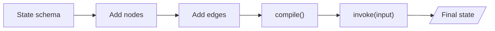
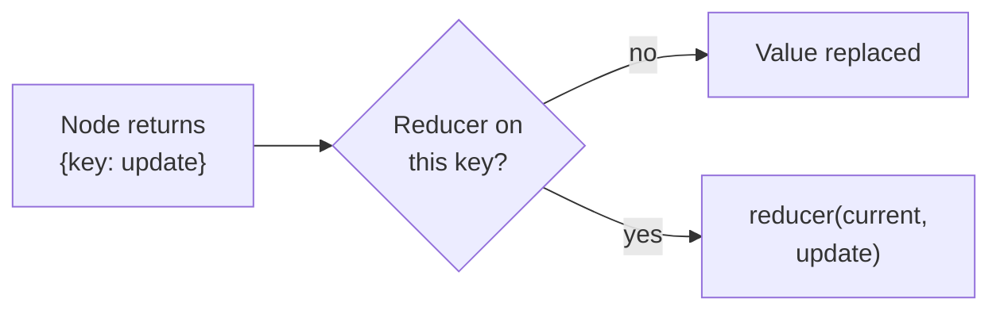

# M08.1 Theory: State, graphs and reducers

*[M08 theory](../README.md) · Lesson 8.1 · Notebooks: [`01a_State_and_Graph_Basics.ipynb`](../../notebook/01a_State_and_Graph_Basics.ipynb), [`01b_MessagesState.ipynb`](../../notebook/01b_MessagesState.ipynb) · [All theory pages](../../../../../THEORY.md)*
<!-- subtitle: How a LangGraph graph holds shared state, and how a reducer per key decides whether a node's write replaces, adds or merges -->

## The question that vanished

> **What you'll learn**
>
> - **Explain** the three parts of a `StateGraph` and what `compile` and `invoke` do with them.
> - **Trace** a node's partial update through a reducer into the state the next node reads.
> - **Diagnose** a lost question and a doubled message history from the message count alone.
> - **Choose** a reducer for every key that a node writes.

[M07](../../../../m07_lcel_runnables_and_chains/mandatory/theory/README.md) composed chat models into LCEL chains: one fixed path, with each step's output feeding the next. Larkspur Cloud's support assistant needs more than one path. A `classify` step reads the customer's question and picks a handler (`billing`, `technical` or `human`), and every handler needs that same question to answer from the handbook.

Here is the first version failing. The customer asks *When will my refund appear on my statement?* The `classify` step routes it to billing correctly. The billing step then finds no question to answer, and the run ends with one message in its history: the billing step's own reply, with no handbook page behind it. Nothing raised an error.

The reason fits in one line: the message list had no rule for combining writes, and each step's write replaced it. The rest of this page does two jobs. It defines the graph that holds the question, and the rule that decides what each write does to it.

## StateGraph

**A `StateGraph` is a graph whose nodes share one state object: each node reads the state and returns the changes it wants to make.** It has three parts:

- **State**: a schema, usually a `TypedDict`, naming the keys every node can read.
- **Node**: a plain function that takes the state and returns a dict holding only the keys it changes.
- **Edge**: which node runs next. `START` and `END` mark the entry and the exit.

The Larkspur support graph maps onto those parts like this:

| Part | In the Larkspur support graph | What it decides |
|---|---|---|
| State | `messages`, `route`, `answer` | what every node can read |
| Nodes | `classify`, `billing`, `technical`, `human` | the work, one partial update each |
| Fixed edges | `START` to `classify`; each handler to `END` | the steps that always happen |
| Conditional edge | `classify` to one handler, chosen from `route` | the branch (lesson 8.2) |

*Table 1: The parts of a `StateGraph` in the running example.*

Building a graph and running it are separate phases. You declare the schema, add nodes and edges to a builder, and call `compile()`, which checks the wiring and returns a runnable. Then `invoke` runs it on an input and returns the final state:

*Figure 1: From schema to final state. Everything before `compile()` describes the graph, and `invoke` runs it.*

The basics notebooks trace three small graphs, and we reran each on LangGraph 1.2.18. None calls a model, and the results are exact:

| Graph | Input | Final state |
|---|---|---|
| One node that uppercases `data` and adds 1 to `counter` | `data` "hello world", `counter` 0 | `data` "HELLO WORLD", `counter` 1 |
| Three nodes in a line, each writing a string to `messages` | "Hi, how are you?." | "Hello this is the final node" |
| `MessagesState` plus `turn_count`, three nodes | `turn_count` 0 | 2 messages (one human, one AI), `turn_count` 1 |

*Table 2: Three graphs from the lesson's notebooks, rerun without a model.*

The second row is the vanished question in miniature: three nodes wrote the same key, and only the last write survived.

The third row introduces **`MessagesState`**, a ready-made schema with one key, `messages`, already paired with a merge rule that appends. The notebook subclasses it to add `turn_count`, which has no rule. One node appends a human message, one appends an AI reply, and a counter node writes `turn_count`. The run ends with both messages kept and the count replaced: two keys in one schema, merged by two different rules.

Two habits from the notebooks keep graphs readable.

1. **Return partial updates.** A node returns only the keys it changed, never the whole state, and each return shows exactly what that node did.
2. **Keep state for data.** State holds what the graph works on. Per-call settings and dependencies, such as a database client, go elsewhere ([lesson 8.4](../04_nodes_runtime_context_and_command/README.md) and lesson 8.5).

The second and third rows of Table 2 differ only in the rule attached to the key, and that rule has a name.

## Reducers

**A reducer is the function that decides what a node's write does to one key of the state.** Without one, the write replaces the value. With one, LangGraph calls it with the current value and the update, and stores the result:

*Figure 2: What happens to each key a node returns.*

You attach a reducer in the schema by annotating the key's type with a function, `Annotated[type, function]`. The function receives two arguments, the current value and the update. The basics notebook starts from a count of 5 and the animals *lion* and *tiger*, then runs one node that returns a count of 1 and the animal *cat*:

| Schema | Final `count` | Final `animals` |
|---|---|---|
| No reducers | 1 | cat |
| `custom_increment` on `count`, `operator.add` on `animals` | 6 | lion, tiger, cat |

*Table 3: One node's write under two schemas (notebook rerun on LangGraph 1.2.18).*

The same write gives different states. The node never decides how its output merges; the schema does.

### The message reducer

`add_messages` is the reducer built for chat histories, and the one `MessagesState` uses. It does four things:

- **Appends** new messages to the list.
- **Assigns an id** to every message that lacks one.
- **Replaces** a message whose id is already in the list, instead of adding a second copy.
- **Converts** a bare string into a `HumanMessage`.

The last rule plants a quiet failure. In the basics notebook, the input and three nodes each write a plain string, and the final list holds four `HumanMessage` objects. We call this **speaker drift**: the assistant's replies are stored as if the customer said them, and a model reading that history sees four customer turns. A node that speaks as the assistant returns an `AIMessage`.

### Planted failures: return style

A reducer and the nodes' return style have to agree. The lab runs the Larkspur graph under each reducer, once with nodes that return only their new message and once with nodes that return the whole list plus their message. Messages in the final state for the refund question:

| Reducer on `messages` | Node returns its message | Node returns the whole list |
|---|---|---|
| None (overwrite) | **1**, and the question is lost | 3 |
| `operator.add` | 3 | **7**, the question four times |
| `add_messages` | 3 | 3 |

*Table 4: Final message counts in the lab for each reducer and return style.*

Each bold cell, plus one fragile cell, is a named failure:

- **Lost question** (overwrite, new-message returns). After `classify`, the list holds only its route message. The billing node has nothing to answer and the structured answer has no source. This is the failure the page opened on.
- **Copy discipline** (overwrite, whole-list returns). It works, but only while every node copies the list forward. One node written the other way erases the history.
- **Doubling history** (`operator.add`, whole-list returns). Each node returns the current list plus one message, and `operator.add` concatenates that onto the current list. A list of *n* messages becomes 2*n* + 1: 1, then 3, then 7. A third step would give 15, and a chat-model node would read, and bill for, every copy.

`add_messages` gives 3 either way, because the copied messages already carry ids and replace themselves. Try each cell in the [reducer lab](interactive/reducer-lab.html), which prints the list after every step:

<!-- lab: interactive/reducer-lab.html -->

Reducers matter a second time when nodes run in parallel. If two nodes in the same step write a key that has no reducer, LangGraph 1.2.18 stops the run with `InvalidUpdateError: At key 'out': Can receive only one value per step`. With `operator.add` on the same key, the run ends with both writes in the list. The fan-out patterns in [M24](../../../../../p06_agent_foundations/m24_agentic_workflow_patterns/mandatory/theory/README.md) give such keys a reducer for this reason.

The rule that follows: decide the reducer for every key that more than one node writes, then hold every node to one return style.

## In practice: the refund question

Here is the refund question through the graph with `add_messages` on `messages` and nodes that return only their new message, as the lab runs it:

1. **Input.** The caller sends the question. State: 1 message.
2. **`classify`** reads the question, finds the billing word *refund*, writes `route` as billing and appends a route message. State: 2 messages.
3. **The conditional edge** reads `route` and sends the run to `billing`.
4. **`billing`** still sees the question, matches it to the handbook's refund-timing page, writes `answer` and appends its reply. State: 3 messages, one of them the customer's.

The `answer` key holds the route (billing), the source (refund-timing) and the page's text: refunds take 5 to 10 business days to appear on the statement.

> **Next lesson:** step 3 is a conditional edge. Lesson 8.2 opens it up: what the router may return, what happens when it returns a name no node has, and why the order of its rules decides close calls.

## Key Takeaways

- A graph is state, nodes and edges. Have each node return only the keys it changes, and keep settings and dependencies out of the state.
- A key with no reducer is replaced on every write. Attach one with `Annotated[type, function]` when a key should accumulate, as `messages` does with `add_messages`.
- Match the reducer to what nodes return. `operator.add` with whole-list returns grows 1, 3, 7 messages, while `add_messages` stays at 3 because ids replace duplicates.

## Check yourself

1. What does a reducer decide, and what happens to a key that has none?

A reducer decides what a node's write does to one key; LangGraph calls it with the current value and the update. Without one, the write replaces the value. Three nodes writing strings into a key with no reducer leave only the last string, "Hello this is the final node", and the original input is gone after the first node.

2. The state starts as count 5 and animals lion and tiger. A node returns count 1 and animals cat. What is the state with custom_increment on count and operator.add on animals?

A count of 6 and the animals lion, tiger and cat. Each reducer combines the current value with the update. Without reducers the same write gives a count of 1 and the animal cat alone.

3. The Larkspur graph with operator.add on messages ends with 7 messages, the question four times. What went wrong, and what fixes it?

The nodes return the whole list plus their message, and `operator.add` concatenates that copy onto the current list: 1, then 3, then 7 messages. This is the doubling history. Either have each node return only its new message, or use `add_messages`, which gives 3 either way because the copied messages carry ids and replace themselves.

---
*Previous: [M08 overview](../README.md). Next: [8.2 Conditional edges and LLM nodes](../02_conditional_edges_and_llm_nodes/README.md).*
