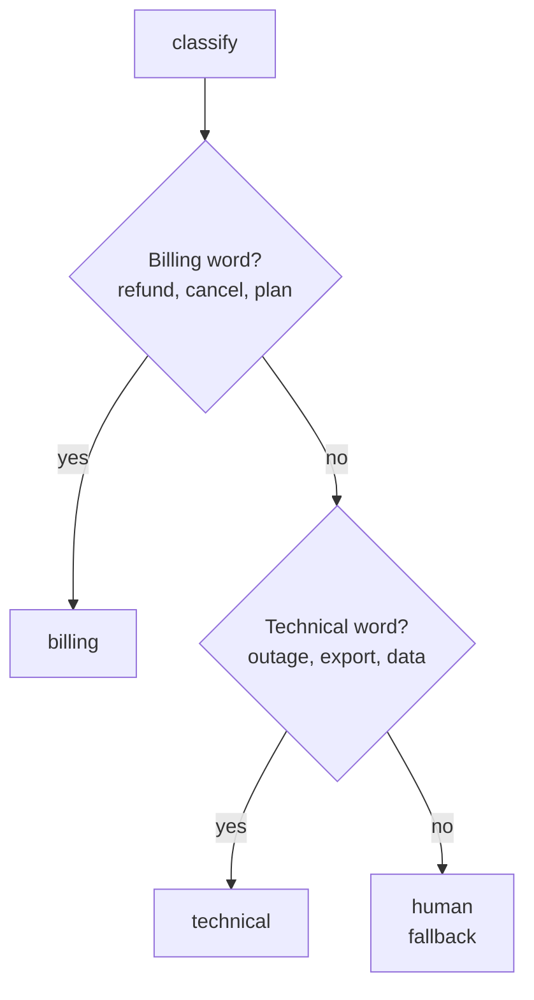
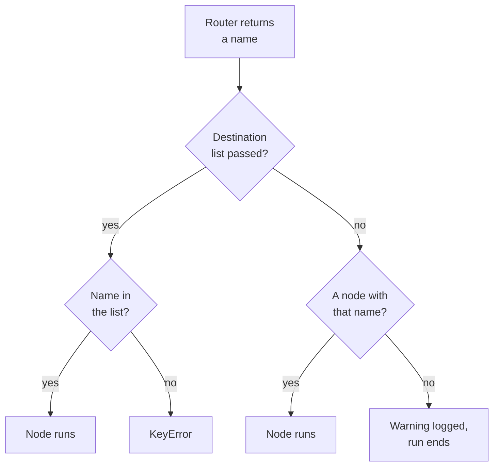
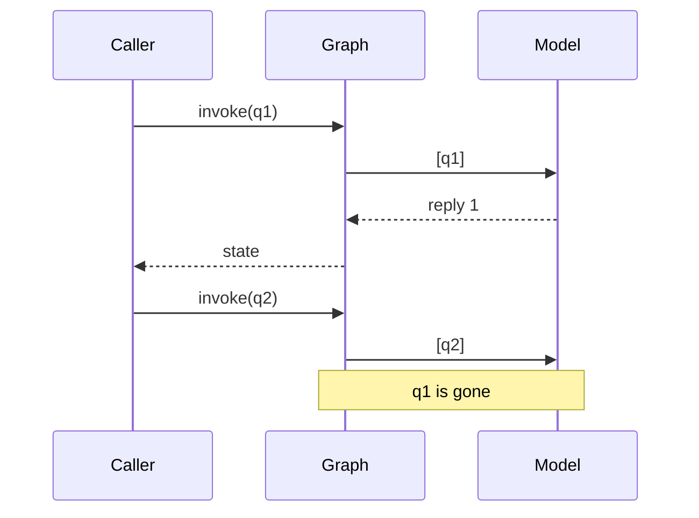

# M08.2 Theory: Conditional edges and LLM nodes

*[M08 theory](../README.md) · Lesson 8.2 · Notebooks: [`02a_Conditional_Routing.ipynb`](../../notebook/02a_Conditional_Routing.ipynb), [`02b_LLM_Powered_Chatbot.ipynb`](../../notebook/02b_LLM_Powered_Chatbot.ipynb) · [All theory pages](../../../../../THEORY.md)*
<!-- subtitle: How a router function picks the next node, the ways a route fails loudly or silently, and what changes when a chat model runs inside a node -->

## A router with a blind spot

> **What you'll learn**
>
> - **Explain** how a conditional edge calls a router after its source node and goes where the router says.
> - **Diagnose** an unknown route that fails loudly, one that ends the run silently, and a router write that disappears.
> - **Trace** a chat-model node through `invoke` and both stream modes, and say why it forgets the last call.
> - **Choose** between keyword rules and a model label for the routing decision.

Lesson 8.1 followed the refund question through the Larkspur support graph and stopped at step 3, where a conditional edge read `route` and picked the billing handler. That step is where most routing bugs live.

Here it fails. A customer asks *Can I export my data after I cancel my plan?* It is a question about data: the customer wants the export page and the 30-day retention window. The graph sends it to billing, and the billing node answers from the cancellation page. Every step ran, nothing raised, and the answer is about the wrong thing.

The one-line reason: the router is plain code that checks its rules in order, and LangGraph trusts whatever name it returns. This page covers what a router may return, what happens when the name is wrong, and what changes when a chat model makes the decision or writes the answer.

## Conditional edges

**A conditional edge is an edge whose target is chosen at run time: after its source node finishes, LangGraph calls a routing function on the state and goes to the node whose name it returns.** A fixed edge always goes from A to B. A conditional edge goes from A to whichever node the router names.

You register one with the source node, the router and, optionally, the list of nodes it may return. The Larkspur router reads the words of the question and checks two rule sets in order, billing words first:

*Figure 1: The Larkspur router. The first rule that matches wins.*

The routing notebook builds two routers of the same kind: one for weather and one for comic-book characters with a fallback branch. We reran both, with the Larkspur router from the lab beside them:

| Router | Input | Route taken | Why |
|---|---|---|---|
| Comic books | Batman | `node_dc` | on the DC list |
| Comic books | avengers | `node_marvel` | on the Marvel list |
| Comic books | Venom | `node_others` | on neither list: the fallback |
| Weather | humid | none: `ValueError` | the router raises for anything but rainy or sunny |
| Larkspur | *Will I get credits after an outage?* | `technical` | *outage* is a technical word |
| Larkspur | *Can I export my data after I cancel my plan?* | `billing` | *cancel* and *plan* match the billing rule first |
| Larkspur | *Can I pay by bank transfer?* | `human` | no rule matches |

*Table 1: Routes from the notebook's routers (rerun on LangGraph 1.2.18) and the lab's Larkspur router.*

The weather router guards itself: its last branch raises `ValueError: Unknown weather condition: humid`. Most routers are not written that defensively, and what happens next depends on how the edge was registered.

### Planted failures: bad routes

We changed the weather router to return the weather word as the node name, then planted each failure on LangGraph 1.2.18:

| Planted case | What LangGraph did | Named failure |
|---|---|---|
| Router returns `humid`; destination list `rainy`, `sunny` passed | `KeyError: 'humid'` at run time | loud, as it should be |
| Router returns `humid`; no destination list | logs "wrote to unknown channel branch:to:humid, ignoring it", ends the run, no error | **silent dead end** |
| No destination list, then draw the graph | the drawing shows `weather_node` going straight to `END`, no branches | invisible branches |
| Router sets a counter in `state` before returning | the next node still reads the old value, 0 | **lost router write** |
| Question matches two rule sets | the first rule set wins | **rule-order capture** |

*Table 2: One planted case per guard, on a stub weather graph.*

The order LangGraph checks a returned name:

*Figure 2: What happens to the name a router returns. Only the left branch can fail loudly.*

Three rules follow from the table.

1. **Pass the destination list.** It turns a bad name into an exception, and it is what lets the drawn graph show its branches. A silent dead end returns a final state with no `answer`, and the error logs stay empty.
2. **Keep the router read-only.** It runs between nodes, and LangGraph 1.2.18 throws away any change it makes to `state`. A retry counter or a "reason for the route" must be written by a node, such as `classify`, before the router runs.
3. **Give the router a fallback.** The comic router's `node_others` and Larkspur's `human` turn a gap in the rules into a handoff instead of an error: *Can I pay by bank transfer?* matches no rule and reaches a person.

Rule order is the failure the page opened on. The export question contains two billing words and two technical words, and the billing rule is checked first. The [reducer lab](../01_state_graphs_and_reducers/interactive/reducer-lab.html) prints the route and the answer source for each of its four questions, including this one.

A model can make the decision instead of keywords. The `classify` node asks a chat model for a label, writes it to `route`, and the router stays a one-line read. The model call then sits in a node, where it can be retried and traced, and the edge stays testable without a model. [M24](../../../../../p06_agent_foundations/m24_agentic_workflow_patterns/mandatory/theory/README.md) builds its routing workflow this way.

M30 does the same at a larger scale, routing each question between knowledge bases. A model call inside a node is the next thing to look at.

## A chat model inside a node

**A node that calls a chat model is an ordinary node: it reads the messages from state, calls the model, and returns the reply under `messages` for `add_messages` to append.** The chatbot notebook builds the smallest such graph: one `chatbot` node between `START` and `END`, on `gpt-4o-mini`. Its replies change from run to run, and we describe them as the notebook states them.

With a stub in place of the model, the same graph shows its mechanics exactly:

| Call | What comes back | Size |
|---|---|---|
| `invoke` | the final state, once the run ends | 2 messages: the question and the reply |
| `stream`, `stream_mode="values"` | the full state after each step | 1 message, then 2 |
| `stream`, `stream_mode="updates"` | what each node returned, keyed by node name | one event: `chatbot` with its 1 new message |

*Table 3: One run of the chatbot graph through each call, with a stub model on LangGraph 1.2.18.*

- **`values`** suits watching a list grow, as the lab's step-by-step view does.
- **`updates`** is smaller, and it names the node that made each change. That makes it the mode for debugging which node wrote what.

### The forgetful chatbot

The graph keeps no memory between calls. Each `invoke` starts from the input you pass. The notebook asks two questions in separate calls, then asks *What did we discuss so far?* in a third, and the model has nothing to report: the follow-up reaches it on its own.

*Figure 3: Two `invoke` calls. Nothing from the first call reaches the second.*

The basics notebook from lesson 8.1 works around this by hand: the second call's input is the first call's final messages plus the new question. That works, and it has a cost the caller carries. Each turn resends the whole history:

| Turn | Messages sent to the graph | Messages the model reads |
|---|---|---|
| 1 | 1 (q1) | 1 |
| 2 | 3 (q1, reply 1, q2) | 3 |
| 3 | 5 | 5 |
| *n* | 2*n* - 1 | 2*n* - 1 |

*Table 4: History passed by hand. Counted from the pattern: one question and one reply per turn.*

The message count grows with every turn, and every caller has to store and resend it correctly. [M09](../../../../m09_langgraph_runtime/mandatory/theory/README.md) moves that job into the graph with a checkpointer that saves the state per conversation thread.

## Choosing a router

The routing decision can live in three places:

| Router | Strength | Main risk |
|---|---|---|
| Keyword rules in the router | fast, free, testable without a model | rule-order capture; misses paraphrases |
| Model label written by `classify` | handles meaning and paraphrase | a model call per question; labels drift with the prompt |
| Fallback branch (`human`) | turns a gap into a handoff | hides a rising miss rate unless you count it |

*Table 5: Where the routing decision can live, with the risk each one carries.*

The three combine well: a model label, a router that reads it, and a fallback whose rate you count. Whichever decides, the edge still passes a destination list.

## In practice: the export question

Here is the opening failure again, step by step, as the lab runs it with `add_messages`:

1. **`classify`** splits *Can I export my data after I cancel my plan?* into words and checks the billing rule first. *cancel* and *plan* match, and it writes `route` as billing. The technical words *export* and *data* are never checked.
2. **The conditional edge** reads `route` and sends the run to `billing`.
3. **`billing`** finds its best page among the billing pages, *cancel*, and answers that cancelling stops the next charge.
4. The customer, who asked about exporting data, gets no word about the export page or the 30-day retention window.

Reordering the rules would only move the capture: billing questions that mention *data* would then go to technical. The fix is a router that reads meaning, a model label written by `classify`, measured against a labelled set of Larkspur questions before each change.

> **Next lesson:** every node so far has trusted the state it was given. Lesson 8.3 asks what happens when the question arrives as a number, and which state schemas catch it before a node runs.

## Key Takeaways

- Always pass the destination list to a conditional edge. With it an unknown route fails loudly; without it the run ends silently and the drawing shows no branches.
- A router only reads state, and checks its rules in order. Write anything the route needs from a node, and add a fallback route such as `human` for questions no rule matches.
- A graph keeps no memory between `invoke` calls. Use `stream_mode="updates"` to see which node changed what, and a checkpointer for conversation history.

## Check yourself

1. The chatbot answers one question, and a second invoke asks it what was discussed so far. Why can it not say?

The graph keeps no memory between calls. Each `invoke` starts from the input you pass, and the second question reaches the model on its own. Passing the first run's messages plus the new one works around it, at the cost of resending the history every turn; M09 replaces that with a checkpointer that saves state per thread.

2. The Larkspur router gets the question about exporting data after cancelling a plan. Which node answers it, and why?

The billing node, from the cancellation page. The router checks the billing words first, and *cancel* and *plan* match before the technical rule sees *export* and *data*. This is rule-order capture: the order of the rules decides the close calls, even when the question is really about data.

3. You leave the destination list out of the conditional edge, and a run whose router returns an unknown name ends with no error and no answer. What happened?

LangGraph 1.2.18 logged "wrote to unknown channel branch:to:humid, ignoring it" and ended the run: a silent dead end. The drawn graph also shows no branches. With the destination list passed, the same route fails loudly with `KeyError: 'humid'`. Pass the list, and add a fallback route such as `human` so a router gap becomes a handoff.

---
*Previous: [8.1 State, graphs and reducers](../01_state_graphs_and_reducers/README.md). Next: [8.3 State schemas and validation](../03_state_schemas_and_validation/README.md).*
