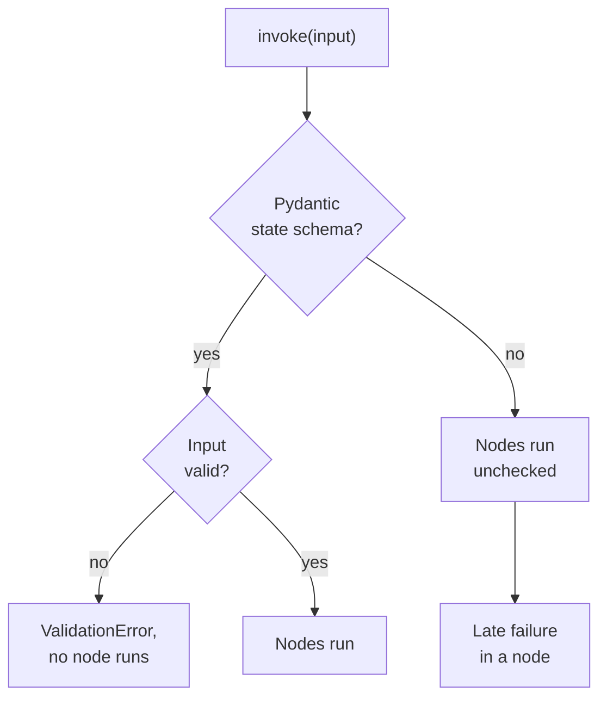
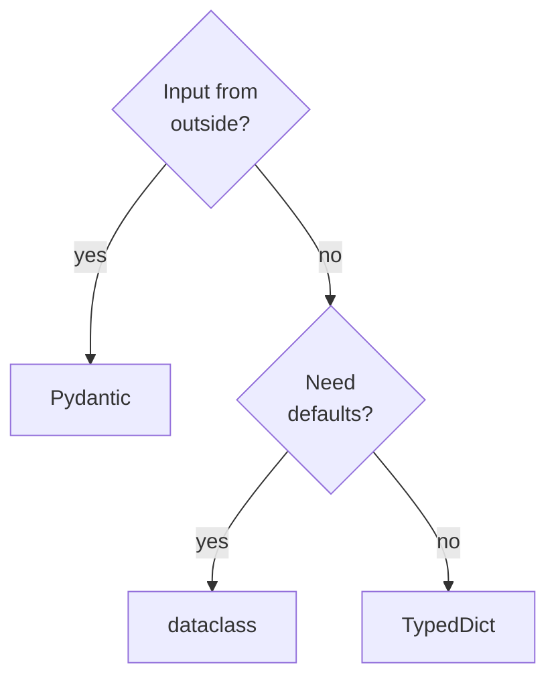

# M08.3 Theory: State schemas and validation

*[M08 theory](../README.md) · Lesson 8.3 · Notebooks: [`03a_Different_Graph_States.ipynb`](../../notebook/03a_Different_Graph_States.ipynb), [`03b_Pydantic_State_Validation.ipynb`](../../notebook/03b_Pydantic_State_Validation.ipynb) · [All theory pages](../../../../../THEORY.md)*
<!-- subtitle: Four kinds of state schema, where each one catches a bad input, and the two things even Pydantic state never checks -->

## A number where a question goes

> **What you'll learn**
>
> - **Compare** the four kinds of state schema `StateGraph` accepts: `dict`, `TypedDict`, dataclass and Pydantic.
> - **Explain** where each one catches a bad input: at `invoke`, inside a node, or nowhere.
> - **Diagnose** a late failure and an unchecked node write.
> - **Choose** a schema for a graph whose input comes from outside.

Lesson 8.2 ended with a router that trusts whatever is in the state. Every node so far has done the same.

Here is that trust failing. Larkspur's support graph sits behind a web widget, and a client bug sends the question as a ticket number, 123, instead of text. The state schema says the question is a string. The run starts anyway, `classify` tries to split the number into words, and the graph fails inside the first node with an error about an `int`. With a model call in that node, the failure would also have cost a request.

The one-line reason: a `TypedDict` annotation is a hint for people and editors, and LangGraph checks no types against it. This page compares the four schema kinds by what they check, and when.

## Choosing a state schema

**A state schema is the type you pass to `StateGraph` to declare the state's keys, their types and their reducers.** `StateGraph` accepts four kinds, and the schemas notebook runs the same two-node graph on each. The wiring, the nodes and the reducers (`custom_add` on `step_count`, `add_messages` on `messages`) stay the same. The choice changes how nodes read the state and where a bad input is caught. Measured on LangGraph 1.2.18:

| Schema | Nodes read | Defaults | Wrong type in the input |
|---|---|---|---|
| `dict` | `state["key"]` | none | accepted |
| `TypedDict` | `state["key"]` | none | accepted |
| `@dataclass` | `state.key` | yes | accepted |
| Pydantic `BaseModel` | `state.key` | yes | `ValidationError` at `invoke` |

*Table 1: The four schema kinds by how nodes read them and what they check.*

- **`dict`** has no schema at all, and so no place to attach a reducer.
- **`TypedDict`** names keys and types, and checks neither.
- **`@dataclass`** adds defaults (`private_data: str = ""`) and passes nodes an instance, but checks no types.
- **Pydantic** checks the input against the model before the first node, and converts values where it can.

Both nodes in the schemas notebook return one message and a `step_count` of 1. We reran all four builds:

| Schema | Final `messages` | Final `step_count` | Type `invoke` returns |
|---|---|---|---|
| `dict` | only "Step B Completed" | 1 | `dict` |
| `TypedDict` | 2 messages | 2 | `dict` |
| `@dataclass` | 2 messages | 2 | `dict` |
| Pydantic | 2 messages | 2 | `dict` |

*Table 2: The schemas notebook's two-node graph under each schema (rerun on LangGraph 1.2.18).*

The `dict` row is lesson 8.1's lost write again: with no schema there are no reducers, and node B's write replaces node A's. The last column holds for every schema. Nodes of a dataclass or Pydantic graph receive an instance, yet `invoke` hands the caller a plain `dict`.

### Where a bad input stops

The validation notebook builds a one-key graph (`name: str`) whose node appends a greeting to the name, then feeds it a number. We planted that case and its neighbours on each schema:

| Planted case | What happened | Where |
|---|---|---|
| `TypedDict`, `name` is 123 | `TypeError: unsupported operand type(s) for +: 'int' and 'str'` | inside the node |
| `TypedDict`, `name` missing | `KeyError: 'name'` | inside the node |
| dataclass, `name` is 123 | the node receives the `int` 123; no error | nowhere |
| Pydantic, `name` is 123 | `ValidationError`; no node runs | at `invoke` |
| Pydantic, `name` missing | `ValidationError`; no node runs | at `invoke` |
| Pydantic, "5" for an `int` field | the node receives the `int` 5; the returned state still holds the string "5" | converted for nodes only |
| Pydantic, a node writes 5 into the `str` field | no error; the final state holds 5 | nowhere |
| Pydantic `input_schema` on a `TypedDict` state, question 123 | the number reaches the first node, which fails | inside the node |

*Table 3: One planted case per check, on LangGraph 1.2.18. The first and fourth rows are the validation notebook's own runs.*

Two named failures come out of this table.

- **Late failure.** A bad input passes the schema and fails deep inside a node, after any work that node did first. The `TypedDict` and dataclass rows show it. The error names an operand, not the field the caller got wrong.
- **Unchecked write.** Pydantic validates what comes in, never what nodes write. A node that returns 5 for a `str` field finishes cleanly and leaves a wrong type in the state for every later node.

The last row is a trap worth naming separately. An input schema narrows which keys a caller may send (lesson 8.5). Made from a Pydantic model on a `TypedDict` state, it still let the number through on LangGraph 1.2.18. The type check comes from the state schema itself.

Where each kind of input stops, as a check order:

*Figure 1: Where a bad input stops. Only a Pydantic state schema stops it before the first node.*

The validation notebook also runs a message graph under `TypedDict` and Pydantic state. Both end with the same three messages, all `HumanMessage`: Pydantic changes nothing about reducers, and lesson 8.1's speaker drift happens under either schema.

### Which schema, when

The choice reduces to two questions:

*Figure 2: Choosing a state schema. Outside input decides first.*

Validation costs a parse on every `invoke`, small next to a single model call. A `TypedDict` stays the right choice for a graph whose only callers are your own code and tests, where a late failure is a bug you will see in a stack trace.

## In practice: the widget question

For Larkspur the question arrives from a web widget, and the state schema itself becomes a Pydantic model: `question` as a string, with `route` and `answer` given defaults.

1. **The client bug returns.** The widget sends 123 as the question. `invoke` raises `ValidationError` naming the `question` field. No node runs and no model is called.
2. **A real question arrives.** *When will my refund appear on my statement?* passes validation, and `classify` receives an instance with `question` as text.
3. **The billing node answers.** Pydantic will not check what it writes. The node builds its structured answer (route, source, text) as a Pydantic model of its own before returning it, and a malformed answer fails inside the node that produced it.
4. **The caller reads the result.** `invoke` returns a plain `dict` holding every key. Lesson 8.5 narrows that to the answer alone.

> **Next lesson:** every node so far has taken one argument, the state. Lesson 8.4 shows what else a node can ask for, and how a node can route the run by itself.

## Key Takeaways

- `TypedDict` and dataclass annotations check no types, so a bad input fails late, inside a node. A plain `dict` cannot attach reducers at all.
- Use a Pydantic state schema when input comes from outside. It raises `ValidationError` at `invoke` before any node runs, and converts values for nodes where it can.
- Pydantic validates input only, never what nodes write, and `invoke` always returns a plain dict. Validate important node output, such as a structured answer, inside the node.

## Check yourself

1. A graph with a TypedDict state receives a name of 123, and its node fails with a TypeError. Why did the schema not stop it?

`TypedDict` annotations are hints for people and editors; LangGraph checks no types against them. The run starts and the node fails when it adds a string to the int: a late failure. With a Pydantic `BaseModel` state, the same input raises `ValidationError` at `invoke` and no node runs.

2. The Larkspur question arrives from a web widget. Why make the state schema itself Pydantic instead of adding a Pydantic input schema to a TypedDict state?

On LangGraph 1.2.18 a Pydantic input schema on a `TypedDict` state let a question of 123 through to the first node, which failed there. The type check comes from the state schema: with a Pydantic state the same input stops at `invoke` before any node runs.

3. A node in a Pydantic-state graph returns 5 for a str field, and the run finishes cleanly. How should Larkspur protect its structured answer?

Validate it in the node. Pydantic checks what comes in at `invoke`, not what nodes write, and the final state simply holds 5: an unchecked write. A node whose output matters builds its answer as a Pydantic model before returning it, and a bad answer then fails in the node that made it.

---
*Previous: [8.2 Conditional edges and LLM nodes](../02_conditional_edges_and_llm_nodes/README.md). Next: [8.4 Nodes, runtime context and Command](../04_nodes_runtime_context_and_command/README.md).*
