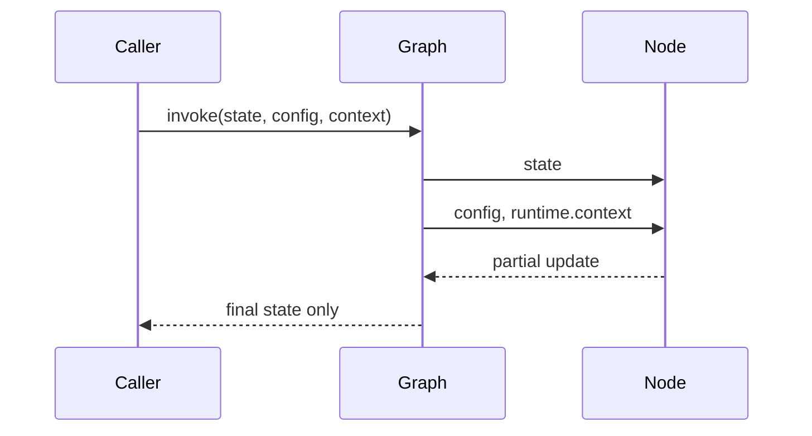
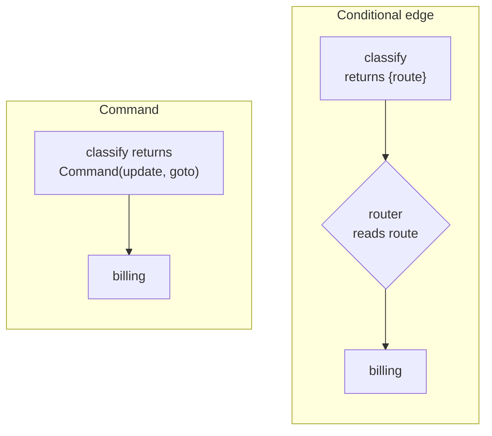
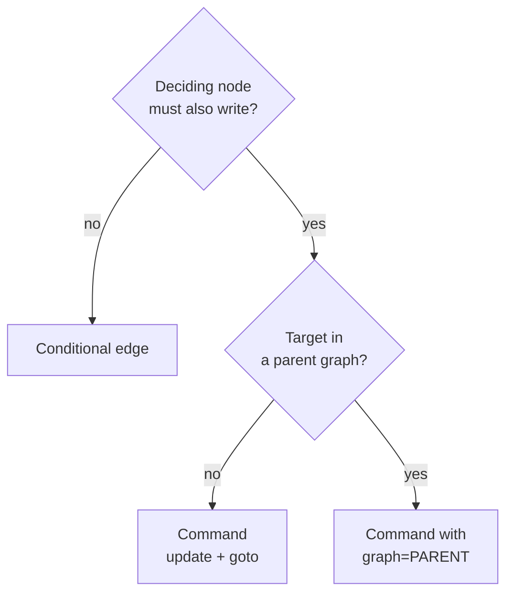

# M08.4 Theory: Nodes, runtime context and Command

*[M08 theory](../README.md) · Lesson 8.4 · Notebooks: [`04a_Node_Patterns.ipynb`](../../notebook/04a_Node_Patterns.ipynb), [`04b_Runtime_Context.ipynb`](../../notebook/04b_Runtime_Context.ipynb), [`04c_Command_Objects.ipynb`](../../notebook/04c_Command_Objects.ipynb) · [All theory pages](../../../../../THEORY.md)*
<!-- subtitle: What a node can ask for besides the state, and how a node writes and routes in one return with Command -->

## A route with no reason

> **What you'll learn**
>
> - **Explain** the three node signatures and what LangGraph passes into each.
> - **Trace** typed runtime context through a call, with its defaults and overrides.
> - **Diagnose** absent context, a silent dead end from `goto` and double dispatch.
> - **Choose** between a conditional edge and `Command` for a routing step.

Lesson 8.3 made the Larkspur state check its input. The nodes still take one argument, the state, and that leaves two jobs undone.

The triage team wants each route logged with the reason for it, such as "matched *refund*". Lesson 8.2 showed that a router's writes are thrown away, so the reason has to be written by `classify`, while a separate router reads `route`: two pieces of code that must agree. And `classify` should check the customer's plan in the account database, but the database client is not something the graph computes. The first attempt put the client into the input state, where it came back out in every result.

The one-line reason: a node had only the state to work with, and could only write, never route. This page gives it two more inputs and one more kind of return.

## Node signatures and runtime context

**A node's signature decides what LangGraph passes into it: the state always, and, if the node declares them, the run's config or its runtime context.** A node asks for more by declaring a second parameter:

| Signature | The node also gets | Larkspur use |
|---|---|---|
| `f(state)` | nothing | `classify` reads the question |
| `f(state, config: RunnableConfig)` | `config["configurable"]` | the `thread_id` for logs |
| `f(state, runtime: Runtime[Ctx])` | `runtime.context` | the customer's plan, a database client |

*Table 1: The three node signatures.*

The node patterns notebook chains one node of each kind and invokes the graph with a state of `input` "World", a config holding `thread_id` "user-1234" and a context holding `user_id` "alice_smith". The plain node writes "Hello, World!", the config node reads the thread id, and the runtime node reads the user id. None of the config or context values appears in the final state.

Each kind of input enters the run through its own channel:

*Figure 1: Config and context reach the node beside the state, and only the state comes back.*

**Runtime context is a typed set of dependencies the caller passes on each call: connections, clients, the caller's identity.** The graph declares its shape with a `context_schema`, and each `invoke` passes values in a `context` argument. The runtime context notebook uses a dataclass, where fields without a default are required: `user_agent` has none, while `docs_url` and `db_connection` default to a docs address and a MySQL connection string. We reran its calls and two planted ones:

| Call | What the node saw | Result |
|---|---|---|
| `user_agent` "Default-Run" only | the default MySQL connection | runs |
| `user_agent` "Override-Run" and a Postgres `db_connection` | the Postgres connection | runs |
| no `context` at all | `runtime.context` is `None` | `AttributeError: 'NoneType' object has no attribute 'user_agent'` in the node |
| an empty `context` | nothing: the call fails before the node | `TypeError`, missing `user_agent` |

*Table 2: The runtime context notebook's two calls and two planted ones (LangGraph 1.2.18).*

The third row is **absent context**: the graph starts without the dependency and fails only when a node reads it. The returned state in the first two rows holds `input` and `result` and nothing from the context. That is the property we want for a database client: the graph uses it and never hands it back.

Context gives `classify` its client. The other half of the opening problem is the route and its reason.

## Command

**`Command` is a value a node returns instead of a dict to do two jobs at once: `update` is merged into the state like any node's return, and `goto` names the node that runs next.** The Command notebook's `check_temp_node` sends a reading above 90 to `warn_user` with `warning_sent` set, and anything else to `success`. No edge leaves the node, and none leaves either handler, which end the run:

| Input temperature | `goto` | Final state |
|---|---|---|
| 100 | `warn_user` | status "Routing to warning handler...", `warning_sent` true, action "Warning Notification sent" |
| 40 | `success` | status "Routing to success handler...", action "Temperature Safety Confirmed" |

*Table 3: The Command notebook's two runs, rerun on LangGraph 1.2.18.*

The two ways of routing, side by side:

*Figure 2: A conditional edge splits writing and routing across two functions. `Command` does both in one return.*

### The Command traps

The node's return annotation, `Command[Literal["warn_user", "success"]]`, looks like a check, and the notebook calls it compile-time safety. On LangGraph 1.2.18 it only draws the graph. We planted one case per assumption:

| Planted case | What happened | Named failure |
|---|---|---|
| `Literal` annotation removed | routing still works; the drawing shows the node going straight to `END` | invisible branches |
| `goto` names a real node missing from the `Literal` | that node runs | no check |
| `goto` names a node that does not exist | logs "wrote to unknown channel branch:to:nowhere, ignoring it"; the run ends with no handler output | **silent dead end** |
| static edge to `success` added; reading 95 | `warn_user` and `success` run in the same step, both write `final_action_performed`: `InvalidUpdateError` | **double dispatch** |
| same static edge; reading 40 | runs: `goto` and the edge name the same node | hidden until a hot reading |

*Table 4: One planted case per assumption about `Command`.*

The silent dead end is the one from lesson 8.2, reached by a different road: a misspelled `goto` ends the run with an empty answer and no error. Double dispatch comes from `goto` adding to static edges rather than replacing them. It also hides: the cool reading passes, and only a hot reading triggers it.

### Which one, when

The choice turns on whether the deciding node must also write:

*Figure 3: Choosing between a conditional edge and `Command`.*

Choose a conditional edge when routing is a pure read of state. The router is testable alone, and the destination list names every target at build time. Choose `Command` when the node that decides must also write, such as the route with its reason, or when the target lies outside the current graph.

The same object returns in later modules. It carries `resume` for a paused run in [M09](../../../../m09_langgraph_runtime/mandatory/theory/README.md).

With `graph=Command.PARENT` it hands work from one agent to another in [M35](../../../../../p10_multi_agent_systems/m35_multi_agent_architectures/mandatory/theory/README.md).

## In practice: classify with a reason

In this design `classify` takes the runtime parameter and returns a `Command`:

1. **The call.** The widget invokes the graph with the question as state, the conversation's `thread_id` in config, and the customer id and database client as context.
2. **`classify`** reads the customer's plan through the client in `runtime.context`, matches *refund*, and returns `Command` with `route` billing and the reason "matched *refund*" as the update, and `billing` as the `goto`.
3. **`billing`** answers. The final state holds the route and its reason for the triage log. The client and customer id appear nowhere in it.
4. **The guard.** A test runs one question per route and asserts that every run ends with an `answer` key. A misspelled `goto` fails that test instead of shipping as a silent dead end.

> **Next lesson:** the final state still returns every key, including the reason and the message history. Lesson 8.5 decides what a caller may send and receive, and where per-call settings such as the reply language go.

## Key Takeaways

- A node gets extra inputs by declaring them: `config` for per-call settings, `runtime` for typed context. Absent context fails only when a node reads it.
- `Command(update=..., goto=...)` lets a node write and route in one return. Its `Literal` annotation only draws the graph, and a `goto` to an unknown node is silently ignored.
- Use a conditional edge when routing is a pure read of state, and `Command` when the deciding node must also write. Never combine `goto` with a static edge from the same node.

## Check yourself

1. When should a node return a Command instead of leaving the route to a conditional edge?

When the node that decides must also write, such as the route with the reason for it, or when the target lies outside the current graph. When routing is a pure read of state, a conditional edge is better: the router is testable alone and the destination list names every target at build time.

2. The temperature node that returns a Command also gets a static edge to success, and a reading of 95 arrives. What happens?

The run fails. A reading above 90 makes the node `goto` `warn_user`, and `goto` adds to static edges, so `warn_user` and `success` run in the same step. Both write `final_action_performed`, and LangGraph raises `InvalidUpdateError`: double dispatch. A reading of 40 passes, which is why the bug hides.

3. A node reads user_agent from runtime context and fails with an AttributeError on NoneType. What went wrong?

The graph was invoked with no `context`, and `runtime.context` was `None`. On LangGraph 1.2.18 absent context fails when a node reads it, not when the graph starts. Pass it in the `context` argument and include `user_agent`, which has no default; an empty context raises `TypeError` for it.

---
*Previous: [8.3 State schemas and validation](../03_state_schemas_and_validation/README.md). Next: [8.5 Input/output schemas and configuration](../05_input_output_schemas_and_configuration/README.md).*
