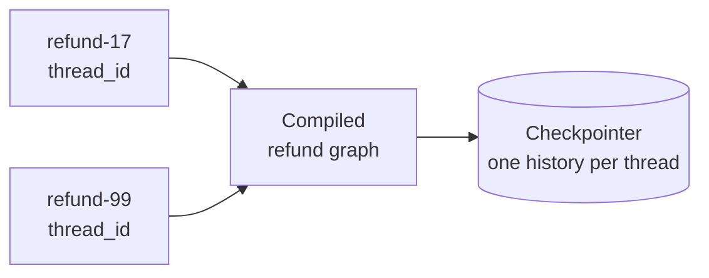
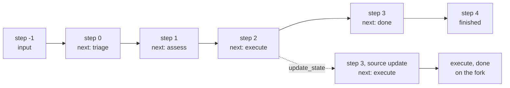

# M09.1 Theory: Checkpointing and threads

*[M09 theory](../README.md) · Lesson 9.1 · Notebooks: [`01a_Checkpointing.ipynb`](../../notebook/01a_Checkpointing.ipynb) · [All theory pages](../../../../../THEORY.md)*
<!-- subtitle: How a checkpointer and a thread id let one compiled graph remember, survive restarts and rewind each refund on its own -->

## A graph that forgets every refund

> **What you'll learn**
>
> - **Explain** what a checkpointer saves, when it saves it, and how a `thread_id` keeps one customer's run apart from another's.
> - **Trace** the six checkpoints of a four-node refund run, field by field.
> - **Choose** a saver for tests, for one process and for several workers.
> - **Compare** replay, fork and copy-to-a-new-thread, and predict how many checkpoints each one adds.
> - **Diagnose** a fork that sends a finished refund down a different branch.

[M08](../../../../m08_langgraph_core/mandatory/theory/README.md) built graphs from state, reducers, nodes and conditional edges. Each one ran from `START` to `END` inside a single `invoke` and returned the final state. Nothing survived the call.

That is fine for a demo and wrong for Larkspur Cloud's refund desk. The desk runs a graph modelled on the refund agent in the state-management notebook: `triage` reads the request, `assess` sets the risk, low-risk refunds go straight to `execute` and then `done`, and high-risk refunds wait for the billing team. Two requests follow us through this module. `refund-17` is an annual plan cancelled within 30 days, which the handbook refunds in full. `refund-99` is a prorated annual refund that needs approval.

Without anything extra, the graph fails the desk in three ways:

- **A second message starts from nothing.** We ran the four-node graph twice with no checkpointer. The second call's event log held only its own four lines, with no trace of the first.
- **A restart loses work in flight.** A refund waiting two days for approval lives only in the worker's memory.
- **Nobody can say what the graph saw.** When finance asks why `refund-17` went through without review, there is no record of the state at the moment `assess` decided.

We call the first of these the **amnesiac run**: every call begins with empty state because nothing outside the call remembers it. The fix is a store that sits beside the graph and keeps one history per conversation:

*Figure 1: One compiled graph, many threads. The checkpointer files every saved state under the thread it belongs to.*

## Checkpointer

**A checkpointer is an object you pass to `compile()` that saves a snapshot of the whole graph state after every step of a run.** You give each run a **thread id** in the config, and the checkpointer files every snapshot under that id. A thread is one conversation or one workflow: the refund request `refund-17` is one thread, `refund-99` another.

The thread id is the key to everything the checkpointer does. Two calls with the same id share one history, and the second turn of a chat sees the first. Calls with different ids never see each other. One compiled graph therefore serves every Larkspur customer at once, and nobody's refund leaks into anybody else's. We checked this offline: after `refund-17` had finished, `get_state` on an unused thread id returned empty values.

The notebooks import the saver as `MemorySaver`. That is the older name for `InMemorySaver`, and in the installed LangGraph 1.2.18 both names point to the same class.

### What one refund leaves behind

LangGraph saves a checkpoint before the first node runs and after each step. Running the low-risk refund `refund-17` with stub nodes and `InMemorySaver` leaves this history:

| Step | Source | `next` | Events in state |
|---|---|---|---|
| -1 | `input` | `__start__` | 0 |
| 0 | `loop` | `triage` | 0 |
| 1 | `loop` | `assess` | 1 |
| 2 | `loop` | `execute` | 2 |
| 3 | `loop` | `done` | 3 |
| 4 | `loop` | (empty: finished) | 4 |

*Table 1: The six checkpoints of refund-17, oldest first (offline run with stub nodes, LangGraph 1.2.18).*

Step -1 holds the raw input. Step 0 is the state with the input applied and `triage` queued. Each later step adds one line to the `events` log, because every node appends to it. The last checkpoint has an empty `next`, which is how a dashboard tells a finished thread from a paused one.

Every snapshot carries the same six fields, and each one answers a question an operator will ask:

| Field | What it holds | The question it answers |
|---|---|---|
| `values` | the state itself | what did the graph know at this point |
| `next` | the nodes still to run | is this thread finished, paused or mid-run |
| `config` | the thread id, a namespace and a `checkpoint_id` | how do I address this exact snapshot |
| `parent_config` | the previous checkpoint's address | what came before (the history is a linked list) |
| `metadata` | the source (`input`, `loop`, `update`, `fork`) and the step | how did this snapshot come to exist |
| `created_at` | a timestamp | when was it saved |

*Table 2: The fields of a checkpoint snapshot.*

> **Pitfall: reading `writes` from metadata.** Older LangGraph releases recorded which node wrote a checkpoint under `metadata["writes"]`. In 1.2.18 the metadata holds the source, the step and parent ids, and nothing else. Code that searches it for a node name finds nothing. Read `next` on the previous snapshot instead.

### Where the checkpoints live

The saver decides what survives a restart. Three savers share one interface:

- **`InMemorySaver`**: checkpoints in the process. Fast and free of setup, and gone when the process stops. Use it in tests and notebooks.
- **`SqliteSaver`**: checkpoints in a file. The checkpointing notebook stores a secret code ("ALPHA-7"), closes the connection, opens a new one, and the second session still knows the code. We repeated the restart offline with a fresh connection and a freshly compiled graph, and `get_state` returned the first session's events. It suits one process on one machine.
- **`PostgresSaver`**: the same interface backed by a database server. It suits several workers sharing threads, the production case in [lesson 9.6](../06_state_management_in_practice/README.md).

The graph code does not change between them. That is what lets workers stay stateless: any worker that can reach the saver can continue any thread.

### Planted failures

Each misconfiguration below fails in its own way, and only one of them raises an error:

| Setup | What happened | Why |
|---|---|---|
| No checkpointer, two calls | the second run's log had 4 events, none from the first | the **amnesiac run**: nothing outside the call kept state |
| Checkpointer, no thread id | `ValueError`: the checkpointer requires `thread_id`, `checkpoint_ns` or `checkpoint_id` | it has nowhere to file the snapshot |
| A new thread id for a follow-up | empty state, no error | the follow-up opened a new conversation |
| `InMemorySaver`, worker restarted | every thread gone | the **process-bound thread**: the store died with the process |

*Table 3: Planted checkpointer failures (offline runs; the restart row follows from the saver living in process memory).*

The two silent rows are the dangerous ones. A follow-up on the wrong thread id looks like a fresh customer, and nothing in the logs says otherwise. Once the history is safe, it becomes something we can walk back through.

## History, replay and forks

`get_state(config)` returns the latest snapshot of a thread, and `get_state_history(config)` walks all of them, newest first. Every snapshot has its own id and a pointer to its parent. The history is a chain we can step back along and branch from:

*Figure 2: A fork from step 2 of refund-17. The new checkpoint's parent is the old one, and the original branch stays in the history.*

Three operations use the chain, and each adds checkpoints in a different way:

- **Replay**: invoke with no input on an old snapshot's config. Replaying `refund-17` from step 2 re-ran `execute` and `done`, while `triage` and `assess` kept their recorded results. LangGraph first writes a checkpoint with source `fork` at step 3, then one per node, and the history grows from 6 to 9. Use replay to reproduce what the graph did after a given decision.
- **Fork**: `update_state` on an old snapshot's config writes a new checkpoint with source `update` whose parent is that snapshot. Patching a field no router reads (we patched `decision`) left `next` at `execute`, as in Figure 2, and continuing ran `execute` and `done` on the fork: 9 checkpoints again. The original branch stays.
- **Copy to a new thread**: the notebook's branching demo takes one thread's `values` and writes them with `update_state` into two fresh thread ids, then lets each thread run on its own. The original thread never changes.

### The fork that took another branch

A fork is a write by a node, and the graph treats it like one. `update_state` without `as_node` records the patch as coming from the node that last wrote, here `assess`, and then re-evaluates that node's outgoing edges. Patching a field the router reads changes where the run goes next:

| Patch at step 2 | `next` on the fork | After `invoke(None)` | Checkpoints in the thread |
|---|---|---|---|
| `decision` (no router reads it) | `execute` | ran `execute`, `done` | 9 |
| `risk` set to high | `human_gate` | paused at the gate | 7, then 10 after approval |

*Table 4: Two forks of the finished refund-17 (offline run, LangGraph 1.2.18).*

The second row is the **rerouted fork**. A finished low-risk refund came back as a high-risk one waiting for the billing team, and its event log still said `assess low`, because `assess` never ran again. That can be exactly what you want (a correction that forces review), but only if you expected it.

Two habits keep forks predictable:

- **Fork from the snapshot's own config.** It carries the `checkpoint_ns` key. We rebuilt a config by hand with only the thread id and checkpoint id, and `update_state` raised `KeyError: 'checkpoint_ns'`, the failure the state-management notebook warns about.
- **Remember that replay re-executes.** A replayed node runs its code again. If `execute` sends a refund to the payment provider, replay sends another one. This **replayed side effect** is the subject of [lesson 9.6](../06_state_management_in_practice/README.md#resume-and-side-effects).

The next section puts the whole lesson together on one incident.

## In practice: auditing refund-17

Finance asks why `refund-17` was paid without review. With a checkpointer and the thread id, the desk can answer from the history alone:

1. Read the latest snapshot. `next` is empty: the thread finished.
2. Walk the history to step 2. Its `values` show `risk` set to low and its `next` is `execute`. The graph skipped the gate because `assess` said low.
3. Check the handbook rule against those values. An annual plan within 30 days and under 100 GB of outbound traffic gets a full refund, which makes low risk the right call.
4. If it was wrong, fork from step 2 with `risk` set to high and continue. The thread parks at `human_gate` beside the original branch, as in Table 4, and the billing team sees it.

[Lesson 9.2](../02_interrupts_and_human_in_the_loop/README.md) uses the same saved state to stop a run on purpose and wait for a person.

## Key Takeaways

- A checkpointer saves the whole state after every step, filed under the `thread_id`. Same id shares one history, different ids never see each other, and a missing id is an error while a wrong one is silent.
- `InMemorySaver` suits tests, `SqliteSaver` one process, `PostgresSaver` several workers. The graph code stays the same, and the workers can stay stateless.
- Replay re-runs nodes from an old checkpoint and a fork adds a branch beside the original. Fork from the snapshot's own `config`, and expect a patched routing field to send the run down a different branch.

## Check yourself

1. How does one compiled graph with a checkpointer serve every Larkspur customer at once without mixing their conversations?

The `thread_id` in the config is the key. Calls with the same id share one saved history, and a second turn sees the first. Calls with different ids never see each other. The checkpointer saves a snapshot of the whole state after every step, filed under that id.

2. The finished refund-17 thread holds 6 checkpoints. You fork it at step 2 by setting risk to high and invoke with no input. What happens, and why?

The run parks at `human_gate` instead of going to `execute`. `update_state` records the patch as a write by `assess`, the node that last wrote, and re-evaluates its conditional edge, which now routes high risk to the gate. The thread has 7 checkpoints at that point and 10 after approval, and the original branch stays in the history.

3. Larkspur runs several workers that share threads, and threads must survive a restart. Which saver do you choose, and what fails with the in-memory one?

`PostgresSaver`. `InMemorySaver` keeps checkpoints in one process, and a restart loses every thread. `SqliteSaver` writes a file that suits one process on one machine. The graph code does not change between savers: the workers stay stateless and any of them can continue any thread.

---
*Previous: [M09 overview](../README.md). Next: [9.2 Interrupts and human-in-the-loop](../02_interrupts_and_human_in_the_loop/README.md).*
