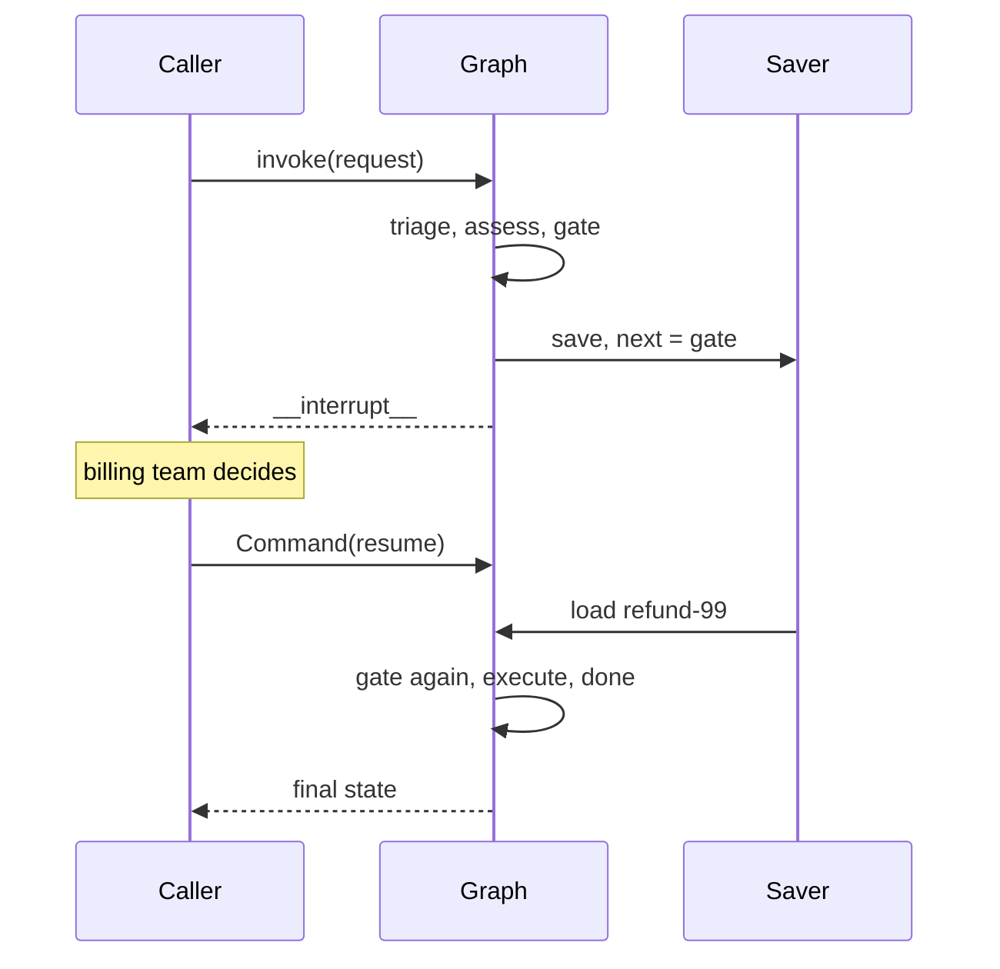
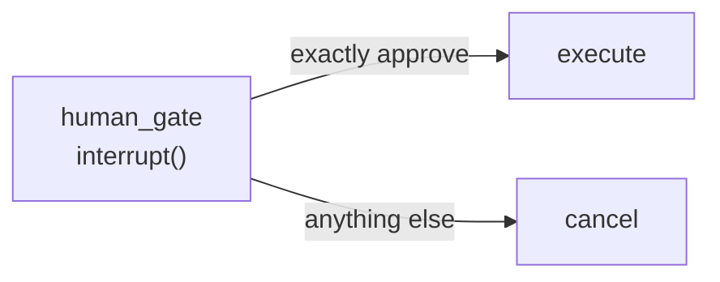

# M09.2 Theory: Interrupts and human-in-the-loop

*[M09 theory](../README.md) · Lesson 9.2 · Notebooks: [`02a_HITL_Mechanics.ipynb`](../../notebook/02a_HITL_Mechanics.ipynb), [`02b_LangGraph_Interrupt_Primitive.ipynb`](../../notebook/02b_LangGraph_Interrupt_Primitive.ipynb), [`02c_HITL_Patterns.ipynb`](../../notebook/02c_HITL_Patterns.ipynb) · [All theory pages](../../../../../THEORY.md)*
<!-- subtitle: How a graph stops mid-run for a person, waits for days without holding a worker, and continues with their answer -->

## A refund that must wait for billing

> **What you'll learn**
>
> - **Explain** what `interrupt()` saves, what it returns to the caller, and what runs again on resume.
> - **Trace** a high-risk refund from the first call, through the pause, to the approval.
> - **Compare** `interrupt()` inside a node with `interrupt_before` and `interrupt_after` at compile time.
> - **Choose** among approve or reject, edit then continue, edit state while paused, and tool-call review.
> - **Diagnose** a gate that approves whatever the reviewer types.

[Lesson 9.1](../01_checkpointing_and_threads/README.md) gave every refund a thread and a saved snapshot after each step. This lesson uses that saved state to stop a run on purpose.

`refund-99` is a prorated annual refund, and Larkspur's policy says a person in billing approves every high-risk refund. The approval can take two days. A worker that blocks inside `invoke` for two days is a worker serving nobody else, and a deploy in the meantime kills the run. The graph has to do three jobs: stop at the gate and show the reviewer what to decide, give the worker back while it waits, and continue from the gate with the reviewer's answer, on whichever worker picks it up.

## interrupt()

**`interrupt(payload)` called inside a node stops the run at that line, saves the state through the checkpointer, and returns the payload to the caller under the `__interrupt__` key.** The thread now waits at that node. Later, any process calls invoke with `Command(resume=value)` on the same thread, and inside the node `interrupt()` returns that value.

The whole exchange takes two calls with a gap between them:

*Figure 1: The two calls of an approved refund. Between them the run exists only as saved state.*

We ran the refund graph offline with stub nodes and an `InMemorySaver` to watch each call:

| Call | What the caller sent | Nodes that ran | Returned | Thread after the call |
|---|---|---|---|---|
| 1 | the refund request | `triage`, `assess`, `human_gate` (stops at `interrupt()`) | `__interrupt__` with the question | 4 checkpoints, `next` = `human_gate` |
| 2 | `Command(resume="approve")` | `human_gate` again, `execute`, `done` | final state | 7 checkpoints, finished |

*Table 1: refund-99 across the pause (offline run, LangGraph 1.2.18).*

A dashboard finds parked refunds by reading `next`: a thread whose `next` is `("human_gate",)` is waiting for billing.

### Three rules that follow

The mechanism has consequences that catch teams the first time:

- **A checkpointer is required.** Without one, the first call still returns `__interrupt__`, but nothing was saved. The resume call then raises `RuntimeError: Cannot use Command(resume=...) without checkpointer`. We reproduced both halves offline.
- **The node runs again from the top.** On resume LangGraph does not continue mid-function. It calls the node again, and this time `interrupt()` returns the resume value instead of stopping. The HITL mechanics notebook prints "Node execution started" twice for one resume. In the refund graph `human_gate` ran 2 times for one approval (Table 1). Anything above the `interrupt()` call (a notification, a counter, a model call) happens twice. We call this the **double-run gate**.
- **The resume value is yours to define.** It can be a string, a dict with an `edited_plan`, or a list in the Agent Inbox format. `interrupt()` returns whatever the caller passes, so the node has to check it.

The mechanics notebook checks it with a loop. Its node asks for an age and calls `interrupt()` again until the answer parses as a non-negative integer:

| Resume value | What the node did |
|---|---|
| (first call) | paused with "Please enter your age…" |
| "not a number" | paused again, quoting the bad value |
| "-10" | paused again |
| "25" | stored age 25 and moved on |

*Table 2: The validation loop over four calls (offline replay of the notebook's node).*

Each bad answer costs one more round trip and nothing else. The checkpointer holds the thread between them.

### Pausing at compile time instead

The notebooks also pause without touching node code. Compiling with `interrupt_before=["assistant"]` stops the run before that node, and `interrupt_after` stops it right after. You continue with invoke and no input. The two forms differ in who decides to stop:

| | `interrupt()` in a node | `interrupt_before` / `interrupt_after` |
|---|---|---|
| Where it is declared | inside the node | at `compile()` |
| What the caller gets | `__interrupt__` with your payload | the state so far, with no `__interrupt__` key in our run |
| How to continue | `Command(resume=value)` | invoke with no input |
| What the reviewer can return | any value the node reads | nothing, unless you call `update_state` first |
| Suits | approvals, questions, validation | debugging and step-through review |

*Table 3: Runtime and compile-time pauses compared.*

The second row matters for clients: after a compile-time pause, the caller learns the run stopped by reading `next` from `get_state`. With the gate's decision settled as a mechanism, the next section is about what the gate does with it.

## Approval patterns

The interrupt-primitive and HITL-patterns notebooks build four shapes on the same primitive. On the Larkspur refund desk they look like this:

- **Approve or reject**: the gate returns `Command(goto="execute")` or `Command(goto="cancel")` depending on the decision, with an `update` that records it. The return type is annotated as a `Command` over the two target names, so the graph knows where the gate can go.
- **Edit then continue**: the gate shows the draft reply to the customer and resumes with an `edited_summary`. The node writes the edited text to state and the graph follows its one path.
- **Edit state while paused**: with `interrupt_before`, the caller runs `update_state` on the parked thread and then continues with no input. The patterns notebook swaps "Multiply 2 and 3" for "No, please multiply 15 and 6" this way, and the agent multiplies the new numbers.
- **Review a tool call**: `interrupt()` inside a sensitive tool, or a wrapper such as the notebook's `add_human_in_the_loop`, lets a person accept the call, edit its arguments, or answer instead of running it. `HumanInTheLoopMiddleware` in [M23](../../../../../p06_agent_foundations/m23_react_agents/mandatory/theory/README.md) packages the same idea for `create_agent`.

The approve-or-reject shape is the one the refund desk needs:

*Figure 2: A fail-closed approval gate. Only one exact value reaches the payment step.*

### Planted failure: the rubber-stamp gate

The state-management notebook's gate stores `decision = "approved"` whatever the resume value is. It records the reviewer's words in the event log and then approves anyway. We call that the **rubber-stamp gate**. The patterns notebook's gate compares the value with `"approve"` and sends everything else to the reject path. We resumed a copy of that gate with the first three values below, and "no" takes the same reject branch:

| Resume value | Rubber-stamp gate | Exact-match gate |
|---|---|---|
| "approve" | execute | execute |
| "Approve" | execute | cancel |
| "yes" | execute | cancel |
| "no" | execute | cancel |

*Table 4: Four reviewer answers through two gates (exact-match column from an offline run; rubber-stamp column read from the notebook's node, which never reads the value).*

The exact-match gate rejects "Approve" and "yes", which annoys reviewers once and costs nothing. The rubber-stamp gate pays out on "no". Approve on an exact value and treat anything else as no. [M27](../../../../../p07_advanced_agents/m27_human_approval_applied_agents/mandatory/theory/README.md) builds that fail-closed gate, with a fingerprint that catches edits made after the review.

## In practice: refund-99 at the gate

Put together, the high-risk path through the desk runs like this:

1. The first call runs `triage` and `assess`, reaches `human_gate`, and returns the question under `__interrupt__`. The worker is free.
2. The billing dashboard lists threads whose `next` is `human_gate` and shows the payload: the request, the risk and the prorated amount rule (unused whole months, minus the 15% early-termination fee).
3. Two days later a reviewer clicks approve. Any worker calls invoke with `Command(resume="approve")` on `refund-99`.
4. `human_gate` runs again from its first line, reads "approve", and routes to `execute`. Any notice sent above `interrupt()` goes out a second time.

> **Key distinction:** the checkpointer makes the wait safe for the state. It does nothing for code that runs twice. Step 4 is why the approval notice belongs in its own node before the gate.

What else runs twice around the gate, and how to count it, is the subject of the lab in [lesson 9.6](../06_state_management_in_practice/README.md#resume-and-side-effects). [Lesson 9.3](../03_subgraphs/README.md) first moves the gate into a graph of its own.

## Key Takeaways

- `interrupt()` saves the state and parks the thread, and `Command(resume=value)` continues it from any process. It needs a checkpointer, or the resume call fails.
- On resume the node runs again from its first line. Keep notifications, counters and model calls out of the code above `interrupt()`.
- The resume value is whatever the caller passes. Validate it, approve only on an exact value, and treat anything else as no.

## Check yourself

1. Why does anything written above the interrupt call in human_gate happen twice for one approval?

On resume, LangGraph does not continue mid-function. It calls the node again from the top, and this time `interrupt()` returns the resume value. In the refund graph `human_gate` runs 2 times per approval, and a notification, a counter or a model call above the `interrupt()` line repeats.

2. A teammate runs the refund graph without a checkpointer. The first call returns an interrupt payload. What happens when they resume?

The resume call raises `RuntimeError: Cannot use Command(resume=...) without checkpointer`. The first call still returned `__interrupt__`, but nothing was saved, and there is no parked thread to continue.

3. A reviewer resumes refund-99 with the word no, and the refund is paid. What is wrong with the gate, and how should it treat the resume value?

It is a rubber-stamp gate: it sets the decision to approved whatever value comes back. `interrupt()` returns whatever the caller passes, so the gate must compare it with one exact value, route that to `execute` with `Command(goto=...)`, and send everything else to the reject path. That fail-closed rule is the gate M27 builds.

---
*Previous: [9.1 Checkpointing and threads](../01_checkpointing_and_threads/README.md). Next: [9.3 Subgraphs](../03_subgraphs/README.md).*
