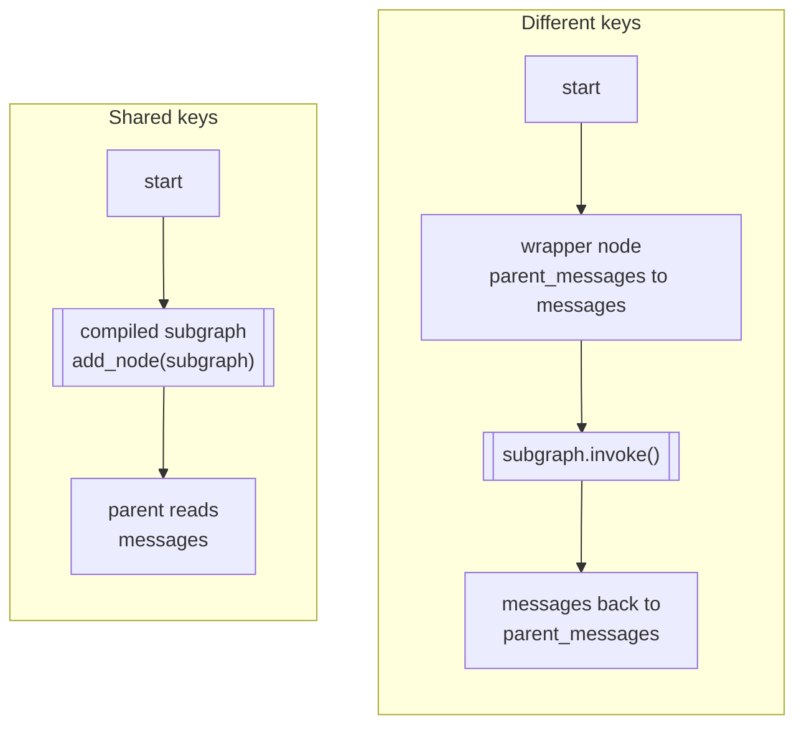
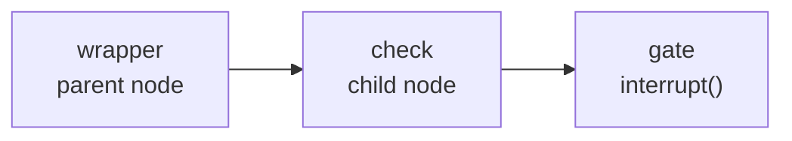

# M09.3 Theory: Subgraphs

*[M09 theory](../README.md) · Lesson 9.3 · Notebooks: [`03a_Subgraphs.ipynb`](../../notebook/03a_Subgraphs.ipynb) · [All theory pages](../../../../../THEORY.md)*
<!-- subtitle: How a compiled graph becomes one node of another, what state crosses the boundary, and what checkpoints, interrupts and streams do inside it -->

## One graph inside another

> **What you'll learn**
>
> - **Explain** what a subgraph is and the two ways to nest one: directly, or through a wrapper node.
> - **Predict** which keys come back out of a subgraph, and when a shared list key doubles.
> - **Trace** an interrupt inside a subgraph and count which nodes run again on resume.
> - **Choose** between a subgraph and plain nodes for a piece of the refund desk.

[Lesson 9.2](../02_interrupts_and_human_in_the_loop/README.md) paused the refund graph at a gate and resumed it. The gate was one node of one graph. Real teams split the work further.

Larkspur's eligibility rules (annual or monthly plan, days since purchase, outbound traffic under 100 GB) grow into a small agent of their own: it looks up the account, checks the rules, loops on a tool when data is missing, and keeps working notes. The refund graph needs its verdict, not its notes. Copying its nodes into the refund graph would mix two teams' state into one schema and make every eligibility change a refund-graph change. The desk wants to build, test and own that agent separately, then drop it in as one step.

## Subgraphs

**A subgraph is an ordinary compiled graph used as a node of another graph, the parent.** The subgraphs notebook builds a weather agent with an `agent` node, a `ToolNode` and a loop between them. It invokes that agent on its own first, to check its input and output, and then nests it two ways. On the Larkspur desk the same move turns the eligibility agent into one step of the refund graph.

The two ways differ in how state crosses the boundary:

*Figure 1: Nesting with shared keys (add the compiled graph as a node) and with different keys (call it from a wrapper that maps state).*

- **Shared keys: add it directly.** When parent and child both use `MessagesState`, adding the compiled subgraph as a node is enough. The parent's `messages` channel is the child's, and the child's reply lands on it with the same reducer.
- **Different keys: wrap it.** The notebook's second parent stores the transcript under `parent_messages`. A wrapper node calls the subgraph with `{"messages": ...}` built from `parent_messages`, then writes the result back. The child does not change. Only the parent knows the mapping.

### What crosses the boundary

A directly added subgraph returns its whole final state, and the parent keeps only the keys it declares. We built a two-node eligibility child (`check`, then `decide`) whose state has a private `scratch` key, a shared `decision` key and a shared `log` list with an `operator.add` reducer, and ran it inside a parent whose first node writes `intake` to the log:

| Key | Child wrote | Parent received | Why |
|---|---|---|---|
| `scratch` | "notes" | nothing | the parent's schema has no `scratch` |
| `decision` | "eligible" | "eligible" | shared, no reducer: the value is replaced |
| `log` | `check`, `decide` | `intake`, `intake`, `check`, `decide` | shared with a reducer: the child's whole list is added again |

*Table 1: State crossing a directly added subgraph (offline run with stub nodes, LangGraph 1.2.18).*

The first row is a feature. The child keeps working notes the parent never sees, and a key you expect in the parent has to be in the parent's schema. The third row is the **echoed log**. The child received the parent's `["intake"]`, appended its own two entries, and returned all three. The parent's reducer then added those three to the `["intake"]` it already had. Any list key with an add reducer on both sides doubles everything the parent wrote before the subgraph ran.

Two fixes work: give the child its own log key that the parent does not declare, or call the child from a wrapper that returns only what the child added. Both keep an audit trail honest, which [lesson 9.6](../06_state_management_in_practice/README.md#reducers-and-parallel-writes) relies on.

### Checkpoints, interrupts and streams inside a subgraph

The runtime features from lessons 9.1 and 9.2 reach inside subgraphs:

- **Checkpoints**: a subgraph compiled without its own checkpointer uses the parent's. A parent thread parked inside a subgraph reports the subgraph's node name in `next`. Asking `get_state` with `subgraphs=True` also shows the child's own state and its own `next`. In our run the parent showed `approval` and the child showed `gate`.
- **Interrupts**: an `interrupt()` inside the child pauses the whole run, in both nesting forms, and one `Command(resume=...)` on the parent thread continues it.
- **Streams**: streaming with `subgraphs=True` yields pairs of a namespace and a chunk. The namespace names the subgraph node and its task (`approval:<task id>` in our run), and the parent's own events carry the empty namespace.

The interrupt case needs a closer look, because nesting adds one more place where code runs twice. We moved the refund gate into a two-node child (`check`, then a `gate` that calls `interrupt()`), paused it, resumed it, and counted runs:

*Figure 2: The approval child behind a wrapper. A resume restarts the interrupted child node and the parent node around it.*

| Node | Added directly | Behind a wrapper |
|---|---|---|
| `check` | 1 | 1 |
| `gate` | 2 | 2 |
| wrapper | (none) | 2 |

*Table 2: Runs per node for one pause and one resume (offline run, LangGraph 1.2.18).*

Resuming re-runs only the interrupted child node. `check` kept its saved result in both forms. The wrapper is different: it is the parent's node, and the parent's node is the one that was interrupted, so the wrapper function runs again from its first line. Any parent-side code before the call into the child repeats. This is the **double-run gate** from lesson 9.2, one level up.

## Choosing a subgraph or plain nodes

A subgraph costs a boundary: a schema to keep in step, a mapping or a shared reducer to reason about, and one more level in streams and state. It pays for that boundary in four situations:

| Situation | Subgraph | Plain nodes |
|---|---|---|
| The piece has its own loop (a tool-calling agent) | ✓ keeps the loop inside | ✗ the loop's edges clutter the parent |
| The piece keeps private state (working notes) | ✓ undeclared keys stay inside | ✗ every key joins the parent schema |
| Another team owns it, or several parents reuse it | ✓ build and test it alone | ✗ copies drift apart |
| A straight sequence on the same state | ✗ boundary for nothing | ✓ simpler |

*Table 3: When a subgraph earns its boundary.*

[M35](../../../../../p10_multi_agent_systems/m35_multi_agent_architectures/mandatory/theory/README.md) to M37 build multi-agent systems out of exactly these pieces: each agent is a compiled graph, and a supervisor or a handoff decides which one runs.

## In practice: nesting eligibility

The desk nests the eligibility agent like this:

1. Build the agent as its own graph with its own state (account, plan, days since purchase, traffic, `scratch`) and test it alone on `refund-17` and `refund-99`.
2. Choose the wrapper form, because the refund graph's state and the agent's state share almost nothing. The wrapper passes the request in and copies only `decision` back.
3. Keep side effects out of the wrapper above the call into the child, since a pause inside the agent re-runs the wrapper.
4. Stream with `subgraphs=True` and show progress only for the parent's namespace. Customers then see "checking eligibility" once and not every tool step inside it.

> **Pitfall: one reducer, two graphs.** If the agent and the refund graph both declare `events` with an add reducer and the agent is added directly, every event written before eligibility appears twice in the audit trail.

[Lesson 9.4](../04_async_and_streaming/README.md) looks at streaming itself: which events a caller can ask for while any of these graphs runs.

## Key Takeaways

- Add a compiled subgraph directly when it shares keys with the parent, and wrap it in a node that maps keys when it does not. Only keys the parent declares come back out.
- A shared list key with an add reducer on both sides doubles whatever the parent wrote before the subgraph ran. Give the child its own key or return only its new entries.
- Checkpoints, interrupts and streams reach inside subgraphs. A resume re-runs only the interrupted child node, but a wrapper also runs again from its first line.

## Check yourself

1. When can you add a compiled subgraph directly as a node, and when do you need a wrapper node?

Add it directly when parent and child share keys, as with `MessagesState` on both sides: the parent's `messages` channel is the child's. When the keys differ, as with the notebook's `parent_messages`, a wrapper calls the subgraph with the child's keys and writes the result back. The child does not change, and only the parent knows the mapping.

2. A parent writes intake to an events list, then runs a directly added child that appends check and decide to the same list. Both declare the list with an add reducer. What does the parent end up with?

Four entries: intake, intake, check, decide. The child receives the parent's list, appends its two entries and returns its whole state. The parent's reducer then adds all three to the intake it already had. Give the child its own key or wrap it so only new entries come back.

3. A two-node approval child (a check, then a gate) runs through a wrapper, pauses at the gate and resumes. What runs twice?

The gate and the wrapper. Resuming re-runs only the interrupted child node: the check runs once and the gate twice. The wrapper is the parent's interrupted node, so it also runs again from its first line, and any parent-side code before the call into the child repeats.

---
*Previous: [9.2 Interrupts and human-in-the-loop](../02_interrupts_and_human_in_the_loop/README.md). Next: [9.4 Async and streaming](../04_async_and_streaming/README.md).*
