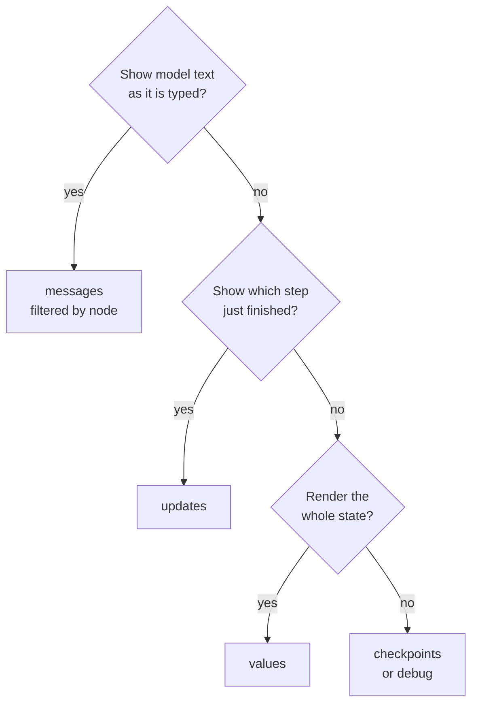
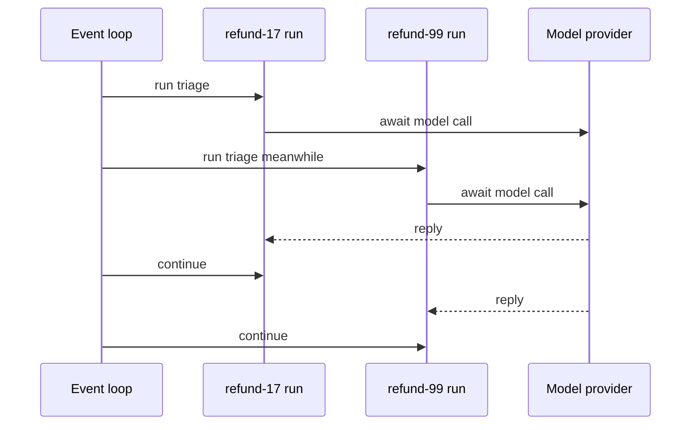

# M09.4 Theory: Async and streaming

*[M09 theory](../README.md) · Lesson 9.4 · Notebooks: [`04a_Async_and_Streaming.ipynb`](../../notebook/04a_Async_and_Streaming.ipynb) · [All theory pages](../../../../../THEORY.md)*
<!-- subtitle: What a caller can see while a graph runs, which stream mode fits which screen, and why async nodes let one process serve many conversations -->

## A support chat that goes silent

> **What you'll learn**
>
> - **Compare** the seven stream modes by what one chunk is and how many a run yields.
> - **Choose** a stream mode, or a pair of them, for progress labels, a typing effect, a whole-state client and an audit.
> - **Diagnose** grader text leaking into a customer's chat, and filter it out.
> - **Explain** what an async node changes for a server, and why async and streaming are separate choices.

[Lesson 9.3](../03_subgraphs/README.md) nested one graph inside another. Every graph so far returned its result once, at the end of `invoke`.

Larkspur's support chat runs a graph that triages the message, retrieves handbook passages, grades them and writes the answer. With `invoke`, the customer stares at an empty box until the last node finishes, then the whole reply appears at once. If the refund branch pauses for billing, the chat shows nothing at all, because the caller only learns about the pause when `invoke` returns. Meanwhile, one worker process blocks on each conversation for its full length, model calls included. The desk needs to show progress and text while the run is in flight, show an approval card when it pauses, and serve many customers from one process.

## Streaming modes

**A stream mode decides what one chunk is when you call `stream` (or `astream`) instead of `invoke`.** `invoke` returns once. `stream` yields chunks while the graph runs, and `stream_mode` picks their content. The installed LangGraph 1.2.18 has seven modes.

We counted the chunks for one run of the four-node low-risk refund `refund-17` (triage, assess, execute, done) with stub nodes, in the scratchpad:

| Mode | One chunk is | Chunks |
|---|---|---|
| `values` | the whole state, once at the start and after each step | 5 |
| `updates` | `{node: what it returned}`, after each node | 4 |
| `checkpoints` | a snapshot in the shape `get_state()` returns | 6 |
| `tasks` | a node starting, then finishing with its result or error | 8 |
| `debug` | checkpoints and tasks together, with step and timestamp | 14 |
| `messages` | `(message chunk, metadata)` from a chat model inside a node | per token |
| `custom` | whatever a node writes with `StreamWriter` | per write |

*Table 1: The seven stream modes on refund-17 (offline run, LangGraph 1.2.18). The stub nodes call no model and write nothing custom, which leaves both of the last two modes empty for this graph.*

The counts follow from the run. Four nodes give four `updates`. `values` adds the starting state for five. `checkpoints` matches the six snapshots of lesson 9.1. `tasks` reports a start and a finish for each node, eight in all, and `debug` carries both streams, six plus eight.

### Matching the mode to the screen

Each screen wants a different slice of the run. Asking three questions in order picks the mode:

*Figure 1: Picking a stream mode for a screen. Audits and debugging fall through to the last box.*

- **Progress labels** ("checking eligibility", "waiting for approval"): `updates`. Each chunk names the node that just finished. When the run pauses, the last chunk is `{"__interrupt__": ...}`. We streamed the high-risk `refund-99` and the final chunk's only key was `__interrupt__`, which is the client's cue to show an approval card.
- **A typing effect**: `messages`. The async-and-streaming notebook prints each token as it arrives and adds the `AIMessageChunk` objects together with `+` to rebuild the full reply.
- **A client that renders the whole state**: `values`.
- **Audits and debugging**: `checkpoints` or `debug`.

Pass a list to get several modes from one run. Each chunk then arrives as a `(mode, chunk)` pair. On the refund run, `updates` and `values` together yielded 9 pairs, the 4 and the 5 from Table 1. A chat endpoint usually asks for `updates` and `messages` together: labels from one, text from the other.

### Planted failure: the leaking grader

`messages` mode streams from every chat-model call inside every node, not only the node that writes the answer. We built a three-node graph (a grader, a node that returns a finished message, and an answer node) with a fake chat model that replies "yes relevant" to the grader and a handbook sentence to the answer node, and streamed it:

| Node | What the stream yielded | Kind |
|---|---|---|
| `grader` | "yes", " ", "relevant" | token chunks |
| `note` | one whole message | the message the node returned, not streamed |
| `answer` | "Refunds", " ", "within", … | token chunks |

*Table 2: What `messages` mode yields from a graph with a grader (offline run with a fake chat model; a real model splits tokens differently).*

We call the first row the **leaking grader**: the customer sees "yes relevant" flash up before the answer. The second row is the less known part. A node that returns a message without streaming it (a tool result, a canned reply) still shows up in `messages` mode, as one whole message. The notebook's weather agent shows the same thing: its print loop skips only the human message, so the tool's weather report prints too.

Every chunk comes with metadata, and `langgraph_node` in that metadata names the node that produced it. Filter on it before rendering, and only the answer node's text reaches the screen. Streaming tells the caller what is happening. It does nothing for the server's capacity, which is where async comes in.

## Async nodes

**An async node is a node written as `async def` that awaits its slow calls, such as `await model.ainvoke(...)`.** The graph then runs with `await graph.ainvoke(...)` or `async for chunk in graph.astream(...)`. The notebook's async graph has the same shape as its synchronous one: only the node and the call change.

Async matters when one server process handles many conversations. A synchronous `invoke` holds its worker for the whole run, model calls included. An async node hands the event loop back while it waits on the model or a tool, and the loop runs other conversations in the gap:

*Figure 2: Two refund runs sharing one event loop. Each await frees the loop for the other run.*

A FastAPI handler built on `astream` can therefore serve other Larkspur customers while one customer's answer is still being written. We call the opposite the **blocked worker**: a synchronous handler whose process does nothing else while a model call is in flight.

Async and streaming are separate choices:

| | Returns once | Yields chunks |
|---|---|---|
| Blocks the worker | `invoke` | `stream` |
| Frees the event loop while waiting | `ainvoke` | `astream` |

*Table 3: Async and streaming are two independent switches.*

`stream` works synchronously, and `ainvoke` returns once at the end like `invoke`. A chat endpoint usually wants the bottom-right cell: `astream` with `messages` and `updates`.

Two details from the notebook complete the picture:

- **`streaming=True` on the model** makes the provider send tokens as they are generated, which `messages` mode then passes through.
- **Checkpoints work the same.** The async graph is compiled with `MemorySaver`, and a second `ainvoke` on the same thread sees the first turn. Our offline async run kept both turns' events on one thread.

## In practice: the refund chat

The desk's chat endpoint combines everything on this page:

1. The handler is async and calls `astream` on the refund graph with the thread id from the session and the modes `updates` and `messages`.
2. Each `updates` chunk maps a node name to a label: `triage` to "reading your request", `assess` to "checking the refund rules".
3. Each `messages` chunk is rendered only when its `langgraph_node` is the reply node. Grader and tool text never reach the customer.
4. If the last `updates` chunk is `__interrupt__`, the chat shows "waiting for billing" and the handler returns. Billing's approval later resumes the thread from another request.

> **Interview tip:** when asked how to make an agent feel fast, separate the two questions. Streaming changes what the user sees during the run. Async changes how many runs one process can hold.

[Lesson 9.5](../05_retry_policies_and_bounded_cycles/README.md) turns to runs that fail or loop: how a node retries and how a cycle is made to stop.

## Key Takeaways

- Choose the stream mode for the screen: `updates` for progress labels and pauses, `messages` for a typing effect, `values` for whole-state clients, `checkpoints` or `debug` for audits. Ask for a list of modes to get `(mode, chunk)` pairs.
- `messages` mode streams tokens from every model call in every node, plus whole messages that nodes return. Filter on `metadata["langgraph_node"]` before you render.
- Async nodes free the event loop while waiting on models and tools, so one process serves many conversations. Streaming is a separate choice, and a chat endpoint usually wants both.

## Check yourself

1. A RAG graph streamed in messages mode shows the grader's yes relevant before the answer. Why, and how do you stop it reaching the screen?

`messages` mode streams tokens from every chat-model call inside every node, not only the one that writes the answer. Each chunk's metadata names its node in `langgraph_node`. Render a chunk only when that is the answer node.

2. The Larkspur client shows progress labels and must show an approval card when the refund run pauses. Which stream mode fits, and how does it know to show the card?

`updates`. Each chunk is `{node: what it returned}`, which names the node that just finished: the low-risk refund yields 4 of them. When the run pauses, the last chunk is `{"__interrupt__": ...}`, and that tells the client to show the approval card.

3. A FastAPI chat endpoint calls invoke synchronously and slows down as conversations grow. What does making the nodes async change, and what does it not change?

A synchronous `invoke` holds its worker for the whole run, model calls included. An `async def` node hands the event loop back while it waits on the model or a tool, and the handler serves other customers meanwhile. Async does not stream by itself: `ainvoke` still returns once, and a chat endpoint usually wants `astream` with `messages` and `updates`.

---
*Previous: [9.3 Subgraphs](../03_subgraphs/README.md). Next: [9.5 Retry policies and bounded cycles](../05_retry_policies_and_bounded_cycles/README.md).*
