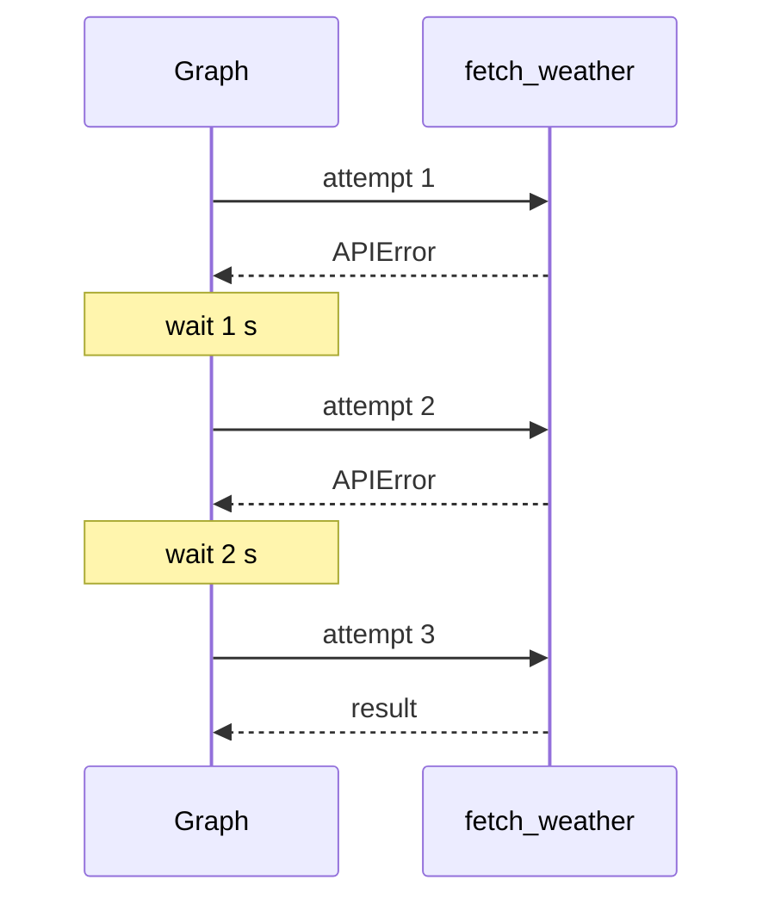
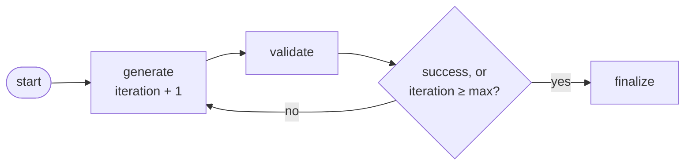

# M09.5 Theory: Retry policies and bounded cycles

*[M09 theory](../README.md) · Lesson 9.5 · Notebooks: [`05a_Retries.ipynb`](../../notebook/05a_Retries.ipynb), [`05b_Cycles_and_Loops.ipynb`](../../notebook/05b_Cycles_and_Loops.ipynb) · [All theory pages](../../../../../THEORY.md)*
<!-- subtitle: How a node retries a flaky call without the caller noticing, which errors it should retry, and how to make a loop stop when the model never gets it right -->

## Flaky providers and endless loops

> **What you'll learn**
>
> - **Explain** how a `RetryPolicy` re-runs a node inside one call, and compute its waits from its four numbers.
> - **Predict** which exceptions the default policy retries, and why naming them is safer.
> - **Build** a loop guard from three parts: a counter in a node, a cap in the router, and a `recursion_limit`.
> - **Diagnose** a loop whose counter never grows.

[Lesson 9.4](../04_async_and_streaming/README.md) showed a caller what a run is doing while it runs. This lesson is about runs that go wrong in two different ways.

Larkspur's refund graph calls a payment provider that sometimes answers 503 for a few seconds. One failed call should not fail the refund, and nobody wants retry code inside every node. The support chat has the opposite problem: a node rewrites the customer reply until a tone checker passes it, and on a bad day the checker never passes. Without a guard, that loop calls the model until something outside the graph stops it. The desk needs retries that are short, bounded and aimed at the right errors, and loops that end whether or not the model gets it right.

## Retry policies

**A `RetryPolicy` attached to a node with `add_node(..., retry_policy=...)` re-runs that node when it raises, inside the same invoke.** The caller sees one call and one result. We gave a node a policy and made it fail twice with `ConnectionError` before succeeding: the `updates` stream showed the node once, after the third attempt.

The retries notebook wraps a weather API that fails 70% of the time and gives it this policy: `max_attempts` 5, `initial_interval` 1 second, `backoff_factor` 2, `max_interval` 10 seconds, `jitter` on, and `retry_on` set to the notebook's own `APIError`. A run that succeeds on the third attempt looks like this:

*Figure 1: Retries happen between the graph and the node. The caller of invoke sees none of them (jitter left out).*

### How long the waits are

In the installed LangGraph 1.2.18 the wait after the n-th failure is the smaller of `max_interval` and `initial_interval × backoff_factor^(n − 1)`, plus a random 0 to 1 second when `jitter` is on. (The notebook's summary writes the exponent as the attempt number. The source uses one less.) For the notebook's policy:

| After failure | Wait | With jitter |
|---|---|---|
| 1 | 1 s | 1 to 2 s |
| 2 | 2 s | 2 to 3 s |
| 3 | 4 s | 4 to 5 s |
| 4 | 8 s | 8 to 9 s |
| 5 | no wait, the exception reaches the caller | |

*Table 1: Waits under the retries notebook's policy, from the formula in the installed source.*

A run that exhausts the policy waits 15 to 19 seconds before it fails. With a 70% failure rate and independent attempts, all five fail with probability 0.7^5 ≈ 0.168, about one run in six. More attempts would lower that and lengthen the worst wait. The `max_interval` of 10 seconds caps any single wait. With five attempts it never bites. A sixth attempt would bring it into play: the wait after the fifth failure would double to 16 seconds and be cut to 10.

A policy you create without arguments is shorter: 3 attempts, a first wait of 0.5 seconds, a factor of 2, a cap of 128 seconds, and jitter on.

### Which errors get retried

With no `retry_on`, a policy uses a default rule. We read it in the installed source and tested it offline:

| Exception | Retried by default | Why |
|---|---|---|
| `ConnectionError` (and `ConnectionResetError`) | yes | checked first, as a network blip |
| HTTP 5xx from `httpx` or `requests` | yes | server errors are worth another try |
| `TimeoutError` | no | it is an `OSError`, and `OSError` is on the never list |
| `ValueError`, `TypeError`, `RuntimeError`, `LookupError` (incl. `KeyError`) | no | programming errors |
| a custom `APIError(Exception)` | yes | anything not on the never list is retried |

*Table 2: The default retry rule in LangGraph 1.2.18 (offline checks; a custom exception made 3 attempts, a `ValueError` made 1).*

Two rows surprise people. A plain timeout is not retried, and a custom exception is, even without `retry_on`. The second one hides bugs. A node that raises its own error class for a bad input waits through every backoff before failing. We call this the **patient bug**. Name the exceptions you mean in `retry_on`, as the notebook does, so a bug fails on the first attempt and a real outage gets the retries.

> **Pitfall: the retried side effect.** A retry repeats everything the node did before it raised. If the payment provider applied a Larkspur refund and then the connection dropped, the retry refunds again. [Lesson 9.6](../06_state_management_in_practice/README.md#resume-and-side-effects) shows the fix and the lab that counts it.

Retries handle a node that fails. A loop that keeps succeeding without ever finishing needs a different guard.

## Bounded cycles

**A cycle is a conditional edge that routes back to a node the run already visited.** The cycles notebook uses one to regenerate code until it passes its tests, and another to research a topic to a fixed depth. Every cycle needs a reason to stop that does not depend on the model getting it right:

<!-- animated: diagrams/bounded-cycle.anim.html -->

*Figure 2: The bounded code-generation loop. The node counts, and the router reads the count.*

### The three-part guard

The notebook's guard has three parts, and each one covers a failure the others miss:

- **The node counts.** `generate` returns `iteration + 1`. The router only reads it. A router function picks an edge, and anything it writes to `state` is discarded.
- **The router checks success first, then the cap.** With a cap of 3 and a validator that always fails, the run is generate, validate, three times over, then `finalize`.
- **`recursion_limit` is the backstop.** It counts steps, not loops. The installed LangGraph's default is 10,007 (read from the environment variable `LANGGRAPH_DEFAULT_RECURSION_LIMIT`), far too high to protect a model budget. Pass it on every run.

We ran the loop offline with stub nodes and a validator that fails every time, the worst case a real model can produce:

| Round | `generate` sets iteration | `validate` | Router sees | Goes to |
|---|---|---|---|---|
| 1 | 1 | fails, error 1 | not success, 1 below 3 | `generate` |
| 2 | 2 | fails, error 2 | not success, 2 below 3 | `generate` |
| 3 | 3 | fails, error 3 | not success, 3 reaches 3 | `finalize` |

*Table 3: The bounded loop with an always-failing validator (offline run, LangGraph 1.2.18).*

That is 7 node runs, 3 errors accumulated through the `operator.add` reducer, and a result whose `success` is still false. The caller must handle that result: a capped loop ends, but it does not end well.

### Planted failure: the counter in the router

Move the increment into the router function and the guard stops working. We ran that version with the same always-failing validator:

| Version | Where the count grows | Outcome |
|---|---|---|
| Counter in `generate` | node update, saved to state | `finalize` after 3 rounds, 7 node runs |
| Counter in the router, `recursion_limit` 10 | router writes, discarded | `GraphRecursionError` after 10 steps (5 generates, 5 validations) |
| Counter in the router, default limit | router writes, discarded | stops only after 10,007 steps |

*Table 4: Where the counter lives decides whether the cap ever fires (first two rows from offline runs; the third follows from the default limit).*

We call this the **runaway loop**: the cap is written correctly and never reached, because the number it reads never grows. With an explicit `recursion_limit` the run fails loudly after a few steps. With the default it can make thousands of model calls first. The safe habit is to test every loop with a grader that always says no, and check that it ends where you expect.

## In practice: the tone-check loop

The support chat's "rewrite until the tone checker passes" loop gets the same treatment:

1. The rewriting node increments `attempts` in its update. The router only reads it.
2. The router sends a passing reply to `send` first, then sends a reply that has used 3 attempts to a fallback node, and only then loops.
3. The fallback hands the conversation to a person instead of sending an unchecked reply.
4. Every run passes an explicit `recursion_limit` a little above the steps three rounds need.
5. The model call inside the rewriting node gets a `RetryPolicy` with `retry_on` naming the provider's connection and 5xx errors, and nothing else.

[M29](../../../../../p08_agentic_rag/m29_crag_and_self_rag/mandatory/theory/README.md)'s grade-and-rewrite loops are built this way. [Lesson 9.6](../06_state_management_in_practice/README.md) puts retries, resumes and crashes together and counts what reaches the outside world.

## Key Takeaways

- A `RetryPolicy` re-runs a failing node inside one call, with waits that double from `initial_interval` up to `max_interval`. Name the exceptions in `retry_on`, because the default retries any custom exception and skips timeouts.
- Every retry repeats the node's side effects, and an external write that already succeeded can happen twice.
- Bound every cycle: count in the node, check success then the cap in the router, and pass an explicit `recursion_limit`. The default of 10,007 steps will not protect a model budget.

## Check yourself

1. Why should a RetryPolicy name its exceptions in retry_on instead of relying on the default?

The default retries `ConnectionError` and HTTP 5xx errors and skips the programming errors on its list, but any class not on that list is retried, including a custom `APIError(Exception)`. A node that raises its own error for a bad input then waits through every backoff before failing. Naming the exceptions makes a bug fail on the first attempt and keeps retries for real outages.

2. With the retries notebook's policy and a weather API that fails 70% of the time, how long does a run that exhausts the policy wait, and how often does that happen?

15 to 19 seconds: waits of 1, 2, 4 and 8 seconds, plus up to 1 second of jitter each, and no wait after the fifth failure. All five attempts fail with probability 0.7^5 ≈ 0.168, about one run in six.

3. A rewrite loop bumps its attempt counter in the router function, and the loop runs until GraphRecursionError. What went wrong?

Anything a router writes to `state` is discarded: the counter never grows and the cap is never reached. The node must count (`generate` returns `iteration + 1`) and the router only reads it, checking success first, then the cap. Pass an explicit `recursion_limit` as the backstop, since the default of 10,007 steps is far too high to protect a model budget.

---
*Previous: [9.4 Async and streaming](../04_async_and_streaming/README.md). Next: [9.6 State management in practice](../06_state_management_in_practice/README.md).*
