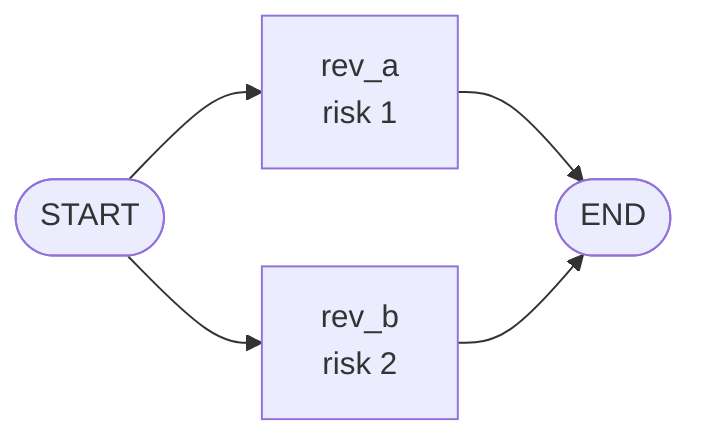
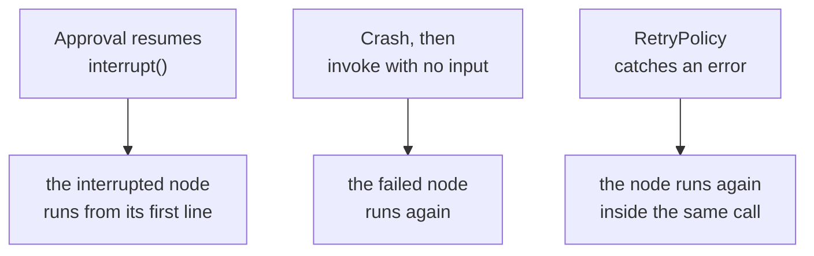

# M09.6 Theory: State management in practice

*[M09 theory](../README.md) · Lesson 9.6 · Notebooks: [`06a_LangGraph_State_Management.ipynb`](../../notebook/06a_LangGraph_State_Management.ipynb) · [All theory pages](../../../../../THEORY.md)*
<!-- subtitle: How reducers keep parallel writes and audit trails safe, and how to stop a resumed, crashed or retried node from paying a customer twice -->

## Paid twice, notified twice

> **What you'll learn**
>
> - **Explain** how a field's reducer decides what happens when two nodes write it, in a row or in the same step.
> - **Diagnose** an `InvalidUpdateError` from parallel reviewers and fix it with a reducer.
> - **Trace** the three ways a node runs again: resume after an interrupt, resume after a crash, and a retry.
> - **Count**, with the lab, how many notices and refunds reach the outside world for each fault.
> - **Apply** the two guards that make re-execution harmless: side effects off the resumed path, and idempotency keys.

[Lesson 9.5](../05_retry_policies_and_bounded_cycles/README.md) made nodes retry and loops stop. Every lesson in this module has ended on the same warning: some code runs twice. This lesson counts it.

Finance at Larkspur reports two problems with `refund-99`. The customer was refunded twice, and the billing team got two approval requests for it. The approval itself was given once. The state-management notebook builds the refund agent this module has followed, with a deterministic stub in place of the model and stub tools. It runs without an API key, and every result on this page comes from running its code or the lab's recorded runs. The page answers two questions: how state stays correct when several nodes write it, and how the outside world stays correct when nodes run more than once.

## Reducers and parallel writes

**The state schema is the contract between steps, and each field's reducer decides how a node's partial update lands on it.** A field with no reducer is overwritten. A field annotated with `operator.add` accumulates. A field annotated with `add_messages` merges chat messages by id. The notebook makes nodes `a` then `b` each return `1` for two fields, and adds a parallel case:

| Reducer | Two nodes in a row each write | Two parallel nodes write in one step |
|---|---|---|
| None (`plain: int`) | the last write wins: `1` | `InvalidUpdateError` |
| `operator.add` (`summed`) | the writes add up: `2` | the writes add up |
| `add_messages` | appended, matched by id | appended; `RemoveMessage(id=...)` deletes |

*Table 1: What each reducer does with two writes (the notebook's reducer, fan-out and pruning cells, run offline).*

### Planted failure: two reviewers, one field

A missing reducer only fails when writes collide in one step. The notebook fans out two reviewers from `START`, and both return `risk`:

*Figure 1: Two reviewers in one super-step. Both write the same field in the same step.*

LangGraph cannot choose between the two values and stops with *At key 'risk': Can receive only one value per step. Use an Annotated key to handle multiple values.* We call this the **ambiguous write**. Give the field a reducer and the merge is deterministic. The notebook's fixed version sums the reviewers' scores into `risk_score`, and the merged result is 3 with both reviewers' events kept.

### The audit trail and the context window

Two list fields in the refund agent use reducers for opposite purposes:

- **`events`**, annotated with `operator.add`, is the audit trail. Every node appends a line, nothing overwrites it, and the checkpoint history from [lesson 9.1](../01_checkpointing_and_threads/README.md) records when each line arrived. It is never pruned.
- **`messages`**, annotated with `add_messages`, is what the model sees. The notebook's trimming node sends `RemoveMessage` updates to fit the context window: after a node adds 5 transcript messages, the trimmer keeps the last 2, and the audit log records "pruned 3 old messages".

Keeping the two apart means the model's context can shrink while the record of what happened never does. [Lesson 9.3](../03_subgraphs/README.md#what-crosses-the-boundary) showed one way to break this: a directly added subgraph that declares the same `events` key echoes the parent's entries into it twice. State inside the graph is now safe. The outside world is the harder half.

## Resume and side effects

**A durable workflow re-executes code.** The run resumes after an approval, a worker restarts after a crash, a `RetryPolicy` tries again. The checkpointer makes the state safe across all three. It cannot take back what a node already did to the outside world: a refund sent, an email delivered. The notebook's refund agent shows three ways a node runs again, and the Larkspur refund graph in the lab records each one with LangGraph 1.2.18:

*Figure 2: Three paths to a second run. Earlier nodes keep their checkpointed results on all three.*

- **Resume after `interrupt()`** re-runs the interrupted node from its first line ([lesson 9.2](../02_interrupts_and_human_in_the_loop/README.md#interrupt)). Nodes before it do not run again.
- **Resume after a crash** is invoke with no input on the same thread, once the cause is fixed. The failed node runs again, and `triage` and `assess` keep their checkpointed results. The low-risk refund takes 2 client calls: the first raises `ConnectionError` and leaves the thread parked at `execute`, the second finishes.
- **A `RetryPolicy`** re-runs the node inside the same call ([lesson 9.5](../05_retry_policies_and_bounded_cycles/README.md#retry-policies)). The caller sees no error. The provider sees two requests. The notebook's flaky provider succeeds on its third attempt under a three-attempt policy.

### Counting what reaches the outside world

The [interactive lab](interactive/resume-side-effects-lab.html) counts what reaches the outside world for each combination of request, fault and guards. Its headline numbers, for the high-risk refund `refund-99`:

| Fault in `execute` | Guards off: notices, refunds | Guards on: notices, refunds |
|---|---|---|
| None | 2, 1 | 1, 1 |
| 503, crash then `invoke(None)` | 2, 1 | 1, 1 |
| 503, `RetryPolicy` | 2, 1 | 1, 1 |
| Response lost, `RetryPolicy` | 2, 2 | 1, 1 |

*Table 2: Approval notices and refunds per fault for refund-99, from the lab's recorded runs.*

<!-- lab: interactive/resume-side-effects-lab.html -->

The guards-off column holds both of finance's problems. The notice doubles on every row, faults or not. The refund doubles only on the last row, where the provider applied the refund and the response never came back.

### The two guards

Two guards account for every difference in Table 2:

- **Keep side effects off the resumed path.** With guards off, the approval notice is sent inside `human_gate` above `interrupt()`, and the billing team gets it again when the gate resumes: the **double-run gate**. Moved into its own `notify` node before the gate, it runs once. The graph gains a node and one checkpoint (8 instead of 7), and the client still makes 2 calls.
- **Make external writes idempotent.** A 503 before the provider refunds is harmless to retry. A lost response after it refunds is not: with guards off the customer is refunded twice. We call that the **lost-response double charge**. With guards on, the call carries the key `refund:refund-99`, the provider recognises the second request and returns the stored result.

An **idempotency key** is a name for one intended effect that the receiver remembers. The notebook's `EXECUTION_LEDGER` does the same check in process:

| Call | Key | Ledger before | Returned |
|---|---|---|---|
| first | `refund:order-99:v1` | empty | executed: refunded $42.00 |
| duplicate | `refund:order-99:v1` | holds the first result | skipped (already executed): refunded $42.00 |

*Table 3: The notebook's idempotency ledger on a duplicate call (run offline).*

The key has to name the intended effect, not the attempt. A key built from a timestamp or a retry counter changes on every run and dedups nothing.

## In practice: fixing refund-99

The desk's fix for finance's report follows the two guards:

1. Read `refund-99`'s checkpoint history beside the provider's log. `human_gate` ran twice and `execute` ran twice, and the provider applied two refunds.
2. Move the approval notice out of `human_gate` into a `notify` node before it. The gate keeps only the `interrupt()` call and the decision.
3. Send every refund with the key `refund:<thread id>`, so a retry, a crash resume or a replay asks the provider for the same refund and gets the stored result.
4. Keep `events` as the append-only audit trail and record the reviewer's decision in it on resume.
5. Open the lab, set *Response lost, RetryPolicy*, and turn the guards on: both counts drop to 1 with the same number of client calls.

> **Key distinction:** the checkpointer guarantees the graph's state. Idempotency guarantees the world's state. A production workflow needs both.

Put together, these are the notebook's closing rules: workers stay stateless, state lives in the checkpointer, the `events` field is the audit log, the workflow is an explicit graph with the human gate as a waiting state, and every side effect can run twice without harm.

## Key Takeaways

- Give any field that parallel nodes write a reducer, or the step fails with `InvalidUpdateError`. An `operator.add` list makes an audit trail that nothing overwrites, kept apart from the pruned `messages` list.
- Nodes run again after an interrupt, a crash or a retry. The checkpointer protects the state, never what a node already did outside the graph.
- Move side effects off the resumed path into their own node, and send external writes with an idempotency key that names the effect, such as `refund:refund-99`.

## Check yourself

1. Two reviewers fan out from the start node and both return risk, and the run stops. Why, and what fixes it?

The `risk` field has no reducer: LangGraph cannot choose between two writes in one step and raises "Can receive only one value per step". Give the field a reducer, such as `operator.add`, and the merge is deterministic. The notebook's fixed version sums the two scores to 3.

2. In the lab, refund-99's provider applies the refund and the response is lost, then a RetryPolicy retries. How many refunds does the customer get with guards off, and with guards on?

Two with guards off, one with guards on. With guards on the call carries the key `refund:refund-99`. The provider recognises the second request and returns the stored result. A 503 before the refund is harmless to retry either way.

3. The billing team gets every high-risk approval notice twice, even with no faults. What causes it, and what is the fix?

The notice is sent inside `human_gate` above `interrupt()`, and a resume re-runs that node from its first line. Move the notice into its own `notify` node before the gate, where it runs once. The graph gains a node and one checkpoint (8 instead of 7), and the client still makes 2 calls.

---
*Previous: [9.5 Retry policies and bounded cycles](../05_retry_policies_and_bounded_cycles/README.md). Next: [M09 interview questions](../README.md#interview-spotlight-5-questions-you-might-get-asked).*
