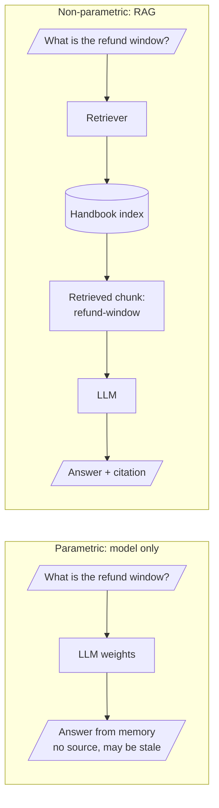
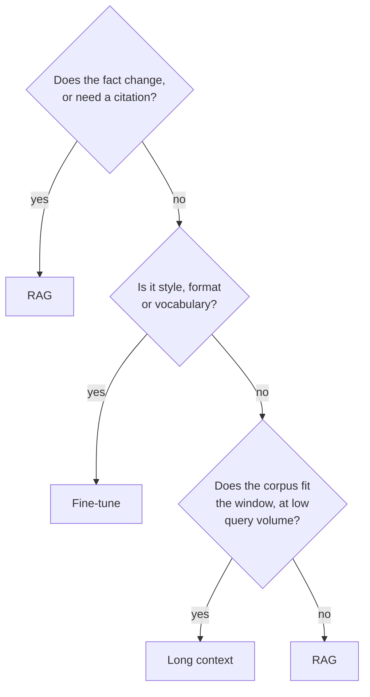

# M10.1 Theory: The knowledge problem: hallucination, freshness, context-window growth, RAG vs fine-tuning vs long context

*[M10 theory](../README.md) · Lesson 10.1 · [All theory pages](../../../../../THEORY.md)*
<!-- subtitle: Facts belong in an index you control, because the weights go stale and cite nothing -->

## Parametric vs non-parametric knowledge

> **What you'll learn**
>
> - **Explain** the four ways knowledge stored in a model's weights fails an application.
> - **Compare** RAG, fine-tuning and long context by where the knowledge lives and what an update costs.
> - **Choose** an approach for a fact that changes, a house style, and a corpus small enough to fit in the prompt.

Modules M06 to M09 built chains and graphs around a model. From this module on, the question is what the model knows at the moment it answers, and where that knowledge comes from.

A Larkspur Cloud customer bought an annual plan 45 days ago and asks the support assistant for a refund. With no handbook behind it, the assistant answers from memory: refunds are only available within 30 days of purchase. The handbook says otherwise. After day 30, annual refunds are prorated: the customer gets back the unused whole months, minus a 15% early-termination fee. The answer is fluent, specific and wrong, and nothing in it tells the customer to doubt it.

**Parametric knowledge** is what a model stores in its weights during training. It is fast and needs no infrastructure, but it fails an application in four ways:

| Failure | What happens | Larkspur example |
|---|---|---|
| **Stale memory** | Knowledge stops at the training cut-off | The refund policy changed in March 2026, and no model trained before then has seen the new terms |
| **Missing data** | Private data was never in the training set | Larkspur's tickets, contracts and runbooks |
| **No source** | The model cannot point to where a fact came from | Nobody can check the "30 days" answer against a page |
| **Confident fabrication** | Asked about something it never saw, the model still writes fluent text | The refund answer above, which is a hallucination |

*Table 1: Four ways parametric knowledge fails an application.*

**Non-parametric knowledge** lives outside the model, in an index you build and query. **RAG** (retrieval-augmented generation) retrieves the passages relevant to a question and puts them in the prompt. The model then answers from evidence it can quote. Here is the same refund question answered both ways:

*Figure 1: The same question answered from memory and from a retrieved handbook chunk. Only the RAG path returns a source.*

The index is where an update happens. When the refund terms change, you re-index the refund page and the next answer quotes the new text, while the model's weights stay exactly as they were.

## RAG, fine-tuning and long context

There are three ways to give a model knowledge it did not learn in training, and they solve different problems. Table 2 compares them on what an application cares about:

| | RAG | Fine-tuning | Long context |
|---|---|---|---|
| Where the knowledge lives | External index | Model weights | The prompt, every call |
| Updating a fact | Re-index one document | Retrain | Edit the prompt |
| Citations | Yes, per chunk | No | Possible, but nothing narrows the evidence |
| Cost per question | Retrieval + a short prompt | Cheap once trained | Pays for the whole corpus in tokens |
| Best at | Facts that change, private data, auditability | Style, format, domain vocabulary, behaviour | Small corpora that fit, one-off analysis |
| Fails when | Retrieval misses the evidence | Facts change after training | The corpus outgrows the window, or the answer sits mid-context |

*Table 2: Three ways to add knowledge, compared.*

Context windows have grown large enough that a small handbook fits in one prompt, which makes long context tempting. Every call then pays for every page in tokens, and nothing ranks the evidence: the model has to find the refund paragraph among the outage, export and sizing pages by itself. Lesson 10.2 shows that a passage's position in a long prompt also changes how reliably the model uses it.

> **Key distinction:** fine-tuning teaches behaviour, such as style, format and vocabulary. RAG supplies facts at the moment of the question. Anything that changes, or that a user must be able to check, goes on the RAG side.

The two combine well. A model fine-tuned on Larkspur's support voice would still need retraining at every policy change. The policy itself belongs in the index. M45 covers when fine-tuning is worth its cost. The questions below give a first pass at the choice:

*Figure 2: A first-pass choice between the three approaches. When you need both a house voice and current facts, combine fine-tuning with RAG.*

## In practice: the March refund change

When the refund policy changed in March 2026, a RAG assistant needed four steps and no retraining:

1. **The policy team edits the refund page.** The new text adds proration after day 30, minus the 15% early-termination fee.
2. **Re-index that page.** Load it, split it, embed the new chunks and replace the old ones in the index.
3. **Ask the 45-day question again.** The assistant now retrieves the proration chunk, answers from it and cites the page.
4. **Keep the question.** Add it to the set of test questions, and the next policy change gets checked the same way.

> **Next:** step 2 hides the core mechanism, an index that scores every chunk against a question. Lesson 10.2 builds one from scratch with TF-IDF.

## Key Takeaways

- Knowledge in the weights goes stale, misses private data, cannot cite a source and stays fluent when wrong. RAG answers from passages retrieved from an index you control.
- Choose RAG for facts that change, private data and citations; fine-tuning for style, format and vocabulary; long context for small corpora that fit the window.
- Combine the approaches when you need both: fine-tune for tone and format, retrieve for facts.

## Check yourself

1. A model trained before March 2026 answers the Larkspur refund question fluently. Why can you not trust that answer?

Parametric knowledge stops at the training cut-off, and the refund policy changed in March 2026, so the answer may be stale. The model also cannot point to a source, so nobody can check it, and it writes fluent text even about what it never saw. RAG puts the current policy passage in the prompt, so the model answers from evidence it can quote.

2. The refund terms change again next month. What does updating that fact take under RAG, fine-tuning and long context?

With RAG you re-index one document. With fine-tuning you retrain. With long context you edit the prompt, but every call pays for the whole corpus in tokens.

3. Larkspur wants answers in its house tone that also state current policy with citations. Which approach fits?

Combine them: fine-tune for tone and format, retrieve for facts. Fine-tuning alone gives no citations and goes wrong when facts change after training, while RAG cites per chunk and picks up a change with a re-index. M45 covers when fine-tuning is worth it.

---
*Previous: [M10 overview](../README.md). Next: [10.2 Indexing from scratch with TF-IDF and nearest neighbours](../02_indexing_from_scratch_with_tf_idf_and_nearest_neighbours/README.md).*
