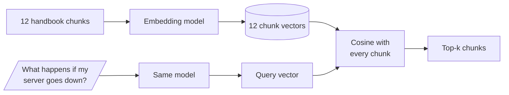

# M10.3 Theory: Semantic retrieval with embedding similarity

*[M10 theory](../README.md) · Lesson 10.3 · Notebooks: [`03a_retrieval_strategies.ipynb`](../../notebook/03a_retrieval_strategies.ipynb) · [All theory pages](../../../../../THEORY.md)*
<!-- subtitle: Embeddings match meaning across word forms, and can lose the literal word TF-IDF caught -->

## Embedding similarity

> **What you'll learn**
>
> - **Explain** how an embedding model scores a chunk against a question by the angle between their vectors.
> - **Compare** embeddings with TF-IDF on the three Larkspur golden questions.
> - **Diagnose** why a semantic retriever can rank a related chunk above the one that holds the answer.
> - **Choose** a score threshold from the golden set instead of a fixed number.

Lesson 10.2 left two questions that no `k` could fix. The `refund-timing` chunk scored zero because "Refunds" is a different token from "refund", and the outage evidence scored zero because the customer wrote "server goes down" where the handbook says "outage". Both are representation problems: TF-IDF vectors only count shared words.

An **embedding model** turns a text into a fixed-length list of numbers, a vector. Texts with similar meaning get vectors that point in similar directions, even when they share no words. Retrieval with embeddings has the same shape as the TF-IDF index; only the vectors change:

*Figure 1: Semantic retrieval. Chunks are embedded once at indexing time. The question is embedded when it arrives.*

Each chunk is scored by the cosine of the angle between its vector and the question's. Libraries report that comparison in one of two forms:

| Quantity | How it is computed | Range | Closer chunk |
|---|---|---|---|
| **Cosine similarity** | The dot product of the two vectors, divided by the product of their lengths | -1 to 1 | Higher number |
| **Cosine distance** | 1 minus the cosine similarity | 0 to 2 | Lower number |

*Table 1: Two forms of the same comparison. Notebook 03a's nearest-neighbour search prints the distance.*

When every vector has length 1, the cosine is the plain dot product. OpenAI's embeddings come normalised that way, and sentence-transformers returns them so when asked to normalise.

The question and the chunks must go through the same model. Two models produce vectors in different spaces, so the cosine between a vector from one and a vector from the other means nothing. We call that a **space mismatch**. Notebook 03a avoids it by sending both sides through one embedding function, and it follows that changing the embedding model means re-embedding the whole corpus (M13).

## Embeddings against TF-IDF

The comparison below uses the 12 Larkspur chunks and three golden questions from the [lesson 10.2 lab](../02_indexing_from_scratch_with_tf_idf_and_nearest_neighbours/interactive/top-k-retrieval-lab.html). It embeds every chunk and question with `all-MiniLM-L6-v2`, a small model (384 numbers per vector) that runs locally, so anyone can reproduce the scores. Notebook 03a uses OpenAI's `text-embedding-3-small`, whose scores will differ.

With two evidence chunks per question, recall moves in steps of 0.50:

| Question | TF-IDF R@2 | TF-IDF R@3 | Embeddings R@2 | Embeddings R@3 | Embedding top three (cosine) |
|---|---|---|---|---|---|
| *How long does a refund take?* | 0.50 | 0.50 | **1.00** | 1.00 | `refund-timing` 0.766, `refund-window` 0.608, `support` 0.297 |
| *What happens if my server goes down?* | 0.00 | 0.00 | 0.50 | **1.00** | `reboot` 0.394, `incidents` 0.314, `sla` 0.257 |
| *Can I export my data after I cancel my plan?* | **1.00** | 1.00 | 0.50 | 1.00 | `retention` 0.817, `cancel` 0.561, `export` 0.479 |

*Table 2: Recall at k = 2 and k = 3 for TF-IDF and embeddings, with the embedding scores of the top three chunks.*

The three questions move in three directions:

- **Word-form miss, fixed** (refund): the embedding model places "Refunds" and "refund" close together, and `refund-timing`, which scored 0 under TF-IDF, ranks first.
- **Vocabulary gap, narrowed** (outage): both evidence chunks now reach the top three, though `reboot` still ranks first because rebooting a server is close in meaning to a server going down. The top three scores sit within 0.137 of each other, so a small change to the question can reorder them.
- **Topic drift** (export): embeddings lose a question TF-IDF answered. The question is half about cancelling, so the `cancel` chunk (0.561) outranks `export` (0.479). TF-IDF matched the literal word "export" and found both evidence chunks at `k = 2`.

Topic drift is the general weakness. Embeddings measure how close two texts are in topic, which is a different thing from whether a chunk contains the answer. The two retrievers suit different questions:

| The question shares with its evidence | Better retriever | Larkspur example |
|---|---|---|
| A rare exact word: a product name, an error code | TF-IDF | "export" |
| Meaning, in other words or word forms | Embeddings | "server goes down" for "outage", "refund" for "Refunds" |
| Some of each | Hybrid search (M16), then a reranker (M18) | The export question, half about cancelling |

*Table 3: Which retriever wins, by what the question and the evidence have in common.*

Hybrid search combines the two scores. A reranker reorders the candidates with a model that reads the question and each chunk together.

> **Pitfall: the fixed-threshold trap.** Cosine scores are not probabilities. The best outage match scores 0.394, while the best export match scores 0.817 on the same model. A rule such as "drop chunks below 0.5" sends the outage question to the model with no context at all.

## In practice: switching the Larkspur baseline to embeddings

Moving the handbook index from TF-IDF to embeddings takes four steps, and the last one decides whether the change stays:

1. **Re-embed all 12 chunks** with one model, and send every question through the same model.
2. **Rerun the golden set at `k = 2`.** Mean recall@2 rises from 0.50 under TF-IDF to (1.00 + 0.50 + 0.50) / 3 = 0.67. At `k = 3` it reaches 1.00, against 0.50 for TF-IDF.
3. **Check every question, not only the mean.** The export question fell from 1.00 to 0.50 at `k = 2`. Lesson 10.5's rule keeps a change only when it breaks nothing. This one needs `k = 3` or hybrid search before it can become the baseline.
4. **Set any score threshold from the golden set.** It has to sit below 0.394, the outage question's best match, and it has to be re-checked whenever the model changes.

> **Next:** lesson 10.4 replaces the hand-built index with a LangChain vector store, which keeps the embedding model and runs the search for you.

## Key Takeaways

- Embeddings score chunks by the cosine between their vectors, which lets paraphrases and word forms match. Embed questions and chunks with the same model. Changing it means re-embedding the corpus.
- Embeddings win on paraphrase and TF-IDF wins on rare exact words such as product names or error codes. Topic closeness is not the same as containing the answer.
- Cosine scores are not probabilities and vary by question. Set any threshold per corpus and model from the golden set.

## Check yourself

1. Why must the question and the chunks be embedded with the same model?

Two models produce vectors in different spaces, so the cosine between a vector from one and a vector from the other means nothing. Notebook 03a sends both sides through one embedding function. It follows that changing the embedding model means re-embedding the whole corpus (M13).

2. With all-MiniLM-L6-v2, why does the export question fall from recall@2 of 1.00 under TF-IDF to 0.50?

Embeddings measure closeness in topic, and the question is half about cancelling. After `retention` (0.817), the `cancel` chunk (0.561) outranks the `export` evidence chunk (0.479). TF-IDF matched the literal word "export" and found both evidence chunks. Hybrid search (M16) combines the two scores.

3. A teammate drops every chunk whose cosine is below 0.5. What happens to the outage question?

It reaches the model with no context at all, because its best match, `reboot`, scores 0.394. The scores are not probabilities: the best export match scores 0.817 on the same model. Set any threshold per corpus and model from the golden set, and re-check it when the model changes.

---
*Previous: [10.2 Indexing from scratch with TF-IDF and nearest neighbours](../02_indexing_from_scratch_with_tf_idf_and_nearest_neighbours/README.md). Next: [10.4 Your first LangChain RAG with Chroma](../04_your_first_langchain_rag_with_chroma/README.md).*
