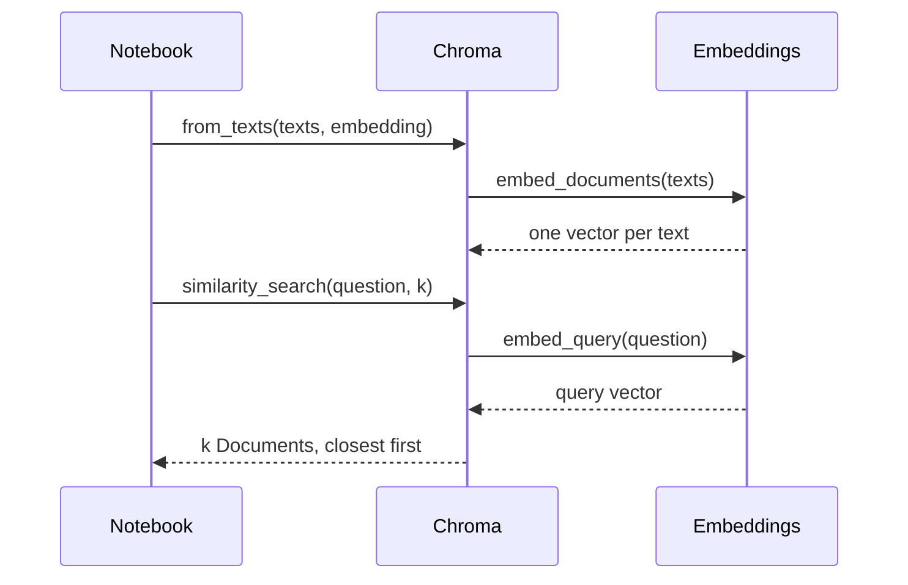
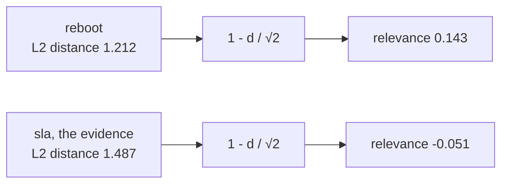

# M10.4 Theory: Your first LangChain RAG with Chroma

*[M10 theory](../README.md) · Lesson 10.4 · Notebooks: [`04a_langchain_rag_quickstart.ipynb`](../../notebook/04a_langchain_rag_quickstart.ipynb) · [All theory pages](../../../../../THEORY.md)*
<!-- subtitle: A vector store hides the index loop, and three of its defaults change what you retrieve -->
<!-- format: approved -->

## What LangChain replaces

> **What you'll learn**
>
> - **Explain** which steps of the hand-built index a LangChain vector store takes over.
> - **Diagnose** a duplicated index, a lost index and an unset `k` from what retrieval returns.
> - **Explain** why Chroma's default distance breaks relevance-score thresholds.
> - **Choose** the distance metric when you create a collection, because it cannot change afterwards.

Lessons 10.2 and 10.3 built the index by hand: embed each chunk, keep the vectors in an array, fit a nearest-neighbour search, embed the question, look up its neighbours. This lesson hands that work to a library.

A teammate reruns the indexing cell to pick up an edit to the handbook, then asks *How long does a refund take?* The top three comes back with `refund-timing` twice. Nothing raised an error, and the index now holds every chunk twice.

LangChain splits the hand-built work between two interfaces, `Embeddings` and `VectorStore`. Notebook 04a covers the first two rows below: it embeds a list of sentences with `embed_documents`, then builds a Chroma store with `from_texts`. The search rows belong to the same `VectorStore` interface, which lesson 10.5's notebook calls on a FAISS store. Each step maps onto one call:

| Step | By hand (notebook 03a) | LangChain vector store |
|---|---|---|
| Embed the chunks | One API call per chunk, in a loop | `embed_documents`, batched |
| Store the vectors | An array, then a fitted `NearestNeighbors` | `Chroma.from_texts`, given the texts and the embedding model |
| Embed the question | The same embedding function | `embed_query`, called by the store |
| Search | `kneighbors` on the question vector | `similarity_search(question, k)` |
| Hand results to a chain | Not covered | `as_retriever`, with `k` in its search settings |

*Table 1: The hand-built index from lesson 10.3 and its LangChain equivalent.*

The calls run in this order:

*Figure 1: Building and querying a Chroma store. The store holds the embedding object and calls it on both sides.*

Because the store keeps the embedding object, the question always goes through the same model as the chunks, and the space mismatch from lesson 10.3 cannot happen by accident. `Embeddings` has separate methods for documents and queries because some models encode questions and passages differently. For OpenAI's models the two do the same thing: the query method embeds a one-item list of documents.

## Three defaults that change the results

Three defaults surprise people the first time. Notebook 04a's `from_texts` call relies on all of them, and each one fails without an error:

| Default | What you see | Why | Guard |
|---|---|---|---|
| `k` left unset | Four chunks per question, whatever lesson 10.2 measured | `similarity_search` returns 4 when no `k` is given | Set `k` explicitly, from the golden set |
| No collection name and no ids | 24 entries after two runs on 12 chunks; `refund-timing` twice in the refund question's top three | `from_texts` adds to a default collection called `langchain`, on top of what is already there | Pass `ids=` so a rerun overwrites, or give each experiment its own collection |
| No persist directory | An empty index after the kernel restarts | The collection lives in memory | Set `persist_directory` when the index must survive a restart |

*Table 2: Three defaults and the failure each one causes.*

The second row is **silent duplication**: every chunk counted twice. The duplicates crowd evidence out of the top `k`. It is the failure in the opening example. The 24 entries and the doubled `refund-timing` come from running the 12 Larkspur chunks through `from_texts` twice.

The notebook imports `Chroma` from the community integrations package, which now warns that it is being sunset. This repo depends on `langchain-chroma`, which provides the same class.

## Distance, not similarity

Chroma ranks by distance, and its default metric is squared Euclidean (L2) distance. Lower numbers from `similarity_search_with_score` mean closer chunks. For vectors of length 1 the two measures are tied by distance = 2 - 2 × cosine, so L2 and cosine rank chunks in the same order. On the 12 Larkspur chunks, embedded with `all-MiniLM-L6-v2` as in lesson 10.3 (langchain-chroma 1.1.0, chromadb 1.5.9):

| Question | Chunk | Cosine (10.3) | `similarity_search_with_score` | `similarity_search_with_relevance_scores` |
|---|---|---|---|---|
| *How long does a refund take?* | `refund-timing` (1st) | 0.766 | 0.469 | 0.668 |
| *Can I export my data after I cancel my plan?* | `retention` (1st) | 0.817 | 0.367 | 0.741 |
| *What happens if my server goes down?* | `reboot` (1st) | 0.394 | 1.212 | 0.143 |
| *What happens if my server goes down?* | `sla` (3rd, evidence) | 0.257 | 1.487 | **-0.051** |

*Table 3: The same chunks scored three ways under Chroma's default L2 space.*

The relevance-score method converts L2 distance with 1 - distance / √2, which assumes a range the distances do not keep to:

*Figure 2: The relevance conversion on the outage question. Any distance above √2 becomes a negative score.*

The `sla` chunk, which holds the evidence for the outage question, gets a negative relevance score, and LangChain warns that relevance scores must be between 0 and 1. A retriever with a similarity-score threshold of 0.2 returns no chunks at all for the outage question, although all three top chunks have a cosine above 0.25. We call this a **metric mismatch**: a threshold written for one scale applied to scores from another.

> **Pitfall: metric mismatch.** Choose the metric when you create the collection, by setting its HNSW space to cosine in the collection metadata. Then `similarity_search_with_score` returns 1 - cosine (0.606 for `reboot`), the relevance score is the cosine itself (0.394), and the same 0.2 threshold returns `reboot`, `incidents` and `sla`. The ranking does not change.

Choose the collection's space and follow the outage question's top three through a 0.2 relevance threshold.

<button type="button" data-mode="l2" aria-pressed="false" aria-controls="space-l2">Default space (L2)</button>
<button type="button" data-mode="cosine" aria-pressed="false" aria-controls="space-cosine">Cosine space</button>

<section id="space-l2" class="mode-panel" data-announcement="Default L2 space. The threshold returns nothing."><h4>Default space: squared L2 distance</h4><dl><dt>Distance (lower is closer)</dt><dd><code>reboot</code> 1.212, <code>incidents</code> 1.371, <code>sla</code> 1.487</dd><dt>Relevance score</dt><dd>0.143, 0.030 and -0.051, from 1 - distance / √2</dd><dt>Threshold 0.2 returns</dt><dd>no chunks, with a warning that relevance scores must lie between 0 and 1</dd></dl></section>
<section id="space-cosine" class="mode-panel" data-announcement="Cosine space. The threshold returns all three chunks."><h4>Cosine space, set at creation</h4><dl><dt>Distance (lower is closer)</dt><dd><code>reboot</code> 0.606, <code>incidents</code> 0.686, <code>sla</code> 0.743</dd><dt>Relevance score</dt><dd>0.394, 0.314 and 0.257: the cosines from lesson 10.3</dd><dt>Threshold 0.2 returns</dt><dd><code>reboot</code>, <code>incidents</code> and <code>sla</code>, in the same order as before</dd></dl></section>

The metric is fixed when the collection is created. Changing it means building a new collection (M14).

## In practice: a Larkspur index that reruns safely

For the handbook, each guard from this page becomes one decision made before the first run:

1. **Name the collection** `handbook` and pass each chunk's id (`refund-timing`, `sla`, and so on). A rerun then overwrites instead of duplicating.
2. **Set the space to cosine** at creation. Relevance scores are then cosines, and thresholds behave.
3. **Set a persist directory** if the index must survive a kernel restart.
4. **Set `k = 2`** from lesson 10.2, and check that a 0.2 threshold still returns all three outage candidates.

Lesson 10.5 puts the store into the full lifecycle, adds the generation step, and records the baseline every later module must beat.

## Limits of this evidence

- **Replayed, not taken from the notebook.** Notebook 04a stops after building its store and prints no scores. Tables 2 and 3 and the switcher come from rerunning the 12 Larkspur chunks through `langchain-chroma` 1.1.0 and `chromadb` 1.5.9 with `all-MiniLM-L6-v2`, the versions this course's lock file pins.
- **Defaults move between releases.** The default `k`, the default collection name and the relevance formula are library choices. Check them again after an upgrade.
- **Unit-length vectors assumed.** The tie between L2 and cosine order holds only for normalised vectors. A model that returns unnormalised vectors can rank differently under the two metrics.

## References

1. LangChain, [Chroma integration](https://docs.langchain.com/oss/python/integrations/vectorstores/chroma), covering `from_texts`, ids, persistence and search methods.
2. Chroma, [Configure collections](https://docs.trychroma.com/docs/collections/configure), on choosing the distance space when a collection is created.

## Key Takeaways

- A LangChain vector store keeps the embedding object and embeds the question for you. Both sides always use the same model.
- Set `k` explicitly, pass `ids=` so a rerun overwrites instead of duplicating, and set `persist_directory` if the index must survive a restart.
- Chroma ranks by squared L2 distance by default, which breaks relevance-score thresholds. Create the collection with cosine space if you plan to filter on scores.

## Check yourself

1. Chroma's default metric is squared L2 distance. Why does it rank unit-length vectors in the same order as cosine?

For vectors of length 1, distance = 2 - 2 × cosine, so a higher cosine always means a lower distance. The order is the same. Only the direction of the numbers flips: lower scores from `similarity_search_with_score` mean closer chunks.

2. You run the from_texts cell twice on the 12 Larkspur chunks. What does the refund question's top three look like, and how do you prevent it?

The default `langchain` collection now holds 24 entries, and `refund-timing` comes back twice in the top three. Pass `ids=` so a rerun overwrites the same entries, or give each experiment its own collection.

3. A retriever with score_threshold 0.2 returns nothing for the outage question, though its top three chunks have cosine above 0.25. Why, and what is the fix?

The relevance score converts L2 distance with 1 - distance / √2, which assumes a range the distances do not keep to: `reboot` gets 0.143 and the `sla` evidence chunk -0.051. Create the collection with its HNSW space set to cosine, so the relevance score is the cosine itself and the same threshold returns `reboot`, `incidents` and `sla`. The metric is fixed at creation, which means a new collection (M14).

---
*Previous: [10.3 Semantic retrieval with embedding similarity](../03_semantic_retrieval_with_embedding_similarity/README.md). Next: [10.5 The RAG lifecycle and a measured baseline](../05_the_rag_lifecycle_and_a_measured_baseline/README.md).*
