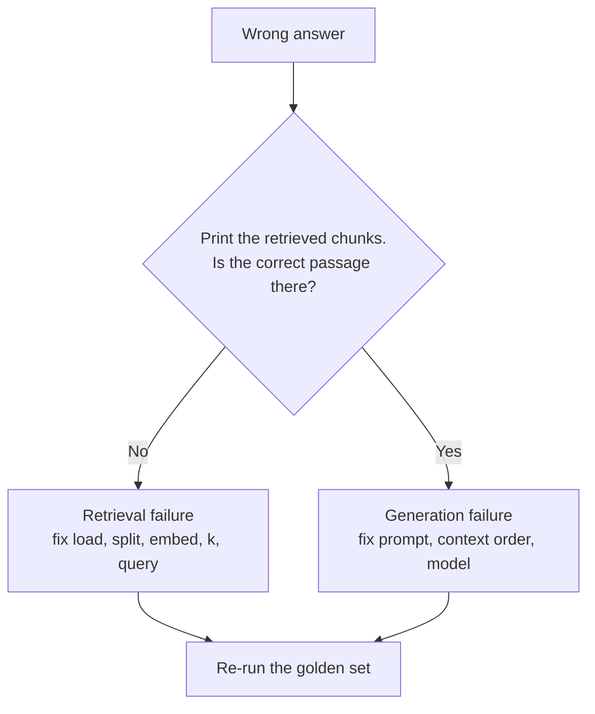
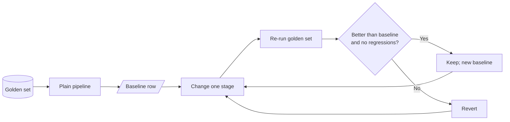

# M10.5 Theory: The RAG lifecycle and a measured baseline

*[M10 theory](../README.md) · Lesson 10.5 · Notebooks: [`05a_rag_lifecycle_and_baseline.ipynb`](../../notebook/05a_rag_lifecycle_and_baseline.ipynb) · [All theory pages](../../../../../THEORY.md)*
<!-- subtitle: Find the half that failed before you fix anything, then beat a baseline one change at a time -->
<!-- format: approved -->

## Indexing vs retrieval vs generation

> **What you'll learn**
>
> - **Explain** the seven lifecycle steps, the job of each one and its typical failure.
> - **Diagnose** whether a wrong answer is a retrieval failure or a generation failure with one check.
> - **Measure** a plain pipeline on a frozen golden set and record its baseline row.
> - **Choose** whether to keep a change by comparing it with that row, question by question.

Lessons 10.2 to 10.4 built the pieces one at a time: an index, a retriever, a vector store. This lesson joins them into one pipeline and gives it a number to beat.

The refund question is still answered wrongly. A teammate spends an afternoon on the prompt: stricter wording, an instruction to quote the handbook, a worked example. The answer does not change, because in the baseline index the `refund-timing` chunk never reaches the top two. The model cannot quote a passage it never received.

The lifecycle has seven steps in two phases. Each step has one job and one typical failure:

| Phase | Step | Job | Typical failure | Fixed in |
|---|---|---|---|---|
| Indexing | Load | Turn files into `Document`s with metadata | Garbled PDF text, missing metadata | [M11](../../../../m11_document_ingestion/mandatory/theory/README.md) |
| Indexing | Split | Cut documents into retrievable chunks | A fact split across two chunks | [M12](../../../../m12_chunking/mandatory/theory/README.md) |
| Indexing | Embed | Turn each chunk into a vector | Model cannot tell paraphrases apart, or blurs exact codes | M13 |
| Indexing | Store | Index vectors for nearest-neighbour search | Chunk count ≠ vector count; no metadata filters | M14 |
| Query | Retrieve | Return the top-k chunks with scores | Evidence ranked below the cut-off, or not at all | M16 to M18 |
| Query | Augment | Format the chunks into the prompt | Sources dropped, so no citations | M19 |
| Query | Generate | Answer from the supplied context | Ignores the evidence, or answers beyond it | M19, M28 and M29 |

*Table 1: The seven lifecycle steps, with the module that fixes each step's typical failure.*

When an answer is wrong, one question tells you which half to debug:

*Figure 1: The one check that splits retrieval failures from generation failures.*

Tuning the prompt cannot fix a retrieval failure, because the model never saw the evidence. We call that the **wrong-half fix**: effort spent on the half of the pipeline that did not fail. The notebook prints each retrieved chunk with its score for exactly this check. Applied to the three Larkspur questions at the baseline:

| Question | Evidence in the top two | Verdict | Where to work |
|---|---|---|---|
| *Can I export my data after I cancel my plan?* | Both chunks | Any wrong answer is a generation failure | Prompt, context order, model |
| *How long does a refund take?* | `refund-window` only; `refund-timing` scores 0 | Retrieval failure for the timing half | M13 embeddings, M16 hybrid search |
| *What happens if my server goes down?* | Neither chunk | Retrieval failure | M13 embeddings, M17 query transformation |

*Table 2: The check applied to the TF-IDF baseline at k = 2. The teammate's prompt work targeted the refund row, where generation was never the problem.*

## Baseline-first optimisation

Every later module in this course changes one stage of the pipeline: chunking, embeddings, hybrid search, reranking, query rewriting. Without a baseline you cannot tell whether a change helped, hurt, or moved the failure to another question.

The method has four parts:

1. **Fix a golden set.** 20 to 50 real questions, each with its evidence chunks and a reference answer. Freeze it, and add questions when production shows a new failure.
2. **Build the plain pipeline.** Default loader, recursive splitter, one embedding model, top-k similarity, a simple prompt.
3. **Record the baseline row.** Retrieval metrics (recall@k, hit rate, MRR), answer metrics (correctness, faithfulness), latency and cost per question.
4. **Change one stage, re-run, compare.** Keep the change only if the row improves on the questions it targets without breaking the others.

**Hit rate** is the share of questions with at least one evidence chunk in the top `k`. **MRR** (mean reciprocal rank) averages 1 divided by the rank of the first evidence chunk, so it rewards evidence that ranks high. The loop then runs for as long as there are changes to try:

<!-- animated: diagrams/baseline-loop.anim.html -->

*Figure 2: The baseline loop. A change that wins on the mean but breaks a question goes back for rework.*

For the handbook, the [top-k lab](../02_indexing_from_scratch_with_tf_idf_and_nearest_neighbours/interactive/top-k-retrieval-lab.html) gives the retrieval half of the row:

| Metric | Baseline (TF-IDF, k = 2) |
|---|---|
| Mean recall@2 | 0.50 |
| Mean precision@2 | 0.50 |
| Questions fully answered by retrieval | 1 of 3 (export) |

*Table 3: The Larkspur baseline row. Answer metrics, latency and cost join it once the notebook runs generation.*

That row already points at the next modules. The export question is solved, the refund question needs better term matching (M13, M16), and the outage question needs paraphrase-aware retrieval (M13, M17). The lifecycle notebook ends with the map from symptom to module:

| What you observe | Likely cause | Where it is fixed |
|---|---|---|
| Question worded unlike the documents; evidence never retrieved | Vocabulary mismatch | M13 embeddings, M17 query transformation |
| Exact codes or names missed (`ORD-88213`) | Dense retrieval blurs rare tokens | M16 hybrid search |
| Half an answer; one fact found, another missed | Question needs several chunks | M17 query decomposition |
| Evidence retrieved but ranked low | Ranking noise | M18 reranking |
| Retrieved chunk holds half the fact | Chunk boundary | M12 chunking |
| Answer contradicts the retrieved chunk | Generation | M19 per-claim citations, M29 Self-RAG |

*Table 4: Symptom to module. Each later module is a fix for one of these rows.*

## In practice: the first change against the Larkspur baseline

Lesson 10.3's switch to embeddings is the first change to run through the loop:

1. **Re-run the golden set** with embeddings at `k = 2`.
2. **Compare the mean.** Recall@2 rises from 0.50 to 0.67, and precision@2 from 0.50 to 0.67.
3. **Compare each question.** Refund rises from 0.50 to 1.00 and outage from 0.00 to 0.50, while export falls from 1.00 to 0.50.
4. **Decide.** The change broke a question it was not aimed at. The loop says revert, or rework it (raise `k` to 3, or add the exact-word signal back with hybrid search in M16) and run the golden set again.

> **Interview tip:** when someone reports a mean improvement, ask for the per-question rows. A better average can hide a question type the change broke.

## Limits of this evidence

- **The notebook builds the pipeline; the lab gives the row.** Notebook `05a` runs load, split, embed (FAISS with `text-embedding-3-small`), retrieve and generate over its own restaurant text and a PDF, and prints scores for the diagnosis check. It keeps no golden set and computes no recall. Table 3 comes from the lesson 10.2 lab, and the embedding comparison from lesson 10.3.
- **A retrieval-only row.** The Larkspur baseline has recall and precision but no answer correctness, faithfulness, latency or cost yet. Those columns are added when a module measures them (M19 for answers).
- **Three questions decide nothing alone.** The 20 to 50 question range is this course's working rule for a first golden set, not a statistical threshold. With three questions, one regression is a third of the set.
- **Table 4 is a map, not a measurement.** Its rows follow the notebook's own failure list. The order code `ORD-88213` is an illustration, not a handbook entry.

## References

1. LlamaIndex, [Evaluating](https://developers.llamaindex.ai/python/framework/module_guides/evaluating/), defining retrieval metrics such as hit rate and mean reciprocal rank.
2. Ragas, [Context recall](https://docs.ragas.io/en/stable/concepts/metrics/available_metrics/context_recall/), a recall measure computed against reference answers.

## Key Takeaways

- RAG runs in two phases: indexing (load, split, embed, store) and query (retrieve, augment, generate). Each step has one job and one typical failure.
- Debug a wrong answer by printing the retrieved chunks first. If the evidence is missing, no prompt change can help.
- Freeze a golden set of 20 to 50 questions, record a baseline row, and keep a change only when it helps its target questions without breaking others.

## Check yourself

1. An answer is wrong. What one check tells you whether to debug retrieval or generation?

Print the retrieved chunks and look for the correct passage. If it is missing, retrieval failed: fix loading, splitting, embedding, `k` or the query. If it is there, generation failed: fix the prompt, the context order or the model.

2. A teammate rewrites the prompt and the refund question is still wrong. The refund-timing chunk never appears in the top-k. Why did the rewrite not help?

The model never saw the evidence, so no prompt can make it use that evidence. This is a retrieval failure, and the prompt work is a wrong-half fix. The refund question needs better term matching (M13 embeddings, M16 hybrid search), measured against the golden set.

3. Switching to embeddings lifts mean recall@2 from 0.50 to 0.67 but drops the export question from 1.00 to 0.50. Do you keep it?

Not as it stands. The loop keeps a change only when the row improves on the questions it targets without breaking the others. Revert it, or rework it (a larger `k` or hybrid search) and re-run the golden set before it becomes the new baseline.

---
*Previous: [10.4 Your first LangChain RAG with Chroma](../04_your_first_langchain_rag_with_chroma/README.md). Next: [M10 interview questions](../README.md#interview-spotlight-5-questions-you-might-get-asked).*
