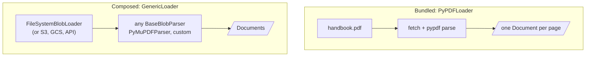
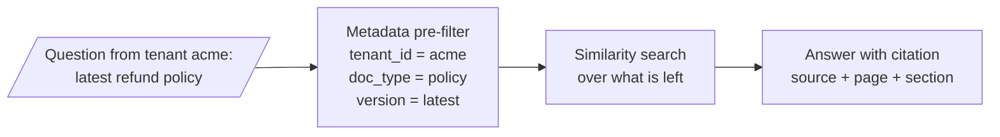

# M11.1 Theory: The Document abstraction and metadata design

*[M11 theory](../README.md) · Lesson 11.1 · Notebooks: [`01a_document_loading_and_metadata.ipynb`](../../notebook/01a_document_loading_and_metadata.ipynb), [`01b_document_loaders_overview.ipynb`](../../../optional/notebook/01b_document_loaders_overview.ipynb) (optional) · [All theory pages](../../../../../THEORY.md)*
<!-- subtitle: The parser decides what text exists, and the schema decides what you can filter, cite and protect -->
<!-- format: approved -->

## Loader vs parser

> **What you'll learn**
>
> - **Explain** the difference between a loader and a parser, and which one decides the extracted text.
> - **Design** a metadata schema with provenance, filtering, access-control and quality fields.
> - **Diagnose** a title that never matches a query and a filter that silently returns nothing.
> - **Choose** which fields go in the embedded text, which in metadata, and which in both.

M10 put Load first in the lifecycle and measured a baseline that every later change must beat. This module opens that first step, because retrieval can only return text that ingestion extracted, labelled with metadata that ingestion attached.

Larkspur's assistant answers a refund question from page 7 of the customer handbook PDF. The answer is right, but the chunk behind it starts with the page header "Larkspur Cloud · Customer Handbook", carries no section name and no policy date, and its page number counts from 0. The assistant cannot say which version of the policy it quoted, and its citation points one page early.

Every loader returns the same shape: a **Document**, with `page_content` (the text that gets embedded and shown to the model) and `metadata` (a dictionary that is never embedded). People say "loader" for the whole step that produces Documents, but LangChain separates two jobs:

| | Loader | Parser |
|---|---|---|
| Job | Find and fetch the source, yield Documents | Turn raw bytes into text and structure |
| LangChain type | `BaseLoader` (`load`, `lazy_load`) | `BaseBlobParser` (`lazy_parse(blob)`) |
| Examples | `PyPDFLoader`, `DirectoryLoader`, `WebBaseLoader`, your own `BaseLoader` | `PyPDFParser`, `PyMuPDFParser`, Unstructured's `partition_pdf` |
| What it decides | Where documents come from, how many per file | What text is extracted, in what order, with what structure |

*Table 1: The two jobs inside "loading".*

Most built-in loaders bundle both: `PyPDFLoader` fetches the file and runs pypdf on it. `GenericLoader` keeps them apart, a blob loader plus a parser, which lets one parser read from a folder, a bucket or an API without new code:

*Figure 1: A bundled loader and a composed one. Only the parser box changes the extracted text.*

When someone says "the PDF loader is bad", they usually mean the parser extracts the wrong text. Swapping the parser fixes that. Changing how files are fetched does not, and we call that attempt a **fetch-side fix**: work on the layer that was never the problem.

## Metadata schema

Metadata answers questions about a chunk that similarity search cannot: where it came from, who may see it, how recent it is, what kind of content it is. A **metadata schema** is the fixed list of fields, with their meanings and types, that every Document must carry. It has to exist before ingestion, because every field you forget costs a full re-ingest to add.

Plan four kinds of field:

| Kind | Examples | Enables |
|---|---|---|
| Provenance | `source`, `page`, `row`, `loader`, `ingested_at` | Citations, debugging, re-ingesting one file |
| Filtering | `doc_type`, `section`, `date`, `language`, `version` | Narrowing the search before similarity |
| Access control | `tenant_id`, `visibility`, `owner` | Multi-tenant isolation; never optional |
| Quality | `extraction_method`, `confidence`, `verified` | Excluding low-quality text, audits |

*Table 2: Four kinds of metadata field, and what each makes possible.*

The filtering and access fields run before similarity search. A question then only competes against chunks it is allowed to see:

*Figure 2: A metadata pre-filter narrows the index before similarity search runs.*

The M11 lab asks for one shared schema across PDF, DOCX, Markdown, CSV and a web page, with five fields: `source`, `type`, `section`, `page`, `date`. On page 7 of the handbook PDF used in lesson 11.4's parser lab, the loaders fill different parts of it:

| Loader | Fields it fills | Fields you supply |
|---|---|---|
| PyPDF | `source`, `page`, `date` | `type`, `section` |
| Unstructured, element mode | `source`, `type`, `section` (via `parent_id`), `page` | `date` |

*Table 3: How much of the lab's five-field schema each PDF loader fills on the handbook page (representative output from lesson 11.4's lab, written to show each loader's defaults).*

A filled field can still be wrong for your purpose. The file's modification time is not the policy date. Take `date` from your CMS.

Three hard constraints shape the design, and each has a failure we name:

| Constraint | What goes wrong | Guard |
|---|---|---|
| Metadata is not embedded | **Invisible title**: a title that lives only in metadata never matches a query | Put fields that should affect similarity into the text too (M15's contextual chunk headers do this) |
| Value types are restricted | Chroma 1.5, the version this course installs, accepts `str`, `int`, `float`, `bool` and non-empty lists of one of those types. A `None` value, a nested dict, an empty list or a mixed list such as `[1, "x"]` fails the write | Flatten values and drop unset fields before you index |
| Filters match exactly | **Case-split filter**: `{"department": "Engineering"}` does not match `"engineering"`, and the filter returns nothing | Normalise values when you load |

*Table 4: Three constraints on metadata, the failure each one causes and its guard. The type and case rows were checked against Chroma 1.5.9: each failing value raised an error on `add`, and a filter for "Engineering" returned no ids for a chunk stored as "engineering".*

The first and third constraints pull in opposite directions for one field, the section name. The switcher places it three ways for the refund chunk and two requests: a question that says "refunds", and a filter that asks for the Refunds section only.

Choose where the section name lives and see which request can find the refund chunk. The outcomes follow from the two constraints above.

<button type="button" data-mode="meta" aria-pressed="false" aria-controls="place-meta">Metadata only</button>
<button type="button" data-mode="text" aria-pressed="false" aria-controls="place-text">Text only</button>
<button type="button" data-mode="both" aria-pressed="false" aria-controls="place-both">Both</button>

<section id="place-meta" class="mode-panel" data-announcement="Metadata only. The filter works and the title never reaches the embedding."><h4>Metadata only</h4><dl><dt>Embedded text</dt><dd>the refund rules, with no section name</dd><dt>Question naming "refunds"</dt><dd>matches only through the rule words; the section name adds nothing (invisible title)</dd><dt>Filter on the Refunds section</dt><dd>works, provided the stored value and the filter use the same case</dd></dl></section>
<section id="place-text" class="mode-panel" data-announcement="Text only. Similarity sees the section name and no filter can select it."><h4>Text only</h4><dl><dt>Embedded text</dt><dd>a short "Refunds" header, then the rules</dd><dt>Question naming "refunds"</dt><dd>the header word is embedded with the chunk and can help it match</dd><dt>Filter on the Refunds section</dt><dd>impossible: there is no field to match exactly</dd></dl></section>
<section id="place-both" class="mode-panel" data-announcement="Both. The chunk can be matched and filtered."><h4>Both</h4><dl><dt>Embedded text</dt><dd>a short "Refunds" header, then the rules</dd><dt>Question naming "refunds"</dt><dd>can match through the header</dd><dt>Filter on the Refunds section</dt><dd>works on the normalised metadata value</dd></dl></section>

## In practice: a schema for the Larkspur handbook

For the refund chunk in the opening example, the schema decisions come before the first load:

1. **Choose the parser for the layout.** Page 7 has two columns and a pricing table. An element-level parser (lesson 11.4) is worth its cost there, and it also separates the page header from the text.
2. **Fill provenance on every Document.** `source` is the file, `page` is stored 1-based so citations match the printed page.
3. **Supply what the parser cannot.** `type` comes from the route that loaded the file, `date` from the CMS record of the policy.
4. **Keep the section in two places.** As metadata for filtering, and as a short header in the chunk text so a question that names "Refunds" can match it.

> **Next:** lesson 11.2 starts with the simplest sources, plain text and Markdown, where the single choice is whether one file becomes one Document or many.

## Limits

- **The handbook PDF page is a teaching page.** The Larkspur handbook in this repo ships as 13 Markdown files. Page 7 and Table 3 come from lesson 11.4's lab, which writes each loader's output by hand to show its defaults. Run the loaders on your own PDFs before trusting the field counts.
- **Type rules belong to one store.** Table 4's value rules were checked on Chroma 1.5.9. Other vector stores accept other types, and some flatten or drop fields without an error.
- **The switcher is reasoning, not a measurement.** Whether a header word moves a chunk up the ranking depends on the embedding model and the rest of the chunk. M15 measures contextual chunk headers on a real corpus.
- **`GenericLoader` is not in the notebooks.** Notebooks `01a` and `01b` use bundled loaders only. Figure 1's composed path follows LangChain's loader and blob parser interfaces.

## References

1. LangChain, [Document loaders](https://docs.langchain.com/oss/python/integrations/document_loaders), the list of built-in loaders and the Document they return.
2. LangChain reference, [BaseBlobParser](https://reference.langchain.com/python/langchain-core/document_loaders/base/BaseBlobParser), the parser interface that turns a blob into Documents.
3. Chroma, [Adding data to a collection](https://docs.trychroma.com/docs/collections/add-data), including the metadata value types.
4. Chroma, [Metadata filtering](https://docs.trychroma.com/docs/querying-collections/metadata-filtering), on exact-match filters.

## Key Takeaways

- A loader fetches the source and a parser turns bytes into text. When the extracted text is wrong, swap the parser.
- Design the metadata schema before ingestion: provenance, filtering, access control and quality fields. Every forgotten field costs a full re-ingest.
- Metadata is not embedded, accepts only flat value types, and filters match exactly. Put fields that should affect similarity into the text, flatten values and normalise case.

## Check yourself

1. A teammate says the PDF loader is bad because the extracted text comes out wrong. Do you change the loader or the parser?

The parser. The loader decides where documents come from and how many there are per file. The parser decides what text is extracted, in what order and with what structure. Changing how files are fetched is a fetch-side fix, and `GenericLoader` lets you swap the parser without touching the fetching.

2. You load the handbook page with PyPDF for the lab's five-field schema. Which fields does it fill, and which must you supply yourself?

PyPDF fills `source`, `page` and `date`, so you supply `type` and `section`. Unstructured would fill `section` through `parent_id`. Even a filled field can be wrong for your purpose: take `date` from your CMS rather than the file's modification time.

3. You store each document's title only in metadata, and questions that name the title never retrieve its chunks. What went wrong?

Metadata is not embedded, so a title that lives only there never matches a query. If a field should affect similarity, also put it into the chunk text, which is what M15's contextual chunk headers do. Keep it in metadata as well when you want to filter on it.

---
*Previous: [M11 overview](../README.md). Next: [11.2 Plain text and Markdown (single vs element mode)](../../../optional/theory/02_plain_text_and_markdown_single_vs_element_mode/README.md).*
