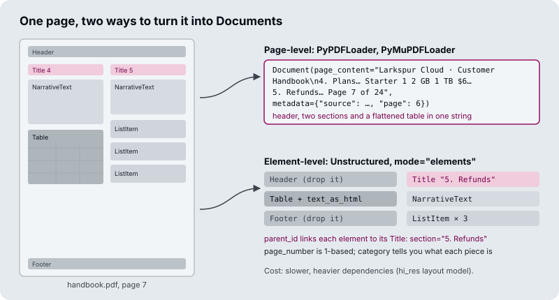
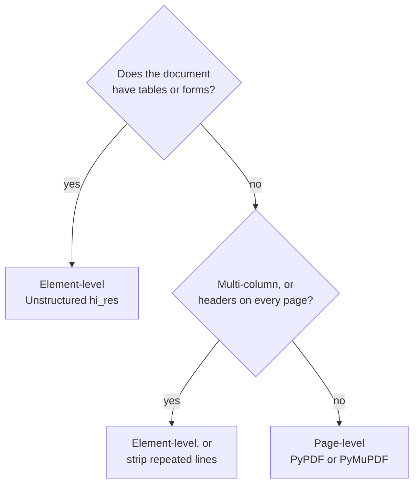

# M11.4 Theory: PDF and Word: parser comparison and element-level parsing

*[M11 theory](../README.md) · Lesson 11.4 · Notebooks: [`04a_pdf_loader.ipynb`](../../notebook/04a_pdf_loader.ipynb), [`04b_ms_word_loader.ipynb`](../../../optional/notebook/04b_ms_word_loader.ipynb) (optional) · [All theory pages](../../../../../THEORY.md)*
<!-- subtitle: Page-level text flattens layout, while elements keep sections, tables and boilerplate apart -->

## Element-level parsing

> **What you'll learn**
>
> - **Explain** what an element-level parser returns, and how it differs from page-level text.
> - **Compare** three PDF loaders on the same handbook page by Documents, tables, sections and cost.
> - **Diagnose** boilerplate that raises every chunk's similarity and a table cell cut off from its column name.
> - **Choose** where element-level parsing is worth its time and dependencies.

Lesson 11.3 picked records out of CSV and JSON, where the structure was already in the file. A PDF stores positioned text on a page. The parser has to rebuild the structure, and how much it rebuilds decides what the index can contain.

A customer asks the Larkspur assistant *Which plan has 16 GB of memory?* Page 7 of the handbook PDF holds the answer in its pricing table. The page was loaded as plain text and then split, and the chunk that reaches the model reads "Business 4 16 GB 5 TB $48": the values are there, but the column names stayed in another chunk. The model cannot tell which number is the memory.

A **page-level parser** returns the page as one string. An **element-level parser** (Unstructured, in element mode) returns one Document per layout element, each with a `category` such as `Title`, `NarrativeText`, `Table`, `ListItem`, `Header` or `Footer`:

*Figure 1: The same handbook page as one page-level string and as one typed Document per region, each linked to its section title.

Here is what the three PDF loaders in the notebook produce from the handbook page:

| | `PyPDFLoader` | `PyMuPDFLoader` | `UnstructuredPDFLoader`, element mode, `hi_res` |
|---|---|---|---|
| Documents from the page | 1 | 1 | 10 |
| Header and footer | Inside the text | Inside the text | Separate elements you can drop |
| Pricing table | Rows of space-separated values | One cell per line | `Table` element with an HTML form |
| Section of each piece | Unknown | Unknown | `parent_id` points to its `Title` |
| Page number | `page` (0-based) | `page` (0-based) | `page_number` (1-based) |
| Speed and dependencies | Fast, pure Python | Fastest; AGPL licence | Slowest; layout models and system packages |

*Table 1: Three PDF loaders on page 7 of the Larkspur handbook.*

The comparison has three consequences for retrieval, two of them failures we name:

- **Boilerplate echo.** If every chunk starts with "Larkspur Cloud · Customer Handbook", every chunk shares that text, and similarity between chunks from different pages rises. Drop `Header` and `Footer` elements, or strip repeated lines from page-level text.
- **Orphaned cell.** "Business 4 16 GB 5 TB $48" can be read, but once a splitter cuts the table, "16 GB" no longer has a column name. This is the failure in the opening example. Keep a table as one chunk and give the model its HTML or Markdown form.
- **Granularity is decided at load time.** One Document per file, page, row or element sets the smallest thing retrieval can return, and changing it later means re-ingesting.

The [interactive lab](interactive/pdf-parsers-lab.html) puts the handbook page through all three loaders. Hover a Document to see which part of the page it came from, and read how many of the five schema fields each loader fills: three for PyPDF and PyMuPDF, four for Unstructured.

<!-- lab: interactive/pdf-parsers-lab.html -->

## Choosing a parser

Element-level parsing costs time and dependencies. It pays only where layout carries meaning. A short chain of questions settles most documents:

*Figure 2: Choosing between page-level and element-level parsing. Plain prose goes to the fast parsers.*

The licence row of Table 1 matters as well: PyMuPDF is the fastest, but its AGPL licence can rule it out for a product you ship.

Word and Markdown files have the same switch. In the Word notebook, the Unstructured Word loader returns the file as one Document by default. In element mode with by-title chunking it returns pieces of at most 3,000 characters and starts a new one at every heading. Lesson 11.2 does the same for Markdown: single mode gives one Document, element mode one per heading, paragraph or list item.

## In practice: page 7 of the Larkspur handbook

For the handbook PDF, the parser choice follows the page:

1. **Route page 7 to element-level parsing**, because it has two columns and a pricing table.
2. **Drop the `Header` and `Footer` elements**, which removes the boilerplate echo from every chunk.
3. **Keep the `Table` element whole**, in its HTML form, so "16 GB" stays under "Memory".
4. **Fill `section` from `parent_id`** and store the page as 1-based, matching lesson 11.1's schema.
5. **Send plain prose pages to PyPDF**, which is faster and needs no system packages.

> **Next:** lesson 11.5 loads sources from outside the file system, web pages, transcripts and papers, and a whole mixed folder at once.

## Key Takeaways

- Element-level parsing returns one Document per layout element with a `category`, so headers and footers can be dropped and each piece knows its section.
- Drop repeated boilerplate before embedding, and keep each table as one chunk in HTML or Markdown form so values keep their column names.
- Granularity is fixed at load time. Use element-level parsing for reports, manuals, forms and tables. Plain prose PDFs do fine with PyPDF or PyMuPDF.

## Check yourself

1. Why does leaving the handbook's page header in every chunk hurt retrieval?

If every chunk starts with "Larkspur Cloud · Customer Handbook", every chunk shares that text, and similarity between chunks from different pages rises. This is boilerplate echo. An element-level parser returns `Header` and `Footer` as separate elements you can drop. With page-level text, strip the repeated lines instead.

2. The pricing table was loaded with PyPDFLoader and then split. Why can a question about which plan has 16 GB of memory fail, and what would Unstructured give instead?

PyPDF flattens the table into rows of space-separated values, and once a splitter cuts a row, "16 GB" no longer has a column name: an orphaned cell. The Unstructured PDF loader in element mode with `hi_res` returns the table as one `Table` element with an HTML form. Keep it as one chunk and give the model its HTML or Markdown form.

3. Your corpus is plain prose PDFs with no tables or forms. Should you switch everything to element-level parsing?

No. Element-level parsing is the slowest option and needs layout models and system packages, and plain prose PDFs do fine with PyPDF or PyMuPDF. Use it where layout carries meaning: reports, manuals, forms, anything with tables. Choose before you ingest, because changing granularity later means re-ingesting.

---
*Previous: [11.3 Semi-structured sources: CSV rows and JSON / JSONL with jq schemas](../../../optional/theory/03_semi_structured_sources_csv_rows_and_json_jsonl_with_jq_schemas/README.md). Next: [11.5 Web, YouTube and arXiv sources; bulk directory loading](../05_web_youtube_and_arxiv_sources_bulk_directory_loading/README.md).*
