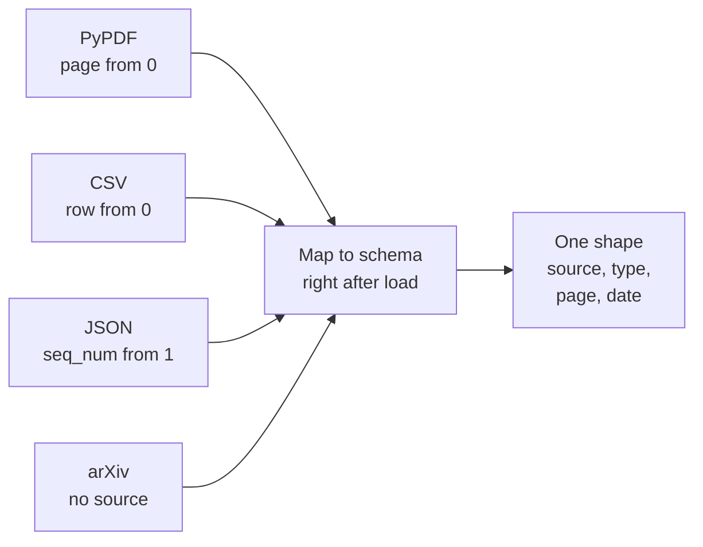

# M11.5 Theory: Web, YouTube and arXiv sources; bulk directory loading

*[M11 theory](../README.md) · Lesson 11.5 · Notebooks: [`05a_url_loader.ipynb`](../../notebook/05a_url_loader.ipynb), [`05b_youtube_transcript_loader.ipynb`](../../../optional/notebook/05b_youtube_transcript_loader.ipynb) (optional), [`05c_research_paper_loader.ipynb`](../../../optional/notebook/05c_research_paper_loader.ipynb) (optional), [`05d_directory_loader.ipynb`](../../../optional/notebook/05d_directory_loader.ipynb) (optional) · [All theory pages](../../../../../THEORY.md)*
<!-- subtitle: Every loader names its metadata differently, so map each one onto one schema right after loading -->

## Routing a mixed folder

> **What you'll learn**
>
> - **Explain** how a directory loader routes each file type in a mixed folder to its own loader.
> - **Compare** the metadata keys and counting rules that eight loaders write.
> - **Design** one mapping from every loader's output onto the module's five-field schema.
> - **Diagnose** a skipped file, an indexed error page and a page that loads empty.

Lessons 11.2 to 11.4 loaded one kind of file at a time. A real corpus arrives as a mixed folder, plus sources that are not files at all.

Larkspur's nightly ingestion job loads a folder of handbook material and reports success. A week later, a customer's question about the onboarding guide gets no answer: the DOCX failed to parse on the first night, the job skipped it, and the only record is a line in a log nobody reads. We call this a **silent skip**.

The M11 lab asks for exactly this kind of folder: the handbook as PDF, the onboarding guide as DOCX, release notes in Markdown, `plans.csv` and the status page from the web. The directory loader loads a folder with one loader class per file type. The notebook builds one directory loader per extension, each with its own file pattern, loader class and loader settings, because the default loader class is the generic Unstructured file loader for everything.

Two defaults matter on a real folder:

- **Stop on error, or skip.** By default the whole run stops at the first file that fails to parse. A nightly job usually turns on silent errors to keep going. Then compare the number of files with the number of distinct `source` values after every run, because a skipped file only shows up in the log.
- **Progress and threads** are off by default. Turn them on for folders of thousands of files. The default concurrency is 4.

Loading the folder is the easy half. Each loader writes its own metadata, with its own key names and counting rules. This is what each one sets, in `langchain-community` 0.4.2, run on files in this repo's `data/sample/` (the last three read from the loader source, since they need the network):

| Loader | One Document per | Metadata it sets |
|---|---|---|
| `TextLoader`, `Docx2txtLoader` | file | `source` |
| `PyPDFLoader` | page | `source`, `page` (0-based), `page_label`, `total_pages`, `producer`, `creator`, `creationdate`, `moddate` |
| `PyMuPDFLoader` | page | `source`, `page` (0-based), `total_pages`, `producer`, `creationdate`, `moddate`, plus `file_path`, `format`, `title`, `author` and the dates again in PDF format (`creationDate`, `modDate`); no `page_label` |
| `CSVLoader` | row | `source` as you passed it, `row` (0-based) |
| `JSONLoader` | jq match | `source` as an absolute path, `seq_num` (1-based) |
| `RecursiveUrlLoader` | page crawled | `source` (the URL), `content_type`, `title`, `description`, `language` |
| `YoutubeLoader` | video, or time window | `source` (the video id); with chunks also `start_seconds`, `start_timestamp` |
| `ArxivLoader` | paper | `Published`, `Title`, `Authors`, `Summary`; no `source` at all |

*Table 1: What eight loaders put in metadata.*

None of these fill the lab's five fields (`source`, `type`, `section`, `page`, `date`) the same way. Map each loader's output onto the schema in one place, right after loading and before splitting, so every later stage sees one shape:

*Figure 1: Four loaders, four conventions, one mapping step before splitting.*

The mapping chooses one meaning per field:

| Schema field | Rule | Where the value comes from |
|---|---|---|
| `source` | Always something a reader can open | The loader's `source`; for arXiv, the entry id, which the loader only returns when asked for all available metadata |
| `type` | Set by the route, never guessed | The route that loaded the file |
| `page` | Always 1-based | PDF loaders' `page` plus 1; Unstructured's `page_number` as it is |
| `date` | Always ISO | The PDF's creation date; arXiv's `Published` |
| `section` | Only on element-level routes | The `Title` that `parent_id` points to (lesson 11.4) |

*Table 2: The mapping rule for each of the five schema fields.*

The mapping drops the fields a loader did not set instead of storing `None`, so a filter on `page` only ever meets numbers. `section` stays missing on routes that use a page-level parser, because only an element-level parser can fill it.

## Web pages, transcripts and papers

Remote sources fail more quietly than files, because the loader returns whatever the server sent.

**Web pages.** The recursive URL loader crawls from a root URL to a depth of 2 by default and stays under that root. Without an extractor, `page_content` is the raw HTML: tags, scripts and navigation menus get embedded. The URL notebook passes a BeautifulSoup extractor to keep only the text. Two failures come from its defaults:

| Default | What gets indexed | Name | Guard |
|---|---|---|---|
| Response status not checked | A 404 page becomes a Document holding the error page's text | **Indexed error page** | Turn the status check on |
| HTML fetched, JavaScript not run | A page that renders in the browser comes back as a near-empty shell | **Empty shell** | Flag Documents whose text is much shorter than the HTML they came from |

*Table 3: Two web-loader defaults and the failure each one causes.*

**YouTube transcripts.** By default the YouTube loader returns one Document per video, with the video id as `source`. In chunked transcript mode it returns one Document per time window (120 seconds by default; the notebook uses 10 and 15), and each `source` becomes the video URL with a start time, so a citation opens the video at that moment. Adding the video's title and author needs another network call, which is where the notebook's SSL errors come from.

**arXiv papers.** The arXiv loader downloads each matching PDF, reads it with PyMuPDF, and joins every page into one Document. The page numbers are lost. A citation can name the paper but not the page. `Published` holds the date of the latest version, not the first submission. The loader fetches up to 100 papers by default, and it can return only the abstracts, which is often enough for a "find me papers about X" index and far cheaper to embed.

## In practice: the Larkspur nightly job

For the lab's mixed folder, the nightly job runs in this order:

1. **Route by extension**: PDF to the element-level parser for layout pages (lesson 11.4), DOCX to the Word loader, Markdown in element mode (lesson 11.2), CSV by row (lesson 11.3).
2. **Load the status page** with an extractor and the status check on, and flag it if its text is much shorter than its HTML.
3. **Map every Document onto the five-field schema** before splitting, dropping unset fields.
4. **Count files against distinct `source` values.** Five files in, five sources out, or the run fails loudly instead of skipping silently.

> **Next:** lesson 11.6 writes a loader for a source no library covers, Larkspur's ticket API, and makes it stream.

## Key Takeaways

- Route each file type in a mixed folder to its own loader. With silent errors on, compare the file count with the distinct `source` values to catch skipped files.
- Every loader writes different metadata keys and counting rules. Map them onto one schema right after loading, and drop unset fields instead of storing `None`.
- Remote sources fail quietly. Pass an extractor for web pages, check the response status, and flag pages whose text is much shorter than their HTML.

## Check yourself

1. Why map every loader's metadata onto one schema right after loading, before splitting?

Each loader writes its own keys with its own counting rules: the PyPDF loader counts `page` from 0, the CSV loader counts `row` from 0, the JSON loader counts `seq_num` from 1, and the arXiv loader sets no `source`. One mapping gives every later stage one shape, with `page` always 1-based, `date` always ISO and `source` always something a reader can open. Dropping unset fields instead of storing `None` means a filter on `page` only ever meets numbers.

2. A nightly directory-loader job runs with silent errors turned on and reports success. How do you check that no file was skipped?

Compare the number of files in the folder with the number of distinct `source` values in the loaded Documents. With silent errors on, a file that fails to parse only shows up in the log, which is a silent skip. With the default setting, the whole run stops at the first failure instead.

3. A web crawl indexes a 404 error page, and a page that renders in the browser comes back almost empty. What causes each?

The recursive URL loader does not check the response status by default. Error responses become Documents and get indexed. Turn the check on. The loader fetches HTML and does not run JavaScript, so a browser-rendered page comes back as an empty shell. Flag Documents whose text is much shorter than the HTML they came from.

---
*Previous: [11.4 PDF and Word: parser comparison and element-level parsing](../04_pdf_and_word_parser_comparison_and_element_level_parsing/README.md). Next: [11.6 Custom loaders with lazy loading](../06_custom_loaders_with_lazy_loading/README.md).*
