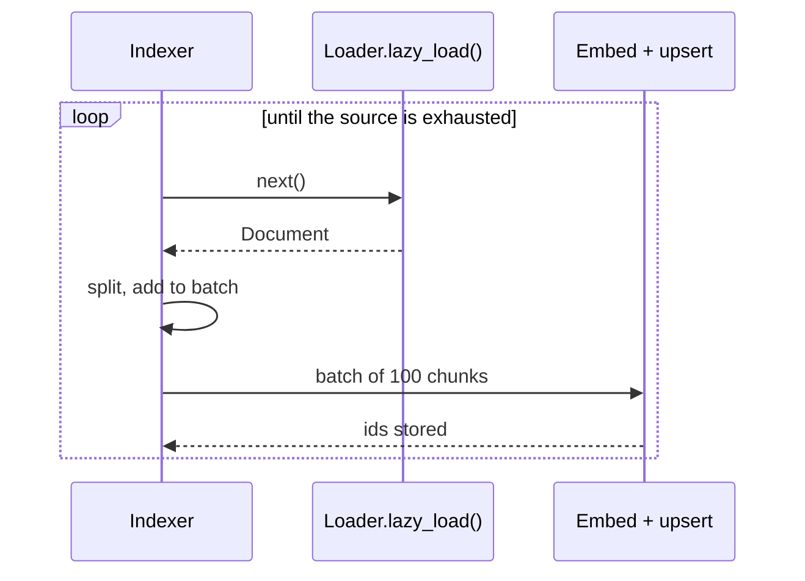

# M11.6 Theory: Custom loaders with lazy loading

*[M11 theory](../README.md) · Lesson 11.6 · Notebooks: [`06a_custom_loader.ipynb`](../../notebook/06a_custom_loader.ipynb) · [All theory pages](../../../../../THEORY.md)*
<!-- subtitle: A generator streams the corpus, so memory stays flat and a crash loses one batch -->
<!-- format: approved -->

## Lazy loading

> **What you'll learn**
>
> - **Explain** the difference between loading a corpus as a list and streaming it from a generator.
> - **Design** a custom loader for a source no library covers, with the module's schema in every Document.
> - **Diagnose** an ingestion job that grows in memory and indexes nothing.
> - **Apply** a checkpoint so a crashed run resumes instead of starting over.

Lesson 11.5 loaded files and web sources with loaders that already exist. Larkspur's support tickets live behind its own paginated API. No library loader covers them, and we write one.

The first version builds a list of every ticket and returns it. On the million-ticket backfill, the job's memory grows for hours, the machine kills it, and the index holds nothing, because no Document could be split or embedded until the whole list was complete. We call this a **load-all stall**.

A loader has two methods. `load()` returns a list: the whole corpus sits in memory before anything else runs. `lazy_load()` is a **generator**: it yields one Document at a time, and the pipeline can split, embed and upsert in batches while the loader keeps reading.

Notebook `06a` shows the pattern on the smallest possible source: a loader that reads a text file line by line and yields one Document per line, with `source` and a `line_number` counted from 0. Its three-line test file gives three Documents. The ticket loader below applies the same pattern to Larkspur's API and is a design for this page, not code from the notebook. It implements only `lazy_load()`, walks the API page by page from a `since` date and yields one Document per ticket, already in the module's schema:

| Document field | Filled from |
|---|---|
| `page_content` | The ticket body |
| `source` | `ticket:` followed by the ticket id |
| `type` | The fixed value `ticket` |
| `date` | The ticket's `updated_at` |
| `tenant_id` | The customer's organisation, for access control (lesson 11.1) |

*Table 1: What the ticket loader puts in each Document (a design, illustrative).*

`BaseLoader` derives `load()` from `lazy_load()`. Implementing the generator gives you both methods. The indexer pulls Documents one at a time and sends batches downstream:

<!-- animated: diagrams/lazy-load-loop.anim.html -->

*Figure 1: Lazy loading. Embedding starts with the first batch while the loader is still reading.*

The memory difference is a matter of what is held at once. With an assumed average of 2 KB of text per ticket:

| | `load()` | `lazy_load()`, batches of 100 chunks |
|---|---|---|
| Held in memory at the peak | All 1,000,000 tickets, about 2 GB of text before any Python overhead | One batch of 100 chunks, about 200 KB |
| First vectors reach the index | After the last ticket is read | After the first batch |
| Lost on a crash at ticket 900,000 | Everything | The current batch, if a checkpoint was recorded |

*Table 2: Load all versus stream, for the million-ticket backfill (illustrative: 2 KB per ticket and per chunk are assumptions).*

A failure part-way through only loses the current batch as long as you record a **checkpoint**: the last id or `updated_at` written to the index. The loader's `since` argument goes straight to the API, so a restart begins from the checkpoint instead of the first ticket.

## In practice: the Larkspur ticket backfill

For the backfill and the nightly updates after it, the ticket loader runs in four steps:

1. **Implement `lazy_load()` only**, yielding one Document per ticket in the module's schema, with `tenant_id` filled.
2. **Batch downstream**: split each Document, collect 100 chunks, embed and upsert them.
3. **Record a checkpoint** after each batch is stored: the last `updated_at` written.
4. **Pass the checkpoint as `since`** on the next run. The nightly job then reads only tickets changed since the last one.

> **Next:** M12 takes the Documents this module produced and decides where to cut them into chunks.

## Limits

- **The ticket loader is a design.** Larkspur's ticket API, its `since` argument and the million-ticket backfill are this page's scenario. The notebook proves only the generator pattern, on a three-line file.
- **Table 2's sizes are assumptions.** 2 KB per ticket and per chunk are round figures chosen to show the scale. Python objects, embeddings and the HTTP client add memory that the table leaves out.
- **A checkpoint is not idempotence.** Resuming from the last stored `updated_at` can resend the batch that was in flight when the job died. Stable ids such as `ticket:` plus the ticket id make that resend overwrite rather than duplicate.
- **`load()` still exists.** `BaseLoader` builds it by draining `lazy_load()` into a list. A caller who uses `load()` gets the load-all stall back.

## References

1. LangChain reference, [BaseLoader](https://reference.langchain.com/python/langchain-core/document_loaders/base/BaseLoader), the interface whose `load()` collects `lazy_load()`.
2. Python, [Functional programming HOWTO](https://docs.python.org/3/howto/functional.html), whose generators section explains `yield`.

## Key Takeaways

- `load()` holds the whole corpus in memory as a list, while `lazy_load()` yields one Document at a time so splitting and upserting run in batches alongside reading.
- Implement `lazy_load()` in a custom `BaseLoader`. `load()` comes free from it.
- Record a checkpoint, such as the last id or `updated_at` written, so a crash loses only the current batch and the next run can resume from there.

## Check yourself

1. With lazy loading, why do the first vectors reach the index before the loader has finished reading the source?

`lazy_load()` is a generator that yields one Document at a time. The indexer splits each one, adds it to a batch, and sends each batch of 100 chunks to be embedded and upserted while the loader keeps reading. With `load()`, nothing else runs until the whole corpus sits in memory as a list.

2. The ticket loader ingests a million tickets and crashes part-way through. How much work is lost, and what lets you resume?

Only the current batch, as long as you record a checkpoint: the last id or `updated_at` written. The loader takes a `since` argument and passes it to the paginated API. A restart can then begin from the checkpoint instead of the first ticket.

3. A teammate writes a custom loader that overrides load and builds a list of every record. Which method should they implement instead?

`lazy_load()`, as a generator. `BaseLoader` derives `load()` from `lazy_load()`, so the generator gives them both methods. A list keeps the whole corpus in memory, which a million-record source cannot afford, and nothing reaches the index until it is complete: a load-all stall.

---
*Previous: [11.5 Web, YouTube and arXiv sources; bulk directory loading](../05_web_youtube_and_arxiv_sources_bulk_directory_loading/README.md). Next: [M11 interview questions](../README.md#interview-spotlight-5-questions-you-might-get-asked).*
