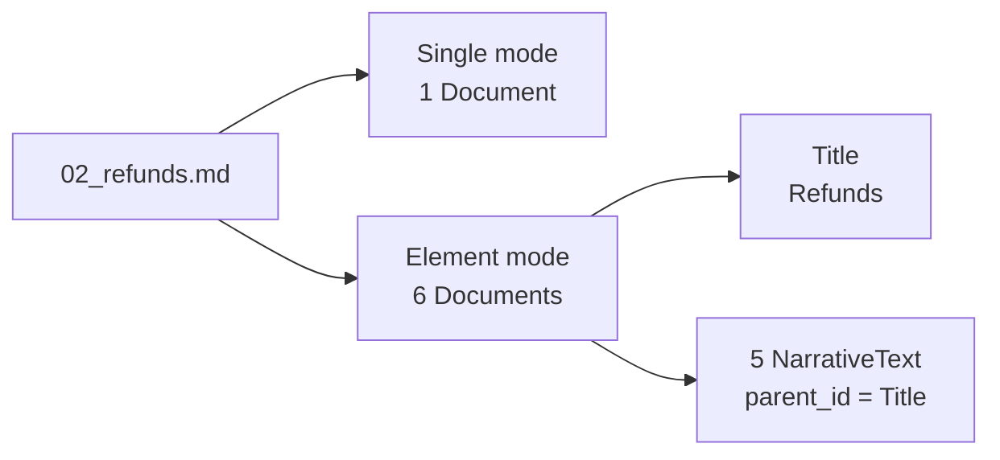

# M11.2 Theory: Plain text and Markdown (single vs element mode)

*[M11 theory](../../../mandatory/theory/README.md) · Lesson 11.2 · Notebooks: [`02a_text_loader.ipynb`](../../notebook/02a_text_loader.ipynb) (optional), [`02b_markdown_loader.ipynb`](../../notebook/02b_markdown_loader.ipynb) (optional) · [All theory pages](../../../../../THEORY.md)*
<!-- subtitle: Single mode gives one Document per file, and element mode gives one per heading, paragraph and list item -->

## Single mode and element mode

> **What you'll learn**
>
> - **Explain** what a plain text loader and a Markdown loader in single and element mode return for the same file.
> - **Compare** the three by Document count, markup kept and metadata.
> - **Choose** a mode by what the next step in the pipeline needs.

Lesson 11.1 defined the Document and the schema it should carry. Plain text and Markdown are the simplest sources: there is no layout to recover. The main decision is how many Documents one file becomes.

The Larkspur handbook ships as 13 Markdown files. Loaded with the plain text loader, the refunds page becomes one Document of 660 characters that begins with "# Refunds". Its five rules (monthly plans, the 30-day window, proration, the 5 to 10 business days, how to request) sit in one string, and nothing records that they belong under the Refunds heading. The splitter in M12 will cut that string without knowing where the sections were.

We loaded the refunds page three ways. The plain text loader reads the file as it is. The Unstructured Markdown loader parses the Markdown first, and its `mode` setting decides the output: **single mode** returns the whole file as one Document, and **element mode** returns one Document per element (a title, a paragraph, a list item, a table), each tagged with a `category`:

| Loader | Documents | Text | Metadata keys |
|---|---|---|---|
| Plain text loader | 1 | 660 characters, starting "# Refunds", Markdown marks kept | `source` |
| Markdown loader, single mode | 1 | 657 characters, starting "Refunds", heading mark removed | `source` |
| Markdown loader, element mode | 6: 1 `Title`, 5 `NarrativeText` | "Refunds", then one Document per paragraph, 106 to 152 characters each | `source`, `category`, `parent_id`, `element_id`, `filename`, `filetype`, `languages`, `last_modified`, `file_directory` |

*Table 1: The refunds page through three loaders (unstructured 0.27.37, langchain-community 0.4.2, run on `data/larkspur/handbook/02_refunds.md`).*

In element mode, every paragraph's `parent_id` points at the `Title` element above it:

*Figure 1: One file, two modes. Element mode keeps the link from each paragraph to its heading.*

That link is what fills the `section` field of lesson 11.1's schema. Single mode loses it before splitting even starts, and we call that a **one-blob file**: a file reduced to one string, its structure gone. The plain text loader has a second effect, **markup in the embedding**: heading marks and table pipes stay in the text and get embedded with it unless a later step removes them.

Notebook 02b runs the same loaders on a different file, the LangChain README in `data/sample/`, and its counts differ from these. It also calls Unstructured's own partitioner directly, which returns Unstructured elements rather than LangChain Documents; converting them copies each element's text and metadata into a Document.

## What element mode finds in the handbook

Across all 13 handbook files, element mode returns 78 elements:

| Category | Count | Where in the handbook |
|---|---|---|
| `NarrativeText` | 60 | Paragraphs on every page |
| `Title` | 13 | One heading per file |
| `ListItem` | 3 | The three plan tiers on the plans page |
| `Table` | 2 | Server sizes on the plans page, request limits on the API limits page |

*Table 2: Element categories across the 13 Larkspur handbook files.*

The two tables are where the mode matters most. Each `Table` element has a flat text form and an HTML form. The flat form of the server-size table starts "Size vCPUs Memory Included outbound traffic Small 2 4 GB 1 TB per month Medium 4 16 GB…", so once a splitter cuts it, "16 GB" no longer sits under a column name. Keep each table as one piece and give the model its HTML form; lesson 11.4 meets the same problem in a PDF.

The plain text loader is still the right choice in one case. A Markdown-aware splitter (M12) cuts on the heading marks and needs them in the text:

| What the next step needs | Loader and mode |
|---|---|
| The raw Markdown, for a splitter that cuts on headings | Plain text loader |
| Clean text per file, with structure left to the splitter | Markdown loader, single mode |
| Typed pieces with sections, tables kept whole | Markdown loader, element mode |

*Table 3: Choosing a loader and mode for Markdown.*

## In practice: loading the Larkspur handbook

For the handbook, element mode does the most work at load time:

1. **Load each file in element mode.** The 13 files give 78 elements.
2. **Fill `section` from `parent_id`.** Each paragraph takes the text of its `Title`: the refunds rules carry "Refunds".
3. **Keep the two `Table` elements whole**, in their HTML form, so the server sizes keep their column names.
4. **Hand the rest to the splitter** (M12) with `section` attached, and put the section name into the chunk text as well, since metadata is not embedded.

> **Next:** lesson 11.3 moves to sources that already come in records, CSV rows and JSON objects, where the choice is which record becomes one Document.

## Key Takeaways

- Single mode gives one Document per file. Element mode gives one per title, paragraph, list item or table, each with a `category` and a `parent_id` that links it to its heading.
- The plain text loader keeps Markdown marks in the text. That suits a heading-aware splitter, and puts markup into the embedding when nothing strips it.
- Keep each `Table` element as one piece in its HTML form, so values stay under their column names.

## Check yourself

1. What does element mode return for the Larkspur refunds page, and how does each paragraph know its section?

Six Documents: one `Title` ("Refunds") and five `NarrativeText` paragraphs of 106 to 152 characters. Each paragraph's `parent_id` points at the `Title` element, which is what fills the `section` field of the schema. Single mode returns one Document and loses that link.

2. The plain text loader keeps the heading marks in the text. When is that what you want?

When the next step is a Markdown-aware splitter (M12), because it cuts the text on those heading marks. If the text goes to the embedding model without such a splitter, the marks and table pipes are embedded with it, which is markup in the embedding.

3. The server-size table on the plans page loads as a Table element. Why keep its HTML form instead of its flat text?

The flat text runs the header and the rows together ("Size vCPUs Memory … Medium 4 16 GB …"). Once a splitter cuts it, "16 GB" no longer sits under a column name. The HTML form keeps rows and columns, so keep the table as one piece and give the model that form.

---
*Previous: [11.1 The Document abstraction and metadata design](../../../mandatory/theory/01_the_document_abstraction_and_metadata_design/README.md). Next: [11.3 Semi-structured sources: CSV rows and JSON / JSONL with jq schemas](../03_semi_structured_sources_csv_rows_and_json_jsonl_with_jq_schemas/README.md).*
