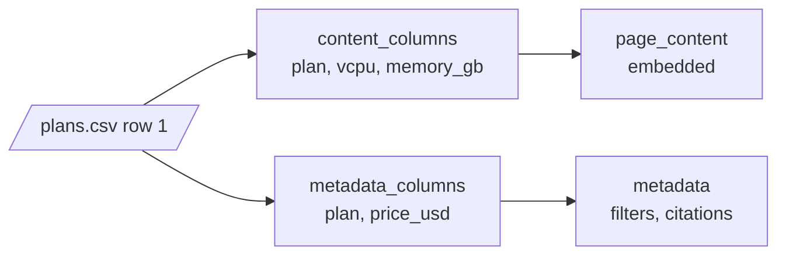

# M11.3 Theory: Semi-structured sources: CSV rows and JSON / JSONL with jq schemas

*[M11 theory](../../../mandatory/theory/README.md) · Lesson 11.3 · Notebooks: [`03a_csv_loader.ipynb`](../../notebook/03a_csv_loader.ipynb) (optional), [`03b_json_loader.ipynb`](../../notebook/03b_json_loader.ipynb) (optional) · [All theory pages](../../../../../THEORY.md)*
<!-- subtitle: The record you choose is the smallest thing retrieval can return, and each field goes in the text, the metadata or both -->

## One record, one Document

> **What you'll learn**
>
> - **Explain** how a CSV loader and a JSON loader decide which record becomes one Document.
> - **Diagnose** empty Documents, a column missing from the embedded text, and a header read as data.
> - **Choose** per field whether it belongs in the embedded text, the metadata or both.
> - **Apply** the right type and provenance to loader metadata before indexing.

Lesson 11.2 loaded Markdown, where the question was how many Documents a file becomes. A CSV or JSON file already has records. The loader's job is to decide which record becomes one Document. That choice sets the smallest thing retrieval can return, the same way element-level parsing does for a PDF (lesson 11.4).

Larkspur exports the handbook's plan table as `plans.csv` so the assistant can answer *How much memory does the Business plan have?* A teammate moves the plan name and price into metadata to make them filterable. The question stops retrieving the Business row, because the word "Business" is no longer in any text that gets embedded.

The CSV loader makes one Document per row. Each line of `page_content` is `column: value`, and `metadata` gets the file and the row number, counted from 0. `plans.csv` gives three Documents. The Business row:

| Part | Value |
|---|---|
| `page_content` | Five lines: `plan: Business`, `vcpu: 4`, `memory_gb: 16`, `traffic_tb: 5`, `price_usd: 48` |
| `metadata` | `source`: `plans.csv`, `row`: 1 |

*Table 1: The Business row of `plans.csv` as a Document, with default settings.*

The Unstructured CSV loader goes the other way and returns the whole file as one table Document. Use it when the question is about the table as a whole. Use the row loader when each row answers a question on its own, as the Business memory question does.

The JSON loader has no fixed record. A **jq schema** is a path expression that says where one Document starts, and the notebook's `chat_data.json` shows how much it decides:

| jq schema | Documents | Each Document holds |
|---|---|---|
| `.` | 1 | The whole file as JSON text, 1,612 characters |
| `.messages[]` | 11 | One message object as JSON text, keys included |
| `.messages[].content` | 11 | One message's text; one of them is empty, because a photo message has no `content` |

*Table 2: Three jq schemas on the same chat export.*

The empty Document is the failure to watch for here, and we call it an **empty record**. A jq path that misses on some records still yields a Document for them, with empty `page_content`, and it gets embedded like any other. Count empty Documents after every load. For JSON Lines files, a flag runs the schema once per line.

## Content fields and metadata fields

Every column or key ends up in one of three places: the embedded text, the metadata, or both. Text is what similarity search can match, and metadata is what a filter can match exactly (lesson 11.1). Decide per field:

*Figure 1: One row split into embedded text and metadata. `plan` is listed on both sides: it can be matched and filtered.*

The CSV loader takes three settings for this: `content_columns`, `metadata_columns` and `source_column`. Its defaults hold three traps, and all three show up on `plans.csv`. One more comes from the notebook's own data:

| Setting | What happened | Name | Guard |
|---|---|---|---|
| `metadata_columns` = plan, price, no `content_columns` | The Business text became `vcpu: 4`, `memory_gb: 16`, `traffic_tb: 5`; "Business" is gone from the embedding | **Text-stripped column** | List `plan` in `content_columns` too, so it lands in both places |
| Any metadata column | The price reads as the string `'48'`; a filter for "plans under $50" compares numbers | **String numbers** | Cast numeric fields to `int` or `float` at load time |
| `source_column` = plan | The metadata says `source`: `Business`, and nothing records which file the row came from | **Lost file path** | Keep the file path in its own field |
| Renamed `fieldnames` on a file that has a header | The five-row `data.csv` loads as six Documents; the first reads `Property ID: Property_ID` | **Header-as-row** | Rename the columns in the file, or drop the first Document |

*Table 3: Four CSV loader settings, the failure each caused and its guard.*

The JSON loader splits the same decision across two arguments. `content_key` names the field that becomes `page_content`, and a metadata function copies the fields you want to filter on. The notebook copies `sender_name` and `timestamp_ms`, so a query can ask for one person's messages in a time range.

The two loaders also disagree on provenance. The JSON loader stores `source` as an absolute path and counts `seq_num` from 1. The CSV loader writes `source` as you passed it and counts `row` from 0. Lesson 11.5 maps these differences onto one schema.

## In practice: `plans.csv` for the Larkspur assistant

To answer both *How much memory does Business have?* and *Which plans cost under $50?* from the same file:

1. **One Document per row**, so each plan can be retrieved on its own.
2. **`plan` in both the text and the metadata**, so it can be matched by similarity and filtered exactly.
3. **`price_usd` cast to a number** in metadata, for range filters.
4. **`source` kept as the file path**, with `row` beside it, so a citation can open the right file at the right row.
5. **Count empty Documents** after the load, which catches a column or jq path that missed.

> **Next:** lesson 11.4 returns to files with layout, PDFs and Word documents, where the parser decides what text exists at all.

## Key Takeaways

- For CSV and JSON, decide which record becomes one Document: the CSV loader gives one per row, and the jq schema sets the record for the JSON loader. Count empty Documents after every load.
- Decide per field whether it goes in the embedded text, the metadata or both. A column listed only in `metadata_columns` disappears from the text.
- Loader metadata values arrive as strings and `source_column` overwrites the file path. Cast numbers and keep the file path in its own field.

## Check yourself

1. What does the jq schema passed to the JSON loader decide, and why does it matter for retrieval?

It decides where one Document starts, and so the smallest thing retrieval can return. On `chat_data.json`, `.` gives one Document of 1,612 characters, while `.messages[]` gives 11, one per message. A path that misses on some records still yields an empty Document, so count empty Documents after every load.

2. You load plans.csv with metadata columns set to plan and price and no content columns. What text gets embedded for the Business row, and what breaks?

The text becomes `vcpu: 4`, `memory_gb: 16` and `traffic_tb: 5`, because `metadata_columns` alone removes those columns from the text. The word "Business" is gone from the embedding, so a question about the Business plan cannot match it. List `plan` in `content_columns` too, and cast `price_usd` to `int`, since it stays the string `'48'`.

3. A five-row CSV loads as six Documents, and the first one reads Property ID: Property_ID. What caused it?

The loader was given new `fieldnames` to rename columns on a file that already has a header row, so the header was read as a data row. Rename the columns in the file instead, or drop that first Document.

---
*Previous: [11.2 Plain text and Markdown (single vs element mode)](../02_plain_text_and_markdown_single_vs_element_mode/README.md). Next: [11.4 PDF and Word: parser comparison and element-level parsing](../../../mandatory/theory/04_pdf_and_word_parser_comparison_and_element_level_parsing/README.md).*
