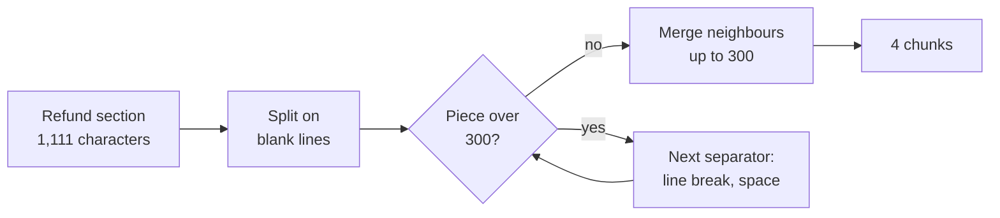
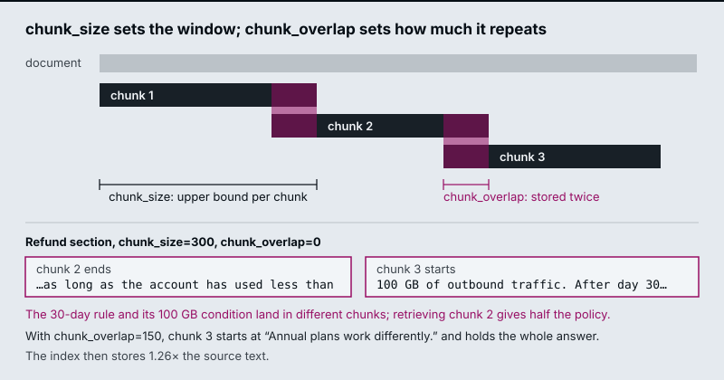
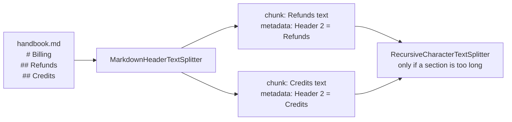

# M12.1 Theory: Splitter fundamentals: character, recursive, token and structure-aware

*[M12 theory](../README.md) · Lesson 12.1 · Notebooks: [`01a_document_splitting_and_chunking.ipynb`](../../notebook/01a_document_splitting_and_chunking.ipynb), [`01b_document_splitters_and_chunkers.ipynb`](../../../optional/notebook/01b_document_splitters_and_chunkers.ipynb) (optional), [`01c_text_splitters_and_chunking_strategies.ipynb`](../../../optional/notebook/01c_text_splitters_and_chunking_strategies.ipynb) (optional) · [All theory pages](../../../../../THEORY.md)*
<!-- subtitle: A chunk smaller than the fact can never hold it, and overlap only saves what fits inside it -->
<!-- format: approved -->

## Chunk size and overlap

> **What you'll learn**
>
> - **Explain** how a recursive splitter chooses its cuts, and what chunk size and overlap control.
> - **Diagnose** a half-answer caused by a boundary cut, and tell whether overlap can fix it.
> - **Compare** small and large chunks by what they hold, what they dilute and what they store.
> - **Choose** structure-aware splitting first and a size cap second for documents with markup.

M11 turned files into Documents with a schema. Most Documents are still too long to embed as one vector. The next step cuts them into **chunks**: the pieces that get embedded, retrieved and shown to the model.

A customer asks *Can I get a full refund on my annual plan?* The retriever returns a chunk that says refunds are available "within 30 days of purchase, as long as the account has used less than" and stops. The model answers with the 30-day rule and no traffic condition. The 100 GB limit sits at the top of the next chunk, which was not retrieved. We call this a **boundary cut**: a fact split between two chunks, which hands the model a confident half-answer.

The recursive character splitter tries its separators in order: blank line, line break, space, then single characters. It splits on the first one present, merges pieces back up to the **chunk size**, and recurses into any piece that is still too long. The **chunk overlap** is how many trailing characters of one chunk it may repeat at the start of the next:

<!-- animated: diagrams/recursive-split.anim.html -->

*Figure 1: The recursive splitter on the handbook's refund section at chunk size 300.*

At chunk size 300 the blank lines give five pieces of 25, 262, 525, 151 and 148 characters, each counting the blank line in front of it. The first two merge into chunk 1 (287 characters). The 525-character paragraph is too long, and a line break only peels off its leading blank line. The splitter falls through to spaces, splits the paragraph into 95 words and merges them into chunks 2 and 3. The last two paragraphs merge into chunk 4. The cut between chunks 2 and 3 lands inside the answer sentence:

*Figure 2: How overlap works, and the 300/0 split of the refund section. With 150 characters of overlap, chunk 3 holds the whole answer.*

The [interactive lab](interactive/chunk-size-overlap-lab.html) runs a JavaScript port of the LangChain splitter on the refund section, and it matches `langchain_text_splitters` exactly at all 1,061 slider positions. Five settings from the lab, rerun with `langchain_text_splitters` for this page:

| Chunk size / overlap | Chunks | Stored ÷ source | Answer in one chunk? | Answer share of its chunk |
|---|---|---|---|---|
| 140 / 0 | 11 | 0.99× | No: the sentence is longer than the chunk | none |
| 300 / 0 | 4 | 1.00× | No: cut after "…used less than" | none |
| 300 / 150 | 5 | 1.26× | Yes, chunk 3 | 47% |
| 500 / 50 | 4 | 1.04× | Yes, chunk 2 | 28% |
| 1200 / 0 | 1 | 1.00× | Yes, the whole section | 13% |

*Table 1: Five chunk settings on the refund section, from the lab.*

Each row teaches one rule:

- **A chunk smaller than the fact can never hold it.** The answer sentence is 141 characters. At 140, no overlap helps.
- **A boundary cut produces a confident half-answer.** At 300/0, chunk 2 gives the model the 30-day rule without the 100 GB condition, as in the opening example.
- **Overlap only rescues a piece that fits inside it.** At 300/150 the cut piece fits, and the index stores 26% more text.
- **Bigger chunks keep facts whole and dilute them.** At 1200 the answer is 13% of the chunk, and the other 87% is about monthly plans, refund timing and credits. The chunk's embedding averages all of it, and the model reads all of it. We call that a **diluted chunk**.

The third rule is easiest to see at the cut itself. The switcher holds the chunk size at 300 and changes only the overlap, using the splitter's real output:

Choose an overlap and see where chunks 2 and 3 meet in the refund section at chunk size 300.

<button type="button" data-mode="ov0" aria-pressed="false" aria-controls="ov-0">Overlap 0</button>
<button type="button" data-mode="ov100" aria-pressed="false" aria-controls="ov-100">Overlap 100</button>
<button type="button" data-mode="ov150" aria-pressed="false" aria-controls="ov-150">Overlap 150</button>

<section id="ov-0" class="mode-panel" data-announcement="Overlap 0. The answer is cut between chunks 2 and 3."><h4>Overlap 0: a boundary cut</h4><dl><dt>Chunk 2 ends</dt><dd>"…as long as the account has used less than"</dd><dt>Chunk 3 starts</dt><dd>"100 GB of outbound traffic. After day 30…"</dd><dt>Result</dt><dd>4 chunks, 1.00× the source; no chunk holds the answer</dd></dl></section>
<section id="ov-100" class="mode-panel" data-announcement="Overlap 100. The answer is still cut."><h4>Overlap 100: still cut</h4><dl><dt>Chunk 2 ends</dt><dd>"…as long as the account has used less than", unchanged</dd><dt>Chunk 3 starts</dt><dd>"full refund on an annual plan within 30 days…"; the opening words "You can get a" did not fit in the 100 characters carried over</dd><dt>Result</dt><dd>5 chunks, 1.17× the source; still no chunk holds the answer</dd></dl></section>
<section id="ov-150" class="mode-panel" data-announcement="Overlap 150. Chunk 3 holds the whole answer."><h4>Overlap 150: rescued</h4><dl><dt>Chunk 2 ends</dt><dd>"…as long as the account has used less than", unchanged</dd><dt>Chunk 3 starts</dt><dd>"Annual plans work differently. You can get a full refund…" and holds the whole answer (47% of its 297 characters)</dd><dt>Result</dt><dd>5 chunks, 1.26× the source; chunk 4 now starts mid-phrase with "GB of outbound traffic"</dd></dl></section>

Overlap never moves the first cut. Chunk 2 ends at the same word in all three settings, and overlap only copies its tail into the start of chunk 3. A larger overlap therefore helps only when the copied tail is long enough to include the start of the fact.

<!-- lab: interactive/chunk-size-overlap-lab.html -->

Two more effects show at the edges. At 500/50 the splitter leaves a 72-character **trailing stub** ("to the original payment method and take 5 to 10 business days…"). Tiny trailing chunks like this retrieve badly. Merge them or set a minimum size. At 300/150, chunk 4 starts mid-phrase with "GB of outbound traffic", because overlap carries whole words and ignores sentence boundaries.

## Characters or tokens

Measure length in tokens when the limit that matters is the embedding model's input or the prompt budget. The recursive splitter can count tokens with a tokenizer while keeping its separators, and notebook `01a` recommends that combination as the default for prose. English prose runs about four characters per token, but the ratio shifts by 2× or more for code, URLs and compound words. A character limit then drifts across content types, which we call **token drift**. Characters are fine for comparing settings on one document, as the lab does.

A pure token splitter is the other choice. It cuts at exactly N tokens and ignores separators. It therefore lands mid-sentence more often than the recursive splitter does. Use it when a hard model limit matters more than clean boundaries.

## Structure-aware splitting

Many documents already mark their own boundaries. **Structure-aware splitting** cuts on those boundaries first, which keeps each section intact and gives you metadata for free:

| Content | Splitter | What it uses |
|---|---|---|
| Markdown | `MarkdownHeaderTextSplitter` | `#`, `##`, `###`; header text goes into metadata (`{"Header 2": "Refunds"}`) |
| HTML | `HTMLHeaderTextSplitter`, `HTMLSectionSplitter` | `<h1>` to `<h6>` and sections |
| Code | The recursive splitter with a language preset | `class`, `def`, then blank lines |
| Elements from M11 | Unstructured's own chunking | Whole elements combined up to a maximum size (500 characters by default); only an oversized element is text-split |

*Table 2: Structure-aware splitters and the boundaries each one uses.*

On the Markdown handbook, each section becomes its own chunk with its heading in metadata:

*Figure 3: Header splitting first, a size cap second.*

Run a size-based splitter after the structural one, because one long section can still exceed your limit. The refund section is a case in point: at 1,111 characters it is one heading's worth of text and still four chunks at size 300. By default the header splitter also strips the heading line from the chunk text, so the heading survives only in metadata unless you put it back.

Use the header metadata in two places. Filter on it at query time ("only the Refunds section"), and prepend it to the chunk text so the embedding knows which section a sentence came from. M15 calls that a contextual chunk header.

## In practice: chunking the Larkspur refund section

For the handbook, the settings follow from Table 1 and the structure:

1. **Split on headings first.** The refund section then never shares a chunk with billing or credits.
2. **Cap long sections by size.** The 1,111-character refund section still needs cutting, and 500/50 keeps the answer whole in chunk 2.
3. **Merge the 72-character trailing stub** into the chunk before it.
4. **Prepend "Refunds" to each chunk's text** and keep it in metadata for filtering.
5. **Count tokens, not characters**, if the embedding model's input limit is close.

These settings came from where the text lands. Lesson 12.2 drops fixed sizes altogether and cuts where the meaning of the text changes.

## Limits of this evidence

- **One section, one question.** Every number on this page comes from the 1,111-character refund section and its 141-character answer. Another section puts its cuts elsewhere. Read your own chunks before reusing a setting.
- **Where text lands, not how it retrieves.** The lab and Table 1 show which chunk holds the answer. They do not embed or retrieve anything. The cost of a diluted chunk to its similarity score is argued here and measured in lesson 12.4.
- **Characters, not tokens.** The lab counts characters. The four-characters-per-token figure is a rule of thumb for English prose, not a measurement on the handbook.

## References

1. LangChain, [Text splitters](https://docs.langchain.com/oss/python/integrations/splitters/index), the overview of the splitter families on this page.
2. LangChain, [Recursively split by character](https://docs.langchain.com/oss/python/integrations/splitters/recursive_text_splitter), on the separator order, chunk size and overlap.
3. LangChain, [Split by tokens](https://docs.langchain.com/oss/python/integrations/splitters/split_by_token), on counting length with a tokenizer.
4. LangChain, [Split Markdown by headers](https://docs.langchain.com/oss/python/integrations/splitters/markdown_header_metadata_splitter), on header metadata and stripped headers.
5. Unstructured, [Chunking](https://docs.unstructured.io/open-source/core-functionality/chunking), on combining whole elements up to a maximum size.

## Key Takeaways

- A chunk smaller than the fact can never hold it, and overlap rescues only a piece that fits inside it. A boundary cut hands the model a confident half-answer.
- Bigger chunks keep facts whole but dilute them: at 1200 characters the refund answer is 13% of its chunk. Merge tiny trailing chunks, and count tokens when a model limit applies.
- Split on the document's own structure first, then cap long sections with a size-based splitter. Use header metadata for filtering and as a prefix in the chunk text.

## Check yourself

1. At chunk size 300, an overlap of 100 leaves the refund answer cut, but an overlap of 150 keeps it whole. Why?

Overlap only rescues a piece that fits inside it. Chunk 2 always ends at "used less than", and at 300/100 the tail copied into chunk 3 starts at "full refund on an annual plan": the opening words are still missing. At 300/150 the tail reaches back to the start of the answer, and chunk 3 holds the whole sentence, at the cost of storing 26% more text (1.26× the source).

2. You split the refund section at chunk size 1200 with no overlap. Does the answer survive, and what does it cost?

The answer survives, because the whole section becomes one chunk, but it is only 13% of that chunk. The other 87% is about monthly plans, refund timing and credits, and the chunk's embedding averages all of it while the model reads all of it. Bigger chunks keep facts whole and dilute them.

3. Your handbook is Markdown, and after splitting on headers one section is still longer than your limit. What do you do, and how do you use the header metadata?

Run a size-based splitter such as the recursive character splitter after the structural one to cap the long section. Use the header metadata twice: filter on it at query time ("only the Refunds section"), and prepend it to the chunk text so the embedding knows which section a sentence came from. M15 calls that a contextual chunk header.

---
*Previous: [M12 overview](../README.md). Next: [12.2 Semantic chunking: breakpoints on embedding distance](../02_semantic_chunking_breakpoints_on_embedding_distance/README.md).*
