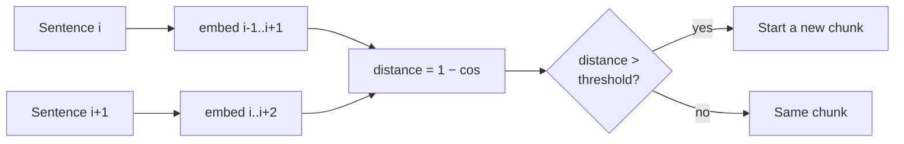

# M12.2 Theory: Semantic chunking: breakpoints on embedding distance

*[M12 theory](../README.md) · Lesson 12.2 · Notebooks: [`02a_semantic_chunking.ipynb`](../../notebook/02a_semantic_chunking.ipynb), [`02b_semantic_chunking_walkthrough.ipynb`](../../../optional/notebook/02b_semantic_chunking_walkthrough.ipynb) (optional), [`02c_semantic_chunking_rag_techniques.ipynb`](../../../optional/notebook/02c_semantic_chunking_rag_techniques.ipynb) (optional) · [All theory pages](../../../../../THEORY.md)*
<!-- subtitle: Semantic chunking cuts where meaning jumps, at a threshold set by each document's own distances -->

## Breakpoint threshold

> **What you'll learn**
>
> - **Explain** how semantic chunking turns sentence embeddings into chunk boundaries.
> - **Compare** the four threshold types by how they set the cut-off and whether they always cut.
> - **Diagnose** a section with three topic changes that gets cut only once, and a topic that drifts without a cut.
> - **Choose** a threshold per corpus, with a size cap after the chunker.

Lesson 12.1 cut text by length and used the document's markup where it had any. Semantic chunking cuts on meaning instead: a boundary goes where one sentence is about something different from the next.

The refund section has 13 sentences and three real topic changes: monthly plans, the annual-plan window, refund timing, and credits. Run through the semantic chunker with its default settings, it comes back cut only once, so two of the topics share a chunk with their neighbours.

**Semantic chunking** places boundaries in five steps:

1. Split the text into sentences.
2. Embed each sentence, combined with its neighbours (a buffer of 1 adds one sentence on each side).
3. Compute the distance between consecutive sentences: 1 minus their cosine similarity.
4. Mark every distance above the **breakpoint threshold** as a boundary.
5. Group the sentences between boundaries into chunks.

The threshold decides everything that follows. Here it is on the refund section, at two percentile levels:

*Figure 1: Distances between neighbouring sentences in the refund section, with the 95th and 75th percentile thresholds (illustrative distances).*

The semantic chunker turns the distances into a threshold in one of four ways:

| Threshold type | Default amount | Cuts where the distance is above… |
|---|---|---|
| `percentile` | 95 | the 95th percentile of this document's distances |
| `standard_deviation` | 3 | mean + 3 standard deviations |
| `interquartile` | 1.5 | mean + 1.5 × IQR (interquartile range) |
| `gradient` | 95 | the 95th percentile of the distance *gradient* (for text where everything is similar) |

*Table 1: The four breakpoint threshold types and their defaults.*

All four are computed from the document's own distances. A threshold tuned on one corpus therefore does not transfer to another, and we call reusing one the **relative-threshold trap**. It also explains the opening example. A 13-sentence section has 12 distances, and only the largest clears their 95th percentile. Lowering the amount to 75 cuts at all three topic changes.

The types also differ in whether they must cut:

| Threshold type | On a document with no topic change |
|---|---|
| `percentile` | Always cuts somewhere, at its own top 5% of distances |
| `standard_deviation`, `interquartile` | Can decide there is no boundary at all and return one chunk |

*Table 2: Which threshold types can return a single chunk.*

On a short text, no distance is 3 standard deviations above the mean. The default `standard_deviation` then returns one chunk. That is correct for a document about one thing, and it leaves chunk size with no upper limit. We call that an **unbounded chunk**: it can grow past the embedding model's input limit.

Only local change counts. The comparison is sentence *i* against sentence *i + 1*. A topic that drifts across five sentences never produces one large distance and never triggers a cut. This is **slow drift**, and `gradient` helps with it somewhat. One cut decision looks like this:

*Figure 2: One boundary decision. Each sentence is embedded with its neighbours, and only consecutive sentences are compared.*

The cost is a full extra embedding pass over every sentence at index time, before the chunks themselves are embedded.

## In practice: semantic chunks for the refund section

For the refund section, semantic chunking needs four checks against the text:

1. **Tune the threshold on this corpus.** The 75th percentile finds the three topic changes in the refund section where the default 95th finds one. Check that on other handbook pages before keeping it.
2. **Read the chunks** before trusting the boundaries, which catches slow drift the distances cannot show.
3. **Cap chunk size afterwards** with a size-based splitter. A long single-topic section then cannot become an unbounded chunk.
4. **Budget the extra embedding pass** over every sentence when the handbook is re-indexed.

> **Next:** lesson 12.3 hands the cutting to an LLM, which rewrites text into standalone facts.

## Key Takeaways

- Semantic chunking embeds each sentence with its neighbours and cuts where the distance between consecutive sentences clears a threshold.
- Every threshold type is relative to the document's own distances, so tune it per corpus. `percentile` always cuts somewhere; `standard_deviation` may return one chunk.
- Only local change triggers a cut, so slow drift is missed. Read the chunks, cap their size afterwards, and budget an extra embedding pass over every sentence.

## Check yourself

1. A topic drifts slowly across five sentences. Why does semantic chunking never cut there?

The distance compares sentence i with sentence i + 1 only, so a gradual drift never produces one large distance to clear the threshold. The `gradient` threshold helps somewhat. Read the chunks before you trust the boundaries.

2. The 13-sentence refund section has three real topic changes, yet the default percentile threshold cuts only once. Why, and what changes that?

A 13-sentence section has 12 distances, and only the largest clears their 95th percentile. Lowering the amount to 75 cuts at all three topic changes. Every threshold type is computed from the document's own distances, so a value tuned on one corpus does not transfer to another.

3. The standard deviation threshold returns a short document as one chunk. Is that a bug, and what should you add after the chunker?

Not necessarily: on a short text no distance is 3 standard deviations above the mean, and one chunk is correct for a document about one thing. But it leaves chunk size unbounded. Cap chunk size afterwards, because semantic chunks can grow past the embedding model's limit.

---
*Previous: [12.1 Splitter fundamentals: character, recursive, token and structure-aware](../01_splitter_fundamentals_character_recursive_token_and_structure_aware/README.md). Next: [12.3 Proposition chunking with LLM quality checks](../03_proposition_chunking_with_llm_quality_checks/README.md).*
