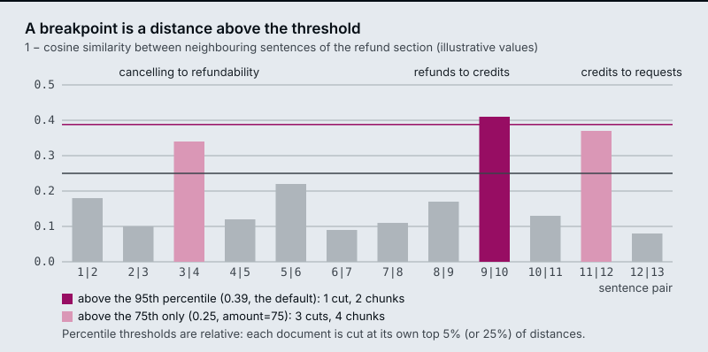
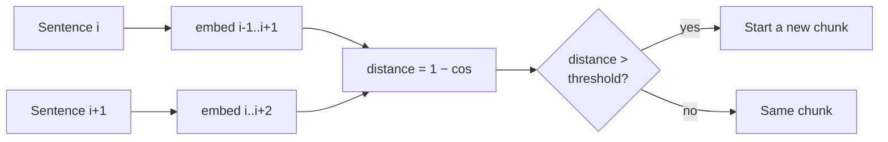

# M12.2 Theory: Semantic chunking: breakpoints on embedding distance

*[M12 theory](../README.md) · Lesson 12.2 · Notebooks: [`02a_semantic_chunking.ipynb`](../../notebook/02a_semantic_chunking.ipynb), [`02b_semantic_chunking_walkthrough.ipynb`](../../../optional/notebook/02b_semantic_chunking_walkthrough.ipynb) (optional), [`02c_semantic_chunking_rag_techniques.ipynb`](../../../optional/notebook/02c_semantic_chunking_rag_techniques.ipynb) (optional) · [All theory pages](../../../../../THEORY.md)*
<!-- subtitle: Semantic chunking cuts where meaning jumps, at a threshold set by each document's own distances -->
<!-- format: approved -->

## Breakpoint threshold

> **What you'll learn**
>
> - **Explain** how semantic chunking turns sentence embeddings into chunk boundaries.
> - **Compare** the four threshold types by how they set the cut-off and whether they always cut.
> - **Diagnose** a section with several topic changes that gets cut only once, and a cut that lands beside the topic change instead of on it.
> - **Choose** a threshold per corpus, with a size cap after the chunker.

Lesson 12.1 cut text by length and used the document's markup where it had any. Semantic chunking cuts on meaning instead: a boundary goes where one sentence is about something different from the next.

The refund section has 13 sentences and several topic changes: from cancelling to refundability, from refunds to credits, and from credits to how to request a refund. Run through the semantic chunker with its default settings, it comes back cut only once. Most of those topics share a chunk with their neighbours.

**Semantic chunking** places boundaries in five steps:

1. Split the text into sentences.
2. Embed each sentence, combined with its neighbours (a buffer of 1 adds one sentence on each side).
3. Compute the distance between consecutive sentences: 1 minus their cosine similarity.
4. Mark every distance above the **breakpoint threshold** as a boundary.
5. Group the sentences between boundaries into chunks.

The threshold decides everything that follows. Here it is on the refund section, at two percentile levels, with distances drawn by hand to show the idea:

*Figure 1: Distances between neighbouring sentences in the refund section, with the 95th and 75th percentile thresholds (illustrative distances).*

The semantic chunker turns the distances into a threshold in one of four ways:

| Threshold type | Default amount | Cuts where the distance is above… |
|---|---|---|
| `percentile` | 95 | the 95th percentile of this document's distances |
| `standard_deviation` | 3 | mean + 3 standard deviations |
| `interquartile` | 1.5 | mean + 1.5 × IQR (interquartile range) |
| `gradient` | 95 | the 95th percentile of the distance *gradient* (for text where everything is similar) |

*Table 1: The four breakpoint threshold types and their defaults, as set in the installed `langchain_experimental`.*

All four are computed from the document's own distances. A threshold tuned on one corpus therefore does not transfer to another, and we call reusing one the **relative-threshold trap**.

The percentile arithmetic also explains the opening example. A 13-sentence section has 12 distances, and only the largest one sits above their 95th percentile. The default therefore cuts exactly once on this section unless two distances tie. At an amount of 75, the three largest sit above the threshold, which gives three cuts and four chunks. The amount sets how many cuts a percentile threshold makes. It says nothing about where they land.

## What a real run cuts

Figure 1 is drawn by hand. To see where real cuts land, we ran `SemanticChunker` on the refund section with a buffer of 1 and a small local embedding model (`all-MiniLM-L6-v2`; the notebooks use an OpenAI model with other distances). The 12 distances ran from 0.017 to 0.303. The largest were 0.303 between sentences 12 and 13, 0.279 between 2 and 3, and 0.274 between 8 and 9.

The switcher applies each threshold type to those same 12 distances:

Choose a threshold type and see where it cuts the refund section in the real run.

<button type="button" data-mode="p95" aria-pressed="false" aria-controls="tt-p95">Percentile 95</button>
<button type="button" data-mode="p75" aria-pressed="false" aria-controls="tt-p75">Percentile 75</button>
<button type="button" data-mode="sd3" aria-pressed="false" aria-controls="tt-sd3">Standard deviation 3</button>
<button type="button" data-mode="iqr" aria-pressed="false" aria-controls="tt-iqr">Interquartile 1.5</button>
<button type="button" data-mode="grad" aria-pressed="false" aria-controls="tt-grad">Gradient 95</button>

<section id="tt-p95" class="mode-panel" data-announcement="Percentile 95. One cut, before the last sentence."><h4>Percentile 95 (the default)</h4><dl><dt>Cuts</dt><dd>1, between sentences 12 and 13</dd><dt>Chunks</dt><dd>2: the first 12 sentences, then "Requests sent by email are not tracked and take longer."</dd><dt>Reading</dt><dd>the one cut splits the refund-request paragraph in half</dd></dl></section>
<section id="tt-p75" class="mode-panel" data-announcement="Percentile 75. Three cuts, each one sentence from a topic change."><h4>Percentile 75</h4><dl><dt>Cuts</dt><dd>3, after sentences 2, 8 and 12</dd><dt>Chunks</dt><dd>4, starting at "Larkspur Cloud bills…", "Cancelling stops the next charge…", "Refunds go back to the original payment method…" and "Requests sent by email…"</dd><dt>Reading</dt><dd>each cut sits one sentence from a topic change (3 to 4, 9 to 10, 11 to 12), and no cut lands on one</dd></dl></section>
<section id="tt-sd3" class="mode-panel" data-announcement="Standard deviation. No cut, one chunk."><h4>Standard deviation 3</h4><dl><dt>Cuts</dt><dd>none: no distance is 3 standard deviations above the mean</dd><dt>Chunks</dt><dd>1, the whole 1,111-character section</dd><dt>Reading</dt><dd>an unbounded chunk; only a size cap afterwards limits it</dd></dl></section>
<section id="tt-iqr" class="mode-panel" data-announcement="Interquartile. No cut, one chunk."><h4>Interquartile 1.5</h4><dl><dt>Cuts</dt><dd>none</dd><dt>Chunks</dt><dd>1, the whole section</dd><dt>Reading</dt><dd>same as standard deviation on this section</dd></dl></section>
<section id="tt-grad" class="mode-panel" data-announcement="Gradient. One cut, after the first sentence."><h4>Gradient 95</h4><dl><dt>Cuts</dt><dd>1, between sentences 1 and 2</dd><dt>Chunks</dt><dd>2: the title and opening sentence, then the rest</dd><dt>Reading</dt><dd>the largest rise in distance is at the start, where it marks no topic change</dd></dl></section>

The real run confirms the counts and contradicts the placement in Figure 1. The default makes one cut, and an amount of 75 makes three, as the arithmetic says. Figure 1's three cuts sit on topic changes, and each of the three real cuts sits one sentence away from one of them. We call this a **misplaced cut**: the right number of boundaries in the wrong places.

Two features of the mechanism make misplaced cuts likely on short policy text. Every sentence in the section is about billing. The distances are therefore small and close together. With a buffer of 1, the windows for neighbouring sentences also share two of their three sentences, which flattens the distances further. Re-running with a buffer of 0 spread the distances to 0.39 to 0.85, but at an amount of 75 only one of its three cuts (credits to requests) landed on a topic change.

## Which types must cut

The types also differ in whether they must cut, and Table 2 matches the real run:

| Threshold type | On a document with no clear topic change |
|---|---|
| `percentile` | Always cuts somewhere, at its own top 5% of distances |
| `standard_deviation`, `interquartile` | Can decide there is no boundary at all and return one chunk |

*Table 2: Which threshold types can return a single chunk.*

On a short text, no distance is 3 standard deviations above the mean. The default `standard_deviation` then returns one chunk. That is correct for a document about one thing, and it leaves chunk size with no upper limit. We call that an **unbounded chunk**: it can grow past the embedding model's input limit.

Only local change counts. The comparison is sentence *i* against sentence *i + 1*. A topic that drifts across five sentences never produces one large distance and never triggers a cut. This is **slow drift**, and `gradient` helps with it somewhat. One cut decision looks like this:

*Figure 2: One boundary decision. Each sentence is embedded with its neighbours, and only consecutive sentences are compared.*

The cost is a full extra embedding pass over every sentence at index time, before the chunks themselves are embedded. Notebook `02a` puts it plainly: semantic chunking embeds the corpus roughly twice, once by sentence to find boundaries and once by chunk to index. It also finds that a free header splitter often beats semantic chunking on structured documents, so try structure first.

## In practice: semantic chunks for the refund section

For the refund section, semantic chunking needs five checks against the text:

1. **Try structure first.** The handbook is Markdown, and lesson 12.1's header splitter already separates refunds from credits at no embedding cost.
2. **Tune the threshold on this corpus** if you still use semantic chunking, and check the setting on other handbook pages before keeping it.
3. **Read the chunks** before trusting the boundaries. That catches misplaced cuts and slow drift, which the distances alone cannot show.
4. **Cap chunk size afterwards** with a size-based splitter. A long single-topic section then cannot become an unbounded chunk.
5. **Budget the extra embedding pass** over every sentence when the handbook is re-indexed.

Semantic chunking still keeps the source's words. Lesson 12.3 hands the cutting to an LLM, which rewrites text into standalone facts.

## Limits of this evidence

- **One section, one small model.** The real run used `all-MiniLM-L6-v2` on 13 sentences. The notebooks' OpenAI embeddings produce other distances and may place the cuts better or worse.
- **Figure 1 is illustrative.** Its distances were drawn to show how a percentile threshold works, and its cut positions are not a measurement.
- **Topic changes were judged by hand.** "The right place to cut" here means our reading of the section's topics, not a labelled benchmark.

## References

1. Langchain-experimental package on [the Python Package Index](https://pypi.org/project/langchain-experimental/), which ships `SemanticChunker` and the four threshold types.
2. NumPy, [percentile](https://numpy.org/doc/stable/reference/generated/numpy.percentile.html), the function the percentile and interquartile thresholds call.
3. Sentence Transformers, [Pretrained models](https://sbert.net/docs/sentence_transformer/pretrained_models.html), which lists `all-MiniLM-L6-v2`, the model used for the real run.
4. LangChain, [Split Markdown by headers](https://docs.langchain.com/oss/python/integrations/splitters/markdown_header_metadata_splitter), the free structural alternative.

## Key Takeaways

- Semantic chunking embeds each sentence with its neighbours and cuts where the distance between consecutive sentences clears a threshold.
- Every threshold type is relative to the document's own distances: tune it per corpus. A percentile amount sets how many cuts you get, not where they land; `standard_deviation` may return one chunk.
- Only local change triggers a cut, so slow drift is missed, and on short single-subject text the cuts can land beside the topic changes. Read the chunks, cap their size afterwards, and budget an extra embedding pass over every sentence.

## Check yourself

1. A topic drifts slowly across five sentences. Why does semantic chunking never cut there?

The distance compares sentence i with sentence i + 1 only. A gradual drift never produces one large distance to clear the threshold. The `gradient` threshold helps somewhat. Read the chunks before you trust the boundaries.

2. The 13-sentence refund section has several topic changes, yet the default percentile threshold cuts only once. Why, and does lowering the amount to 75 fix it?

A 13-sentence section has 12 distances, and only the largest sits above their 95th percentile. The default therefore always makes one cut there. At 75 the three largest distances pass, giving three cuts. In the real run each of those cuts landed one sentence away from a topic change: the amount sets how many cuts you get, not where they go, so read the chunks.

3. The standard deviation threshold returns a short document as one chunk. Is that a bug, and what should you add after the chunker?

Not necessarily: on a short text no distance is 3 standard deviations above the mean, and one chunk is correct for a document about one thing. But it leaves chunk size unbounded. Cap chunk size afterwards, because semantic chunks can grow past the embedding model's limit.

---
*Previous: [12.1 Splitter fundamentals: character, recursive, token and structure-aware](../01_splitter_fundamentals_character_recursive_token_and_structure_aware/README.md). Next: [12.3 Proposition chunking with LLM quality checks](../03_proposition_chunking_with_llm_quality_checks/README.md).*
