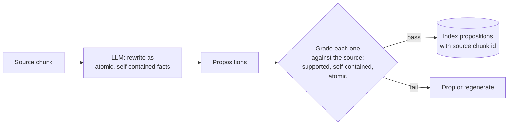

# M12.3 Theory: Proposition chunking with LLM quality checks

*[M12 theory](../README.md) · Lesson 12.3 · Notebooks: [`03a_proposition_chunking.ipynb`](../../notebook/03a_proposition_chunking.ipynb), [`03b_proposition_chunking_rag_techniques.ipynb`](../../../optional/notebook/03b_proposition_chunking_rag_techniques.ipynb) (optional) · [All theory pages](../../../../../THEORY.md)*
<!-- subtitle: An LLM rewrites text into standalone facts, and a grader has to check what it changed -->

## Propositions

> **What you'll learn**
>
> - **Explain** what makes a proposition atomic and self-contained, and why both matter once it is retrieved alone.
> - **Diagnose** the three ways a generated proposition goes wrong, one per grader check.
> - **Compare** a same-model grader with independent verification.
> - **Choose** where propositions are worth one or two LLM calls per chunk.

Lessons 12.1 and 12.2 cut the source text and kept its words. Proposition chunking rewrites it: an LLM turns each chunk into short standalone facts, and those facts are what get embedded.

A chunk boundary leaves the sentence "It takes 5 to 10 business days to appear" at the top of a chunk. Retrieved alone, it says nothing about what "it" is. A question about refund timing may still match it, and the model then has to guess whether the 5 to 10 days refer to a refund, a credit or a server migration. We call this a **dangling reference**: a sentence whose subject stayed in another chunk.

A **proposition** is one fact written so it stands alone. It has to be:

- **Atomic:** one claim. "Annual plans can be refunded within 30 days and refunds take 5 to 10 business days" is two.
- **Self-contained:** no unresolved references. "It takes 5 to 10 business days" means nothing once retrieved alone; "A Larkspur Cloud refund takes 5 to 10 business days to appear" does.

The refund sentence becomes three propositions:

1. Larkspur Cloud gives a full refund on an annual plan requested within 30 days of purchase.
2. A full refund on a Larkspur Cloud annual plan requires the account to have used less than 100 GB of outbound traffic.
3. After day 30, a Larkspur Cloud annual-plan refund is prorated to the unused whole months, minus a 15% early-termination fee.

Each proposition names its own subject and condition. The golden question can match proposition 1, and the retriever can return proposition 2 beside it, which is the condition the boundary cut in lesson 12.1 lost.

Generation and grading form one pipeline:

*Figure 1: Proposition chunking with a grading pass. Only propositions that pass every check are indexed.*

## What the grader catches

Grade every proposition against its source chunk before indexing it. A splitter can only cut text, while an LLM can merge two facts, drop a qualifier or state something the source only implied. The mandatory notebook's grader returns three yes-or-no checks through structured output, plus a short note on the issue, and keeps only propositions that pass all three. One planted proposition per check:

| Generated proposition | Check it fails | Why |
|---|---|---|
| "Annual plans can be refunded within 30 days and refunds take 5 to 10 business days" | Atomic | Two claims in one sentence |
| "It takes 5 to 10 business days to appear" | Self-contained | "It" refers to a subject outside the proposition |
| "Annual plans can be fully refunded within 30 days of purchase" | Supported by the source | "Less than 100 GB of outbound traffic" is gone, so the proposition states more than the source allows |

*Table 1: Three planted propositions, one per grader check.*

The third row is a **dropped qualifier**: the proposition reads well and is wrong for every account over 100 GB. It is the most expensive of the three, because nothing about its wording looks broken.

The optional notebook grades differently. It scores accuracy, clarity, completeness and conciseness from 1 to 10 and drops anything under 7 on any of them.

> **Pitfall: the self-grading blind spot.** In the notebook the grader is the same model as the generator, so it shares its blind spots and can pass a proposition it should reject. Treat it as a filter for obvious damage; independent verification needs a different model or a human.

Keep the source chunk id in each proposition's metadata. The answer can then show the original text beside the fact that matched.

Cost decides where propositions are worth it. Each source chunk takes one LLM call to generate and about one more to grade, and the index usually holds several times as many vectors. That pays off for dense, high-value text (policies, specs, medical or legal facts) where a missed qualifier is expensive, and not for a whole document lake.

## In practice: propositions for the Larkspur refund policy

The refund policy is the kind of dense, high-stakes text propositions are for:

1. **Generate propositions** from the refund section's chunks, each naming Larkspur Cloud and the plan type.
2. **Grade each one** for support, self-containment and atomicity, and drop the failures.
3. **Check the qualifiers by hand** on this section, or with a second model, since the same-model grader can miss a dropped "less than 100 GB".
4. **Store the source chunk id** with every proposition, so the assistant can cite the original sentence.
5. **Leave the rest of the handbook** to the splitters from lessons 12.1 and 12.2.

> **Next:** lesson 12.4 measures which chunking setting actually retrieves best, instead of choosing by argument.

## Key Takeaways

- A proposition is one atomic, self-contained fact that names its own subject and condition, so it still makes sense when retrieved alone.
- Grade every generated proposition against its source before indexing, because an LLM can merge facts or drop a qualifier. Keep the source chunk id in metadata.
- A grader that is the same model shares its blind spots. With one or two LLM calls per chunk and several times the vectors, keep propositions for dense, high-value text.

## Check yourself

1. What two properties make a proposition, and why does each matter once it is retrieved alone?

It is atomic, holding one claim, and self-contained, with no unresolved references. "It takes 5 to 10 business days" means nothing when retrieved alone, while "A Larkspur Cloud refund takes 5 to 10 business days to appear" does. Because each proposition names its own subject and condition, a question can match one and the retriever can return a related one beside it.

2. A generated proposition reads: Annual plans can be refunded within 30 days and refunds take 5 to 10 business days. Which grader check fails, and what happens to it?

The atomic check fails, because the sentence makes two claims. The mandatory notebook's grader keeps only propositions that pass all three checks (supported by the source, self-contained, atomic), so this one is dropped or regenerated.

3. Your team plans to turn its whole document lake into propositions, graded by the same model that writes them. What two concerns do you raise?

Cost: one LLM call per source chunk to generate, about one more to grade, and usually several times as many vectors, so keep propositions for dense, high-value text such as policies and specs. Grading: a grader that is the same model shares the generator's blind spots and can pass a proposition it should reject. Treat it as a filter for obvious damage, and use a different model or a human for independent verification.

---
*Previous: [12.2 Semantic chunking: breakpoints on embedding distance](../02_semantic_chunking_breakpoints_on_embedding_distance/README.md). Next: [12.4 Choosing chunk size empirically: retrieval quality, faithfulness, latency](../04_choosing_chunk_size_empirically_retrieval_quality_faithfulness_latency/README.md).*
