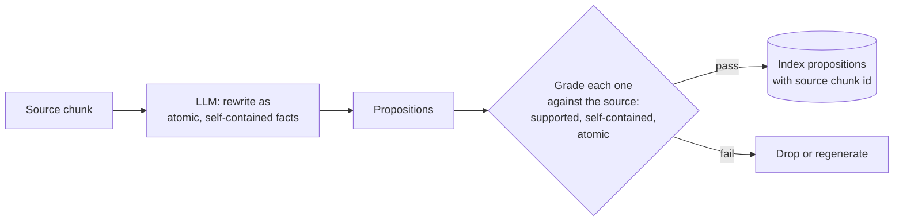

# M12.3 Theory: Proposition chunking with LLM quality checks

*[M12 theory](../README.md) · Lesson 12.3 · Notebooks: [`03a_proposition_chunking.ipynb`](../../notebook/03a_proposition_chunking.ipynb), [`03b_proposition_chunking_rag_techniques.ipynb`](../../../optional/notebook/03b_proposition_chunking_rag_techniques.ipynb) (optional) · [All theory pages](../../../../../THEORY.md)*
<!-- subtitle: An LLM rewrites text into standalone facts, and a grader has to check what it changed -->
<!-- format: approved -->

## Propositions

> **What you'll learn**
>
> - **Explain** what makes a proposition atomic and self-contained, and why both matter once it is retrieved alone.
> - **Diagnose** the three ways a generated proposition goes wrong, one per grader check.
> - **Compare** a same-model grader with independent verification.
> - **Choose** where propositions are worth one generation call per chunk and one grading call per proposition.

Lessons 12.1 and 12.2 cut the source text and kept its words. Proposition chunking rewrites it: an LLM turns each chunk into short standalone facts, and those facts are what get embedded.

A chunk boundary leaves the sentence "It takes 5 to 10 business days to appear" at the top of a chunk. Retrieved alone, it says nothing about what "it" is. A question about refund timing may still match it, and the model then has to guess whether the 5 to 10 days refer to a refund, a credit or a server migration. We call this a **dangling reference**: a sentence whose subject stayed in another chunk.

A **proposition** is one fact written so it stands alone. It has to be:

- **Atomic:** one claim. "Annual plans can be refunded within 30 days and refunds take 5 to 10 business days" is two.
- **Self-contained:** no unresolved references. "It takes 5 to 10 business days" means nothing once retrieved alone; "A Larkspur Cloud refund takes 5 to 10 business days to appear" does.

The two requirements are separate. A sentence can be atomic and still dangle, and the finer you split for precision, the more sentences lose their subject. The refund sentence becomes three propositions (written for this page, not generated by a model):

1. Larkspur Cloud gives a full refund on an annual plan requested within 30 days of purchase.
2. A full refund on a Larkspur Cloud annual plan requires the account to have used less than 100 GB of outbound traffic.
3. After day 30, a Larkspur Cloud annual-plan refund is prorated to the unused whole months, minus a 15% early-termination fee.

Each proposition names its own subject and condition. The golden question can match proposition 1, and the retriever can return proposition 2 beside it, which is the condition the boundary cut in lesson 12.1 lost.

Generation and grading form one pipeline:

*Figure 1: Proposition chunking with a grading pass. Only propositions that pass every check are indexed.*

The mandatory notebook's generation prompt carries five rules: one fact per proposition, every pronoun replaced by its noun, compound sentences split, nothing added that the passage does not say, and dates, numbers and names kept exactly. It runs at temperature 0, because this is extraction rather than writing, and returns a validated list through structured output.

The walkthrough follows one refund chunk through the pipeline. It is a scripted example; no model produced these outputs.

Step through one refund chunk, from source text to the propositions a question retrieves. Scripted example.

<button type="button" data-step="source" aria-pressed="false" aria-controls="pp-source">Source chunk</button>
<button type="button" data-step="generate" aria-pressed="false" aria-controls="pp-generate">Generate</button>
<button type="button" data-step="grade" aria-pressed="false" aria-controls="pp-grade">Grade</button>
<button type="button" data-step="index" aria-pressed="false" aria-controls="pp-index">Index</button>
<button type="button" data-step="retrieve" aria-pressed="false" aria-controls="pp-retrieve">Retrieve</button>

<section id="pp-source" class="step-panel"><h4>1. Source chunk</h4>
<strong>Input:</strong> chunk 3 of the refund section from lesson 12.1 (300/150), 297 characters, holding the annual-plan rule, its traffic condition and the proration rule.

<strong>Calls so far:</strong> none. A splitter produced this chunk.
</section>
<section id="pp-generate" class="step-panel"><h4>2. Generate</h4>
<strong>Call:</strong> one LLM call for the chunk.

<strong>Output:</strong> four candidate propositions: the three listed above, plus "Annual plans can be fully refunded within 30 days of purchase", which drops the traffic condition.
</section>
<section id="pp-grade" class="step-panel"><h4>3. Grade</h4>
<strong>Calls:</strong> one per proposition, four in all.

<strong>Output:</strong> three pass all of supported, self-contained and atomic. The fourth fails "supported": the source limits the refund to accounts under 100 GB, and the proposition does not.
</section>
<section id="pp-index" class="step-panel"><h4>4. Index</h4>
<strong>Stored:</strong> three vectors in place of one chunk, each with the source chunk id in its metadata.

<strong>Total cost for this chunk:</strong> five LLM calls before any embedding.
</section>
<section id="pp-retrieve" class="step-panel"><h4>5. Retrieve</h4>
<strong>Question:</strong> <em>How long do I have to get a full refund on an annual plan?</em>

<strong>Result:</strong> proposition 1 matches best. The answer is complete only if proposition 2 also comes back, so <code>k</code> must leave room for the condition.
</section>

<button type="button" data-walk="previous">Previous</button><button type="button" data-walk="next">Next</button>

The last stage shows the trade the notebook names. Propositions buy **precision**: the retrieved text is almost all signal. They spend **completeness**: a question that needs two facts now depends on retrieving two correct vectors instead of one good chunk.

## What the grader catches

Grade every proposition against its source chunk before indexing it. A splitter can only cut text, while an LLM can merge two facts, drop a qualifier or state something the source only implied. The mandatory notebook's grader returns three yes-or-no checks through structured output, plus a short note on the issue, and keeps only propositions that pass all three. One planted proposition per check:

| Generated proposition | Check it fails | Why |
|---|---|---|
| "Annual plans can be refunded within 30 days and refunds take 5 to 10 business days" | Atomic | Two claims in one sentence |
| "It takes 5 to 10 business days to appear" | Self-contained | "It" refers to a subject outside the proposition |
| "Annual plans can be fully refunded within 30 days of purchase" | Supported by the source | "Less than 100 GB of outbound traffic" is gone: the proposition states more than the source allows |

*Table 1: Three planted propositions, one per grader check.*

The third row is a **dropped qualifier**: the proposition reads well and is wrong for every account over 100 GB. It is the most expensive of the three, because nothing about its wording looks broken.

The optional notebook grades differently. It scores accuracy, clarity, completeness and conciseness from 1 to 10 and drops anything under 7 on any of them.

> **Pitfall: the self-grading blind spot.** In the notebook the grader is the same model as the generator. It shares its blind spots and can pass a proposition it should reject. Treat it as a filter for obvious damage; independent verification needs a different model or a human.

## What propositions cost

Keep the source chunk id in each proposition's metadata. A proposition is a paraphrase, so that id is the only route back to text the assistant can quote. Notebook `03a` lists the costs a token count does not show:

- **Lost phrasing**: the index holds the model's wording. A search for a distinctive phrase from the source may find nothing.
- **Indirect citation**: showing the source means following the chunk id back to the original.
- **Invented text in the index**: every other method on this module only cuts text. This one can index a falsehood, which then looks like any other proposition at retrieval time.

The call count follows from the pipeline: one generation call per source chunk, then one grading call per proposition. Each chunk yields several propositions, so grading costs more calls than generation, and the index holds several times as many vectors. That pays off for dense, high-value text (policies, specs, medical or legal facts) where a missed qualifier is expensive, and not for a whole document lake.

Check the cheaper fix first. A contextual chunk header from M15 also repairs dangling references, by prepending context to the chunk instead of rewriting it, and it costs no LLM call per chunk.

## In practice: propositions for the Larkspur refund policy

The refund policy is the kind of dense, high-stakes text propositions are for:

1. **Generate propositions** from the refund section's chunks, each naming Larkspur Cloud and the plan type.
2. **Grade each one** for support, self-containment and atomicity, and drop the failures.
3. **Check the qualifiers by hand** on this section, or with a second model, since the same-model grader can miss a dropped "less than 100 GB".
4. **Store the source chunk id** with every proposition. The assistant can then cite the original sentence.
5. **Retrieve enough propositions** for a rule and its condition to arrive together.
6. **Leave the rest of the handbook** to the splitters from lessons 12.1 and 12.2.

Three strategies now compete for the same text. Lesson 12.4 measures which setting retrieves best, instead of choosing by argument.

## Limits of this evidence

- **No model output on this page.** The three propositions, the planted failures and the walkthrough were written by hand to show each check. The notebook generates and grades its own propositions on a different text, a short passage about the Hubble telescope.
- **The notebook measures text, not accuracy.** Its comparison counts how many characters each approach returns per question. It does not score whether the right answer was retrieved.
- **Quality depends on the model.** A weaker generator writes propositions that are less atomic and drift further from the source, and a same-model grader inherits that weakness.

## References

1. Chen and others, [Dense X Retrieval: What Retrieval Granularity Should We Use?](https://arxiv.org/abs/2312.06648), 2023, which proposes propositions as retrieval units.
2. LangChain, [Text splitters](https://docs.langchain.com/oss/python/integrations/splitters/index), the cutting methods propositions are compared against.

## Key Takeaways

- A proposition is one atomic, self-contained fact that names its own subject and condition. It still makes sense when retrieved alone.
- Grade every generated proposition against its source before indexing, because an LLM can merge facts or drop a qualifier. Keep the source chunk id in metadata, since the proposition is a paraphrase.
- A grader that is the same model shares its blind spots. With one generation call per chunk, one grading call per proposition and several times the vectors, keep propositions for dense, high-value text.

## Check yourself

1. What two properties make a proposition, and why does each matter once it is retrieved alone?

It is atomic, holding one claim, and self-contained, with no unresolved references. "It takes 5 to 10 business days" means nothing when retrieved alone, while "A Larkspur Cloud refund takes 5 to 10 business days to appear" does. Because each proposition names its own subject and condition, a question can match one and the retriever can return a related one beside it.

2. A generated proposition reads: Annual plans can be refunded within 30 days and refunds take 5 to 10 business days. Which grader check fails, and what happens to it?

The atomic check fails, because the sentence makes two claims. The mandatory notebook's grader keeps only propositions that pass all three checks (supported by the source, self-contained, atomic). This one is dropped or regenerated.

3. Your team plans to turn its whole document lake into propositions, graded by the same model that writes them. What two concerns do you raise?

Cost: one LLM call per source chunk to generate, one more per proposition to grade, and several times as many vectors, so keep propositions for dense, high-value text such as policies and specs. Grading: a grader that is the same model shares the generator's blind spots and can pass a proposition it should reject. Treat it as a filter for obvious damage, and use a different model or a human for independent verification.

---
*Previous: [12.2 Semantic chunking: breakpoints on embedding distance](../02_semantic_chunking_breakpoints_on_embedding_distance/README.md). Next: [12.4 Choosing chunk size empirically: retrieval quality, faithfulness, latency](../04_choosing_chunk_size_empirically_retrieval_quality_faithfulness_latency/README.md).*
