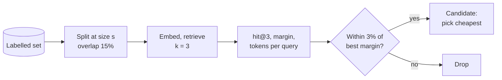

# M12.4 Theory: Choosing chunk size empirically: retrieval quality, faithfulness, latency

*[M12 theory](../README.md) · Lesson 12.4 · Notebooks: [`04a_choosing_chunk_size.ipynb`](../../notebook/04a_choosing_chunk_size.ipynb), [`04b_choose_chunk_size_llamaindex.ipynb`](../../../optional/notebook/04b_choose_chunk_size_llamaindex.ipynb) (optional) · [All theory pages](../../../../../THEORY.md)*
<!-- subtitle: Sweep chunk size on labelled questions, then pick the cheapest size on the plateau -->

## Choosing chunk size

> **What you'll learn**
>
> - **Explain** why no chunk size is right in general, and what it depends on.
> - **Measure** a chunk-size sweep with hit@k, a margin and the token cost per query.
> - **Choose** a size from the plateau of the curve, and confirm it on split halves of the labelled set.
> - **Compare** the five chunking strategies of this module by cost and failure mode.

Lessons 12.1 to 12.3 showed what each splitter does to the refund section. This lesson decides between them, and between their settings, with a measurement instead of an argument.

A teammate sets the Larkspur index to a chunk size of 1000 with 200 overlap, because a tutorial used it. Nobody measured it against the handbook's questions, and nobody knows whether 500 would retrieve as well for half the tokens on every request. We call this a **copied default**: a setting chosen for someone else's corpus.

No chunk size is right in general. It depends on how dense the facts are, how specific the questions are, the embedding model, the document's structure, and `k` together with the token budget, since chunk size × `k` has to fit the prompt. The notebook replaces the habit of copying 1000/200 or 512/50 with a procedure:

1. **Build a small labelled set**: a question plus a string that must appear in a correct chunk. Real user queries are the best source. The notebook uses 14 questions over 8 policy sections.
2. **Sweep chunk size with everything else fixed.** The notebook tries 64 to 768 tokens, with overlap at 15% of the size and `k = 3`.
3. **Score each setting** with hit@k and a **margin**: how much closer the best correct chunk is to the question than the best wrong one. Hit@k saturates at 1.0, while the margin keeps separating settings after that. A question whose gold string no chunk contains counts as a failure, because the splitter cut it.
4. **Put cost in the same table**: index tokens (paid once), tokens per query (chunk size × `k`, paid on every request) and the chunk count.
5. **Take the plateau, not the peak.** Keep every size within 3% of the best margin, then pick the cheapest of those.
6. **Re-score the top three sizes on random halves** of the labelled set. If the winner changes between halves, the sizes are indistinguishable at this sample size, so pick on cost.

The sweep runs as one loop per size:

*Figure 1: The chunk-size sweep. Every size goes through the same split, retrieve and score steps.*

The cost column needs no model at all. At `k = 3`, the tokens sent to the model on every request are three times the chunk size:

| Chunk size (tokens) | 64 | 128 | 256 | 512 | 768 |
|---|---|---|---|---|---|
| Tokens per query at k = 3 | 192 | 384 | 768 | 1,536 | 2,304 |

*Table 1: Retrieved tokens per query for five of the notebook's sweep sizes (chunk size × k, before overlap).*

Going from 256 to 768 triples the cost of every request. Choosing the largest size because its margin is a fraction higher is **peak chasing**: paying that cost for a difference the labelled set cannot confirm.

Sweep overlap afterwards, at the chosen size. It moves the curve far less than size does and grows the index linearly. The notebook keeps 10 to 20% of the chunk size as cheap insurance against a fact straddling a boundary. A flat curve is a finding too: chunk size is not the bottleneck, so stop tuning it and look at retrieval, query rewriting or reranking.

The optional LlamaIndex notebook measures the answer side instead. GPT-4o judges the faithfulness and relevancy of answers at chunk sizes 128 and 256, and the notebook records response time. LLM judges cost a model call per question per setting, so use the deterministic sweep to narrow the range and the judges to confirm it.

If small chunks win on precision and large ones win on completeness, stop looking for one number. Index small chunks and return their larger parent (M15 parent-document retrieval), or expand to neighbouring chunks after retrieval (M18).

## Choosing a strategy

The five strategies of this module differ in where boundaries come from and what they cost:

| Strategy | Boundaries come from | Index-time cost | Best for | Watch out for |
|---|---|---|---|---|
| Recursive character | Separators + size | None | Default for prose | Facts cut at boundaries |
| Token | Tokenizer + size | None | Hard model limits | Cuts mid-sentence |
| Structure-aware | Markup | None | Markdown, HTML, code, manuals | Oversized sections |
| Semantic | Embedding distance | One embedding per sentence | Long prose with topic shifts, no markup | Relative threshold; unbounded chunk size |
| Propositions | An LLM | 1 or 2 LLM calls per chunk | Dense, high-stakes facts | Invented or dropped details without grading |

*Table 2: The five chunking strategies compared.*

## In practice: replacing Larkspur's copied default

To replace the 1000/200 setting with a measured one:

1. **Label the handbook questions** with the string each correct chunk must contain, starting from the golden set in M10.
2. **Sweep 64 to 768 tokens** with structure-aware splitting first (lesson 12.1) and overlap at 15%, `k = 3`.
3. **Read hit@3, the margin and the tokens per query** from one table, and keep every size within 3% of the best margin.
4. **Re-score the survivors on random halves.** If the winner flips, take the cheapest.
5. **Record the chosen size in the baseline row** from M10, so M13's embedding change is compared at the same chunking.

> **Next:** M13 changes the embedding model, and every chunk this module produced has to be embedded again.

## Key Takeaways

- Choose chunk size by sweeping it on a labelled set with everything else fixed. Score hit@k and the margin, and put index tokens and chunk size × k per query in the same table.
- Take the plateau, not the peak: keep sizes within 3% of the best margin and pick the cheapest. Tune overlap afterwards at 10 to 20% of the size.
- A flat curve means chunk size is not the bottleneck. When small chunks win precision and large ones completeness, index small and return the parent.

## Check yourself

1. Why does the chunk-size sweep score each setting with a margin as well as hit at k?

Hit@k saturates at 1.0, and after that it cannot tell settings apart. The margin, how much closer the best correct chunk is to the question than the best wrong one, keeps separating them.

2. Three sizes land within 3% of the best margin, and the winner changes when you re-score them on random halves of the labelled set. Which size do you pick?

The cheapest of the three. Taking the plateau rather than the peak already points there, and a winner that changes between halves means the sizes are indistinguishable at this sample size. Cost is what separates them: tokens per query are chunk size × k, paid on every request.

3. You must chunk long prose reports that shift topic often and carry no markup. Which strategy fits, and what do you watch for?

Semantic chunking, which puts boundaries where the embedding distance jumps. It costs one embedding per sentence at index time. Watch its relative threshold and its unbounded chunk size.

---
*Previous: [12.3 Proposition chunking with LLM quality checks](../03_proposition_chunking_with_llm_quality_checks/README.md). Next: [M12 interview questions](../README.md#interview-spotlight-5-questions-you-might-get-asked).*
