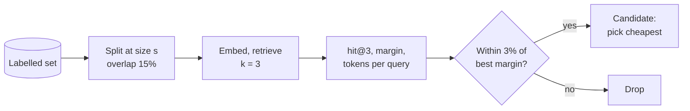

# M12.4 Theory: Choosing chunk size empirically: retrieval quality, faithfulness, latency

*[M12 theory](../README.md) · Lesson 12.4 · Notebooks: [`04a_choosing_chunk_size.ipynb`](../../notebook/04a_choosing_chunk_size.ipynb), [`04b_choose_chunk_size_llamaindex.ipynb`](../../../optional/notebook/04b_choose_chunk_size_llamaindex.ipynb) (optional) · [All theory pages](../../../../../THEORY.md)*
<!-- subtitle: Sweep chunk size on labelled questions, then pick the cheapest size on the plateau -->
<!-- format: approved -->

## Choosing chunk size

> **What you'll learn**
>
> - **Explain** why no chunk size is right in general, and what it depends on.
> - **Measure** a chunk-size sweep with hit@k, a margin and the token cost per query.
> - **Choose** a size from the plateau of the curve, and confirm it on split halves of the labelled set.
> - **Compare** the five chunking strategies of this module by cost and failure mode.

Lessons 12.1 to 12.3 showed what each splitter does to the refund section. This lesson decides between them, and between their settings, with a measurement instead of an argument.

A teammate sets the Larkspur index to a chunk size of 1000 with 200 overlap, because a tutorial used it. Nobody measured it against the handbook's questions, and nobody knows whether 500 would retrieve as well for half the tokens on every request. We call this a **copied default**: a setting chosen for someone else's corpus.

No chunk size is right in general. It depends on how dense the facts are, how specific the questions are, the embedding model, the document's structure, and `k` together with the token budget, since chunk size × `k` has to fit the prompt. The notebook replaces the habit of copying 1000/200 or 512/50 with a procedure:

1. **Build a small labelled set**: a question plus a string that must appear in a correct chunk. Real user queries are the best source. The notebook uses 14 questions over 8 short policy sections.
2. **Sweep chunk size with everything else fixed.** The notebook tries eight sizes from 64 to 768 tokens, with overlap at 15% of the size and `k = 3`.
3. **Score each setting** with hit@k and a **margin**: how much closer the best correct chunk is to the question than the best wrong one. Hit@k saturates at 1.0, while the margin keeps separating settings after that. A question whose gold string no chunk contains counts as a failure, because the splitter cut it.
4. **Put cost in the same table**: index tokens (paid once), tokens per query (the median chunk's tokens × `k`, paid on every request) and the chunk count.
5. **Take the plateau, not the peak.** Keep every size within 3% of the best margin, then pick the cheapest of those.
6. **Re-score the top three sizes on random halves** of the labelled set. If the winner changes between halves, the sizes are indistinguishable at this sample size. Pick on cost.

The sweep runs as one loop per size:

*Figure 1: The chunk-size sweep. Every size goes through the same split, retrieve and score steps.*

The cost side needs no model at all. At `k = 3`, the tokens sent to the model on every request approach three times the chunk size once chunks fill up:

| Chunk size (tokens) | 64 | 128 | 256 | 512 | 768 |
|---|---|---|---|---|---|
| Tokens per query at k = 3, full chunks | 192 | 384 | 768 | 1,536 | 2,304 |

*Table 1: Upper bound on retrieved tokens per query for five of the notebook's sweep sizes (chunk size × k).*

Going from 256 to 768 triples the cost of every request. Choosing the largest size because its margin is a fraction higher is **peak chasing**: paying that cost for a difference the labelled set cannot confirm.

## The sweep, replayed

The notebook ships without outputs. We replayed its sweep code with one change: a small local embedding model (`all-MiniLM-L6-v2`) in place of the OpenAI model. Same corpus, same 14 questions, same sizes, overlap and `k`:

| Size | Chunks | hit@3 | Margin | Tokens per query |
|---|---|---|---|---|
| 64 | 9 | 1.0 | 0.2884 | 162 |
| 96 | 8 | 1.0 | 0.2887 | 162 |
| 128 | 4 | 1.0 | 0.1769 | 331 |
| 192 | 3 | 1.0 | 0.1543 | 480 |
| 256 | 2 | 1.0 | 0.1288 | 669 |
| 384 | 2 | 1.0 | 0.1058 | 744 |
| 512 | 1 | 1.0 | none | 1,338 |
| 768 | 1 | 1.0 | none | 1,338 |

*Table 2: The notebook's sweep replayed with `all-MiniLM-L6-v2` (overlap 15%, k = 3).*

The table is the procedure's argument in numbers. The walkthrough reads it one decision at a time:

Step through the decisions the replayed sweep supports, from the first metric to the overlap check.

<button type="button" data-step="hit" aria-pressed="false" aria-controls="sw-hit">Hit rate</button>
<button type="button" data-step="margin" aria-pressed="false" aria-controls="sw-margin">Margin</button>
<button type="button" data-step="plateau" aria-pressed="false" aria-controls="sw-plateau">Plateau</button>
<button type="button" data-step="halves" aria-pressed="false" aria-controls="sw-halves">Halves</button>
<button type="button" data-step="overlap" aria-pressed="false" aria-controls="sw-overlap">Overlap</button>

<section id="sw-hit" class="step-panel"><h4>1. Hit rate cannot choose</h4>
hit@3 is 1.0 at every size. On this corpus every setting puts the gold string in the top three, so hit rate alone would accept any of them.
</section>
<section id="sw-margin" class="step-panel"><h4>2. Margin separates the sizes</h4>
The margin falls from 0.289 at 64 and 96 tokens to 0.106 at 384, as chunks start to hold several sections. At 512 and 768 the whole 446-token corpus fits in one chunk; the notebook flags that as degenerate and leaves it out.
</section>
<section id="sw-plateau" class="step-panel"><h4>3. The plateau holds two sizes</h4>
Sizes 64 and 96 sit within 3% of the best margin. Both cost 162 tokens per query, because their median chunk is the same 54 tokens. The rule picks 64, the first of the tie.
</section>
<section id="sw-halves" class="step-panel"><h4>4. Halves confirm a tie, not a winner</h4>
On six random halves, 96 beat 64 five times, each time by at most 0.0006. The notebook's rule calls five wins consistent, yet a gap that small is no reason to prefer either size. Pick on cost, and here the cost is equal.
</section>
<section id="sw-overlap" class="step-panel"><h4>5. Overlap barely moves the margin</h4>
At size 64, overlap of 0, 16 and 32 tokens gave margins of 0.2884, 0.2884 and 0.2827, while index tokens grew from 446 to 478. Size moved the margin almost threefold; overlap moved it by 2%.
</section>

<button type="button" data-walk="previous">Previous</button><button type="button" data-walk="next">Next</button>

The winning sizes are not a recommendation for Larkspur. Each policy section in this toy corpus is about 55 tokens, and the best chunk is one section. That fact about the corpus is what the sweep found.

Sweep overlap afterwards, at the chosen size. It moves the curve far less than size does and grows the index linearly. The notebook keeps 10 to 20% of the chunk size as cheap insurance against a fact straddling a boundary. A flat curve is a finding too: chunk size is not the bottleneck, so stop tuning it and look at retrieval, query rewriting or reranking.

The optional LlamaIndex notebook measures the answer side instead. GPT-3.5 Turbo answers with five retrieved chunks, GPT-4o judges the faithfulness and relevancy of each answer at chunk sizes 128 and 256, and the notebook records response time. LLM judges cost a model call per question per setting, so use the deterministic sweep to narrow the range and the judges to confirm it.

If small chunks win on precision and large ones win on completeness, stop looking for one number. Index small chunks and return their larger parent (M15 parent-document retrieval), or expand to neighbouring chunks after retrieval (M18).

## Choosing a strategy

The five strategies of this module differ in where boundaries come from and what they cost:

| Strategy | Boundaries come from | Index-time cost | Best for | Watch out for |
|---|---|---|---|---|
| Recursive character | Separators + size | None | Default for prose | Facts cut at boundaries |
| Token | Tokenizer + size | None | Hard model limits | Cuts mid-sentence |
| Structure-aware | Markup | None | Markdown, HTML, code, manuals | Oversized sections |
| Semantic | Embedding distance | One embedding per sentence | Long prose with topic shifts, no markup | Relative threshold; unbounded chunk size |
| Propositions | An LLM | 1 call per chunk + 1 per proposition | Dense, high-stakes facts | Invented or dropped details without grading |

*Table 3: The five chunking strategies compared.*

The sweep can compare strategies as well as sizes. Run each candidate splitter through the same labelled set and read the same columns, because a structure-aware splitter on a Markdown handbook may beat every size setting of the recursive one.

## In practice: replacing Larkspur's copied default

To replace the 1000/200 setting with a measured one:

1. **Label the handbook questions** with the string each correct chunk must contain, starting from the golden set in M10.
2. **Sweep 64 to 768 tokens** with structure-aware splitting first (lesson 12.1) and overlap at 15%, `k = 3`.
3. **Read hit@3, the margin and the tokens per query** from one table, and keep every size within 3% of the best margin.
4. **Re-score the survivors on random halves.** If the winner flips, or wins by a gap you cannot see, take the cheapest.
5. **Record the chosen size in the baseline row** from M10. M13's embedding change is then compared at the same chunking.

M13 changes the embedding model next, and every chunk this module produced has to be embedded again.

## Limits of this evidence

- **A toy corpus and another model.** Table 2 comes from 8 sections, 14 questions and `all-MiniLM-L6-v2`. The notebook's OpenAI embeddings would give other margins, and none of these numbers transfers to the handbook.
- **The notebook does not run as committed.** It stops at its corpus cell on an undefined name, and two later cells fail as well, so the replay reused its scoring and plateau code outside the notebook.
- **Substring hits are not correct answers.** The sweep checks whether the evidence was retrieved. Whether the model then answers faithfully is what the LlamaIndex notebook's judges measure.
- **`k` was fixed at 3.** Larger `k` partly compensates for smaller chunks. A thorough sweep varies both.

## References

1. LlamaIndex, [Evaluating the ideal chunk size for a RAG system using LlamaIndex](https://www.llamaindex.ai/blog/evaluating-the-ideal-chunk-size-for-a-rag-system-using-llamaindex-6207e5d3fec5), the source of the optional notebook's method.
2. LlamaIndex, [Evaluating](https://developers.llamaindex.ai/python/framework/module_guides/evaluating/), on the faithfulness and relevancy evaluators.
3. LangChain, [Split by tokens](https://docs.langchain.com/oss/python/integrations/splitters/split_by_token), on sizing chunks in tokens as the sweep does.
4. Sentence Transformers, [Pretrained models](https://sbert.net/docs/sentence_transformer/pretrained_models.html), which lists `all-MiniLM-L6-v2`, the model used for the replay.

## Key Takeaways

- Choose chunk size by sweeping it on a labelled set with everything else fixed. Score hit@k and the margin, and put index tokens and tokens per query in the same table.
- Take the plateau, not the peak: keep sizes within 3% of the best margin and pick the cheapest. A size that wins resampled halves by a hair is still a tie. Tune overlap afterwards at 10 to 20% of the size.
- A flat curve means chunk size is not the bottleneck. When small chunks win precision and large ones completeness, index small and return the parent.

## Check yourself

1. Why does the chunk-size sweep score each setting with a margin as well as hit at k?

Hit@k saturates at 1.0, and after that it cannot tell settings apart. In the replayed sweep hit@3 was 1.0 at every size, while the margin, how much closer the best correct chunk is to the question than the best wrong one, fell from 0.289 to 0.106 and kept separating them.

2. Three sizes land within 3% of the best margin, and the winner changes when you re-score them on random halves of the labelled set. Which size do you pick?

The cheapest of the three. Taking the plateau rather than the peak already points there, and a winner that changes between halves means the sizes are indistinguishable at this sample size. Cost is what separates them: tokens per query are paid on every request.

3. You must chunk long prose reports that shift topic often and carry no markup. Which strategy fits, and what do you watch for?

Semantic chunking, which puts boundaries where the embedding distance jumps. It costs one embedding per sentence at index time. Watch its relative threshold and its unbounded chunk size, and read the chunks, since its cuts can land beside the topic changes.

---
*Previous: [12.3 Proposition chunking with LLM quality checks](../03_proposition_chunking_with_llm_quality_checks/README.md). Next: [M12 interview questions](../README.md#interview-spotlight-5-questions-you-might-get-asked).*
