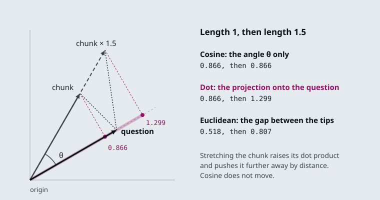
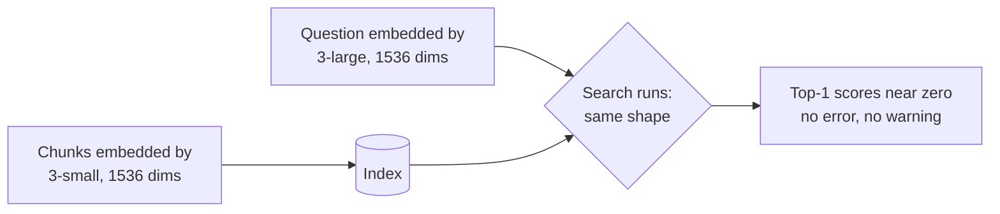

# M13.1 Theory: Embedding fundamentals, similarity metrics and model selection

*[M13 theory](../README.md) · Lesson 13.1 · Notebooks: [`01a_embeddings_and_model_selection.ipynb`](../../notebook/01a_embeddings_and_model_selection.ipynb) · [All theory pages](../../../../../THEORY.md)*
<!-- subtitle: Unit-length vectors make every metric agree, while a length gap or a model gap changes the ranking without an error -->
<!-- format: approved -->

## Cosine similarity

> **What you'll learn**
>
> - **Explain** what cosine similarity, the dot product and Euclidean distance each measure.
> - **Diagnose** a ranking that changes when one vector is longer than the others.
> - **Choose** a metric from one check: the length of a model's vectors.
> - **Explain** why a chunk and question embedded by different models still return scores, and how to catch it.

M10 used embeddings to find the refund and outage evidence that TF-IDF missed, and M12 decided what text each vector stands for. This module opens the embedding step itself: what the numbers mean, how they are compared, and which model produces them.

In the lab for this lesson, the Larkspur pricing page is drawn slightly longer than the other chunks, as an unnormalised model would leave it. Asked *How long does a refund take?*, a dot-product search ranks the pricing page above `refund-timing`, the chunk that holds the answer. Nothing about the pricing page changed except its length.

Retrieval needs one number per chunk that says how close it is to the question. Three measures are in common use, and every vector store offers at least one of them:

| Measure | How it is computed | What it responds to | Closer chunk |
|---|---|---|---|
| **Cosine similarity** | The dot product divided by both vectors' lengths | The angle only; range -1 to 1 | Higher |
| **Dot product** | The sum of the products of matching numbers | The angle and both lengths | Higher |
| **Euclidean distance** | The straight-line gap between the two vector tips | The angle and both lengths | Lower |

*Table 1: The three similarity measures.*

Cosine measures direction only, and a vector's length cannot change it. The dot product is cosine multiplied by both lengths, so a longer vector scores higher at the same angle. Euclidean distance measures the gap between the tips, so a longer vector moves away:

*Figure 1: One question and one chunk. Stretching the chunk to 1.5× leaves its cosine at 0.866, raises its dot product from 0.866 to 1.299, and pushes its distance from 0.518 to 0.807.*

When both vectors have length 1, the three agree. The dot product equals the cosine, and Euclidean distance is √(2 - 2·cos), which falls as cosine rises. All three then return the same chunks in the same order. Notebook 13.1 checks this on two real `text-embedding-3-small` vectors. That is why the first thing to print about a new model is the **norm** (length) of one of its vectors:

| Model output | Norm | Which metric |
|---|---|---|
| OpenAI `text-embedding-3-*` | 1.0, give or take float rounding | Any of the three; pick the one your store computes fastest, usually dot product |
| sentence-transformers through the Hugging Face wrapper, default settings | Not 1 | Cosine, or turn on normalisation and then any of the three |

*Table 2: The norm check, and the metric it allows.*

The [interactive lab](interactive/similarity-metrics-lab.html) draws ten Larkspur handbook chunks as 2D vectors so the angles are visible. The vectors are hand-placed and every score is computed; the lab's cosine, dot and Euclidean values match scikit-learn's to within 2e-15 at all 156 settings. Every chunk has length 1 except `plans-overview`, the long pricing page, whose length the slider sets, the way notebook 13.1 scales one vector by 3.0 to imitate a model that does not normalise:

| `plans-overview` length | *How long does a refund take?* | *Can I export my data after I cancel?* | *What happens if my server goes down?* |
|---|---|---|---|
| 1.0× | All three rank `refund-timing` first | All three rank `retention` first | All three rank `sla` first |
| 1.2× | Dot product ranks `plans-overview` first | Dot product moves it from #4 to #3 | No change |
| 1.5× | Dot: `plans-overview` first; Euclidean: #4 | Dot: `plans-overview` first; Euclidean: #5 | Euclidean moves it to last |
| 3.0× | Dot: first; Euclidean: last of 10 | Dot: first; Euclidean: last of 10 | Euclidean: last; dot product still #8 |

*Table 3: Where `plans-overview` ranks as its length grows, from the lab.*

We call this **length bias**: a ranking that follows vector length instead of meaning. The table shows three things about it:

- **A small length difference reorders close scores.** For the refund question, dot product prefers the pricing page from 1.15× onward. Its cosine with the question is 0.866 against `refund-timing`'s 0.998, and that gap is all the stretch has to overcome. The export question needs about 1.3×, because the gap there is wider (0.766 against 0.995).
- **Cosine never moves.** In every row, cosine ranks the evidence first and `plans-overview` third or worse. Normalising every vector first gives the same result for all three metrics.
- **Length cannot rescue a wrong direction.** For the outage question `plans-overview` points away (cosine -0.122). A longer vector makes its dot product more negative. It stays 8th of 10 at every length, while Euclidean distance pushes it to last from 1.5× onward.

The same stretch therefore moves one chunk in opposite directions depending on the metric. Dot product pulls it towards the top when its angle is close enough, and Euclidean distance pushes it towards the bottom. Only cosine reports the angle alone.

<!-- lab: interactive/similarity-metrics-lab.html -->

Two cautions apply whatever the metric. Cosine scores are not probabilities, and their range differs between models. A threshold such as "answer only above 0.7" (notebook 13.2's optional tutorial gives bands like this) has to be re-measured after a model change. Embeddings also encode topic more than truth: notebook 13.1 warns that a sentence and its negation embed close together, so "the plan is refundable" and "the plan is not refundable" can retrieve each other. We call that **negation blindness**. Negation, numeric comparison and exact identifiers such as invoice numbers are weak spots, which hybrid search in M16 addresses.

## The same model on both sides

The model that embeds the chunks must also embed the questions, with the same `dimensions` setting. Breaking this rule raises no error. Notebook 13.1 indexes with `text-embedding-3-small`, queries with `text-embedding-3-large` truncated to 1536 dimensions, and gets vectors of the same shape on both sides. The search runs and returns scores from two unrelated coordinate systems:

*Figure 2: A silent model mismatch. The shapes match, and nothing stops the search.*

We call this a **silent model mismatch**. The tell is the score itself: if the best match for a question that plainly has an answer in the corpus scores near zero, suspect a mismatch before you touch chunking or prompts. It happens three ways in practice:

1. **Config drift.** The indexing job and the query service read the model name from different places, and only one gets updated.
2. **An unnamespaced cache.** The cache returns the old model's vectors for the new model's requests ([Embedding cache](../04_production_concerns_batching_caching_and_similarity_behaviour/README.md#embedding-cache), lesson 13.4).
3. **A provider-side update.** A pinned model name is not always pinned weights.

The defence is cheap. Write the model name and dimensions into the index metadata when you build it, and have the query service compare them with its own configuration before it serves a request.

## In practice: choosing the metric for the Larkspur index

For the handbook index, the metric follows from two checks:

1. **Print the norm of one chunk vector.** For `text-embedding-3-small` it is 1.0. Cosine, dot product and Euclidean then rank the same, and you can use the one the store computes fastest.
2. **If a model returns other norms, normalise at embedding time**, before length bias can reorder the refund question.
3. **Store the model name and dimensions** in the index metadata, and check them at query time.
4. **Add a negation case to the golden set**, such as a monthly-plan refund question, to watch for negation blindness.

Lesson 13.2 looks at the hosted models themselves, and at what their dimensions cost to store and search.

## Limits of this evidence

- **The lab is two-dimensional and hand-placed.** Its angles were chosen to make the rankings visible. Table 3 shows the mechanism, not how far real chunk vectors differ in length. The lab's scores are computed, and they match scikit-learn's.
- **The mismatch symptom is the notebook's description.** Notebook 13.1 ships without outputs, and the near-zero top-1 score comes from its text, not from a run recorded here. Treat "near zero" as a direction to look in, and measure your own baseline range first.
- **The norm of 1.0 is a property of the OpenAI models.** It holds for `text-embedding-3-*` as their documentation states. A different provider or a local model needs the same check before you trust any metric.
- **Six documents choose nothing.** The notebook's model comparisons run on six well-separated texts. They demonstrate the procedure; lesson 13.3 explains what a golden set needs before it can separate models.

## References

1. OpenAI, [Vector embeddings guide](https://developers.openai.com/api/docs/guides/embeddings), including the note that its embeddings are normalised to length 1.
2. scikit-learn, [cosine_similarity](https://scikit-learn.org/stable/modules/generated/sklearn.metrics.pairwise.cosine_similarity.html), the reference the lab's scores were checked against.

## Key Takeaways

- Print the norm of one vector from any new model. With unit-length vectors, cosine, dot product and Euclidean distance rank chunks identically; otherwise use cosine or normalise first.
- Cosine scores are not probabilities, and embeddings capture topic more than truth. Negation, numeric comparison and exact identifiers are weak spots.
- Embed chunks and questions with the same model and `dimensions`. A mismatch raises no error; record both in the index metadata and check them before serving.

## Check yourself

1. Why do cosine, dot product and Euclidean distance rank chunks identically when every vector has length 1?

With unit vectors the dot product equals the cosine, and Euclidean distance is √(2 - 2·cos), which falls as cosine rises. All three then return the same chunks in the same order. That is why the first thing to print about a new model is the norm of one of its vectors.

2. In the lab, the plans-overview vector is stretched to 1.5 times its length. Which chunk does dot product rank first for the refund-timing question, and what does cosine do?

Dot product ranks `plans-overview` first. It overtakes from 1.15× onward, because its cosine of 0.866 is not far below `refund-timing`'s 0.998. Cosine never moves and keeps `refund-timing` first. Normalising every vector makes all three metrics agree with cosine.

3. After a config change, the top match for an answerable question scores near zero, and no error is raised. What do you suspect first, and what prevents it?

A model mismatch: chunks and questions embedded by different models, such as `text-embedding-3-small` and `text-embedding-3-large` truncated to 1536, give vectors of the same shape from unrelated coordinate systems. Write the model name and dimensions into the index metadata when you build it. Have the query service compare them with its own configuration before it serves a request.

---
*Previous: [M13 overview](../README.md). Next: [13.2 Hosted embeddings: OpenAI models and dimensions](../02_hosted_embeddings_openai_models_and_dimensions/README.md).*
